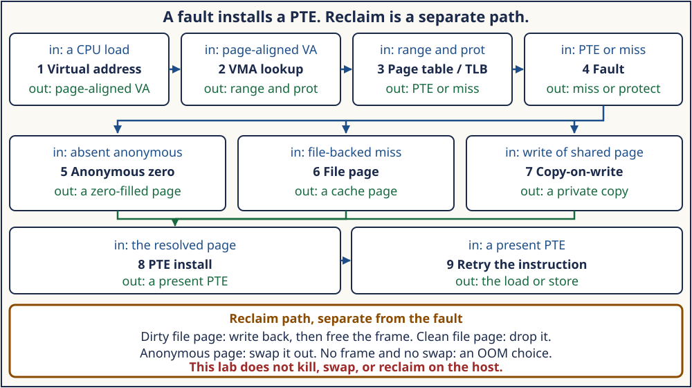

# Week 13 — Virtual Memory, Faults, and Reclaim

**Format:** seven daily sections collected into one weekly module

**Suggested workload:** approximately 21 focused hours, adjustable to mastery

> A virtual address is not a physical frame. A VMA says whether the address
> is mapped and how. A page-table entry, cached in the TLB, says which frame
> currently answers it. A fault fills that entry. Reclaim later takes a frame
> back.

The lab is [projects/linux-vm](../projects/linux-vm/). Wrappers build through
its Makefile and print only the claim the run supports. Kernel names below
were read from Linux 6.12, commit
`adc218676eef25575469234709c2d87185ca223a`, whose top-level `Makefile` sets
`VERSION = 6`, `PATCHLEVEL = 12`, `SUBLEVEL = 0`. Those names are that
snapshot. The host that runs the lab may be another kernel; the wrappers
print `uname`. Re-open the pinned tree, or the sources for the kernel you
boot, before treating a symbol, field, or policy as current.

## Required order: syntax, Linux 0.12, evolution, ToyOS, then 6.12

Each day opens in this order, and the order is required:

1. the few C forms that day's source actually uses;
2. the Linux 0.12 path, read while the whole mechanism still fits in one
   function or one assembly entry;
3. why that early design changed, in the constraint the fixed code, data,
   brk, and stack fields, the flat `mem_map` scan, the missing `mmap`, or
   the single-task `oom()` could not keep;
4. the ToyOS reconstruction of paging from Weeks 7 and 8;
5. the Linux 6.12 tree
   `adc218676eef25575469234709c2d87185ca223a`, then a check against current
   upstream before a symbol is treated as current.

Linux 0.12 is the first conceptual implementation. Its 80386 two-level
tables, segment slot, demand fault, and copy-on-write make the control
flow visible. VMAs, `mmap`, `mprotect`, the buddy allocator, NUMA zones,
folio reclaim, and today's OOM killer belong to the 6.12/current source.

The shared
[Linux 0.12 map](../references/EARLY_LINUX_012_MAP.md)
indexes the early kernel and does not yet extract the memory files. Use
the day sections for `mm/page.s`, `mm/memory.c`, and `kernel/sys.c`.

## Why Week 13 follows I/O

Week 12 stopped at bytes. A successful `read` copies from a page-cache
page. A `MAP_SHARED` store names that same page. An anonymous mapping has
no file: the bytes are the process's own state. Both still have to become
a mapped page before a load or store can complete.

```text
virtual address
  which VMA, if any
        |
        v
page table and TLB
  a present PTE is a frame; a miss is a fault
        |
        +--> anonymous: zero-fill, or a private copy
        +--> file: the page cache, which may sleep for I/O
        |
        v
PTE installed, TLB refreshed, the instruction retries
        |
        v
later, and separately: reclaim
  clean file page dropped, dirty file page written back,
  anonymous page swapped, or an OOM choice
```



That picture is the week's map: the fault path above, reclaim below.
They meet at the frame. One lab run does not walk the kernel reclaim code.

A file fault can sleep inside the page cache, the same way Week 12's
blocking `read` slept. Reclaim can sleep in writeback. A hard interrupt
handler must not take that sleep. Scheduler and interrupt depth need that
fact first: a user fault is a place a task is allowed to sleep. This week
builds the foundation. It does not start the scheduler deep dive.

## Daily roadmap

### Day 1 — Address spaces, VMAs, page tables, and the TLB

[Day 1](sections/day-001-address-spaces-vmas-page-tables-and-tlb.md)
separates the address space, the VMA, the page-table entry, and the TLB.
Linux 0.12 had no VMA list: `start_code`, `end_code`, `end_data`, `brk`,
and `start_stack` were the whole user map, placed by a segment base.
ToyOS maps a page and invalidates it with `invlpg`, and does not keep a
VMA. Linux 6.12 looks the address up with `find_vma` in
`lock_mm_and_find_vma` and enters from `do_user_addr_fault`. The lab
reads the page size and finds one anonymous mapping in `/proc/self/maps`
and `smaps`. Wrapper:
[challenges/day-001-address-space.sh](challenges/day-001-address-space.sh).

### Day 2 — Page faults, demand paging, and zero-fill

[Day 2](sections/day-002-page-faults-demand-paging-and-zero-fill.md)
is the not-present fault. Linux 0.12 `page_fault` calls `do_no_page`,
which zero-fills past the executable image and reads the file image
otherwise. ToyOS reports the fault and does not fill a page. Linux 6.12
`handle_mm_fault` reaches `do_anonymous_page`, which may install the
shared zero page for a read or allocate a private folio for a write.
The lab maps one anonymous page, checks that it is not resident, reads a
zero, and prints a `getrusage` minor-fault delta with an explicit count
caveat. Wrapper:
[challenges/day-002-page-faults.sh](challenges/day-002-page-faults.sh).

### Day 3 — mmap, mprotect, COW, and shared mappings

[Day 3](sections/day-003-mmap-mprotect-cow-and-shared-mappings.md)
splits two sharing rules. `MAP_SHARED` means the child's store and the
parent's mapping name one page. `MAP_PRIVATE` means a write copies.
`mprotect` changes the VMA, so a write the VMA forbids is a signal, not
a copy. Linux 0.12 already copied on write in `copy_page_tables` and
`un_wp_page`, and had no `mmap` and no `mprotect`. The lab's child is the
only process that faults; the parent decodes `wait` status. Wrapper:
[challenges/day-003-mappings.sh](challenges/day-003-mappings.sh).

### Day 4 — User allocators, brk, mmap, and lifetime

[Day 4](sections/day-004-user-allocators-brk-mmap-and-lifetime.md)
separates the libc allocator from the two syscalls underneath it.
Linux 0.12 `sys_brk` only moves `brk`; the page appears on the fault.
Linux 6.12 `brk` calls `do_brk_flags`, and `do_mmap` builds a VMA.
`munmap` drops that VMA. The lab records whether `sbrk` moved and which
`/proc/self/maps` line contains a small and a large `malloc`. It does
not treat either result as glibc's threshold. Wrapper:
[challenges/day-004-allocators.sh](challenges/day-004-allocators.sh).

### Day 5 — Physical pages, zones, the buddy allocator, and NUMA

[Day 5](sections/day-005-physical-pages-zones-buddy-and-numa.md)
is where a fault's request for a frame goes. Linux 0.12 scans `mem_map`
in `get_free_page`. A zone exists because a device may address only a
low physical range, and a node exists because a frame has a distance.
The buddy splits and coalesces power-of-two blocks. ToyOS uses a bitmap
over a bounded window. The lab runs a deterministic simulator and does
not allocate, migrate, or reserve host pages. Wrapper:
[challenges/day-005-buddy-numa.sh](challenges/day-005-buddy-numa.sh).

### Day 6 — Reclaim, writeback, swap, and OOM

[Day 6](sections/day-006-reclaim-writeback-swap-and-oom.md)
asks which frame can be reused. A clean file page can be dropped. A
dirty file page must be written back. An anonymous page needs a swap
slot, or it cannot be taken. Linux 0.12 `oom()` exits the current task.
Linux 6.12 `try_to_free_pages` drives `shrink_folio_list`, and
`out_of_memory` selects a victim. The lab's LRU, writeback, swap, and
OOM choice are a bounded simulator. It does not force reclaim, swap, or
the OOM killer on the host. Wrapper:
[challenges/day-006-reclaim.sh](challenges/day-006-reclaim.sh).

### Day 7 — VM observation and a debugging report

[Day 7](sections/day-007-vm-observation-and-debugging-report.md)
keeps scopes apart. `/proc/self/maps` is this address space.
`/proc/vmstat` is the whole machine. `perf stat` is one run's counters.
ToyOS evidence for a fault is still the serial `EXPECTED-FAULT` line,
not a reclaim scanner. The wrapper writes a report, reruns the
deterministic suite, and records optional tools as pass or skip.
Wrapper:
[challenges/day-007-vm-debug-report.sh](challenges/day-007-vm-debug-report.sh).

## Safety and evidence

The programs create temporary files only under `mkdtemp` directories in
`/tmp`, unlink them, and remove the directories. The suite checks that
those directories are gone. Children are waited for; a failing parent
kills and reaps a child it still owns. Mappings are one page, except one
bounded `malloc` of 2 MiB that is freed. The buddy and reclaim programs
touch only their own arrays.

Nothing in the lab opens a socket, asks for root, writes a sysctl, or
tries to allocate until the machine reclaims, swaps, or invokes the OOM
killer. Optional `perf stat` and `/proc/vmstat` are observational. A
missing tool prints `SKIP` and is not a failed core test. The minor-fault
delta is a lower bound with a printed caveat, not a count of one C
statement.

## Completion checkpoint

Finishing the wrappers does not complete mastery. Answer from the source
and the logs, and leave a question blank when the run did not speak to it:

1. Which object is the VMA, which word is the PTE, and what does the TLB
   cache?
2. What was resident before the first load of the anonymous page, what
   byte did that load return, and why is the minor-fault delta not an
   exact count of that load?
3. Which child store was visible in the parent, which was not, and what
   wait status did the `mprotect` child produce?
4. What did this run's `brk` and `maps` lines show, and which glibc
   threshold did you refuse to infer?
5. Which simulated allocation stayed on the local node, which fell
   back, and which request failed because the free pages were not one
   block of the requested order?
6. Which simulated victim was written back, which was dropped, which
   was swapped, and which OOM choice did not kill a host process?
7. Which numbers came from this process, and which optional counters
   were system-wide or a single `perf` run?
8. Which kernel names did you re-read in commit
   `adc218676eef25575469234709c2d87185ca223a`, and which host
   `uname` actually ran the lab?

Do not auto-fill mastery, confidence, hours, or completion. The
[quizzes](quizzes.json) sit beside this overview and do not grade the report.
