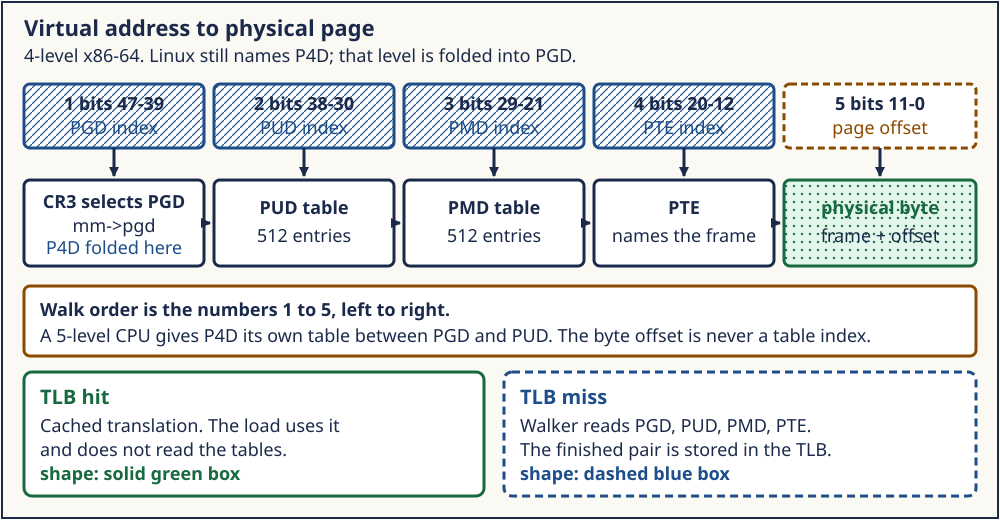
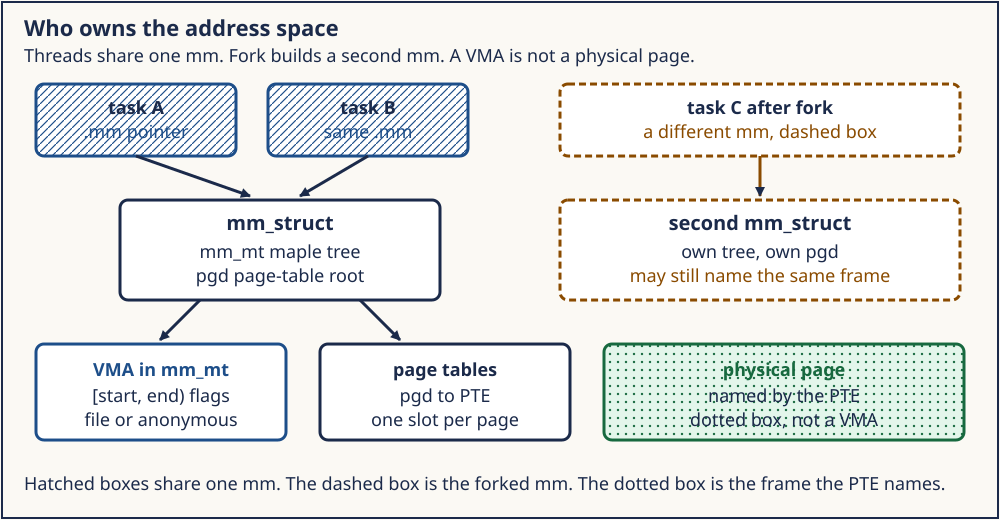

# Day 1 — Address Spaces, VMAs, Page Tables, and the TLB

**Target time:** approximately 3 hours

> The CPU issues a virtual address. Which object decides that the address
> is legal, and which word decides which frame answers it right now?

Every Linux 6.12 excerpt in this lesson is from tag `v6.12`, commit
`adc218676eef25575469234709c2d87185ca223a`, checked out at
`/home/jd/Documents/linux-6.12`. Linux 0.12 page numbers are printed pages
of Zhao Jiong, *A Heavily Commented Linux Kernel Source Code*, Chinese
Revision 5 (2019).

## 1. Syntax needed for this source

A range is two integers and a flags word. The page-table walk is a shift
and a mask.

```c
struct range {
    unsigned long start;
    unsigned long end;
    unsigned flags;
};

unsigned long index = (virtual_address >> shift) & mask;
unsigned long entry = table[index];
```

`start <= address < end` is the lookup. `entry` is not the byte the program
asked for. It is the next table, or the frame, plus permission bits.

The half-open interval matters at a boundary. If one range ends at `0x5000`
and the next starts there, `0x4fff` belongs to the first and `0x5000`
belongs to the second. Length is simply `end - start`; adjacent ranges do
not overlap.

Kernel flags are bit masks. `|` combines independent facts, `&` asks
whether a fact is present, and `~` clears selected facts:

```c
unsigned long flags = RANGE_READ | RANGE_WRITE;

if (flags & RANGE_WRITE)
    permit_store();
flags &= ~RANGE_WRITE;
```

Do not read `flags & RANGE_WRITE` as equality. Other bits may also be set.
The same syntax describes VMA permissions and the present, writable, user,
accessed, and dirty state encoded in page-table entries.

The x86 address split is shifts and masks. For a 4 KiB base page, the low
12 bits are the byte offset. On x86-64, the next four groups of 9 bits
index the PTE, PMD, PUD, and PGD levels:

```text
63                    48 47       39 38       30 29       21 20       12 11       0
+-----------------------+-----------+-----------+-----------+-----------+-----------+
| sign extension        | PGD index | PUD index | PMD index | PTE index | page off  |
+-----------------------+-----------+-----------+-----------+-----------+-----------+
```

That is an architecture example, not the definition of a VMA. A VMA can
cover thousands of pages. Page tables can have missing entries inside its
range. The VMA says an access is allowed in principle; the PTE says what
translation exists now.

AT&T assembly used by early Linux writes source before destination:

```asm
movl %cr3,%eax
movl %eax,%cr3
```

Reloading `cr3` invalidates cached translations in Linux 0.12. Modern x86
has finer invalidation choices, including `invlpg` and range-oriented
shootdown machinery. In both kernels, changing memory does not change a
cached translation; software must perform the architecture's maintenance.



*Figure 1. The range check is a software policy decision. The page-table
walk is a hardware translation operation. A TLB hit can bypass the walk,
but it cannot make an address legal when the kernel handles a fault.*

## 2. Linux 0.12 first: a segment slot and two-level tables

Linux 0.12 does not have a VMA. `task_struct` holds `start_code`,
`end_code`, `end_data`, `brk`, and `start_stack`. Each task occupies a
`TASK_SIZE` window of 64MB, and the LDT segment base places that window at
`nr * TASK_SIZE`. A user pointer is an offset inside the window.

The 80386 walks two levels, a page directory and a page table, over 4KB
pages. `get_free_page` in `mm/page.s` scans the `mem_map` array and returns
one zeroed physical page. `mem_map` counts references. It is not a list of
virtual ranges.

What carries forward is the split between a virtual address and a physical
page, plus permission bits in the page-table entry. The fixed task fields,
the segment base, and the two-level 80386 tables belong to this kernel.

### 2.1 The address has two stages

On the 80386, a user instruction supplies an offset. The selector chooses
an LDT descriptor, and the descriptor base is added to form a linear
address. Paging translates that linear address to a physical address.
Linux 0.12 uses this segmentation stage to give task `nr` a 64 MiB slot:

```c
new_data_base = new_code_base = nr * TASK_SIZE;
p->start_code = new_code_base;
set_base(p->ldt[1], new_code_base);
set_base(p->ldt[2], new_data_base);
```

This excerpt is from `copy_mem` in `kernel/fork.c`, printed pages 407–408,
and is also recorded in the shared Linux 0.12 map. `ldt[1]` is code and
`ldt[2]` is data. Code and data receive the same base because this kernel
does not support separate instruction and data spaces.

The stable mechanism is isolation: the same offset in two tasks reaches
different linear-address slots and different page-table mappings. The
historical mechanism is a fixed slot selected by segmentation. Modern
Linux normally gives each process a page-table root and uses a mostly flat
user segmentation model.

### 2.2 One page-directory page, then one page-table page

A 32-bit linear address is divided into 10 directory bits, 10 table bits,
and 12 offset bits. Each directory or table has 1024 four-byte entries.
Each page-table page therefore covers 1024 × 4 KiB = 4 MiB; one directory
covers 1024 × 4 MiB = 4 GiB.

`copy_page_tables` receives linear bases and a byte size. It allocates
child page tables as needed, copies entries, and makes ordinary shared
pages read-only so a later write can copy. The page-table structure is
therefore both a translation tree and a permission mechanism. The
`mem_map` byte for a physical page counts how many mappings share it.

Those are different resources:

- an LDT descriptor describes a task's linear window;
- a page-directory entry owns or points to a page-table page;
- a page-table entry names a data frame and permission bits;
- a `mem_map` byte accounts for references to the data frame;
- the TLB caches a translation derived from those entries.

Freeing one resource does not imply that all the others disappeared.
Week 7's frame bitmap asked only whether a frame was available. Week 10's
fork path added sharing and reference counts. This week puts range policy,
translation, and cached translation into separate columns.

### 2.3 `get_free_page` does not map

The early allocator searches `mem_map` for a zero byte, changes that byte
to 1, zeroes the physical page, and returns its physical address.
`put_page` walks or allocates page tables and installs that address in a
PTE. Conflating the two hides an important failure boundary: a frame can
exist before the page-table page needed to map it exists.

The early kernel has no object equivalent to a current
`struct vm_area_struct`. Legality comes from task image fields, segment
limits, and special-case fault logic. `start_code`, `end_code`,
`end_data`, `brk`, and `start_stack` are enough for one executable image,
one growing data area, and one stack. They are not a general range model.

### 2.4 What not to carry forward

Do not infer that current Linux gives PID 3 the third 64 MiB slot, that
all page tables have two levels, or that a global byte array is current
physical-page accounting. Keep only the durable questions:

1. Which address space does this execution context use?
2. Which region policy covers the address?
3. Which page-table entry currently translates it?
4. Could a processor still hold an older translation?

## 3. Evolution: why a list of ranges replaced those fields

Code, data, brk, and stack cannot name a shared library, a file mapping
at an arbitrary offset, or a protection change on part of a mapping. The
machine grew programs that needed many such ranges. The structure that
answers "what is this address?" became a searchable set of ranges, each
with protection and a backing. The page tables stayed the structure that
answers "which frame, this instant?"

The pressure was not merely larger programs. One process needed several
independently managed objects:

- an executable with read-only text and writable data;
- a dynamic linker and shared libraries at unrelated addresses;
- private and shared file mappings with page offsets;
- anonymous arenas independent of the historical break;
- thread stacks with guard gaps;
- device or special mappings with custom fault operations;
- protection changes on only part of an existing mapping.

A fixed `brk` field cannot answer which file and page offset backs address
`x`. Splitting and merging ranges also matters. `mprotect` on the middle
page of a three-page VMA may produce three VMAs: the unchanged prefix, the
newly protected middle, and the unchanged suffix. Adjacent compatible
ranges can later merge. The range set is mutable metadata, not a dump of
the page tables.

Scalability changed the search structure. A linked list makes lookup
linear in the number of mappings. Current Linux 6.12 stores VMAs in the
mm's maple tree and uses a VMA iterator. That implementation may evolve
again. The interface-level invariant is the searchable set of nonoverlap-
ping half-open ranges.

Page tables also evolved independently. More virtual-address bits and
larger physical memories required more levels. Huge mappings can stop a
walk above the base-page PTE. Architectures encode permissions differently.
None of those changes removes the need for the VMA. The page table answers
what hardware can do now; the VMA lets the kernel decide what it may build
after a fault.

The TLB exists because walking several memory-resident levels for every
load would be expensive. That cache creates a coherence obligation.
Changing a PTE, unmapping a range, or reducing permissions requires
invalidating translations on every CPU that may have run this mm. A local
`invlpg` is enough for ToyOS's single-CPU exercise. Linux needs batching,
mm tracking, inter-processor interrupts, and architecture-specific rules.

## 4. ToyOS: a mapper, not a VMA list

Week 7's `map_page` in `projects/toyos/src/memory.c` walks four levels
from `bootstrap_pml4` and stores a present PTE. The next instruction is
`invlpg`, because the CPU may already have cached a translation.
`frame_alloc` hands out one frame from a bitmap capped at 128MB. The heap
is eight mapped pages at `HEAP_BASE`. Week 8's `map_page_in` repeats that
walk in a per-process root so one user program has its own tables.

There is still no range list. An address is mapped or it is not. A fault
is diagnosed in `arch.c`. It is not looked up in a VMA and filled.

Trace one ToyOS mapping:

1. `frame_alloc` scans the bitmap and marks a physical frame owned.
2. `map_page` starts at `bootstrap_pml4`.
3. Missing intermediate tables receive frames of their own.
4. The final entry receives the data frame plus present/write flags.
5. `invlpg` discards any translation cached for that virtual address.
6. A later load or store is translated by hardware.

This is deliberately below the VMA layer. A successful `map_page` says
that a translation exists; it does not record whether a file, heap, stack,
or shared-memory object owns the virtual range. `memory_init` maps eight
heap pages up front. `kalloc` moves a bump pointer inside them, so an
allocation neither creates a VMA nor relies on a first-touch fault.

Week 8's per-process root adds an ownership boundary: the process has a
different page-table root from the kernel's bootstrap use. It still does
not add fork, COW, an interval search structure, automatic stack growth,
or a sleepable file-fault callback. Those omissions are the comparison,
not defects to paper over.

If you extend ToyOS, add the layers in dependency order. First define a
range record and nonoverlap invariant. Then make the fault handler find
that record. Then allocate and map an anonymous frame only when its flags
permit the access. Finally add unmap and TLB invalidation. Starting with
"allocate on every fault" turns a wild pointer into valid memory and
removes the protection a VMA is meant to provide.



*Figure 2. Linux 0.12 derives ownership from a task slot and fixed image
fields. ToyOS has explicit page-table roots and mappings. Linux 6.12 adds
an `mm_struct` with a searchable VMA set above its page tables.*

## 5. Linux 6.12: VMA, then page table, then TLB

In commit `adc218676eef25575469234709c2d87185ca223a`, `struct vm_area_struct`
in `include/linux/mm_types.h` carries `vm_start`, `vm_end`, `vm_mm`,
`vm_page_prot`, and `vm_flags`. The comment in that tree says the VMA
covers `[vm_start, vm_end)`. `lock_mm_and_find_vma` in `mm/memory.c` calls
`find_vma`. `arch/x86/mm/fault.c` `do_user_addr_fault` is the x86 entry
that reaches `handle_mm_fault`.

The hardware page walker fills the TLB from the tables. After software
changes a PTE it must invalidate, which is why `do_wp_page` can call
`flush_tlb_page`. A stale TLB entry is still a translation.

`/proc/self/maps` is an export of those VMAs. It is not the page tables
and it is not a physical address.

### 5.1 The VMA record

The definition ties the interval, owner, permissions, and flags together:

```c
/* tree adc218676eef (Linux 6.12)
 * path: include/linux/mm_types.h
 * lines: 667–691
 */
struct vm_area_struct {
	union {
		struct {
			/* VMA covers [vm_start; vm_end) addresses within mm */
			unsigned long vm_start;
			unsigned long vm_end;
		};
#ifdef CONFIG_PER_VMA_LOCK
		struct rcu_head vm_rcu;
#endif
	};
	struct mm_struct *vm_mm;
	pgprot_t vm_page_prot;
```

The RCU member is conditional on `CONFIG_PER_VMA_LOCK`. `vm_mm` owns the
VMA. `vm_page_prot` is the architecture
protection derived for PTEs. `vm_flags` includes generic policy such as
read, write, execute, shared, and grow-down.

Later fields connect file-backed mappings to an `address_space`, private
pages to an `anon_vma`, and device or file behavior to `vm_operations`.
That is why a VMA is more than permissions. It records where a fault can
obtain bytes and how mappings of those bytes relate.

### 5.2 Lookup proves policy before allocation

The locked fallback lookup in `mm/memory.c` is short:

```c
/* tree adc218676eef (Linux 6.12)
 * path: mm/memory.c
 * lines: 6169–6188
 * function: lock_mm_and_find_vma
 */
vma = find_vma(mm, addr);
if (likely(vma && (vma->vm_start <= addr)))
	return vma;

if (!vma || !(vma->vm_flags & VM_GROWSDOWN)) {
	mmap_read_unlock(mm);
	return NULL;
}
```

`find_vma` can return the first VMA after `addr`; the start comparison is
therefore essential. Only a grow-down candidate gets an extension attempt.
A hole is not silently turned into anonymous memory. On x86 the caller
next checks `access_error(error_code, vma)` before
`handle_mm_fault`.

Linux 6.12 also has a per-VMA-lock fast path:
`lock_vma_under_rcu` is tried for user faults before the mmap-lock path.
That is a scalability optimization around the same policy object, not a
replacement for VMA lookup.

### 5.3 Page tables are populated below `handle_mm_fault`

`handle_mm_fault` first validates architecture permissions:

```c
/* tree adc218676eef (Linux 6.12)
 * path: mm/memory.c
 * lines: 6052–6078
 * function: handle_mm_fault
 */
ret = sanitize_fault_flags(vma, &flags);
if (ret)
	goto out;

if (!arch_vma_access_permitted(vma, flags & FAULT_FLAG_WRITE,
				    flags & FAULT_FLAG_INSTRUCTION,
				    flags & FAULT_FLAG_REMOTE)) {
	ret = VM_FAULT_SIGSEGV;
	goto out;
}
```

Later in the same function, the generic walk allocates missing
intermediate page-table levels and
eventually dispatches on the current entry: anonymous missing page, file
fault, swap entry, NUMA hint, or write protection. Day 2 follows those
branches. The important boundary today is that the page-table work begins
only after a covering VMA and a permitted access exist.

### 5.4 The TLB is a derived cache

Suppose CPU 0 has cached virtual page `V` → frame `A`. CPU 1 changes the
PTE to frame `B` while CPU 0 keeps running the same mm. Updating memory is
not enough; CPU 0 can continue sending accesses to `A`. The kernel must
order the PTE change and invalidate CPU 0's cached entry before old
ownership can be reused.

Linux gathers invalidations so that unmapping 10,000 pages does not
necessarily send 10,000 separate cross-CPU requests. The exact primitive
depends on architecture and range. The contract is stronger than
"execute `invlpg` after every PTE store": no processor may legally retain
a translation that violates the completed mapping operation.

Permission upgrades and downgrades have different risks. Leaving a stale
read-only entry after an upgrade causes an extra fault and can be repaired.
Leaving a stale writable entry after a downgrade violates protection.
The architecture APIs encode the ordering; generic mm code does not open-
code a single universal instruction.

### 5.5 `/proc` reports policy and accounting

A typical line is:

```text
7f...-7f... rw-p 00000000 00:00 0
```

The endpoints and permissions describe a VMA. The offset, device, inode,
and optional name describe its backing or presentation. The line contains
no PFN. `/proc/self/smaps` adds accounting such as `Size` and `Rss`, but
that still does not expose a hardware TLB hit or prove one physical frame.

ASLR means addresses differ between runs. VMA merging means the interval
can be larger than the one-page request if an adjacent compatible mapping
is merged. The project lab checks that its returned address lies in the
reported range and, in its controlled run, requires that range to be one
page. Treat that requirement as a property of this lab setup, not a new
`mmap` ABI guarantee.

## 6. What the lab can show

`address_lab` prints the page size, maps one anonymous page, and finds
that range in `/proc/self/maps`. `smaps` Size matches the page. Rss is 0
before any touch. `[stack]` is present. `[heap]` may be present or absent;
the program prints which, and refuses to treat that as a libc contract.

Run [day-001-address-space.sh](../challenges/day-001-address-space.sh).

### 6.1 Predict, run, and label

Before running, predict three separate states:

| Question | Prediction before touch |
|---|---|
| Does a VMA cover the returned pointer? | yes |
| Does `smaps` charge virtual `Size`? | one page in this lab |
| Must a private resident frame exist? | no |

Then run only the existing wrapper:

```sh
./13-virtual-memory-faults-and-reclaim/challenges/day-001-address-space.sh
```

The wrapper builds and runs `projects/linux-vm/src/address_lab.c`. It does
not inspect `/proc/pid/pagemap`, load a kernel module, pin memory, change
sysctls, or touch another process. The mapping is anonymous and is
`munmap`ped before exit.

### 6.2 Observation versus source proof

**The lab observes:** the runtime page size; a covering `maps` range; the
range's writable text permission; `smaps` `Size` and `Rss`; a `[stack]`
line; and whether this libc run happens to show `[heap]`.

**The pinned source proves:** what fields a VMA contains; that the locked
fault fallback calls `find_vma`; that x86 checks access before
`handle_mm_fault`; and that generic fault handling descends into page-
table resolution.

The lab does not execute a source-level trace. Seeing `Rss: 0 kB` is
consistent with an untouched anonymous mapping. It does not prove which
conditional branch in `do_anonymous_page` would run on a future access.
Conversely, reading `do_anonymous_page` proves an implementation path in
the pinned tree; it does not prove the host kernel is that tree. Record
`uname -r` beside observations.

## 7. Execution trace: one load, layer by layer

Assume a program loads from an anonymous page after `mmap` created a VMA
but before a PTE was installed.

1. The compiler emits a load through a virtual address.
2. The CPU searches its TLB. There is no usable translation.
3. Hardware walks the current page tables. The leaf is not present.
4. x86 raises vector 14 and records the address in `CR2`.
5. `do_user_addr_fault` derives read/write/instruction/user flags.
6. The VMA fast path or `lock_mm_and_find_vma` finds the covering range.
7. `access_error` rejects an access that the VMA does not permit.
8. `handle_mm_fault` validates architecture-specific permission.
9. Generic mm descends the page-table hierarchy.
10. Anonymous fault handling chooses zero-page or private-page behavior.
11. The PTE is installed with the VMA-derived protection.
12. Return from the exception retries the original load.
13. Hardware now fills a TLB entry from the page table.
14. The load finally returns a byte.

Steps 6–8 answer "is this access legal?" Steps 9–11 answer "what mapping
should satisfy it?" Steps 2, 3, and 13 are hardware translation. Keeping
those questions separate prevents the common claim that a VMA translates
every load.

## 8. Architecture lens

x86-64 commonly uses four or five page-table levels and 4 KiB base pages.
AArch64 supports translation granules including 4 KiB, 16 KiB, and 64 KiB,
with level geometry selected accordingly. RISC-V uses modes such as Sv39,
Sv48, and Sv57. `struct vm_area_struct` remains a range policy object on
all of them. The shifts, entry bits, and invalidation instructions do not.

ToyOS's four-level x86-64 walker is therefore one concrete implementation,
not the definition of virtual memory. A lesson that hard-codes "bits
47–39 are always the top index" has confused one x86-64 mode with the
generic Linux model.

## 9. Mastery: Explain · Draw · Observe · Build

### Explain

- Why a valid VMA can have no present PTE for an address.
- Why a present PTE without a covering legal range cannot authorize the
  kernel to grow arbitrary user memory.
- Why `mem_map` in Linux 0.12 is not a VMA collection.
- Why changing a PTE requires TLB maintenance.
- Why `[heap]` presence is not a libc or kernel guarantee.

### Draw

Redraw Figure 1. Add the fault address, the half-open VMA endpoints, the
leaf PTE, one physical frame, and a TLB entry. Mark which arrows are
software policy, hardware translation, and accounting.

### Observe

Run the wrapper once. Save `uname -r`, `page_size`, the anonymous range,
`Size`, `Rss`, and the heap-presence line. Write "host observation" beside
each. Beside the three source excerpts, write the pinned commit and
"source proof."

### Build

Without changing the project, write pseudocode for a ToyOS
`find_region(address)` over sorted nonoverlapping records. State its lock,
its half-open comparison, and its answer for a hole. Then describe where
`map_page` would be called after a permitted anonymous fault. Do not make
the pseudocode allocate for an address that has no region.

## 10. Limits

The lab does not print a PTE, a frame number, or a TLB hit. Quote
`find_vma` and `do_user_addr_fault` only from tree `adc218676eef` or from
the sources of the kernel you boot. Record `uname`.

It also does not prove that the host uses four page-table levels, that the
anonymous mapping owns a private frame, or that a particular CPU took a
TLB miss. Those require architecture and tracing evidence outside this
bounded lab. Keep the report at the layer the evidence supports.
