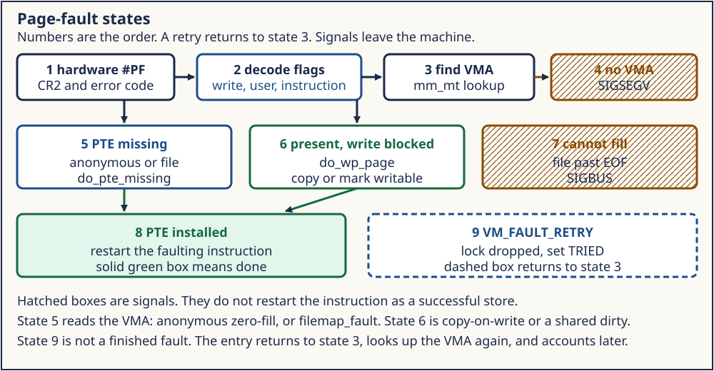
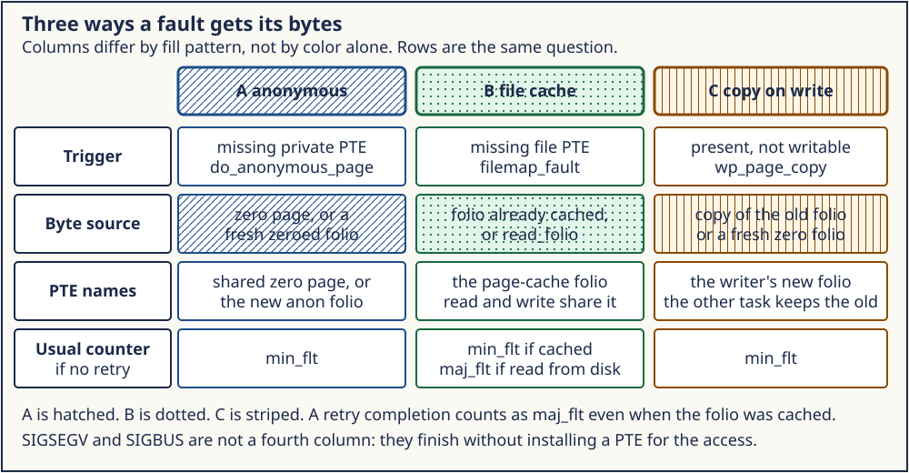

# Day 2 — Page Faults, Demand Paging, and Zero-Fill

**Target time:** approximately 3 hours

> The page is not resident. The load still has to return a byte. Who fills
> it, and who is allowed to sleep while that happens?

Every Linux 6.12 excerpt below is from tag `v6.12`, commit
`adc218676eef25575469234709c2d87185ca223a`, at
`/home/jd/Documents/linux-6.12`. Linux 0.12 page numbers are printed pages
of Zhao Jiong, *A Heavily Commented Linux Kernel Source Code*, Chinese
Revision 5 (2019).

## 1. Syntax needed for this source

The fault entry receives an error code and a fault address. A bit in the
code selects the handler. The handler returns by installing a PTE and
retrying the instruction, or by killing the access.

```c
if ((error_code & present_bit) == 0)
    fill_missing(address);
else
    handle_protection(address);
```

A zero fill is a store of `0` into a fresh frame, or a PTE that points at
a shared page of zeroes. The program's first load cannot observe an old
owner's bytes.

The x86 error code is a bit set, not an enum. In modern names,
`X86_PF_PROT` says the access violated protection rather than finding a
non-present translation, `X86_PF_WRITE` says the access was a write, and
`X86_PF_USER` records the privilege context reported by hardware. Newer
x86 adds bits for reserved-entry errors, instruction fetch, protection
keys, shadow stacks, and SGX. Always mask the bit you need:

```c
bool was_write = error_code & X86_PF_WRITE;
bool was_present = error_code & X86_PF_PROT;
```

The fault address and instruction pointer are different values. `CR2`
holds the linear address that could not be translated. The saved
instruction pointer identifies the instruction to retry or report. A
single instruction can fault on an address other than its own address.

The return value is also a mask. `vm_fault_t` can carry
`VM_FAULT_MAJOR`, `VM_FAULT_RETRY`, `VM_FAULT_OOM`, `VM_FAULT_SIGBUS`,
or `VM_FAULT_SIGSEGV`. Code tests a bit; it does not compare the whole
word with one constant.

Demand paging depends on restart. The architecture preserves enough state
that, after software installs a valid mapping, exception return repeats
the access as though the missing translation had been there. Side effects
before the fault follow the ISA's restart rules. Kernel C does not manually
increment the user instruction pointer past a successful page fault.

Zero-fill is a security rule before it is an optimization. A newly
observable anonymous byte must not contain a prior owner's data. The kernel
can satisfy that invariant by allocating and clearing a frame immediately,
or by mapping a global read-only zero page for reads and allocating on the
first write.



*Figure 1. A fault is an exception, not necessarily an error. The resolver
either establishes the mapping and retries, waits and retries, or converts
the access into a signal or kernel failure.*

## 2. Linux 0.12 first: do_no_page

`mm/page.s` `page_fault` is interrupt 14. It reads `cr2` and tests the
error code. A not-present fault calls `do_no_page`. A protection fault
calls `do_wp_page`.

`do_no_page` in `mm/memory.c` aligns the address and subtracts
`start_code`. Past the executable image, the early path calls
`get_empty_page`: a zeroed frame becomes the stack, the bss, or the heap.
Inside the image, `share_page` may reuse a page another task already
loaded from the same inode. Otherwise `get_free_page` and `bread_page`
read the blocks, the tail past `end_data` is zeroed, and `put_page`
installs the PTE. Failure calls `oom()`.

The durable idea is demand paging. The frame appears on the fault, not
at `brk` time. The 80386 error-code test, the executable-inode read, and
`oom()` killing the current task belong to this kernel.

### 2.1 Entry at vector 14

`mm/page.s`, printed pages 878–879, installs `page_fault` for interrupt
14. The processor has already pushed an error code. The assembly saves
registers, reads `cr2`, pushes arguments for C, and uses bit 0 to choose
the path:

```asm
movl %cr2,%edx
pushl %edx
testl $1,%eax
jne 1f
call do_no_page
jmp 2f
1:	call do_wp_page
```

The exact register shuffling around this excerpt is historical 80386
assembly. The stable mechanism is dispatch on hardware fault state:
non-present faults can be filled; present write-protection faults may be
COW; other invalid accesses must not be repaired as anonymous memory.

Early `invalidate` reloads `cr3`, flushing the 80386 translation cache
after a PTE change. That whole-TLB operation is historical. The need to
make cached translations agree with changed tables carries forward.

### 2.2 The complete missing-page decision

`do_no_page` begins on printed page 896. The compact branch from printed
page 898 is:

```c
if (!inode) {
	get_empty_page(address);
	return;
}
if (share_page(inode,tmp))
	return;
if (!(page = get_free_page()))
	oom();
for (i=0 ; i<4 ; block++,i++)
	nr[i] = bmap(inode,block);
bread_page(page,inode->i_dev,nr);
```

Before this branch, `address` is page-aligned and `tmp` is derived from
the address minus `current->start_code`. The executable and one library
window select an inode and offset. If neither applies, `inode` remains
NULL and `get_empty_page` obtains a zeroed frame and maps it.

If an executable page is eligible to share, `share_page` searches another
task with the same inode and makes both mappings read-only. Otherwise the
kernel allocates a page, maps four 1 KiB filesystem blocks with `bmap`,
and reads them through `bread_page`. For the last data page, bytes beyond
`end_data` are cleared before `put_page` installs the PTE.

The order matters:

1. identify what the fixed image layout says should back the address;
2. try to reuse an existing clean executable page;
3. allocate a frame only if reuse failed;
4. read or zero the bytes;
5. publish the PTE;
6. return so the instruction can retry.

Publishing before filling would let another access observe uninitialized
or partially read bytes. Current code uses locks and memory barriers to
enforce the same "contents before reachable mapping" requirement.

### 2.3 `get_empty_page` separates allocation from mapping

`get_empty_page` calls `get_free_page`, then `put_page`. The first returns
a zeroed physical page. The second creates page-table structure and maps
that page at the linear address. If mapping fails, the physical page must
be freed. Week 7's ToyOS split between `frame_alloc` and `map_page` is the
same resource relationship.

Moving `brk` does not call either function. It changes the legal edge.
Only a later access reaches `do_no_page`. That is the early form of virtual
commit separated from physical allocation.

### 2.4 Early limits

Linux 0.12 has no VMA that can point at any file and arbitrary page offset.
Its executable demand paging knows `current->executable`, `a.out` layout,
four 1 KiB blocks per 4 KiB page, and a fixed library region. A missing
page past those image regions is treated as empty memory.

Do not generalize the behavior "a non-present user address gets a zeroed
page." In current Linux the address first needs a covering VMA, appropriate
permissions, and a backing policy. A hole receives `SIGSEGV`. A file page
past end can receive `SIGBUS`. A swap entry requires swap-in. The early
kernel is valuable because the whole path fits on a page, not because all
modern causes fit its branch.

## 3. Evolution: more reasons to miss

A not-present PTE can mean "zero-fill," "read this file offset," or
"the page is on swap." A present but unwritable PTE can mean
copy-on-write, or a protection the program is not allowed to override.
Major and minor are accounting names for "this fault waited for I/O" and
"this fault did not." They are not a single function's private counter.

A file fault may sleep while the page cache reads. That sleep is the
same kind of wait as Week 12's blocking `read`. A hard interrupt handler
still must not take it. User faults are a sleepable path. That fact is
the foundation later scheduler and interrupt work needs.

The design evolved because "not present" stopped meaning one thing.
A non-present architecture entry can encode or lead to:

- an untouched anonymous VMA;
- a file offset not currently mapped;
- an anonymous page stored in swap;
- a migration entry while a page moves;
- a device-private or special mapping;
- userfaultfd delegation to a userspace handler;
- a transparent huge-page opportunity or fallback;
- a guard or inaccessible region that must fail.

The VMA narrows those possibilities before the PTE is interpreted. Its
backing and operations tell generic fault code whether this is anonymous,
file-backed, hugetlb, PFN-mapped, or special.

Zero-page sharing evolved to avoid allocating a private physical page for
memory that has only been read and therefore still contains all zeroes.
One read-only frame can answer many processes. A write cannot modify that
global frame. It takes the allocation path and installs a private writable
folio. This is COW from an implicit all-zero source.

File mappings evolved around the page cache. `read` and `mmap` must not
maintain unrelated copies of the same file bytes. A file fault looks in
the file's `address_space`; a hit can install the cached folio without
storage I/O. A miss can start I/O and sleep. The VMA's page offset turns
the virtual page into a file index.

Swap adds another identity. Reclaim can replace a present anonymous PTE
with a non-present swap entry. A later fault reads the swap entry, finds
or reads the folio, and restores a present mapping. The virtual address
did not become a new anonymous page; its prior bytes had to survive.

Concurrency adds retry. A file fault can drop `mmap_lock` while waiting,
because holding it across slow I/O would block unrelated mapping changes.
On return, the VMA may have changed or disappeared. `VM_FAULT_RETRY` tells
the architecture path to look up the range and validate the access again.

Major and minor are outcomes, not synonymous with file and anonymous.
A page-cache hit for a file mapping can be minor. A file cache miss that
requires I/O can be major. Anonymous first touch is normally minor, but an
anonymous page swapped out and read back can be major. The pinned tree's
fault accounting tests `VM_FAULT_MAJOR` or a tried/retry state; the lab's
counter is the resulting process accounting.

Sleeping is legal because a user page fault runs in process context with
a current task that can block. `do_user_addr_fault` explicitly rejects the
normal fault path if fault handling is disabled or there is no `mm`.
Interrupt context cannot wait for file I/O, memory reclaim that sleeps, or
a userspace userfaultfd handler. Week 14 will distinguish exception entry
from hard IRQ context; today the resource point is that demand paging needs
a schedulable task.

## 4. ToyOS: the fault stops

`arch.c` names vector 14 "page fault" and can print `EXPECTED-FAULT` for
an injected unmapped write. `kernel.c` writes an unmapped address on
purpose. Nothing in that path allocates a frame and returns to the
instruction. Week 7's mapper installs pages before they are used. Demand
zero-fill is a Linux behavior you are about to measure, not a ToyOS
behavior you already have.

ToyOS nevertheless supplies useful prerequisites:

- an IDT entry names vector 14;
- the architecture handler can read and print fault state;
- `frame_alloc` can provide a zeroed frame;
- `map_page` can create intermediate tables and a leaf PTE;
- `invlpg` can invalidate one cached translation.

What is missing is the policy chain that makes recovery safe. There is no
sorted range set, no access check against region flags, no backing object,
no fault lock, and no return convention that distinguishes retry from
fatal failure. Its injected write intentionally demonstrates diagnosis.
The expected outcome is the serial `EXPECTED-FAULT` marker, not a resumed
store.

A minimal demand-zero extension would need:

1. an anonymous region record created before access;
2. a lookup proving the fault address lies inside it;
3. a check that the access type is permitted;
4. one zeroed frame from `frame_alloc`;
5. a mapping in the faulting process's page-table root;
6. rollback if a page-table allocation fails;
7. exception return that retries the instruction.

Only step 4 is allocation. A wild store outside every region must remain
fatal. This is why the VMA lesson came first.

## 5. Linux 6.12: handle_mm_fault and the anonymous page

In commit `adc218676eef`, `do_user_addr_fault` calls `handle_mm_fault`.
`handle_mm_fault` calls `__handle_mm_fault` unless the VMA is hugetlb.
For an anonymous miss, `do_anonymous_page` in `mm/memory.c` has two
shapes. A read may install the shared zero page through `my_zero_pfn`.
A write allocates with `alloc_anon_folio` and marks the folio up to date
before `set_pte_at`. A file miss goes to `do_fault`, and `filemap_fault`
in `mm/filemap.c` is the page-cache side, which can sleep.

Rss after a pure read can stay 0 when the PTE names the shared zero page.
Rss after a store counts the private page. The lab prints the read-side
Rss and does not assert it.

### 5.1 x86 translates hardware state into generic flags

`do_user_addr_fault` in `arch/x86/mm/fault.c` turns architecture bits into
generic flags:

```c
/* tree adc218676eef (Linux 6.12)
 * path: arch/x86/mm/fault.c
 * lines: 1285–1306
 * function: do_user_addr_fault
 */
if (error_code & X86_PF_SHSTK)
	flags |= FAULT_FLAG_WRITE;
if (error_code & X86_PF_WRITE)
	flags |= FAULT_FLAG_WRITE;
if (error_code & X86_PF_INSTR)
	flags |= FAULT_FLAG_INSTRUCTION;

if (user_mode(regs))
	flags |= FAULT_FLAG_USER;
```

The user flag comes from saved register state, not blindly from the
hardware error-code user bit. This is an x86 entry concern. Generic mm
receives `FAULT_FLAG_*` and need not decode x86 bits.

The function first tries `lock_vma_under_rcu`; the fallback calls
`lock_mm_and_find_vma`. Both paths run `access_error` before
`handle_mm_fault`. A missing range or forbidden access is rejected before
anonymous allocation.

### 5.2 Missing page-table levels are resources too

`__handle_mm_fault` initializes a `vm_fault` and allocates upper levels:

```c
/* tree adc218676eef (Linux 6.12)
 * path: mm/memory.c
 * lines: 5816–5841
 * function: __handle_mm_fault
 */
struct vm_fault vmf = {
	.vma = vma,
	.address = address & PAGE_MASK,
	.real_address = address,
	.flags = flags,
	.pgoff = linear_page_index(vma, address),
	.gfp_mask = __get_fault_gfp_mask(vma),
};
```

Immediately after this initializer the function obtains or allocates upper
page-table levels. The data folio is not the only possible allocation. A sparse address space
may need page-table pages before it can install one leaf. Folded levels on
some architectures make a helper cheap without removing the generic level
from source.

`real_address` preserves the original byte address; `address` is page
aligned. `pgoff` is the backing-object page index. Those three values answer
different questions and should not be used interchangeably.

### 5.3 Read miss: map the zero page

The anonymous read branch is explicit:

```c
/* tree adc218676eef (Linux 6.12)
 * path: mm/memory.c
 * lines: 4755–4761
 * function: do_anonymous_page
 */
/* Use the zero-page for reads */
if (!(vmf->flags & FAULT_FLAG_WRITE) &&
		!mm_forbids_zeropage(vma->vm_mm)) {
	entry = pte_mkspecial(pfn_pte(my_zero_pfn(vmf->address),
					vma->vm_page_prot));
```

The optimization is conditional. An architecture or mm can forbid it.
The PTE is special and uses the VMA's protection. This excerpt proves why
the lesson does not require read-side RSS to equal one page.

### 5.4 Write miss: allocate before publishing

The write path allocates a private folio:

```c
/* tree adc218676eef (Linux 6.12)
 * path: mm/memory.c
 * lines: 4779–4805
 * function: do_anonymous_page
 */
/* Allocate our own private page. */
ret = vmf_anon_prepare(vmf);
if (ret)
	return ret;
folio = alloc_anon_folio(vmf);
if (IS_ERR(folio))
	return 0;
if (!folio)
	goto oom;
```

The function next derives folio size and aligned address, marks the folio
uptodate, then builds the PTE. The full function adds reverse mapping, LRU membership, mm accounting, and
the PTE under its lock. The barrier documented inside
`__folio_mark_uptodate` orders initialized contents before `set_pte_at`.
Only after publication may the retried store observe the page.

`alloc_anon_folio` may return more than one base page when multi-size THP
policy permits. Therefore "one anonymous fault always allocates exactly
one 4 KiB `struct page`" is not a Linux 6.12 invariant. The lab requests
one base-page-sized mapping and observes its accounting; it does not prove
the allocator's internal order.

### 5.5 File miss: cache hit or I/O

`filemap_fault` starts with the file's mapping and page index:

```c
/* tree adc218676eef (Linux 6.12)
 * path: mm/filemap.c
 * lines: 3301–3344
 * function: filemap_fault
 */
max_idx = DIV_ROUND_UP(i_size_read(inode), PAGE_SIZE);
if (unlikely(index >= max_idx))
	return VM_FAULT_SIGBUS;

trace_mm_filemap_fault(mapping, index);

folio = filemap_get_folio(mapping, index);
```

The function's following hit/miss branch marks a cache miss major and can
start synchronous mmap readahead. Beyond end is `SIGBUS`, not anonymous
zero-fill. Waiting for the folio may drop the mmap lock, which is
why retry exists.

### 5.6 Fault accounting follows the result

At the end of `handle_mm_fault`, `mm_account_fault` receives the flags and
result. In this tree it treats `VM_FAULT_MAJOR` or `FAULT_FLAG_TRIED` as
major, then increments major or minor accounting. The counter is broader
than one source line: signal delivery, retries, page-cache races, and
other process activity can occur around the measured load.



*Figure 2. Both kernels defer data movement until access. Linux 6.12 first
uses a VMA and can choose zero page, private folio, page cache, swap, huge
page, device handler, or failure.*

## 6. What the lab can show

`fault_lab` maps one anonymous page. `mincore` and `smaps` Rss say it is
not resident. The first load returns `0`. `ru_minflt` across that load
grows by at least one. The program writes a byte, checks `mincore` again,
and requires Rss to match one page. The caveat line is part of the result:
other activity in this process can raise the minor-fault count.

Run [day-002-page-faults.sh](../challenges/day-002-page-faults.sh).

### 6.1 The bounded experiment

Run only the existing wrapper:

```sh
./13-virtual-memory-faults-and-reclaim/challenges/day-002-page-faults.sh
```

`fault_lab` maps one anonymous page and does not create children, temporary
files, memory pressure, swap pressure, or host-wide configuration changes.
It samples `mincore`, the matching `smaps` VMA, and `getrusage`.

Before the load, it requires the `mincore` low bit to be clear and VMA RSS
to be zero. Around one volatile load it samples `ru_minflt` and
`ru_majflt`; the loaded byte must be zero. Then it stores `0xA5`, reads it
back, checks residency, and requires RSS to equal the runtime page size.

### 6.2 Observation versus proof

**The lab observes:** this host returned zero; at least one additional
minor fault was charged during the measured interval; the post-store page
is resident; and the VMA's RSS equals one runtime page after the store.

**The source proves for the pinned tree:** x86 constructs generic fault
flags; `__handle_mm_fault` allocates missing table levels; an eligible
anonymous read can map `my_zero_pfn`; a write allocates an anonymous folio;
and a missing file-cache folio sets `VM_FAULT_MAJOR`.

The observation does not prove that the host ran these exact functions.
The source does not predict an exact counter delta for the process around
stdio and `/proc` parsing. That is why the program asserts
`minor_fault_delta >= 1`, prints major delta without treating it as a disk
claim for the anonymous page, and explicitly labels other activity.

The read-side RSS is printed but not asserted. A zero-page mapping can
leave private anonymous RSS at zero; architecture or policy can choose a
private page. The post-store check is the strong point: writable private
state must exist for this ordinary anonymous mapping.

## 7. Execution traces

### 7.1 Untouched anonymous read

1. `mmap` creates an anonymous readable/writable VMA.
2. No leaf PTE is needed merely to reserve the range.
3. The volatile load misses in the TLB and page table.
4. x86 enters `do_user_addr_fault` with a read fault.
5. VMA lookup and access checks succeed.
6. `handle_mm_fault` descends the tables.
7. `do_anonymous_page` sees no `FAULT_FLAG_WRITE`.
8. If zero-page use is allowed, it installs a special read-only PTE.
9. Exception return retries the load.
10. The load reads zero without owning a private data folio.

### 7.2 First anonymous store

1. The store either finds no PTE or a read-only zero-page PTE.
2. The fault is marked as a write.
3. VMA policy confirms `VM_WRITE`.
4. Anonymous preparation establishes reverse-map state.
5. A private folio is allocated and initialized.
6. A writable, dirty, young PTE is built from VMA protection.
7. Accounting and reverse mappings are installed.
8. The PTE becomes visible and the TLB is made coherent.
9. The store retries and changes only this mapping's private bytes.

### 7.3 File read not in cache

1. VMA `vm_file` and `pgoff` identify the `address_space` and index.
2. `filemap_get_folio` misses.
3. The result gains `VM_FAULT_MAJOR`.
4. Readahead or direct read starts storage I/O.
5. The task may sleep; mmap lock may be dropped.
6. On wake, races and file size are checked again.
7. An uptodate cache folio is installed in the process page tables.
8. The original user load retries.

These traces share exception entry but differ in backing resource. "A page
fault allocates a page" is only accurate for some branches.

## 8. Architecture and context

x86 supplies `CR2` and an error code. AArch64 reports a fault address and
syndrome in different registers. RISC-V reports `stval` and a trap cause.
Generic Linux converts each architecture's state into VMA lookup,
`FAULT_FLAG_*`, and `vm_fault_t` outcomes. Do not carry x86 bit numbers
into portable fault code.

A user fault usually runs in process context and may sleep. A kernel access
to user memory can also fault, but only designated exception-table paths
are recoverable. A fault while page faults are disabled, in an atomic
section, or without an mm cannot enter the ordinary sleepable path. The
same vector number does not imply the same recovery permission.

## 9. Mastery: Explain · Draw · Observe · Build

### Explain

- Why zero-fill is a confidentiality requirement.
- Why a read can complete without private RSS.
- Why a file-cache hit can be minor and swap-in can be major.
- Why `brk` or `mmap` success does not imply resident memory.
- Why fault retry must redo VMA lookup after a dropped lock.
- Why ToyOS must not allocate for every faulting address.

### Draw

Draw Figure 1 with three successful branches: zero page, private anonymous
folio, and file-cache folio. Add one failure for a VMA hole and one retry
for a file wait. Label where sleeping is legal.

### Observe

Run the wrapper once and record `uname -r`, runtime page size, pre-touch
`mincore`, pre-touch RSS, loaded byte, minor and major deltas, read-side
RSS, post-store residency, and post-store RSS. Label all of them "host
observation."

### Build

Write pseudocode for ToyOS demand-zero handling, but do not edit ToyOS.
Include region lookup, permission check, frame allocation, map rollback,
and retry. Add explicit failure results for no region, write to read-only,
and no frame. State which lock protects the region and page-table update.

## 10. Limits

The delta is not the number of C statements you can point at. Major faults
are printed and are not a disk claim for this anonymous page. The lab
does not force reclaim in order to create a major fault.

It also does not observe `CR2`, PTE bits, a zero-page PFN, folio order,
readahead, swap, or a scheduler sleep. Those claims come from the pinned
source or require different instrumentation. Do not infer host kernel
internals from a single counter delta.
