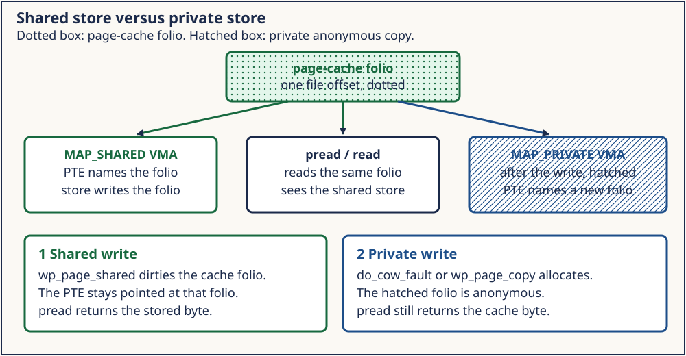
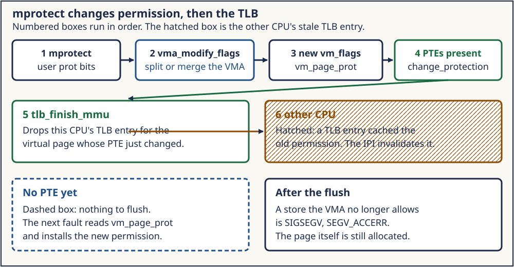

# Day 3 — mmap, mprotect, Copy-on-Write, and Shared Mappings

**Target time:** approximately 3 hours

> Two processes have mappings of the same bytes. A store in the child
> either changes the parent or it does not. What did the flags decide?

Every Linux 6.12 excerpt below is from tag `v6.12`, commit
`adc218676eef25575469234709c2d87185ca223a`, checked out at
`/home/jd/Documents/linux-6.12`. Linux 0.12 page numbers are printed pages
of Zhao Jiong, *A Heavily Commented Linux Kernel Source Code*, Chinese
Revision 5 (2019).

## 1. Syntax needed for this source

`mmap` and `mprotect` take a protection mask and, for `mmap`, a flag mask.
The flags are not a hint the kernel may ignore when you asked for sharing.

```c
void *page = mmap(NULL, length, PROT_READ | PROT_WRITE,
                  MAP_SHARED, fd, 0);
mprotect(page, length, PROT_READ);
```

`MAP_SHARED` and `MAP_PRIVATE` select the write rule. `PROT_READ` without
`PROT_WRITE` selects whether a write is legal at all. `fork` copies the
VMA description into the child. It does not, by itself, copy every frame.

Check the result against `MAP_FAILED`, not `NULL`:

```c
void *p = mmap(NULL, length, PROT_READ | PROT_WRITE,
               MAP_PRIVATE | MAP_ANONYMOUS, -1, 0);
if (p == MAP_FAILED)
    return 1;
```

`NULL` asks the kernel to choose an address. `MAP_FAILED` is `(void *)-1`.
`prot` and `flags` are different masks: `PROT_*` describes permitted
access, while `MAP_SHARED` or `MAP_PRIVATE` selects visibility. File
offsets must be page aligned for ordinary mappings. Inside the kernel the
byte offset has become `pgoff`, a page index:

```text
index = vm_pgoff + ((address - vm_start) >> PAGE_SHIFT)
```

`mprotect` requires a page-aligned start and applies permissions to whole
pages. It cannot protect one C object independently when another object
shares that page.

Fork status is decoded with wait macros:

```c
int status;
waitpid(child, &status, 0);
if (WIFSIGNALED(status) && WTERMSIG(status) == SIGSEGV)
    puts("child faulted");
```

A signal number is not a normal `WEXITSTATUS`.



*Figure 1. Shared writes retain the page-cache folio as their target.
Private writes divert into an anonymous COW folio owned by the writing mm.*

## 2. Linux 0.12 first: copy-on-write without mmap

`copy_page_tables`, used from `copy_mem` during fork, builds the child's
tables and clears the write bit on shared pages while `mem_map` counts
the extra reference. A later write takes the protection fault into
`do_wp_page` and `un_wp_page`. If `mem_map` says the page has one owner,
the write bit is set again. If it says more than one, the kernel allocates,
copies, and installs the new frame.

There is no `mmap` and no `mprotect` in this kernel. Sharing is the fork
rule for the existing code and data. A private file mapping at an
arbitrary offset cannot be expressed with `start_code` and `brk`.

### 2.1 Why fork needs COW

Copying every page during `fork` wastes memory and bandwidth, especially
when the child immediately calls `exec`. Leaving pages shared writable
would violate private process memory. COW shares bytes while neither side
writes and copies only the page a side modifies.

`copy_process` calls `copy_mem` in `kernel/fork.c`, printed pages 407–410.
After assigning the child's segmented slot, `copy_mem` calls:

```c
if (copy_page_tables(old_data_base,new_data_base,data_limit)) {
	free_page_tables(new_data_base,data_limit);
	return -ENOMEM;
}
```

The child gets new page-table pages, while leaf entries initially name the
parent's frames. "Copy page tables" does not mean "copy every data page."

`copy_page_tables` clears the writable bit in child and parent PTEs for
ordinary user pages and increments the frame's `mem_map` byte:

```text
parent PTE --\
              > physical frame -- mem_map count 2
child PTE  --/
```

Downgrading the parent's PTE requires TLB invalidation. Otherwise a stale
writable translation could bypass the future COW fault.

### 2.2 Reuse when exclusive, copy when shared

The write-protection fault reaches `do_wp_page` and `un_wp_page`. If the
page is above `LOW_MEM` and its `mem_map` count is 1, the mapping is
exclusive: set writable and retry. If the count is greater than one,
allocate a page, decrement the old reference, install the new writable
page, copy 4096 bytes, and invalidate.

The writer gets the new frame. COW does not inherently mean "copy for the
child"; a parent that writes first can be the side that separates.

Carry forward shared read access, write protection, reference accounting,
and copy on private write. Leave behind the LDT slot, global byte array,
whole-TLB reload, and fixed 4 KiB copy assumption. Linux 0.12 has no
`mmap` or `mprotect` implementing arbitrary user ranges.

## 3. Evolution: mappings that are not the whole program

Shared libraries, `MAP_SHARED` files, and a protection change on one range
need a VMA with its own flags and operations. Copy-on-write stayed. The
question "who is allowed to write?" moved into the VMA, so a protection
fault and a copy fault are different outcomes. Week 12 already showed the
file half: a `MAP_SHARED` store is visible to `pread` because both name
page-cache pages. This day adds the child and the forbidden write.

Independent objects forced the change: shared libraries, database windows,
anonymous arenas, guard pages, and JIT permission transitions each need
their own range, offset, backing, lifetime, and access policy.

"Writable" alone is insufficient:

- shared plus writable means stores modify common backing/cache bytes;
- private plus writable means stores are legal but private to this mm;
- no write permission means the store is illegal, whatever the map type.

Sparse population matters too. `mmap` publishes a VMA, not a copy of a
whole file. One private file VMA can simultaneously contain untouched
pages, read-only page-cache folios, and anonymous COW folios for pages
already written.

`mprotect` adds mutable ranges. Protecting the middle of a VMA may split it
into prefix, changed middle, and suffix; compatible neighbors can later
merge. VMA locks, mmap locks, PTE locks, and TLB gathering protect different
parts of that operation.

Modern validation also includes file mode, no-exec mounts, protection
keys, security hooks, and architecture policy. A userspace protection mask
is a request. Only a successful call establishes the resulting VMA rule.

## 4. ToyOS: one user root, no COW

Week 8's `map_page_in` gives the single user process a page-table root.
Fork of that address space, write-protect, and a copy on the fault are
not in the tree. Comparing ToyOS with the lab means saying so, not
pretending the serial log contains a COW trace.

ToyOS has the lower mechanisms: frame allocation, per-process page-table
roots, writable leaf flags, local `invlpg`, and vector 14 diagnosis. It
lacks forked VMAs, frame reference counts, file/page-cache backing, and a
recoverable COW fault.

Its one-bit bitmap cannot represent two owners. If either process cleared
the bit on exit, a still-mapped shared frame could be reallocated. A safe
anonymous COW extension first needs reference accounting. Fork would copy
region metadata and page-table structure, clear writable in both private
views, increase frame references, and invalidate stale translations.
The fault path would reject illegal stores, reuse an exclusive page, or
allocate and copy a shared one.

File `MAP_SHARED` needs more than anonymous COW: a backing object, common
cached pages, dirty tracking, writeback, and a lifetime independent of one
process. ToyOS's current serial output proves none of those paths.

## 5. Linux 6.12: do_mmap, do_wp_page, mprotect_fixup

In commit `adc218676eef`, `do_mmap` and `mmap_region` in `mm/mmap.c` build
the VMA. `do_fault` in `mm/memory.c` sends a private write to
`do_cow_fault` and a shared write to `do_shared_fault`. `do_wp_page`
handles the write-protect fault, including the shared case where
`VM_SHARED` is set. `do_mprotect_pkey` in `mm/mprotect.c` calls
`mprotect_fixup` to change the VMA's flags and the PTEs.

### 5.1 `do_mmap` converts ABI bits into VMA policy

The entry validates and page-aligns length, checks offset overflow, derives
VMA flags, and selects an address:

```c
/* tree adc218676eef (Linux 6.12)
 * path: mm/mmap.c
 * lines: 293–323 and 344–357
 * function: do_mmap
 */
len = PAGE_ALIGN(len);
if (!len)
	return -ENOMEM;

if ((pgoff + (len >> PAGE_SHIFT)) < pgoff)
	return -EOVERFLOW;
```

Earlier code rejects zero byte length; later code derives VMA flags and
selects an unmapped address. For a shared writable file mapping, later code requires file write access
and sets `VM_SHARED | VM_MAYSHARE`. A private mapping requires file read
access, but writes become anonymous private state. This policy exists
before a data page is faulted.

### 5.2 `mmap_region` publishes backing and range

The non-merge path allocates and initializes a VMA:

```c
/* tree adc218676eef (Linux 6.12)
 * path: mm/mmap.c
 * lines: 1433–1452 and 1497–1514
 * function: __mmap_region
 */
vma = vm_area_alloc(mm);
if (!vma) {
	error = -ENOMEM;
	goto unacct_error;
}

vma_iter_config(&vmi, addr, end);
vma_set_range(vma, addr, end, pgoff);
vm_flags_init(vma, vm_flags);
vma->vm_page_prot = vm_get_page_prot(vm_flags);
```

The following source preallocates iterator state, selects file, shmem, or
anonymous backing, checks each error, and publishes the VMA. Compatible neighboring
VMAs may merge, so one syscall does not guarantee one permanent VMA object.
Anonymous shared mappings receive shmem backing; they are not ordinary
private anonymous pages plus a visibility bit.

### 5.3 Missing private and shared file writes split

`do_fault` makes the policy branch:

```c
/* tree adc218676eef (Linux 6.12)
 * path: mm/memory.c
 * lines: 5430–5436
 * function: do_fault
 */
} else if (!(vmf->flags & FAULT_FLAG_WRITE))
	ret = do_read_fault(vmf);
else if (!(vma->vm_flags & VM_SHARED))
	ret = do_cow_fault(vmf);
else
	ret = do_shared_fault(vmf);
```

`do_cow_fault` preallocates an anonymous folio, obtains the file source
page, copies it with `copy_mc_user_highpage`, marks the copy uptodate, and
finishes the private mapping. The cache source remains the file's page.

`do_shared_fault` obtains the cache folio, calls the filesystem's
`page_mkwrite` operation when present, finishes the mapping, and runs
`fault_dirty_shared_page`. The cache folio becomes the shared dirty state
eligible for later writeback.

### 5.4 Present private pages reach `do_wp_page`

Fork COW often starts with a present, read-only PTE. The central branch is:

```c
/* tree adc218676eef (Linux 6.12)
 * path: mm/memory.c
 * lines: 3700–3745
 * function: do_wp_page
 */
if (vma->vm_flags & (VM_SHARED | VM_MAYSHARE)) {
	if (!vmf->page)
		return wp_pfn_shared(vmf);
	return wp_page_shared(vmf, folio);
}
```

The later private branch performs the exclusive-reuse check or calls the
copy path. The full function handles userfaultfd and references around
this excerpt. The Linux 0.12 optimization survives in richer form: reuse an exclusive
anonymous folio, otherwise copy. Reverse maps, pins, KSM, folios, and
concurrency make a single byte reference count insufficient.

### 5.5 `mprotect` edits policy and translations

The syscall path checks granularity:

```c
/* tree adc218676eef (Linux 6.12)
 * path: mm/mprotect.c
 * lines: 720–737
 * function: do_mprotect_pkey
 */
if (start & ~PAGE_MASK)
	return -EINVAL;
if (!len)
	return 0;
len = PAGE_ALIGN(len);
end = start + len;
if (end <= start)
	return -ENOMEM;
if (!arch_validate_prot(prot, start))
	return -EINVAL;
```

After VMA and security checks, `mprotect_fixup` changes both layers:

```c
/* tree adc218676eef (Linux 6.12)
 * path: mm/mprotect.c
 * lines: 664–683
 * function: mprotect_fixup
 */
vma = vma_modify_flags(vmi, *pprev, vma, start, end, newflags);
if (IS_ERR(vma)) {
	error = PTR_ERR(vma);
	goto fail;
}
```

The following block resets flags, derives page protection, and calls
`change_protection`. Changing only `vm_flags` would leave hardware permissions stale. Changing
only PTEs would make later fault policy disagree with the range. The
`mmu_gather` batches page-table and TLB work, including invalidation needed
when write permission is removed.



*Figure 2. `mprotect` changes the VMA rule and present translations, then
invalidates stale cached permission. A later forbidden store becomes a
signal; it is not eligible COW.*

A write the VMA forbids becomes `VM_FAULT_SIGSEGV` from
`handle_mm_fault` when `arch_vma_access_permitted` fails. That signal is
what the parent decodes. It is not an oops.

The three cases must stay distinct:

```text
private + VM_WRITE + read-only COW PTE  -> reuse/copy, retry
private + no VM_WRITE + store          -> SIGSEGV
shared  + VM_WRITE + write fault       -> shared dirty path
```

## 6. What the lab can show

`mapping_lab` maps a file `MAP_SHARED`. The child stores a byte. After
`wait`, the parent sees it. A second mapping is `MAP_PRIVATE`. The child
stores and reports that store on a pipe. The parent's byte stays the
original value. A third mapping is `mprotect`ed to `PROT_READ`. Only the
child writes it. The parent reads the old byte and prints a signaled wait
status whose signal is `SIGSEGV`.

Run [day-003-mappings.sh](../challenges/day-003-mappings.sh).

### 6.1 Bounded resources

Run only the existing wrapper:

```sh
./13-virtual-memory-faults-and-reclaim/challenges/day-003-mappings.sh
```

`mapping_lab` creates a private temporary directory under
`/tmp/week13-map.XXXXXX`, two one-page files, and three bounded children.
Its waits have alarm protection. It reaps children, unmaps ranges, closes
descriptors, and removes the files and directory. Cleanup also runs on
ordinary parent exit.

It does not mount a filesystem, flush host caches, force writeback, inspect
PFNs, induce memory pressure, change sysctls, or leave children behind.
Shared visibility in this experiment is not power-loss durability.

### 6.2 Observation versus source proof

**The lab observes:** the shared child's store is visible through the
parent's mapping; the private child's store succeeds while the parent
retains the original byte; and a child store after `mprotect(PROT_READ)`
ends that child with `SIGSEGV` while the parent still reads the old byte.

**The pinned source proves:** `do_mmap` derives VMA policy; `mmap_region`
publishes file, shmem, or anonymous backing; `do_fault` separates COW and
shared writes; `do_wp_page` reuses or copies private anonymous folios; and
`mprotect_fixup` changes VMA flags, page protection, and PTEs.

The pipe note `private_child_store=yes` proves child-side progress. It is
not a PFN trace. Parent bytes staying unchanged prove visible isolation,
not the exact helper used by the host kernel. The shared byte proves common
mapping semantics, not storage durability; the lab calls neither `msync`
nor `fsync`.

## 7. Execution traces

### 7.1 Shared child store

1. Parent opens a writable one-page file and maps it `MAP_SHARED`.
2. Its initial load brings the file's page-cache folio into the mapping.
3. Fork gives the child a mapping of the same shared object.
4. Child stores `'C'`.
5. A shared write fault, if needed, makes the folio writable and dirty.
6. Child exits and parent waits, establishing ordering for this test.
7. Parent's load names the same cache-backed bytes and sees `'C'`.

No pipe carries that byte. The mapping is the communication object.

### 7.2 Private child store

1. Parent maps another file `MAP_PRIVATE` and reads initial `'P'`.
2. Parent and child may initially map the same file-cache folio read-only.
3. Child's store is legal because the VMA allows write.
4. Private policy diverts it into a COW anonymous folio.
5. Child reads `'C'` and sends a progress note through the pipe.
6. Parent waits and verifies the note.
7. Parent still reads `'P'`; the file-cache source was not changed.

The pipe is needed only to prove the child executed after its intentionally
private store.

### 7.3 Protected child store

1. Parent creates private anonymous writable memory and stores `1`.
2. `mprotect(PROT_READ)` changes VMA and PTE permissions.
3. Fork gives the child the same read-only policy.
4. Child attempts to store `2`.
5. VMA validation finds no write permission.
6. The kernel delivers `SIGSEGV`, rather than overriding policy for COW.
7. Parent decodes `WIFSIGNALED` and `WTERMSIG`.
8. Parent can still read `1`.

## 8. Resource and lifetime relationships

A VMA holds a reference to its file through `vm_file`. The file points to
an `address_space`; page-cache folios live there. A private COW folio joins
anonymous reverse mapping associated with an mm. PTEs name whichever folio
currently answers each virtual page.

Closing the descriptor after successful `mmap` does not unmap the range.
The descriptor table and VMA hold independent references, extending Week
12's descriptor → open file → inode graph. `munmap` ends the mapping
lifetime; process exit drops remaining VMAs.

One private file VMA can transition page by page:

```text
untouched -> file-cache read mapping -> anonymous private COW page
```

Unmapping drops virtual references. The cache folio may remain for other
users. An anonymous folio becomes reclaimable only after mappings and pins
are gone. "Unmap frees the file page" is too strong.

TLB entries are derived references without C reference counts. The kernel
must invalidate them before old physical ownership or old permissions can
be treated as gone.

## 9. Architecture lens

COW is generic policy implemented through architecture PTE permission bits
and fault status. x86, AArch64, and RISC-V encode those facts differently.
Architecture fault entry converts them into generic flags before
`do_wp_page`.

Huge mappings can copy or split at a granularity larger than one base page.
Protection keys can deny access beyond ordinary PTE read/write bits. Some
architectures update accessed and dirty state in hardware while others
need software assistance. The invariant is private write isolation, not a
universal sequence of one 4 KiB `memcpy`.

## 10. Mastery: Explain · Draw · Observe · Build

### Explain

- Why fork COW must write-protect the parent's existing PTE.
- Why `MAP_PRIVATE | PROT_WRITE` allows a store without changing the file.
- Why `PROT_READ` produces `SIGSEGV` instead of a private copy.
- Why anonymous `MAP_SHARED` needs common backing.
- Why closing an fd does not end a successful mapping.
- Why shared visibility does not prove durability.

### Draw

Redraw Figure 1 with parent PTE, child PTE, page-cache folio, COW folio,
and reference arrows. Then redraw Figure 2 with VMA change, PTE change,
TLB invalidation, and signal.

### Observe

Run the wrapper once. Record `uname -r` and all `yes` markers. Label bytes
as process observations, the pipe as child-progress evidence, and the wait
status as signal evidence. Record the pinned source commit separately.

### Build

Design, but do not implement, minimum ToyOS anonymous-fork COW state:
frame reference count, private/shared region flag, parent and child PTE
downgrade, TLB invalidation, exclusive reuse, copy rollback, and exit-time
reference drop. Explain why the current one-bit bitmap is insufficient.

## 11. Limits

The wait status names the signal. It does not name the kernel function
that sent it. The lab does not dump PTEs or prove which physical frame
was copied. Temporary files live under `/tmp/week13-map.*` and are removed
before exit.

The lab also does not prove dirty writeback, durability, VMA split shape,
TLB shootdown count, folio order, or the host kernel's exact COW helper.
Use pinned source for implementation claims and runtime values only for
what the processes actually observed.
