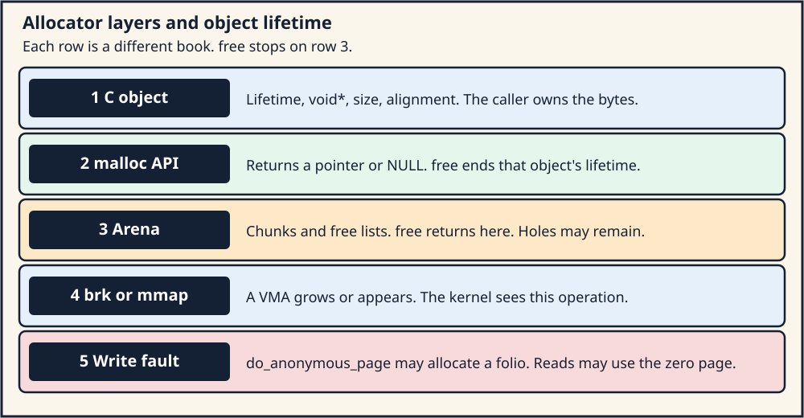
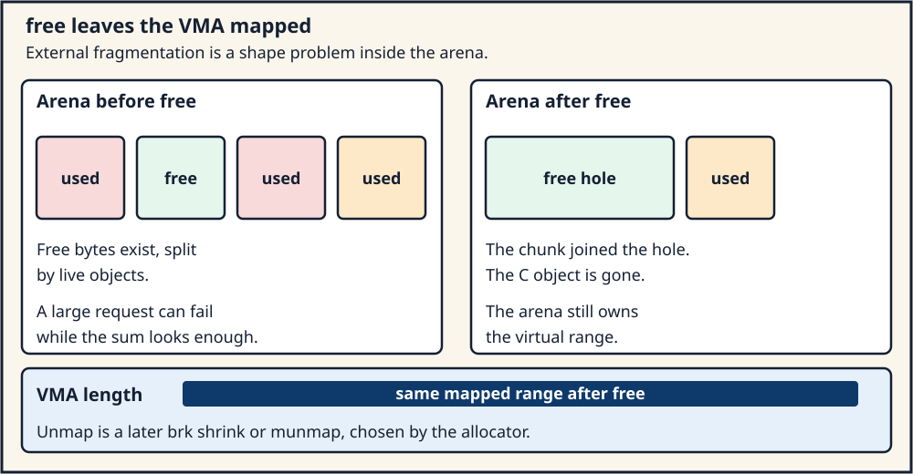

# Day 4 — User Allocators, `brk`, `mmap`, and Lifetime

**Target time:** approximately 3 hours

> `malloc` is a userspace contract about an object's lifetime. The kernel
> records a virtual-memory operation. Those two books stay separate even
> when a call happens to cross from one into the other.

The engineering tree for every Linux 6.12 excerpt below is tag `v6.12`,
commit `adc218676eef25575469234709c2d87185ca223a`, checked out at
`/home/jd/Documents/linux-6.12`. Linux 0.12 page numbers are the printed
pages of Zhao Jiong, *A Heavily Commented Linux Kernel Source Code*,
Chinese Revision 5 (2019).

## 1. Syntax: lifetime, `void *`, size, and alignment

A C object has a lifetime. Automatic storage ends when the block ends.
Allocated storage begins when an allocation function returns a pointer
and ends when `free` is called on that pointer, or when the program
ends. After the lifetime ends, the pointer value is indeterminate. A
later load or store through it is undefined behavior in the abstract
machine. That rule is independent of whether the underlying page is
still mapped.

`void *` is an object pointer with no element type. It can hold the
address of any object. You convert it before you use it:

```c
void *raw = malloc(n);
unsigned char *bytes;

if (raw == NULL)
    return ENOMEM;
bytes = raw;          /* conversion; no arithmetic on raw */
bytes[0] = 0;
```

Pointer arithmetic on `void *` is a GCC extension, not ISO C. The size
you pass to `malloc` is a `size_t`. The difference between two pointers
into the same array is a `ptrdiff_t`. Mixing those types in a length
calculation is how a "small" allocation becomes a huge one, or how a
subtraction underflows.

`malloc(n)` returns a pointer aligned for any object with fundamental
alignment, or `NULL`. `alignof(max_align_t)` is the alignment that
promise is aiming at. It is an alignment of a C object, typically 16
bytes on LP64 System V. It is smaller than a page. `aligned_alloc`
and `posix_memalign` exist when the caller needs a stricter alignment.
Passing a pointer that is only `max_align_t`-aligned to a function that
requires page alignment is a caller bug, even when `malloc` succeeded.

The caller owns the size. The allocated object does not carry a C type
that remembers `n`. A correct `free` receives the same pointer value
`malloc` returned. It does not receive an interior pointer, and it does
not receive a size. The implementation may store a size in bytes before
the returned address. That header is part of the allocator, outside the
lifetime of the caller's object.

`sizeof` on a pointer yields the width of the pointer, not the width of
the allocation. `sizeof *p` after `p = malloc(n)` is the size of the
pointed-to type as the compiler sees it. If `p` is `void *`, that
expression is a constraint violation in ISO C. If `p` is `char *`,
`sizeof *p` is 1, which is the size of one `char`, regardless of `n`.

A store through the pointer is a store. It becomes a page fault only
when the translation is missing or forbidden. The C abstract machine
does not mention faults. The fault is what the machine does when the
virtual address is not yet backed. Section 8 traces that crossing.

## 2. Linux 0.12 first: `sys_brk` moves one field

Linux 0.12 gives each task one break. `sys_brk` lives in `kernel/sys.c`,
printed page 419. The whole function is the check and the assignment:

```c
int sys_brk(unsigned long end_data_seg)
{
	if (end_data_seg >= current->end_code &&
	    end_data_seg < current->start_stack - 16384)
		current->brk = end_data_seg;
	return current->brk;
}
```

Trace. The argument is a linear address the caller wants as the end of
the data segment. The function accepts it when it sits at or after
`current->end_code` and at least 16 KiB before `current->start_stack`.
On success it stores the address in `current->brk` and returns that
value. On failure it leaves `current->brk` alone and still returns
`current->brk`. The caller compares the return value with the request.
A mismatch is the error. There is no `-ENOMEM` here.

The book is explicit about who calls this. Chapter 15.7, printed page
1023, says the `malloc` in the development-environment library adjusts
the end of the process data segment and calls the `brk` system call.
The kernel function of the same name in `lib/malloc.c` is a different
allocator. It takes pages with `get_free_page` and hands out buckets
inside those pages. From 0.98 that kernel function is `kmalloc`. A user
program linked with libc never calls `get_free_page`.

A fault in the new gap is `do_no_page`. Week 12 Day 6 quoted the branch:
when `inode` is NULL, past the executable image, `get_empty_page`
zero-fills a frame and returns. That is the anonymous fill. It is not
`bread_page` of the executable. `get_empty_page` is how the early kernel
turns the break field into a page. Shrinking the break in this function
only stores a smaller address. It does not walk an arbitrary VMA list.

What carries forward is the split in responsibility. Userspace asks for
a byte range. The kernel records how far that range may extend. Physical
pages arrive on the fault. The single `brk` field, the 16 KiB gap written
as a literal, the 80386 segment limits, and the "return the current break
instead of an errno" convention belong to this kernel.

The shared [Linux 0.12 map](../../references/EARLY_LINUX_012_MAP.md)
says to name the stable mechanism, the historical detail, and the modern
path. The stable mechanism is "a syscall moves the edge of a data
mapping, and faults fill pages." The historical detail is one break per
task and the 16 KiB stack gap. The modern path is `SYSCALL_DEFINE1(brk)`
in `mm/mmap.c`, section 5 below.

## 3. Evolution: arenas, fragmentation, and a policy that is not an ABI

One break is a single growing and shrinking edge. A process that needs
a file mapping, a shared mapping, a guard page, and a large anonymous
range wants several ranges with holes between them. `mmap` and `munmap`
name those ranges. `brk` remains the historical edge of the initial
heap. Both are virtual-memory operations. Neither is `malloc`.

A page is the unit the kernel maps. A C object is often smaller. If
every `malloc(24)` entered the kernel, the program would pay a syscall,
a VMA, and a page for 24 bytes. A userspace allocator keeps a reservoir
of address space, carves objects out of it, and returns a freed object
to a free list inside that reservoir. The reservoir is an arena. The
carved piece is a chunk. The header in front of the chunk remembers the
size the C object itself does not remember.

`free` finishes the C lifetime and returns the chunk to the arena. The
arena may coalesce neighboring free chunks. It may satisfy the next
`malloc` from that free list. It may leave the virtual range mapped.
Unmapping is a separate decision: the allocator calls `brk` to shrink,
or `munmap` on a mapping it created, when its own policy says the
address space is worth returning. A correct program treats `free` as
the end of the object. It does not treat `free` as a promise that
`/proc/self/maps` will shrink.

Arenas fragment. Internal fragmentation is wasted bytes inside a chunk
that is larger than the request, because the allocator rounds up to a
size class or to its alignment. External fragmentation is free bytes
that are not contiguous enough for the next request, even though their
sum would be enough. A picture of a heap that is "half free" can still
refuse a large request. The refusal is an allocator decision. It can
happen while the kernel still has physical pages, and it can happen
while the process still has address space, because the free bytes are
the wrong shape.

Threads push the same idea further. One global arena serializes every
allocate and free. A per-thread arena, or a per-thread cache in front
of a shared arena, lets a thread allocate without taking the global
lock. A chunk freed on a different thread than the one that allocated
it may have to cross back to the owning arena. That crossing is
userspace synchronization. The kernel sees it only if the allocator
later issues `brk`, `mmap`, `munmap`, or `madvise`.

Some allocators choose `mmap` for a request above a size they configure,
and `brk` or an existing arena below it. That choice is a parameter of
the allocator you linked. It can change with `mallopt`, with a build
option, with a different libc, or with an arena that already has a
hole of the right size. This lesson states no numeric cutoff. Measuring
one process on one libc and publishing the number as "how Linux
allocates" confuses a userspace policy with the kernel ABI. The kernel
ABI is the syscall: the arguments, the errors, and the mapping that
appears.

Address-space layout randomization, `RLIMIT_DATA`, and a guard gap
before the stack are reasons a modern `brk` can fail even when the
machine has free RAM. The failure is "this address space will not
extend," reported by returning the old break. `mmap` of a fresh
anonymous range can still succeed in the same process, because it does
not need the bytes immediately above the current break.

## 4. ToyOS: a kernel bump heap on frames that are already mapped

ToyOS reconstructs the lower half of the picture and stops before a
user allocator.

[Week 7's frame allocator](../../07-memory-processes-and-scheduling/sections/day-001-memory-map-and-frame-allocator.md)
in `projects/toyos/src/memory.c` answers "which physical frame?"
`frame_alloc` scans a bitmap, sets a bit, zeroes the frame, and returns
a physical address. `frame_free` clears the bit. There is no `brk`, no
`mmap`, and no userspace `malloc`.

[Week 7's kernel heap](../../07-memory-processes-and-scheduling/sections/day-003-kernel-heap-and-ownership.md)
maps frames at `HEAP_BASE` and then bump-allocates with `kalloc`.
The pointer `kalloc` returns is already backed. The first store does
not fault, because `memory_init` installed the translations first. The
bump pointer only moves forward. A free list, coalescing, and `free`
that returns a chunk to the heap are later work. The lesson of that
code is ownership: the caller receives an address and a lifetime, and
the heap does not yet record who must release it.

A user allocator sits one layer above what ToyOS has. It would need a
syscall that creates a VMA, a fault path that calls `frame_alloc` and
installs a PTE, and a userspace free list that usually does not call
back into the kernel. ToyOS has the frame and the mapper. It has a
kernel bump allocator on pre-mapped frames. It does not have the user
arena. Reading `kalloc` as if it were `malloc` skips the VMA.

## 5. Linux 6.12: `brk` edits a VMA

`SYSCALL_DEFINE1(brk)` is in `mm/mmap.c`. The lock and the lower bound
come first:

```c
/* tree adc218676eef (Linux 6.12)
 * path: mm/mmap.c
 * lines: 115–144
 * function: brk
 */
SYSCALL_DEFINE1(brk, unsigned long, brk)
{
	unsigned long newbrk, oldbrk, origbrk;
	struct mm_struct *mm = current->mm;
	struct vm_area_struct *brkvma, *next = NULL;
	unsigned long min_brk;
	bool populate = false;
	LIST_HEAD(uf);
	struct vma_iterator vmi;

	if (mmap_write_lock_killable(mm))
		return -EINTR;

	origbrk = mm->brk;

#ifdef CONFIG_COMPAT_BRK
	if (current->brk_randomized)
		min_brk = mm->start_brk;
	else
		min_brk = mm->end_data;
#else
	min_brk = mm->start_brk;
#endif
	if (brk < min_brk)
		goto out;
```

The return type of the modern syscall is still the break, an address,
on the success path at line 210. The early `-EINTR` is the exception:
the lock was interrupted. A request below `min_brk` jumps to `out`,
which restores `origbrk` and returns it. `CONFIG_COMPAT_BRK` changes
the floor. When the break was randomized, the floor is `mm->start_brk`.
Otherwise the historical floor `mm->end_data` remains. That `#ifdef` is
a kernel configuration fact. It is still about the VMA edge, not about
a userspace size class.

Growth and shrinkage are different operations. Shrinkage is allowed
once the request is within the data rlimit, and it becomes an unmap of
the abandoned tail. Growth checks the stack guard and then extends or
creates an anonymous VMA:

```c
/* tree adc218676eef (Linux 6.12)
 * path: mm/mmap.c
 * lines: 156–210
 * function: brk
 */
	newbrk = PAGE_ALIGN(brk);
	oldbrk = PAGE_ALIGN(mm->brk);
	if (oldbrk == newbrk) {
		mm->brk = brk;
		goto success;
	}

	/* Always allow shrinking brk. */
	if (brk <= mm->brk) {
		vma_iter_init(&vmi, mm, newbrk);
		brkvma = vma_find(&vmi, oldbrk);
		if (!brkvma || brkvma->vm_start >= oldbrk)
			goto out; /* mapping intersects with an existing non-brk vma. */
		mm->brk = brk;
		if (do_vmi_align_munmap(&vmi, brkvma, mm, newbrk, oldbrk, &uf,
					/* unlock = */ true))
			goto out;

		goto success_unlocked;
	}

	if (check_brk_limits(oldbrk, newbrk - oldbrk))
		goto out;

	vma_iter_init(&vmi, mm, oldbrk);
	next = vma_find(&vmi, newbrk + PAGE_SIZE + stack_guard_gap);
	if (next && newbrk + PAGE_SIZE > vm_start_gap(next))
		goto out;

	brkvma = vma_prev_limit(&vmi, mm->start_brk);
	if (do_brk_flags(&vmi, brkvma, oldbrk, newbrk - oldbrk, 0) < 0)
		goto out;

	mm->brk = brk;
	if (mm->def_flags & VM_LOCKED)
		populate = true;

success:
	mmap_write_unlock(mm);
success_unlocked:
	userfaultfd_unmap_complete(mm, &uf);
	if (populate)
		mm_populate(oldbrk, newbrk - oldbrk);
	return brk;
```

`PAGE_ALIGN` means the VMA edge moves by pages. A `brk` that lands
inside the page already covered by `mm->brk` only stores the byte
address and returns. The mapping does not change. A shrink calls
`do_vmi_align_munmap` on `[newbrk, oldbrk)`. A grow calls
`do_brk_flags`. `populate` is true only when `VM_LOCKED` is already in
`mm->def_flags`. An ordinary `brk` returns after publishing the VMA.
The pages are not allocated in this function.

`do_brk_flags` (lines 1778–1845) is the grow. It ORs in
`VM_DATA_DEFAULT_FLAGS | VM_ACCOUNT`, checks `may_expand_vm`,
`sysctl_max_map_count`, and `security_vm_enough_memory_mm`, then either
merges into the existing brk VMA or allocates a new anonymous one:

```c
/* tree adc218676eef (Linux 6.12)
 * path: mm/mmap.c
 * lines: 1814–1834
 * function: do_brk_flags
 */
	if (vma)
		vma_iter_next_range(vmi);
	/* create a vma struct for an anonymous mapping */
	vma = vm_area_alloc(mm);
	if (!vma)
		goto unacct_fail;

	vma_set_anonymous(vma);
	vma_set_range(vma, addr, addr + len, addr >> PAGE_SHIFT);
	vm_flags_init(vma, flags);
	vma->vm_page_prot = vm_get_page_prot(flags);
	vma_start_write(vma);
	if (vma_iter_store_gfp(vmi, vma, GFP_KERNEL))
		goto mas_store_fail;

	mm->map_count++;
	validate_mm(mm);
	ksm_add_vma(vma);
```

`vma_set_anonymous` means there is no file. `vma_iter_store_gfp` inserts
the VMA into the mm's maple tree, the same structure Week 12 Day 6 used
for a file mapping. `mm->total_vm` and `mm->data_vm` grow by
`len >> PAGE_SHIFT` at lines 1834–1835. Those counters are virtual
pages. They are the reason `/proc/pid/status` can show `VmData` moving
while `RssAnon` stays put until something writes the new pages.

The failure path at lines 212–215 restores `origbrk` and returns it.
The C library turns "returned break is not the requested break" into
`ENOMEM` for the caller of `brk` or `sbrk`. The syscall itself handed
back an address.

## 6. `mmap` is the other operation the kernel is willing to see

A large or independent reservation uses `mmap`. Week 12 Day 6 followed
a file mapping through `filemap_fault`. An allocator's anonymous
reservation takes the same syscall and leaves `file` NULL:

```c
/* tree adc218676eef (Linux 6.12)
 * path: mm/mmap.c
 * lines: 504–515
 * function: ksys_mmap_pgoff
 */
unsigned long ksys_mmap_pgoff(unsigned long addr, unsigned long len,
			      unsigned long prot, unsigned long flags,
			      unsigned long fd, unsigned long pgoff)
{
	struct file *file = NULL;
	unsigned long retval;

	if (!(flags & MAP_ANONYMOUS)) {
		audit_mmap_fd(fd, flags);
		file = fget(fd);
		if (!file)
			return -EBADF;
```

`MAP_ANONYMOUS` skips `fget`. The mapping has no inode. `do_mmap` still
builds a VMA through `mmap_region`. `munmap` removes that VMA later.
`madvise` and `mprotect` change advice or protection on it. Those are
the operations an arena is allowed to ask for. The kernel does not
receive the chunk size, the size class, the arena id, or the caller's
type. A bug that frees an object twice is a userspace lifetime bug
until it corrupts the arena so badly that a later syscall passes a
bad address. The kernel is not the referee of `free`.

`VM_LOCKED` and `MAP_POPULATE` are the paths that fault pages in before
returning. An ordinary allocator does not set them. The pointer it
hands back can be a valid virtual address with no PTE, or with a PTE
that still names the shared zero page until the first write.

## 7. Architecture lens: alignment is three different contracts

[The architecture comparison](../../references/ARCHITECTURE_COMPARISON.md)
separates page-table facts from C facts.

The C contract is `alignof(max_align_t)` and the stricter alignments
the caller requests. It is a property of the ABI and of `malloc`. It
does not change because the process crossed into the kernel.

The mapping contract is `PAGE_SIZE`. On x86-64 Linux the base page is
4 KiB. AArch64 Linux can be built with a 4 KiB, 16 KiB, or 64 KiB
translation granule. RISC-V Linux selects Sv39, Sv48, or Sv57, and the
base page in those modes is 4 KiB. `brk` page-aligns with `PAGE_ALIGN`.
A `mmap` offset for a file is rejected on x86-64 when it is not a
multiple of the page size, as Week 12 Day 6 quoted. An anonymous
mapping's length is rounded up to pages inside the kernel. A 24-byte
C object and a 4 KiB mapping can both be "aligned" and still be aligned
to different numbers.

The fault contract is the PTE. A read of a fresh anonymous page may
install the zero page inside `do_anonymous_page` (section 8). A write
allocates a private folio. The ISA decides the PTE format, the fault
status register, and the TLB maintenance. The decision "this VMA is
anonymous and writable" is generic mm code. ToyOS hard-codes a 4 KiB
page and an x86-64 page table. That is a teaching choice. It is the
same shape as one legal Linux configuration, and it is a different
shape from an AArch64 kernel built with a 16 KiB granule.

Byte order does not enter this path. Allocation is addresses and
lengths. The little-endian bias of the three mainstream Linux ABIs is
an ecosystem fact about data, recorded in the architecture comparison,
and it does not decide whether `brk` or `mmap` runs.

## 8. Execution trace: from `malloc` to a private folio

Take a request the arena cannot satisfy from its free lists, on a
process whose allocator then extends the heap with `brk`. The names
below are this tree. The userspace branch is the allocator's; the
lesson does not pin a size at which that branch must be taken.

1. The caller passes `size` and checks for `NULL`. The abstract machine
   has a new object only if the pointer is non-NULL.
2. The arena finds no free chunk of that size class. It asks the kernel
   to extend address space. One implementation calls `brk`. Another
   calls `mmap` with `MAP_ANONYMOUS`. Both are legal. The trace follows
   `brk`.
3. `brk` takes `mmap_write_lock`, page-aligns the request, and calls
   `do_brk_flags`. A VMA is merged or inserted. `mm->brk`, `total_vm`,
   and `data_vm` change. The syscall returns the new break. No folio
   has been allocated for the new range.
4. The arena carves a chunk, writes its header, and returns
   `header + overhead` to the caller. That pointer is `void *` until
   the caller converts it.
5. A read of the new object may fault. `do_anonymous_page` (`mm/memory.c`
   lines 4756–4776) can install the zero page when the fault is not a
   write and the mm allows the zero page. The allocator's header write
   is a write, so the interesting fault is the write.
6. The write fault reaches "Allocate our own private page"
   (`mm/memory.c` lines 4779–4784). `alloc_anon_folio` runs.
   `CONFIG_TRANSPARENT_HUGEPAGE` may try a higher-order folio first
   (lines 4705–4709, `vma_alloc_folio`). The fallback at line 4727 is
   `folio_prealloc`. Either way a folio comes from the physical
   allocator, which Day 5 opens. The PTE is installed, the instruction
   restarts, and the header store completes.
7. The caller writes the object and later calls `free`. The arena
   links the chunk onto a free list and may coalesce it with a
   neighbor. `brk` and `munmap` stay idle. `/proc/self/maps` still
   shows the heap VMA or the anonymous VMA. `RssAnon` still includes
   the folio until the arena advises the kernel to drop it, or until
   the process exits and the mm is torn down.
8. A second `malloc` of a similar size pops the free list and returns.
   No syscall, no fault, no new folio.

A shrink that does cross into the kernel is the other trace. The arena
calls `brk` with a lower address, or `munmap` on a mapping it owns.
`do_vmi_align_munmap` drops the tail. Folios that were private to that
range become freeable. Chunks the arena still considers allocated must
not sit in that tail. That is an arena invariant. The kernel will
unmap whatever range the syscall names.

## 9. Two pictures



*Figure 1. The caller sees a pointer and a lifetime. The arena sees
chunks. The kernel sees a VMA and, on a write fault, a folio. `free`
stops at the arena.*



*Figure 2. External fragmentation is a shape problem inside the arena.
Returning a chunk does not shorten the VMA.*

## 10. A lab that reads one process and invents no threshold

Save this as a file you compile yourself. The wrapper
[`../challenges/day-004-allocators.sh`](../challenges/day-004-allocators.sh)
builds `projects/linux-vm` `allocator_lab`. That program records `sbrk`
around a 32-byte `malloc` and a 2 MiB `malloc`, prints the maps region
that contains each pointer, and `munmap`s one explicit page. The source
marker `glibc_mmap_threshold_asserted=no` is required. A `brk_changed`
value from that run describes this libc on this boot. It is not
`M_MMAP_THRESHOLD`. The program below is the same observation, small
enough to read in one sitting.

```c
#define _DEFAULT_SOURCE
#include <inttypes.h>
#include <stdalign.h>
#include <stddef.h>
#include <stdint.h>
#include <stdio.h>
#include <stdlib.h>
#include <string.h>
#include <unistd.h>

static void dump_maps(const char *tag)
{
	FILE *fp = fopen("/proc/self/maps", "re");
	char line[512];

	printf("== %s  sbrk(0)=%p\n", tag, sbrk(0));
	if (!fp) {
		perror("fopen maps");
		return;
	}
	while (fgets(line, sizeof line, fp)) {
		if (strstr(line, "[heap]") || strstr(line, "[stack]"))
			fputs(line, stdout);
	}
	fclose(fp);
}

int main(void)
{
	void *a = malloc(1);
	void *b = malloc(64);
	size_t align = alignof(max_align_t);

	printf("sizeof(void*)=%zu alignof(max_align_t)=%zu\n",
	       sizeof(void *), align);
	if (!a || !b) {
		perror("malloc");
		return 1;
	}
	printf("a=%p a%%align=%zu  b=%p b%%align=%zu\n",
	       a, (size_t)(uintptr_t)a % align,
	       b, (size_t)(uintptr_t)b % align);
	dump_maps("after malloc");
	free(a);
	free(b);
	dump_maps("after free");
	puts("free ended the C objects. Compare the two [heap] lines.");
	puts("Record what this libc did. State no size cutoff.");
	return 0;
}
```

Compile with `cc -std=c17 -Wall -Wextra -Werror`. Predict, before you
run, that both pointers are multiples of `alignof(max_align_t)`, and
that the `[heap]` line, if one exists, has the same end address after
`free` as after `malloc`. Then run. If this libc satisfies both
requests from an arena that already existed at startup, `sbrk(0)` will
not move. That observation supports the arena story. It does not
identify a threshold, because the program never searched for one.

If you want a second observation, call `mmap` yourself with
`MAP_PRIVATE | MAP_ANONYMOUS` for one page, write one byte, print the
address, `munmap` it, and show that this mapping appeared and
disappeared as its own VMA. That program is using the syscall on
purpose. It is still a fact about your call, not a fact about every
`malloc` of that length.

Leave the machine alone. Do not loop `malloc` until it fails. Day 6
explains why "allocation failed" has several causes, and Day 7 is the
place to record evidence without creating pressure.

## 11. Mastery: Explain · Draw · Observe · Build

The exercise is
[`../challenges/day-004-allocators.sh`](../challenges/day-004-allocators.sh).

### Explain

- Where a C object's lifetime starts and ends, and why a mapped page
  can outlive that lifetime.
- Why `void *` from `malloc` is converted before it is indexed, and
  why `sizeof` on the pointer is the wrong size.
- What Linux 0.12 `sys_brk` writes, and which function fills a page
  later.
- What `do_brk_flags` inserts, and which counters move at that moment.
- Why an arena `free` and `munmap` are different operations.
- Why a size at which one libc calls `mmap` is a property of that
  libc's policy.

### Draw

Draw Figure 1 from memory. Put one address on the arrow from `malloc`
to the caller, and a different address, the VMA start, on the arrow
from `brk` or `mmap` to the kernel. Mark the write fault as the step
that reaches `do_anonymous_page` and `alloc_anon_folio`.

### Observe

Run the wrapper. Record `uname -r`, the libc you linked, and the tree
id if you opened the sources. Paste the two `[heap]` lines, or write
"no `[heap]` line" if the allocator used only anonymous mappings.
Quote `alignof(max_align_t)` from the program. Quote no threshold.
Confirm the lab printed `glibc_mmap_threshold_asserted=no`.

### Build

Write a one-page account of one `malloc`/`free` pair using the
functions from this tree: `brk`, `do_brk_flags`, `ksys_mmap_pgoff`,
`do_anonymous_page`, `alloc_anon_folio`. End with the sentence you will
use when someone says the kernel frees memory at `free`: the kernel
drops pages when a VMA changes or the process exits; `free` returns a
chunk to the allocator that owns the arena.
