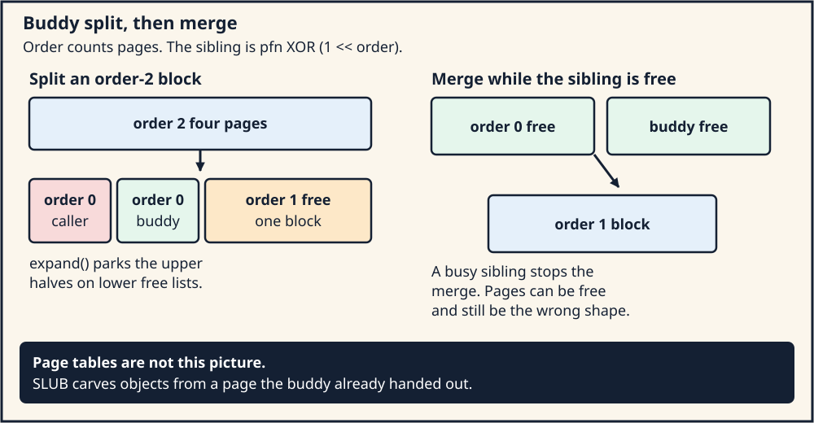
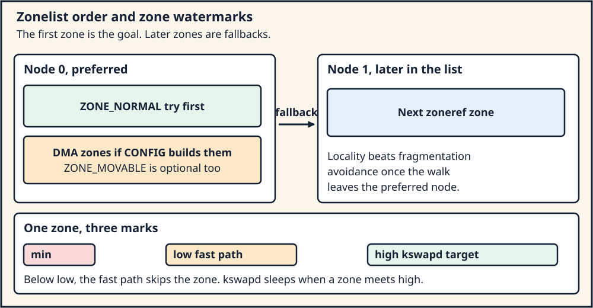

# Day 5 — Physical Pages, Zones, the Buddy Allocator, and NUMA

**Target time:** approximately 3 hours

> The physical allocator hands out page frames. Page tables name a
> translation. SLUB hands out objects carved from frames it already
> obtained. Three allocators, three questions.

The engineering tree is Linux 6.12, tag `v6.12`, commit
`adc218676eef25575469234709c2d87185ca223a`, at
`/home/jd/Documents/linux-6.12`. Linux 0.12 page numbers are printed
pages of Zhao Jiong, Chinese Revision 5 (2019).

## 1. Syntax: bit orders, intrusive lists, and a tree that is not this allocator

An order is an exponent. A block of order `n` contains `1 << n` pages.
Order 0 is one page. Order 3 is eight pages. The byte length is
`(1 << n) * PAGE_SIZE`, so the same order is a different number of
bytes when `PAGE_SIZE` changes. Shifting is the arithmetic:

```c
unsigned int order = 3;
unsigned int pages = 1u << order;          /* 8 */
unsigned long bytes = (unsigned long)pages * 4096ul;
unsigned long buddy = pfn ^ (1ul << order); /* neighbor at this order */
```

`pfn ^ (1 << order)` flips the bit that distinguishes the two halves of
an order-`(order+1)` block. That is the buddy address. The XOR is the
reason the buddy is unique: each block has one sibling at its order.

A free block is linked with an intrusive doubly linked list. The node
is stored inside the object, not beside it:

```c
/* tree adc218676eef (Linux 6.12)
 * path: include/linux/types.h
 * lines: 193–194
 */
struct list_head {
	struct list_head *next, *prev;
};
```

`LIST_HEAD` initializes a node to point at itself. The list is empty
when `next == &head`. The buddy free lists are an array of these heads,
one per migrate type, inside each order:

```c
/* tree adc218676eef (Linux 6.12)
 * path: include/linux/mmzone.h
 * lines: 117–120
 */
struct free_area {
	struct list_head	free_list[MIGRATE_TYPES];
	unsigned long		nr_free;
};
```

The highest order in this tree is `MAX_PAGE_ORDER`. It is 10 unless the
architecture forces another value:

```c
/* tree adc218676eef (Linux 6.12)
 * path: include/linux/mmzone.h
 * lines: 29–33
 */
#ifndef CONFIG_ARCH_FORCE_MAX_ORDER
#define MAX_PAGE_ORDER 10
#else
#define MAX_PAGE_ORDER CONFIG_ARCH_FORCE_MAX_ORDER
#endif
```

Order 10 is 1024 pages. At a 4 KiB page that is 4 MiB. At a 64 KiB
granule it is 64 MiB. Quote the macro, then multiply by the running
`PAGE_SIZE`.

A maple tree, the structure Day 4 used for VMAs, answers "which VMA
covers this virtual address?" A buddy list answers "which free physical
block of this order is available in this zone?" The two structures sit
in different layers. Finding a VMA does not allocate a frame. Popping a
buddy list does not install a PTE.

A bitmap is the third shape. Linux 0.12 uses one byte per page, not one
bit, because the byte stores a reference count. ToyOS uses one bit per
frame, because a frame is either free or owned. The buddy allocator
uses neither as its primary free structure. It uses the per-order lists,
and it stores the order of a free block in the page's private field.
The comment above `__free_one_page` in `mm/page_alloc.c` (lines 747–768)
says that directly: lists of heads of `1 << order` free pages, marked
`PageBuddy`, order in `page_private`.

## 2. Linux 0.12 first: one byte per page, scanned from the top

`mem_map[]` is a byte array in `mm/memory.c`, printed page 883. Each
byte is the number of users of one physical page above 1 MiB. `LOW_MEM`
is that 1 MiB floor. Pages below it belong to the kernel image and the
buffer cache. `free_page` refuses them:

```c
void free_page(unsigned long addr)
{
	if (addr < LOW_MEM) return;
	if (addr >= HIGH_MEMORY)
		panic("trying to free nonexistent page");
	addr -= LOW_MEM;
	addr >>= 12;
	if (mem_map[addr]--) return;
	mem_map[addr] = 0;
	panic("trying to free free page");
}
```

Trace. The address is a physical address. Subtract `LOW_MEM`, divide by
4096, and the result indexes `mem_map`. The post-decrement is the whole
free operation. If the byte was already 0, the decrement wraps it and
the function panics. A shared page, whose byte is greater than 1, loses
one reference and stays allocated. There is no buddy, no order, and no
merge.

`get_free_page` lives in `mm/swap.c`, printed pages 908–909, because a
failed search calls `swap_out`. The scan and the retry are:

```c
unsigned long get_free_page(void)
{
	register unsigned long __res asm("ax");
repeat:
	__asm__("std ; repne ; scasb\n\t"
		"jne 1f\n\t"
		"movb $1,1(%%edi)\n\t"
		/* the book continues: zero the page, leave its address in eax */
		: "=a" (__res)
		: "0" (0), "i" (LOW_MEM), "c" (PAGING_PAGES),
		  "D" (mem_map + PAGING_PAGES - 1)
		: "di", "cx", "dx");
	if (__res >= HIGH_MEMORY)
		goto repeat;
	if (!__res && swap_out())
		goto repeat;
	return __res;
}
```

The quoted `scasb` scans backward from the last byte of `mem_map` for a
0. On a hit the next instruction stores 1 into that byte. The omitted
instructions zero the page and form the address `LOW_MEM` plus the
index shifted by 12. A hit past `HIGH_MEMORY` retries. A miss calls
`swap_out` and, if that freed a page, retries. The comment in the book
is the part to keep: this function names a free physical page and does
not map it into a process. `put_page` does the mapping. The kernel's
own low memory is already identity-mapped, so kernel callers skip
`put_page`.

What carries forward is a physical page allocator with a use count,
separate from the page tables. The historical details are the byte
array, the backward `scasb`, the 1 MiB floor, the panic on a double
free, and the direct call into swap when the array has no zero. Day 6
reads that swap path. Today's modern path is `__alloc_pages_noprof` and
`__free_one_page`.

`mem_init` (printed page 899) sets every `mem_map` byte to `USED` and
then clears the bytes that cover usable main memory. `show_mem` prints
counts from that array when Shift+Scroll Lock is pressed. That is the
0.12 observation tool. Day 7 replaces it with `/proc`.

## 3. Evolution: zones, buddies, per-CPU lists, and a node order

A single array of pages is enough when every page is equally usable and
the machine has one CPU. Both assumptions broke.

Devices with a short DMA address need frames below a limit. The kernel
groups frames into zones. `enum zone_type` in `include/linux/mmzone.h`
(lines 723–745) documents the reason in the comment above the
enumerators: `ZONE_DMA` and `ZONE_DMA32` exist for peripherals that
cannot DMA to all of memory, and both enumerators are compiled in only
under their `CONFIG_` options. `ZONE_NORMAL` is ordinary addressable
memory. `ZONE_HIGHMEM` is a 32-bit-era zone for memory the kernel maps
in pieces. `ZONE_MOVABLE` prefers pages that can be migrated so that
hot-remove and huge pages have a chance. A build that defines none of
the optional zones still has `ZONE_NORMAL`. Quoting "Linux has DMA,
Normal, and HighMem" as a fact about every 6.12 kernel invents zones
the `.config` did not compile.

Contiguous frames became the second problem. A device, a page table
page, or a transparent huge page wants `2^n` physically contiguous
pages. Carving them from a flat free list splits the address space into
holes. The buddy system keeps a free list per order. An allocation of
order `k` that finds only order `n` (`n > k`) splits the block, puts
the unused halves on the lower free lists, and returns the piece of
order `k`. A free that finds its buddy also free merges, and may merge
again at the next order. The merge restores a high-order block only
when the sibling is free. A busy sibling leaves external fragmentation:
enough free pages, in the wrong shape, for an order-0 allocation, and
not enough for order 4.

The zone lock became the third problem. Every allocation and free took
the same lock. A per-CPU page list (`struct per_cpu_pages`, reached
from `zone->per_cpu_pageset`) holds a few order-0 pages, and some
higher orders the kernel treats as cheap, so a common allocation pops
a local list. The buddy runs when the list is empty or when the free
path returns a batch to the zone. Those lists are a cache in front of
the buddy. They are not a second physical memory.

NUMA is the fourth problem. A frame on another node is real RAM and a
slower trip. Each node (`struct pglist_data`) has its own zones. An
allocation starts with a zonelist: the preferred zone, then fallbacks.
`struct zonelist` (lines 1232–1248) is an array of `struct zoneref`.
The comment in the header says the first entry is the goal and the rest
are fallbacks in decreasing priority. Falling off the local node is a
policy outcome of that ordered list, together with the nodemask and
cpusets. It is not a property of the buddy XOR.

Watermarks sit on each zone so the allocator can refuse to drain a zone
that kswapd is supposed to refill. Section 6 quotes the check. The
numbers themselves come from `vm.min_free_kbytes` and from per-zone
state. This lesson does not publish a universal watermark.

SLUB arrived on top of all of this, not inside it. The kernel needs
objects smaller than a page: task structs, inodes, dentries. SLUB asks
the page allocator for a slab page, carves objects, and frees an object
back to the slab. The page returns to the buddy when the slab is empty.
`kmem_cache_alloc_noprof` (`mm/slub.c` lines 4139–4147) calls
`slab_alloc_node`. It does not search `free_area[]`. A `kmalloc` of 128
bytes and an `alloc_pages` of order 0 are different allocators that
meet only when a slab needs a new page.

## 4. ToyOS: a bitmap that answers only the 0.12 question

ToyOS `frame_alloc` in `projects/toyos/src/memory.c` walks
`frame_bitmap`, sets the first clear bit, zeroes `PAGE_SIZE` bytes, and
returns the physical address. `frame_free` clears the bit and panics if
the frame was already free. That is the 0.12 idea — a frame is free or
it is not, and a double free is fatal — with a bit instead of a byte
and with no `swap_out`. The bitmap stops at the physical window Week 7
built from the Multiboot map. There is one order.

The bitmap cannot hand out eight contiguous frames as a single block,
and it cannot merge. There are no zones, because the teaching machine
has no DMA map and one node. There is no per-CPU list, because the
teaching kernel is uniprocessor in its allocator. The mapper in the
same file installs PTEs. `frame_alloc` does not. The Week 7 lesson
states that split on purpose: physical ownership and virtual
translation are different questions, and the identity map at boot makes
them look like the same address.

ToyOS has no SLUB. `kalloc` bump-allocates inside a virtual heap that
was mapped with ordinary frames. When that heap is exhausted, `kalloc`
fails. It does not split a buddy, and it does not wake a reclaimer.
The failure is "the bump pointer reached the end." Day 6 is what Linux
does instead of stopping there.

## 5. Linux 6.12: `alloc_pages` walks a zonelist, then a buddy

The public name `alloc_pages` is a macro in `include/linux/gfp.h` line
333. It lands on `__alloc_pages_noprof`:

```c
/* tree adc218676eef (Linux 6.12)
 * path: mm/page_alloc.c
 * lines: 4715–4764
 * function: __alloc_pages_noprof
 */
struct page *__alloc_pages_noprof(gfp_t gfp, unsigned int order,
				      int preferred_nid, nodemask_t *nodemask)
{
	struct page *page;
	unsigned int alloc_flags = ALLOC_WMARK_LOW;
	gfp_t alloc_gfp;
	struct alloc_context ac = { };

	if (WARN_ON_ONCE_GFP(order > MAX_PAGE_ORDER, gfp))
		return NULL;

	gfp &= gfp_allowed_mask;
	gfp = current_gfp_context(gfp);
	alloc_gfp = gfp;
	if (!prepare_alloc_pages(gfp, order, preferred_nid, nodemask, &ac,
			&alloc_gfp, &alloc_flags))
		return NULL;

	alloc_flags |= alloc_flags_nofragment(zonelist_zone(ac.preferred_zoneref), gfp);

	/* First allocation attempt */
	page = get_page_from_freelist(alloc_gfp, order, alloc_flags, &ac);
	if (likely(page))
		goto out;

	page = __alloc_pages_slowpath(alloc_gfp, order, &ac);
	/* out: optional memcg charge, tracepoint, then return page */
	return page;
}
```

The first attempt uses the low watermark. `prepare_alloc_pages` fills
`ac` with the zonelist for `preferred_nid` and the highest zone the
`gfp` mask allows. `get_page_from_freelist` walks that list:

```c
/* tree adc218676eef (Linux 6.12)
 * path: mm/page_alloc.c
 * lines: 3335–3352
 * function: get_page_from_freelist
 */
	no_fallback = alloc_flags & ALLOC_NOFRAGMENT;
	z = ac->preferred_zoneref;
	for_next_zone_zonelist_nodemask(zone, z, ac->highest_zoneidx,
					ac->nodemask) {
		struct page *page;
		unsigned long mark;
		/* cpuset and dirty-limit checks come first */
```

Inside the loop the function tests watermarks (section 6) and then
tries the zone. A remote node can clear `ALLOC_NOFRAGMENT` and retry
(lines 3389–3402), because the comment says locality outranks
fragmentation avoidance once the allocator has left the local node.

`rmqueue` (lines 3066–3092) tries the per-CPU list when
`pcp_allowed_order(order)` says the order is cheap, and otherwise calls
`rmqueue_buddy`:

```c
/* tree adc218676eef (Linux 6.12)
 * path: mm/page_alloc.c
 * lines: 3073–3081
 * function: rmqueue
 */
	if (likely(pcp_allowed_order(order))) {
		page = rmqueue_pcplist(preferred_zone, zone, order,
				       migratetype, alloc_flags);
		if (likely(page))
			goto out;
	}

	page = rmqueue_buddy(preferred_zone, zone, order, alloc_flags,
							migratetype);
```

`rmqueue_pcplist` (lines 3019–3044) locks `zone->per_cpu_pageset` and
pops `pcp->lists[order_to_pindex(migratetype, order)]`. A miss falls
through to the buddy.

## 6. Split, merge, and the watermark

`__rmqueue_smallest` searches from the requested order upward:

```c
/* tree adc218676eef (Linux 6.12)
 * path: mm/page_alloc.c
 * lines: 1586–1608
 * function: __rmqueue_smallest
 */
	for (current_order = order; current_order < NR_PAGE_ORDERS; ++current_order) {
		area = &(zone->free_area[current_order]);
		page = get_page_from_free_area(area, migratetype);
		if (!page)
			continue;

		page_del_and_expand(zone, page, order, current_order,
				    migratetype);
		return page;
	}
	return NULL;
```

`page_del_and_expand` (lines 1421–1429) unlinks the high-order page and
calls `expand`. `expand` (lines 1393–1418) walks `high` down to `low`.
Each step halves `size` and, unless the half is turned into a debug
guard page, adds `&page[size]` to the free list of the new lower order
and records that order with `set_buddy_order`. The low half, at the
original `page`, is the block the caller receives. The high half is the
buddy left free.

The free path merges. `__free_one_page` (lines 771–840) loops while
`order < MAX_PAGE_ORDER`. `find_buddy_page_pfn` names the sibling. If
the sibling is free and the migrate types may merge, the sibling leaves
its free list, the combined block's address is the lower of the two
PFNs, and `order` increments. The loop stops at a busy buddy, at a
migrate type that must not merge, or at `MAX_PAGE_ORDER`. The survivor
is linked at the final order.

Migrate types keep unmovable, movable, and reclaimable pages from
splintering every pageblock. `fallbacks` (lines 1618–1622) is the order
in which a depleted type may steal from another. A merge across a
pageblock boundary checks `migratetype_is_mergeable` (lines 803–815).
The XOR still names the buddy. The migrate type can refuse the merge.

The watermark check that gates the zone is `__zone_watermark_ok`:

```c
/* tree adc218676eef (Linux 6.12)
 * path: mm/page_alloc.c
 * lines: 3122–3171
 * function: __zone_watermark_ok
 */
	free_pages -= __zone_watermark_unusable_free(z, order, alloc_flags);

	if (unlikely(alloc_flags & ALLOC_RESERVES)) {
		if (alloc_flags & ALLOC_MIN_RESERVE) {
			min -= min / 2;
			if (alloc_flags & ALLOC_NON_BLOCK)
				min -= min / 4;
		}
		if (alloc_flags & ALLOC_OOM)
			min -= min / 2;
	}

	if (free_pages <= min + z->lowmem_reserve[highest_zoneidx])
		return false;

	if (!order)
		return true;
```

Order 0 is done once the free count beats the adjusted min plus the
lowmem reserve. A higher order also needs a free block of that order
or above (lines 3174–3197). `ALLOC_OOM` and `ALLOC_MIN_RESERVE` may dip
into the reserve. They are flags on the allocation, not a statement
that the node is empty. `get_page_from_freelist` compares against the
high watermark as well (lines 3414–3423) and sets `ZONE_BELOW_HIGH` when
the zone has fallen beneath it. The fast path's allocation watermark
is still the low mark from line 4719. Day 6 follows what happens when
every zone in the zonelist fails this test.

## 7. Three machines that share pages and nothing else

Keep the names straight when you read a fault.

The physical allocator returns `struct page *` for a frame, or a
compound folio of `1 << order` frames. It updates `free_area`, the
per-CPU lists, and zone counters. It does not write a user PTE.

The page-table walker runs on a fault or on a call such as `mmap` that
builds tables. `do_anonymous_page` from Day 4 calls `vma_alloc_folio`
or `folio_prealloc`, then stores a PTE. The PTE names the frame. The
frame's identity was decided by the allocator. Replacing the PTE
changes the translation and leaves the buddy lists alone until the
frame's reference count says it can be freed.

SLUB returns `void *` to an object inside a slab page. The slab page's
`struct page` is one the buddy allocated earlier. Freeing the object
returns it to the slab's freelist. Freeing the page, when the slab is
empty, calls back into `__free_pages`. A SLUB debug poison pattern is a
statement about an object. A buddy `PageBuddy` flag is a statement
about a free block of pages. Seeing one when you expected the other
means you are in the wrong allocator.

`/proc/buddyinfo` prints the per-order free counts. `/proc/zoneinfo`
prints watermarks and zone sizes. `/proc/slabinfo` prints SLUB caches.
They are three files because they are three accounts. Day 7 uses the
process-level files; these three are the kernel-side counterparts, and
reading them is safe.

## 8. Architecture lens: the order is pages, the zone is a platform

`PAGE_SIZE` is 4 KiB on the ToyOS teaching machine and on the usual
x86-64 and RISC-V Linux configurations. An AArch64 kernel may use a
16 KiB or 64 KiB granule. Order 1 is then 8 KiB, 32 KiB, or 128 KiB.
Code that converts an order to bytes multiplies by `PAGE_SIZE`. Code
that hard-codes 4096 has picked one configuration.

DMA zones follow the platform. A 64-bit x86 machine often has
`ZONE_DMA` and `ZONE_DMA32` because old devices and 32-bit DMA masks
still exist. An AArch64 server may have a different DMA limit, or none
that the kernel models as a separate zone. The zonelist order is also a
platform and policy choice: node-local `ZONE_NORMAL` first is the
common picture, and a memoryless node or a CPU-less node changes what
"local" means. The generic code walks whatever `build_zonelists`
installed. The XOR that names a buddy does not change across ISAs. The
PTE that later points at the page does.

NUMA distance is a firmware table (SLIT/SRAT on ACPI platforms, or the
architecture's equivalent) interpreted by the kernel. It is not an ISA
instruction. The allocator's use of that distance is the zonelist. A
store on the CPU still goes through the cache-coherence protocol of
that architecture once the page is mapped. The buddy allocator does not
emit a fence.

## 9. Execution trace: one order-0 page from the local node

1. A fault, a slab refill, or a driver calls `alloc_pages` with order 0
   and a `gfp` mask. `__alloc_pages_noprof` rejects an order above
   `MAX_PAGE_ORDER` and builds `alloc_context` for the preferred node.
2. `get_page_from_freelist` starts at `preferred_zoneref`. For a normal
   kernel allocation that is the local node's preferred zone, often
   `ZONE_NORMAL` when the mask allows it.
3. `__zone_watermark_ok` runs with the low watermark. A zone that fails
   is skipped. The walker continues along the zonelist, possibly onto
   another node.
4. On a zone that passes, `rmqueue` tries `rmqueue_pcplist`. The per-CPU
   list for that migrate type has an order-0 page. The page is popped
   and returned. The buddy lists do not move.
5. If the per-CPU list is empty, `__rmqueue_smallest` finds the smallest
   `current_order >= 0` with a free page of the right migrate type.
   Suppose it finds order 2. `expand` links the upper half as an order-1
   buddy and the upper quarter of the lower half as an order-0 buddy,
   and returns the lowest page. Three free-list operations, one page
   for the caller.
6. `post_alloc_hook` (line 1500) sets the page refcounted. The caller's
   layer — fault handler, SLUB, or driver — uses the page. The buddy
   bit is clear. The page is allocated.
7. The matching free calls `__free_pages` with the same order the caller
   still knows. `free_one_page` takes `zone->lock` and `__free_one_page`
   merges while buddies are free, then links the result. A per-CPU free
   of a cheap order may instead push the page onto the local list and
   delay the buddy merge until a batch is flushed. Both end states are
   "the page is free." They are not the same list.

A high-order allocation that finds every free list empty in the
watermark sense does not stop inside this trace. It enters
`__alloc_pages_slowpath`. Day 6 starts there.

## 10. Two pictures



*Figure 1. Split parks the unused half on a lower free list. The
order-2 picture leaves one order-0 buddy and one order-1 block. Merge
runs only when that sibling is free.*



*Figure 2. The zonelist is an order of zones. The watermark is a test
on one zone, not a test that the machine is out of RAM.*

## 11. A small buddy you can run, and a kernel file you only read

The wrapper is
[`../challenges/day-005-buddy-numa.sh`](../challenges/day-005-buddy-numa.sh).
It builds `projects/linux-vm` `buddy_lab`. That simulator has two nodes,
a small DMA zone and a NORMAL zone on each, splits and coalesces, falls
back when the local NORMAL zone is empty, and fails an order the zones
cannot hold. The markers `simulator_only`, `numa_fallback`, and
`exhausted_alloc` are the evidence. The simulator does not call
`get_page_from_freelist` and does not allocate host pages. Its zone
order is a teaching rule. Do not report its node 1 as a `numastat`
measurement.

The program below is a 16-page buddy in ordinary C. It is a model of
the split and merge, not a copy of `mm/page_alloc.c`. Beside it, read
the first lines of `/proc/buddyinfo` and `/proc/zoneinfo` if those files
exist. Do not allocate until the allocator fails.

```c
#include <stdio.h>

#define N 16
static unsigned char order_of[N];
static unsigned char is_free[N];

static void init(void)
{
	for (int i = 0; i < N; i++)
		is_free[i] = 0;
	order_of[0] = 4; /* 2^4 == 16 pages, one block at index 0 */
	is_free[0] = 1;
}

static int alloc_order(unsigned ord)
{
	for (unsigned o = ord; o <= 4; o++) {
		for (int i = 0; i < N; i += (1 << o)) {
			if (!is_free[i] || order_of[i] != o)
				continue;
			is_free[i] = 0;
			while (o > ord) {
				o--;
				int buddy = i + (1 << o);
				is_free[buddy] = 1;
				order_of[buddy] = (unsigned char)o;
			}
			order_of[i] = (unsigned char)ord;
			return i;
		}
	}
	return -1;
}

static void free_order(int i, unsigned ord)
{
	is_free[i] = 1;
	order_of[i] = (unsigned char)ord;
	while (ord < 4) {
		int buddy = i ^ (1 << ord);
		if (buddy < 0 || buddy >= N || !is_free[buddy] ||
		    order_of[buddy] != ord)
			break;
		is_free[i] = is_free[buddy] = 0;
		if (buddy < i)
			i = buddy;
		ord++;
		is_free[i] = 1;
		order_of[i] = (unsigned char)ord;
	}
}

int main(void)
{
	init();
	int a = alloc_order(0);
	int b = alloc_order(0);
	printf("alloc order0 -> %d and %d\n", a, b);
	free_order(a, 0);
	free_order(b, 0);
	printf("after free, block0 free=%u order=%u\n",
	       is_free[0], order_of[0]);
	puts("Read /proc/buddyinfo for the kernel's per-order counts.");
	return a < 0 || b < 0;
}
```

Predict that the two order-0 allocations come from a split of the
order-4 block, and that freeing both restores `is_free[0]` with order
4. Then predict, separately, that `/proc/buddyinfo` will show many
order-0 free pages and fewer high-order pages. The second prediction is
about fragmentation on this machine at this moment. It will not match
the 16-page toy, and it should not. If `buddyinfo` is absent, say so.
That is a measurement result.

The toy has no zones, no per-CPU list, no migrate types, and no
watermark. Adding those to the toy without a caller that needs them
hides the XOR. The kernel excerpts are where those pieces live.

## 12. Mastery: Explain · Draw · Observe · Build

The exercise is
[`../challenges/day-005-buddy-numa.sh`](../challenges/day-005-buddy-numa.sh).

### Explain

- What `mem_map[i]` means in Linux 0.12, and why `get_free_page` does
  not install a PTE.
- Why a zone exists, and which zone enumerators depend on `CONFIG_`.
- How `expand` and `__free_one_page` use the buddy at order `n`.
- What a zonelist orders, and what `__zone_watermark_ok` compares.
- Where a per-CPU page list sits relative to `rmqueue_buddy`.
- Why `kmem_cache_alloc_noprof` and `alloc_pages` are different
  allocators.
- Why `MAX_PAGE_ORDER` is 10 only when
  `CONFIG_ARCH_FORCE_MAX_ORDER` is unset.

### Draw

Draw Figure 1 for an order-2 block serving an order-0 allocation, with
the order-0 buddy and the order-1 block labeled. Beside it, draw the
zonelist from the local `ZONE_NORMAL` to one fallback, and mark the low
watermark as the fast-path test in `__alloc_pages_noprof`.

### Observe

Run the wrapper. Record the simulator's fallback and the exhausted
order, and say that no host page moved. Copy one line of
`/proc/buddyinfo` and one watermark line from `/proc/zoneinfo` (`min`,
`low`, `high` under a zone you name). Record `uname -r`. If the files
are missing, record the error.

### Build

Write a one-page trace of a single order-0 allocation that misses the
per-CPU list and splits an order-2 block, using `__rmqueue_smallest`,
`expand`, and `__free_one_page`. Finish with the sentence you will use
when someone points at a page table and calls it the buddy allocator:
the page table names a translation, the buddy names a free physical
block, and SLUB names an object inside a block the buddy already gave
out.
