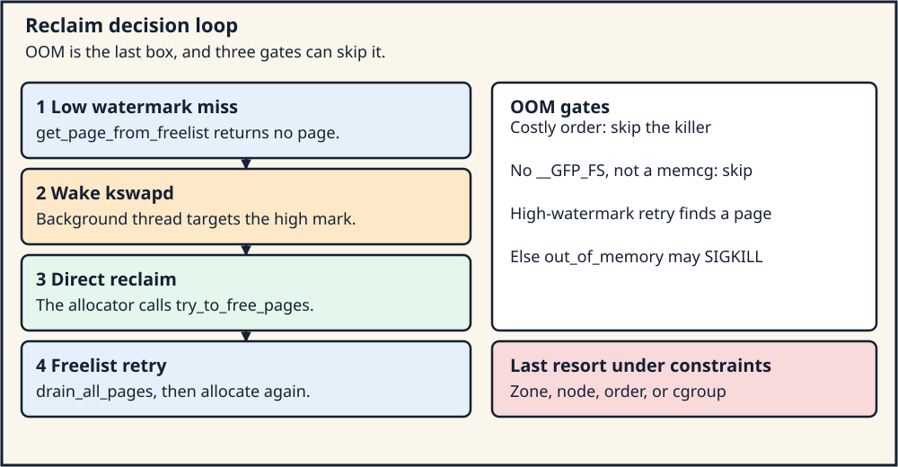
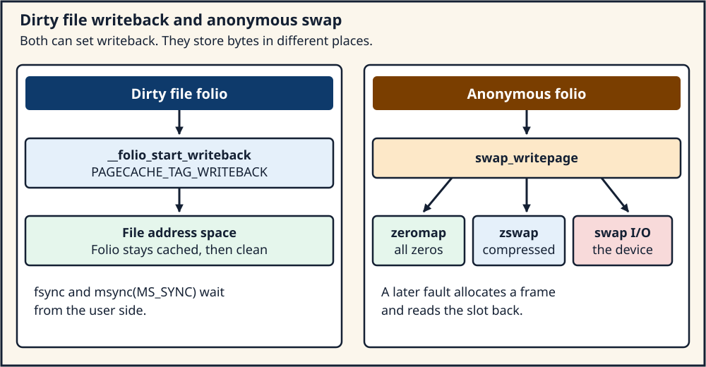

# Day 6 — Reclaim, Writeback, Swap, and the OOM Killer

**Target time:** approximately 3 hours

> Reclaim asks which pages can be turned into free frames. The OOM
> killer is what an eligible allocation does after reclaim has failed.
> A machine can take that path with plenty of RAM in the wrong zone,
> node, order, or cgroup.

The engineering tree is Linux 6.12, tag `v6.12`, commit
`adc218676eef25575469234709c2d87185ca223a`, at
`/home/jd/Documents/linux-6.12`. Linux 0.12 page numbers are printed
pages of Zhao Jiong, Chinese Revision 5 (2019).

## 1. Syntax: a list head, a reference, and a flag bit

A folio that reclaim may select sits on a list. The node is the same
`struct list_head` as Day 5: `next` and `prev`, embedded in the object.
The lists themselves live on the memory cgroup's LRU vector:

```c
/* tree adc218676eef (Linux 6.12)
 * path: include/linux/mmzone.h
 * lines: 276–282 and 608–609
 */
enum lru_list {
	LRU_INACTIVE_ANON = LRU_BASE,
	LRU_ACTIVE_ANON = LRU_BASE + LRU_ACTIVE,
	LRU_INACTIVE_FILE = LRU_BASE + LRU_FILE,
	LRU_ACTIVE_FILE = LRU_BASE + LRU_FILE + LRU_ACTIVE,
	LRU_UNEVICTABLE,
	NR_LRU_LISTS
};

struct lruvec {
	struct list_head		lists[NR_LRU_LISTS];
```

Five lists, not one. Anonymous pages and file pages are separate, and
each of those has an active and an inactive list. `LRU_UNEVICTABLE`
holds pages reclaim has been told not to take, such as pages locked
with `mlock`. A scan that "walks the LRU" walks one of these lists
under `lruvec->lru_lock`.

A reference count answers "how many users?" A flag bit answers "what
state?" The flag names in this tree are an enum that starts at bit 0:

```c
/* tree adc218676eef (Linux 6.12)
 * path: include/linux/page-flags.h
 * lines: 93–102
 */
enum pageflags {
	PG_locked,		/* Page is locked. Don't touch. */
	PG_writeback,		/* Page is under writeback */
	PG_referenced,
	PG_uptodate,
	PG_dirty,
	PG_lru,
	PG_head,		/* Must be in bit 6 */
	PG_waiters,		/* Must be bit #7 and in the same byte as PG_locked */
	PG_active,
```

In this enum, with no `#ifdef` between these enumerators, `PG_locked`
is bit 0, `PG_writeback` is bit 1, `PG_referenced` is bit 2, `PG_dirty`
is bit 4, `PG_lru` is bit 5, and the comments fix `PG_head` at bit 6 and
`PG_waiters` at bit 7. Later enumerators and other configurations add
bits above those. Quote the enum from the tree you build. Do not carry
the numbers into a different version by memory.

`PG_dirty` means the folio's contents are newer than the backing store.
`PG_writeback` means I/O has started. The comment at the top of the
header says `PG_dirty` is cleared when writeback starts. `PG_referenced`
and `PG_reclaim` are reclaim's marks. `PG_lru` means the folio is on
one of the lists. `PG_active` selects the active list rather than the
inactive one when generations are not in charge.

The reference count is not one of those bits. `post_alloc_hook` in Day
5's allocator sets the page refcounted when the buddy hands it out.
Reclaim drops its LRU reference only when it has a plan for every other
user: unmapped, not under writeback, and not held by a driver. A folio
with `PG_writeback` set is busy. Isolating it and freeing it immediately
would throw away I/O that has not finished.

A test in C is the same shape as the kernel's flag test. You mask one
bit and you leave the others alone:

```c
unsigned long flags = folio_flags;
int dirty = (flags >> 4) & 1ul; /* PG_dirty in this tree's enum */
```

Prefer `folio_test_dirty` in kernel code. The shift is here so the bit
number stays tied to the enum you just read.

## 2. Linux 0.12 first: a buffer cache, then a desperate scan

Linux 0.12 has two stores that can give a page back.

The buffer cache in `fs/buffer.c` (chapter 12.2) holds recently used
block-device blocks, hashed by device and block number, and linked on a
free list. A `bread` that hits the cache does not touch the device. A
miss allocates a buffer and reads the block. Dirty buffers are written
back when the cache reclaims them or when the system syncs. This cache
is a block cache. It is not the page cache `read` and `mmap` share in
Linux 6.12. The block size, the hash of 307 heads, and the placement of
the cache between the kernel image and main memory are historical.

The other store is the swap device. `get_free_page` calls `swap_out`
when `mem_map` has no free byte. `try_to_swap_out` (`mm/swap.c`, printed
page 906) looks at one page-table entry:

```c
int try_to_swap_out(unsigned long *table_ptr)
{
	unsigned long page = *table_ptr;
	unsigned long swap_nr;

	if (!(PAGE_PRESENT & page))
		return 0;
	if (page - LOW_MEM > PAGING_MEMORY)
		return 0;
	if (PAGE_DIRTY & page) {
		page &= 0xfffff000;
		if (mem_map[MAP_NR(page)] != 1)
			return 0;
		if (!(swap_nr = get_swap_page()))
			return 0;
		*table_ptr = swap_nr << 1;
		invalidate();
		write_swap_page(swap_nr, (char *) page);
		free_page(page);
		return 1;
	}
	*table_ptr = 0;
	invalidate();
	free_page(page);
	return 1;
}
```

Trace. A missing PTE is skipped. A dirty page that is shared
(`mem_map` byte not 1) is skipped. A dirty private page gets a swap
slot. The PTE is rewritten with `swap_nr << 1`, which leaves the
present bit clear, and the comment in the book says why: a present bit
of 0 lets the rest of the PTE hold a swap identity. `write_swap_page`
sends the page to the swap device. `free_page` drops the frame. A clean
page is simpler. The PTE is cleared and the frame is freed, because the
bytes can be read again from the executable image. `swap_out` walks
directory entries from task 1's range and returns 1 when one page moves.
If the walk finishes with nothing, it prints `Out of swap-memory`.
`oom()` in this kernel is the path that gives up on the current task.
There is no score across tasks.

What carries forward is the decision on one page: clean pages can be
dropped, dirty anonymous pages must be written somewhere first, and a
shared page is a poor victim. The historical details are the single
swap device, the PTE encoding `swap_nr << 1`, the `invalidate()` of the
whole TLB, and the call from `get_free_page` on the allocating CPU.
There is no kswapd, no separate file LRU, and no OOM killer that picks
a different task. The modern path is `try_to_free_pages`, `kswapd`,
`swap_writepage`, and `out_of_memory`.

## 3. Evolution: one cache, two LRUs, a background thread, a last resort

The buffer cache and the page cache duplicated the same file bytes when
a block and a page both cached them. Linux unified them: a file page is
a page-cache folio, and the block layer maps buffer heads onto that
folio when it needs block-sized I/O. Week 12 Day 3 and Day 6 already
use that cache for `read` and `mmap`. Reclaim now sees one object with
two reasons to be kept: a user mapping, and a cache that would save a
disk read.

The single scan of every PTE became lists of victims. Active and
inactive lists, for anonymous folios and for file folios, let reclaim
prefer pages that have not been used lately. Referenced pages get a
second chance. Unevictable pages leave the scan. That is the five-list
`enum lru_list` above. A reverse map exists because one folio can be
named by many PTEs. `try_to_unmap` is how reclaim clears those PTEs
when it has decided the folio may leave.

Multi-generation LRU is a further change, and it is configuration
dependent in this tree. `struct lruvec` contains `struct lru_gen_folio
lrugen` only inside `#ifdef CONFIG_LRU_GEN` (`include/linux/mmzone.h`
lines 625–632). `lru_gen_enabled()` has three bodies in
`include/linux/mm_inline.h`:

- `CONFIG_LRU_GEN` off: the function returns false (lines 296–299).
- `CONFIG_LRU_GEN` on and `CONFIG_LRU_GEN_ENABLED` on: a static key that
  defaults likely (lines 105–110).
- `CONFIG_LRU_GEN` on and `CONFIG_LRU_GEN_ENABLED` off: a static key that
  defaults unlikely (lines 113–118).

`shrink_node` calls `lru_gen_shrink_node` only when `lru_gen_enabled()`
is true and `root_reclaim(sc)` is true (`mm/vmscan.c` lines 5942–5944).
A kernel built without `CONFIG_LRU_GEN` walks the active and inactive
lists. A kernel built with the option still has to have the static key
on, and a memcg-scoped reclaim can take a different branch. Say "this
boot uses generations" only after you have read the config and the
runtime key. The lesson does not assume either answer.

Writeback became its own path. A dirty file folio is written to the
file's address space by the flusher, not by a swap device. The folio
stays in the page cache, clean, unless reclaim later drops it. A dirty
anonymous folio has no file. Swap, or a swap-like store such as zswap,
is the place the bytes go so the frame can be freed. Clean file pages
are the cheap victims. Dirty pages cost I/O. Anonymous pages cost swap
space. Reclaim prefers work it can finish.

The allocating thread is a bad place to do all of that work. kswapd is
a per-node kernel thread. The allocator wakes it when a zone is under
the watermark and the `gfp` mask allows `ALLOC_KSWAPD`. The allocating
thread tries the freelist again. If the zone is still short and the
mask allows direct reclaim, the allocator itself calls
`try_to_free_pages` and then retries. Direct reclaim is the stall the
faulting task feels. kswapd is the attempt to get ahead of that stall.

The OOM killer runs when an allocation that is allowed to invoke it has
not made progress. `__alloc_pages_may_oom` skips it for orders above
`PAGE_ALLOC_COSTLY_ORDER` (the comment at lines 3613–3615 says the
killer will not help higher-order allocations, and that the caller
likely has a fallback). It skips it when `__GFP_FS` is missing, inside
`out_of_memory`, except for a memcg OOM. It can do nothing useful when
no task is killable. A cgroup can hit its own limit while the rest of
the machine has free pages. A node can be below its watermark while
another node is idle, and the nodemask can forbid the idle node. A
high-order allocation can fail in a sea of order-0 pages. "OOM because
RAM is full" erases every one of those branches. The accurate sentence
is: the killer is the last resort of an allocation that already failed
reclaim under the constraints of its `gfp` mask, order, zonelist, and
cgroup.

## 4. ToyOS: failure stops at an empty bitmap

ToyOS `frame_alloc` returns 0 when every bit is set. Callers in
`memory.c` treat 0 as failure: `next_table` returns NULL, and a mapper
that cannot allocate a page-table page stops. There is no `swap_out`,
no kswapd, no writeback, and no task to kill. The physical memory the
bitmap manages is the memory `memory_init` marked free. When it is
gone, it is gone. An `EXPECTED-FAULT` line in the Week 7 profile is a
diagnosed fault in a kernel task. It is not an OOM kill.

That is a deliberate bound. It makes the frame allocator easy to test,
and it makes a fault under memory pressure a hard failure instead of a
reclaim story. The lesson to carry into Linux is the shape of the
failure, not a claim that stopping is what a general-purpose kernel
should do. Linux inserts reclaim between "the freelist missed" and
"the allocation returns NULL or kills a task." ToyOS has no place to
insert it.

## 5. The slow path: wake kswapd, then maybe reclaim in line

Day 5's fast path returns NULL from `get_page_from_freelist`.
`__alloc_pages_slowpath` continues. When the flags include
`ALLOC_KSWAPD`, it wakes every relevant kswapd:

```c
/* tree adc218676eef (Linux 6.12)
 * path: mm/page_alloc.c
 * lines: 4345–4348
 * function: __alloc_pages_slowpath
 */
retry:
	/* Ensure kswapd doesn't accidentally go to sleep as long as we loop */
	if (alloc_flags & ALLOC_KSWAPD)
		wake_all_kswapds(order, gfp_mask, ac);
```

`wake_all_kswapds` (lines 3973–3989) walks the zonelist and calls
`wakeup_kswapd` once per node. The thread that wakes is the allocator.
The thread that runs is `kswapd` (`mm/vmscan.c` line 7165). It sets
`PF_MEMALLOC | PF_KSWAPD` so its own tiny allocations do not recurse
into reclaim, then loops on `kswapd_try_to_sleep`.

`prepare_kswapd_sleep` (lines 6711–6739) returns true, allowing sleep,
when `pgdat_balanced` says so or when `kswapd_failures` has reached
`MAX_RECLAIM_RETRIES`. `pgdat_balanced` (lines 6659–6680) walks zones
bottom-up. The mark is `high_wmark_pages(zone)`, unless
`NUMA_BALANCING_MEMORY_TIERING` is set in `sysctl_numa_balancing_mode`,
in which case the mark is `promo_wmark_pages(zone)`. One zone that
meets the mark balances the node for this test. A node that never meets
it is left to direct reclaim after too many failures. The high
watermark is the usual target. The tiering promotion watermark is the
config-dependent substitute. Neither target is "all RAM in use."

Direct reclaim is the allocating context's own attempt:

```c
/* tree adc218676eef (Linux 6.12)
 * path: mm/page_alloc.c
 * lines: 3940–3966
 * function: __alloc_pages_direct_reclaim
 */
	psi_memstall_enter(&pflags);
	*did_some_progress = __perform_reclaim(gfp_mask, order, ac);
	if (unlikely(!(*did_some_progress)))
		goto out;

retry:
	page = get_page_from_freelist(gfp_mask, order, alloc_flags, ac);
	if (!page && !drained) {
		unreserve_highatomic_pageblock(ac, false);
		drain_all_pages(NULL);
		drained = true;
		goto retry;
	}
```

`__perform_reclaim` reaches `try_to_free_pages` (`mm/vmscan.c` lines
6478–6518). The `scan_control` starts with `nr_to_reclaim =
SWAP_CLUSTER_MAX`, `may_writepage = !laptop_mode`, `may_unmap = 1`, and
`may_swap = 1`. Priority starts at `DEF_PRIORITY` and the scan grows
more aggressive as priority falls. `throttle_direct_reclaim` can return
early with the value 1 so the caller does not treat "we were throttled
because of a fatal signal" as "reclaim found nothing" and then OOM.
That return value is a progress flag, not a page.

`shrink_node` is the per-node body. With generations enabled at the
root, it delegates to `lru_gen_shrink_node` and returns. Otherwise it
calls `shrink_node_memcgs`, which shrinks the active/inactive lists.
Inside `shrink_folio_list`, a dirty file folio can reach `pageout`
(the call is at line 1367) and an anonymous folio can reach
`add_to_swap` (lines 1247 and 1263). Those calls are the file exit and
the anonymous exit. They still depend on `may_writepage`, the `gfp`
mask, and whether the folio is already under writeback:

```c
/* tree adc218676eef (Linux 6.12)
 * path: mm/vmscan.c
 * lines: 1088–1098
 * function: shrink_folio_list (folio loop)
 */
		if (lru_gen_enabled() && !ignore_references &&
		    folio_mapped(folio) && folio_test_referenced(folio))
			goto keep_locked;

		folio_check_dirty_writeback(folio, &dirty, &writeback);
		if (dirty || writeback)
```

A referenced mapped folio can be kept when generations are on. A dirty
folio is a candidate for writeback, not an instant free frame. The
comment a few lines later (lines 1327–1338 in the same file) says only
kswapd may write back filesystem folios in that part of the path.
Direct reclaim of a dirty file page often kicks the flusher and moves
on, because the allocating thread may be holding locks that make
writeback unsafe. Read the branch you hit. The durable rule is that
dirty data is written or kept, and a clean unmapped file folio can be
discarded.

## 6. Writeback and swap are different exits

A file folio that is being written enters `__folio_start_writeback`:

```c
/* tree adc218676eef (Linux 6.12)
 * path: mm/page-writeback.c
 * lines: 3113–3135
 * function: __folio_start_writeback
 */
void __folio_start_writeback(struct folio *folio, bool keep_write)
{
	long nr = folio_nr_pages(folio);
	struct address_space *mapping = folio_mapping(folio);

	VM_BUG_ON_FOLIO(folio_test_writeback(folio), folio);

	folio_memcg_lock(folio);
	if (mapping && mapping_use_writeback_tags(mapping)) {
		XA_STATE(xas, &mapping->i_pages, folio_index(folio));
		/* lock, load the slot, then: */
		folio_test_set_writeback(folio);
		xas_set_mark(&xas, PAGECACHE_TAG_WRITEBACK);
```

The address space is the file's. The xarray mark is how the flusher
finds folios already under I/O. The folio remains a page-cache folio.
When the I/O completes, writeback clears and the folio is clean. Reclaim
may drop it later. `fsync` and `msync(MS_SYNC)` from Week 12 wait for
this I/O from the user's side. Reclaim starts a similar I/O for a
different reason: it wants the frame, or it wants the folio clean so a
later scan can drop it.

An anonymous folio's backing store, if it gets one, is swap.
`swap_writepage` (`mm/page_io.c` lines 241–279) takes the folio, drops
the swap slot again if the folio can be freed without I/O
(`folio_free_swap`), rejects the write when `arch_prepare_to_swap`
fails, and may avoid disk entirely:

```c
/* tree adc218676eef (Linux 6.12)
 * path: mm/page_io.c
 * lines: 261–280
 * function: swap_writepage
 */
	if (is_folio_zero_filled(folio)) {
		swap_zeromap_folio_set(folio);
		folio_unlock(folio);
		return 0;
	} else {
		swap_zeromap_folio_clear(folio);
	}
	if (zswap_store(folio)) {
		folio_unlock(folio);
```

A zero-filled folio can be recorded in a bitmap instead of written.
`zswap_store` can accept the folio into a compressed pool. Either
success returns before the block device. A folio that misses both
continues to swap I/O. The PTE, or the swap map, remembers how to bring
the bytes back. The next fault that needs them allocates a frame and
reads the slot. That fault is a major fault. `getrusage` counts it in
`ru_majflt`. Day 7 reads the counter.

`arch_prepare_to_swap` is the architecture hook. The comment above it
says the architecture may have to preserve more than the page bytes,
for example memory tags. The generic policy — "this anonymous folio may
leave RAM" — stays in mm/. The extra bytes are an architecture
obligation. x86-64 without tags has little to add. An AArch64 build with
memory tagging has a real hook. The reclaim decision does not move into
the ISA.

## 7. OOM is a locked, retried, constrained last step

After direct reclaim fails to help, `__alloc_pages_may_oom` runs for
allocations that reached it:

```c
/* tree adc218676eef (Linux 6.12)
 * path: mm/page_alloc.c
 * lines: 3597–3615
 * function: __alloc_pages_may_oom
 */
	page = get_page_from_freelist((gfp_mask | __GFP_HARDWALL) &
				      ~__GFP_DIRECT_RECLAIM, order,
				      ALLOC_WMARK_HIGH|ALLOC_CPUSET, ac);
	if (page)
		goto out;

	if (current->flags & PF_DUMPCORE)
		goto out;
	/* The OOM killer will not help higher order allocs */
	if (order > PAGE_ALLOC_COSTLY_ORDER)
		goto out;
```

The freelist is tried again at the high watermark, without direct
reclaim, under `oom_lock`. A page found here means someone else already
freed memory. A core dump skips the killer. A costly order skips the
killer. The function then calls `out_of_memory`.

`out_of_memory` (`mm/oom_kill.c` lines 1107–1175) returns immediately
when the killer is disabled. A notifier that freed pages can satisfy a
global OOM without a kill. A task that is already exiting is marked as
the victim so it can finish and release its mm. An allocation without
`__GFP_FS` returns true without killing, except inside a memcg, because
the killer's own work may need filesystem locks the caller cannot take.
`constrained_alloc` records whether the failure is a cgroup, a cpuset, a
memory policy, or the whole system. `select_bad_process` scores
candidates. A kill sends `SIGKILL`. The victim's pages come back as the
task exits, which is asynchronous. The allocating thread retries. It
does not receive the victim's pages as a return value.

`pagefault_out_of_memory` (line 1184) exists because a fault can fail
its allocation too. The comment says the global killer is the
allocation context's job, and this hook exists so the memcg case has a
safe place to run. A user-space `SIGSEGV` from an unmapped address is a
different event. It is not the OOM killer. Day 7's child fault is that
different event, on purpose.

## 8. Execution trace: a slow order-0 allocation

1. `__alloc_pages_noprof` misses `get_page_from_freelist` at the low
   watermark. `__alloc_pages_slowpath` runs.
2. `wake_all_kswapds` wakes the node thread if `ALLOC_KSWAPD` is set.
   kswapd enters `balance_pgdat` and `shrink_node` until
   `pgdat_balanced` sees a zone at the high watermark, or until it
   gives up.
3. The allocator tries the freelist again. On another miss, and if the
   `gfp` mask allows it, `__alloc_pages_direct_reclaim` calls
   `try_to_free_pages`.
4. `shrink_node` either calls `lru_gen_shrink_node` or walks the
   inactive lists. A clean file folio that is unmapped is freed back
   toward the buddy. A dirty file folio is handed toward `pageout` and
   `__folio_start_writeback`, mostly by waking the flusher when the
   allocator itself must not start filesystem I/O. A cold anonymous
   folio is passed toward `add_to_swap` and `swap_writepage`, which may
   end in the zeromap, in zswap, or in swap I/O.
5. `drain_all_pages` pulls per-CPU lists back to the buddy so a page
   that was free but cached on another CPU becomes visible. The freelist
   is tried again.
6. If the order is above `PAGE_ALLOC_COSTLY_ORDER`, the path can fail
   the allocation without `out_of_memory`. Compaction may have been
   tried to build a high-order block from free order-0 pages. Failure
   here is fragmentation plus pressure, and the caller sees NULL.
7. If the order is small and the other gates pass, `__alloc_pages_may_oom`
   takes `oom_lock`, retries at the high watermark, and calls
   `out_of_memory`. A chosen task receives `SIGKILL`. The allocator
   retries. The original caller either receives a page or, if the kill
   did not free a usable page under the same constraints, continues the
   slow path's retry logic until it succeeds or gives up under
   `__GFP_NORETRY` or a fatal signal.

Step 7 is rare on a quiet machine. Manufacturing it in a lab is how
people lose unrelated work. Section 10 reads the counters that would
move if it happened, and it does not make it happen.

## 9. Two pictures



*Figure 1. kswapd and direct reclaim are different contexts. The OOM
killer sits after they fail, and several gates can skip it.*



*Figure 2. Both paths set writeback state when I/O starts. They write
different stores, and a zero anonymous folio may write neither.*

## 10. A lab that reads counters and creates no pressure

The wrapper is
[`../challenges/day-006-reclaim.sh`](../challenges/day-006-reclaim.sh).
It builds `projects/linux-vm` `reclaim_lab` and runs a teaching LRU on
four frames and two swap slots. The pass line is a simulator result:
one dirty file page written back, one clean file page dropped, two
anonymous pages swapped, then a refusal that prints
`simulated_oom_choice=task_b` and `oom_kills_host_process=no`. That
policy is not `shrink_folio_list`, and it is not memcg OOM. The host's
`pswpin`, `pswpout`, and OOM killer must stay untouched.

The program below is the host observation that stays inside that limit.
Read the counters. Do not allocate a large buffer, do not start a
stress tool, and do not tune `vm.overcommit_memory`.

```c
#define _POSIX_C_SOURCE 200809L
#include <stdio.h>
#include <string.h>

static void show_match(const char *path, const char *key)
{
	FILE *fp = fopen(path, "re");
	char line[256];

	if (!fp) {
		perror(path);
		return;
	}
	while (fgets(line, sizeof line, fp)) {
		if (strncmp(line, key, strlen(key)) == 0)
			fputs(line, stdout);
	}
	fclose(fp);
}

int main(void)
{
	const char *mem[] = {
		"MemTotal:", "MemFree:", "MemAvailable:",
		"Buffers:", "Cached:", "SwapTotal:", "SwapFree:", "Dirty:"
	};
	const char *vm[] = {
		"pgscan_kswapd ", "pgsteal_kswapd ",
		"pgscan_direct ", "pgsteal_direct ",
		"oom_kill ", "nr_dirty ", "pswpout "
	};
	unsigned i;

	puts("== meminfo");
	for (i = 0; i < sizeof mem / sizeof mem[0]; i++)
		show_match("/proc/meminfo", mem[i]);
	puts("== vmstat");
	for (i = 0; i < sizeof vm / sizeof vm[0]; i++)
		show_match("/proc/vmstat", vm[i]);
	puts("Record the numbers. Do not try to move oom_kill.");
	return 0;
}
```

`MemAvailable` is an estimate the kernel publishes for "how much could
be given out without going into deep reclaim." It is not a watermark,
and it is not a promise that an allocation of that size will succeed.
`Cached` counts page-cache pages that are often reclaimable and still
in use. `pgscan_kswapd` and `pgscan_direct` tell you which context has
been scanning. A zero `oom_kill` on a desktop that is working is the
expected reading. A non-zero value is a historical count since boot, so
quote the number and the boot, and do not treat it as a live emergency
by itself.

Predict that this program will not change `oom_kill`. Predict that
`Cached` will be non-zero on a machine that has read files. If a key is
absent, record its absence. The strings above match this 6.12 tree's
`mm/vmstat.c` counter texts (`pgscan_kswapd`, `pgsteal_kswapd`, and the
direct-reclaim counterparts, around lines 1304–1310 and 1331). If your
running kernel is older or newer than the tree you read, a missing key
is a version fact, not a failed lab.

## 11. Mastery: Explain · Draw · Observe · Build

The exercise is
[`../challenges/day-006-reclaim.sh`](../challenges/day-006-reclaim.sh).

### Explain

- What Linux 0.12 does with a clean PTE and with a dirty private PTE
  inside `try_to_swap_out`.
- Why the buffer cache and the unified page cache are different designs.
- When `shrink_node` calls `lru_gen_shrink_node`, and which three
  `CONFIG_` and static-key states `lru_gen_enabled` covers.
- What `pgdat_balanced` compares against, including the tiering branch.
- Why `swap_writepage` and `__folio_start_writeback` are different
  exits, and where the zeromap and zswap sit.
- Where `shrink_folio_list` calls `pageout` and `add_to_swap`.
- Which checks in `__alloc_pages_may_oom` and `out_of_memory` return
  without killing a task.

### Draw

Draw Figure 1 as a loop: watermark, kswapd, freelist retry, direct
reclaim, freelist retry, OOM gate. On the OOM gate, write three skips:
costly order, missing `__GFP_FS` outside a memcg, and a high-watermark
retry that finds a page. Draw Figure 2 under the reclaim box.

### Observe

Run the wrapper. Record the simulator counts and
`oom_kills_host_process=no`. Separately record `MemAvailable`,
`Cached`, `SwapFree`, `pgscan_kswapd`, `pgscan_direct`, and `oom_kill`
from the host, and say the host counters were not the target of the
simulator. Record whether the running config enables `CONFIG_LRU_GEN`
if you can read it. If you cannot, say so.

### Build

Write a one-page trace of one order-0 `GFP_KERNEL` allocation that
misses the low watermark, using `wake_all_kswapds`, `try_to_free_pages`,
`shrink_node`, and `__alloc_pages_may_oom`. End with the sentence you
will use when someone says the OOM killer runs because RAM is full: the
killer runs for an allocation that failed reclaim under its own order,
mask, zonelist, and cgroup, and several of those constraints return
before any task is chosen.
