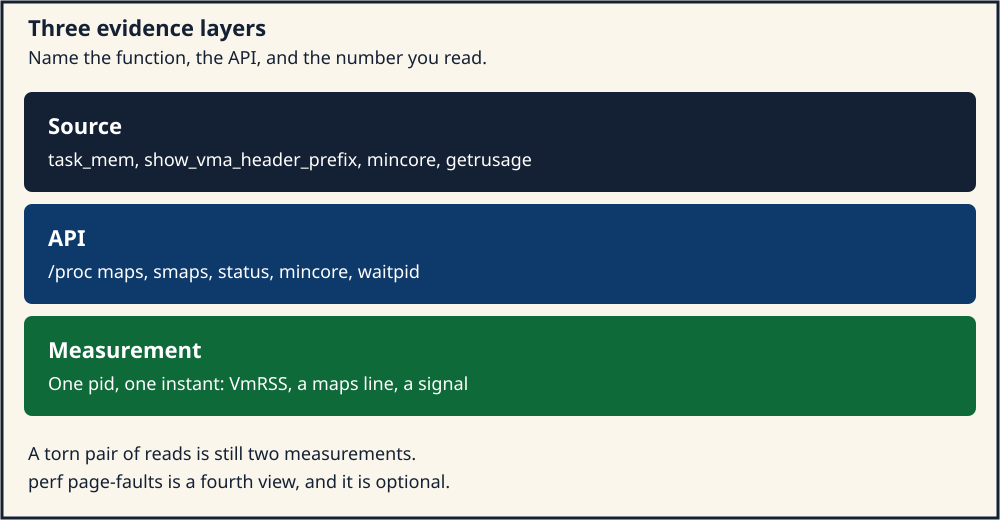
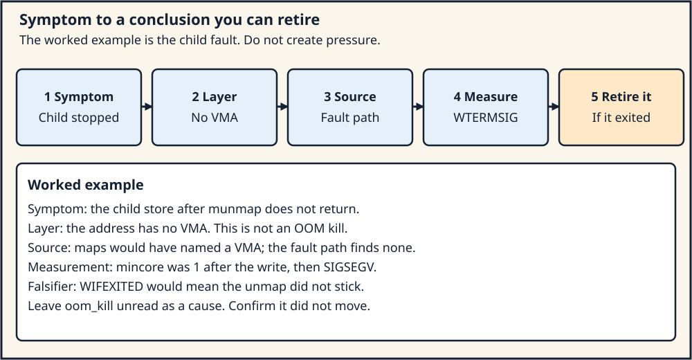

# Day 7 — Virtual-Memory Observation and a Debugging Report

**Target time:** approximately 3 hours

> A virtual-memory bug becomes an explanation when a symptom, a source
> path, and a measurement name the same layer. Counters from a different
> layer are evidence about that layer, and they stay labeled as such.

The engineering tree is Linux 6.12, tag `v6.12`, commit
`adc218676eef25575469234709c2d87185ca223a`, at
`/home/jd/Documents/linux-6.12`. Linux 0.12 page numbers are printed
pages of Zhao Jiong, Chinese Revision 5 (2019). Today's lab faults one
child on purpose and reads counters. It does not create memory pressure.

## 1. Syntax: a text line, a wait status, and a residency byte

`/proc` files are text. The reader splits on a key and treats the value
as a snapshot. A snapshot can tear: `task_mem` says the high-water marks
are updated only when a total is about to fall, and that a collector
can observe an inconsistent pair. You record the instant and you avoid
adding numbers from two reads as if they were one sample.

```c
char line[256];
FILE *fp = fopen("/proc/self/status", "re");
while (fgets(line, sizeof line, fp)) {
	if (strncmp(line, "VmRSS:", 6) == 0)
		fputs(line, stdout);
}
```

`strncmp` on the key is the whole parser this lab needs. The value is
kilobytes because the kernel shifted a page count by `PAGE_SHIFT - 10`
before printing. A program that treats the field as bytes is off by
1024. `/proc/self` is this process. `/proc/vmstat` is the machine.
`perf stat` around one command is that command, plus whatever the tool
could not open. A `SKIP` line is a result. It is not a zero.

A child that faults does not return an `errno` to the parent. It stops
with a signal. `waitpid` fills an `int`. The macros in `<sys/wait.h>`
are the contract:

```c
int status = 0;
waitpid(pid, &status, 0);
if (WIFSIGNALED(status)) {
	int sig = WTERMSIG(status);
	/* SIGSEGV is the usual unmapped-address signal */
}
```

`WIFEXITED` and `WEXITSTATUS` describe a child that called `_exit`.
`WIFSIGNALED` and `WTERMSIG` describe a child the kernel delivered a
signal to. Using the exit macros on a signal status yields a number
that is not the signal. The report names which macro matched.

`mincore` fills one byte per page. The syscall checks alignment and
the user range:

```c
/* tree adc218676eef (Linux 6.12)
 * path: mm/mincore.c
 * lines: 232–247
 * function: mincore
 */
SYSCALL_DEFINE3(mincore, unsigned long, start, size_t, len,
		unsigned char __user *, vec)
{
	long retval;
	unsigned long pages;
	unsigned char *tmp;

	start = untagged_addr(start);

	/* Check the start address: needs to be page-aligned.. */
	if (start & ~PAGE_MASK)
		return -EINVAL;

	/* ..and we need to be passed a valid user-space range */
	if (!access_ok((void __user *) start, len))
		return -ENOMEM;
```

Inside the walk, a present PTE stores `1` in the vector
(`mm/mincore.c` lines 128–129). An anonymous hole stores `0` (lines
84–86). A swap entry may consult the swap cache when `CONFIG_SWAP` is
on (lines 130–142). Userspace is entitled to the low bit: 1 means
resident in the sense this syscall reports, 0 means it does not.
Higher bits are not a portable field. A byte of `1` after you have
written the page, and a byte of `0` before a write on a fresh anonymous
mapping, is the observation Day 4's zero-page and private-folio split
predicts for a write. A read can be resident through the zero page, so
a `1` after a read does not by itself prove a private folio. Say which
access you performed.

`getrusage` fills a `struct rusage`. The faults the kernel adds are
`ru_minflt` and `ru_majflt` (`kernel/sys.c` lines 1836–1837 for the
thread-group path). `ru_maxrss` is converted from pages to kilobytes at
line 1875: `maxrss * (PAGE_SIZE / 1024)`. Minor faults include faults
the kernel satisfied without submitting I/O. Major faults include
faults that waited for I/O, such as a page read back from swap or from
a file that was not in the cache. The man page and this structure are
the API. The decision of which fault increments which counter sits in
the fault handler. Quote the counter you read, and name the access that
you believe caused it.

## 2. Linux 0.12 first: one screen of `mem_map` counts

Linux 0.12 has no `/proc/pid/maps`. The observation tool is `show_mem`
in `mm/memory.c`, printed page 899. `mem_init` marks every `mem_map`
byte `USED` and then clears the bytes that cover the main-memory area.
`show_mem` walks that array, counts free and shared pages, and prints
them. The book says the function runs from `chr_drv/keyboard.S` when
Shift+Scroll Lock is pressed. A fault's other evidence is the address
the CPU saved and the `printk` from the fault path or from `oom()`.

The stable idea is a kernel-side census of frames: how many are free,
how many are shared, taken from the same array the allocator updates.
The historical details are the keyboard trigger, the byte array, and
the absence of any per-process address-space listing. You cannot ask
0.12 which virtual range a process owns, because the task's memory is
the segment bases plus the page tables, and nothing formats them as
text for a shell. The modern census of frames is `/proc/vmstat` and
`/proc/zoneinfo`. The modern census of one process is `/proc/pid/maps`,
`smaps`, and `status`. Day 5 and Day 6 own the frame and reclaim
counters. Today owns the process view, and the habit of saying which
view a number came from.

## 3. Evolution: from a keyboard dump to three files and two syscalls

A process address space became a list of VMAs. Once that list existed,
printing it was more useful than printing only `mem_map`. `maps` is the
list: start, end, permissions, offset, device, inode, and a name.
`smaps` is the same list plus resident, proportional, dirty, and swap
accounting per VMA. `status` is the mm rolled into a few totals:
`VmSize`, `VmRSS`, `RssAnon`, `RssFile`, `VmData`, `VmStk`. The split
matches the questions. "Did the mapping appear?" is `maps`. "Did the
pages become resident, and are they private?" is `smaps`. "How big is
the process, approximately?" is `status`. Adding them together from
different instants invents a total nobody computed.

`mincore` and `getrusage` are syscalls rather than files. `mincore`
answers a question about a range the caller already has mapped, in the
caller's own mm. `getrusage` answers a question about fault counts and
CPU time accumulated for the process or its children. `perf stat`, when
the tool is installed, can count the same faults from outside by asking
the performance counters for `page-faults`. It is optional. A missing
`perf` binary, or a `SKIP` from the wrapper, is recorded as "tool
absent." It is not a failed measurement of `/proc`, and it is not proof
that no fault happened.

The files are a Linux interface. They are not POSIX. A lab report that
says "the operating system" when it means `/proc/self/smaps` has named
the wrong layer. The source that prints the file is the layer below the
interface. The number you read on this boot is the layer above it.
Using a machine-wide `pgfault` to explain one load in this process
mixes those scopes.

## 4. ToyOS: a serial line instead of `/proc`

ToyOS has no procfs. `memory_init` in `projects/toyos/src/memory.c`
prints `free_frames` on the serial port after it has marked the
available ranges. That count is the bitmap census, the same role as
0.12 `show_mem`, with a bit per frame and a boot-time call instead of a
keyboard chord. Week 7's injected fault prints an `EXPECTED-FAULT` line
when the profile asks for it. That line is a diagnosed fault in a
kernel task. It is not a demand-paged user process, and it is not an
OOM kill.

A fault in ToyOS is an exception the kernel prints through its own
handler. Week 6 built that path. There is no parent `waitpid`, because
the teaching profile's user process does not have a POSIX parent
collecting a signal code. The report you write today needs a parent,
a status word, and a file. ToyOS gives you the idea of "print the
allocator's own counter from inside the kernel." Linux gives you that
counter already printed, plus a second set of counters that describe
one mm. The comparison sentence for this week is concrete: ToyOS still
has no VMA list, no buddy, no swap, and no OOM killer. Keep the serial
number and the `/proc` number in different columns when you compare the
two systems.

## 5. Linux 6.12: who prints `maps`, `smaps`, and `status`

`/proc/pid/maps` is `proc_pid_maps_operations`. The show function calls
`show_map_vma` (`fs/proc/task_mmu.c` lines 325–358). The header is one
line of addresses and permission letters:

```c
/* tree adc218676eef (Linux 6.12)
 * path: fs/proc/task_mmu.c
 * lines: 304–321
 * function: show_vma_header_prefix
 */
static void show_vma_header_prefix(struct seq_file *m,
				   unsigned long start, unsigned long end,
				   vm_flags_t flags, unsigned long long pgoff,
				   dev_t dev, unsigned long ino)
{
	seq_setwidth(m, 25 + sizeof(void *) * 6 - 1);
	seq_put_hex_ll(m, NULL, start, 8);
	seq_put_hex_ll(m, "-", end, 8);
	seq_putc(m, ' ');
	seq_putc(m, flags & VM_READ ? 'r' : '-');
	seq_putc(m, flags & VM_WRITE ? 'w' : '-');
	seq_putc(m, flags & VM_EXEC ? 'x' : '-');
	seq_putc(m, flags & VM_MAYSHARE ? 's' : 'p');
	seq_put_hex_ll(m, " ", pgoff, 8);
	seq_put_hex_ll(m, " ", MAJOR(dev), 2);
	seq_put_hex_ll(m, ":", MINOR(dev), 2);
	seq_put_decimal_ull(m, " ", ino);
	seq_putc(m, ' ');
}
```

`VM_MAYSHARE` selects the `s` or `p` letter. That letter is a sharing
permission, the distinction Week 12 Day 6 drew between a shared file
mapping and a private one. It is not the residency bit. A line with
`rw-p` and no pathname is an anonymous private VMA. `[heap]` is the
name `get_vma_name` supplies when `vma_is_initial_heap` is true (lines
287–289). `[stack]` is the initial stack. A mapping the allocator
created with `mmap` may have neither name. Absence of `[heap]` means
this VMA is not the initial heap. It does not mean the process has no
anonymous memory.

`smaps` reprints that header and then `Size`, which is `vm_end -
vm_start` (line 1147), and the block from `__show_smap`:

```c
/* tree adc218676eef (Linux 6.12)
 * path: fs/proc/task_mmu.c
 * lines: 1098–1116
 * function: __show_smap
 */
	SEQ_PUT_DEC("Rss:            ", mss->resident);
	SEQ_PUT_DEC(" kB\nPss:            ", mss->pss >> PSS_SHIFT);
	SEQ_PUT_DEC(" kB\nPss_Dirty:      ", mss->pss_dirty >> PSS_SHIFT);
	if (rollup_mode) {
		SEQ_PUT_DEC(" kB\nPss_Anon:       ",
			mss->pss_anon >> PSS_SHIFT);
		SEQ_PUT_DEC(" kB\nPss_File:       ",
			mss->pss_file >> PSS_SHIFT);
		SEQ_PUT_DEC(" kB\nPss_Shmem:      ",
			mss->pss_shmem >> PSS_SHIFT);
	}
```

`Rss` is pages resident in this VMA, scaled to kilobytes by
`SEQ_PUT_DEC`. `Pss` is the proportional share: a page shared by four
processes contributes a fraction to each. The rollup mode adds the
anon, file, and shmem split, and those three lines are meaningful for
`smaps_rollup`. On a per-VMA `smaps` the kernel still prints `Rss` and
`Pss` for that VMA. `Swap` in the same function (line 1130) is pages
that have been swapped out and are still charged to the VMA. A zero
`Swap` field means this snapshot shows no swapped pages for that range.
It does not mean the system has no swap device. `SwapTotal` in
`meminfo` is the device. The VMA field is the process.

`status` comes from `task_mem` (line 34). The RSS line is the sum of
three mm counters:

```c
/* tree adc218676eef (Linux 6.12)
 * path: fs/proc/task_mmu.c
 * lines: 39–72
 * function: task_mem
 */
	anon = get_mm_counter(mm, MM_ANONPAGES);
	file = get_mm_counter(mm, MM_FILEPAGES);
	shmem = get_mm_counter(mm, MM_SHMEMPAGES);
	hiwater_rss = total_rss = anon + file + shmem;
	SEQ_PUT_DEC("VmPeak:\t", hiwater_vm);
	SEQ_PUT_DEC(" kB\nVmSize:\t", total_vm);
	SEQ_PUT_DEC(" kB\nVmLck:\t", mm->locked_vm);
	SEQ_PUT_DEC(" kB\nVmPin:\t", atomic64_read(&mm->pinned_vm));
	SEQ_PUT_DEC(" kB\nVmHWM:\t", hiwater_rss);
	SEQ_PUT_DEC(" kB\nVmRSS:\t", total_rss);
	SEQ_PUT_DEC(" kB\nRssAnon:\t", anon);
	SEQ_PUT_DEC(" kB\nRssFile:\t", file);
	SEQ_PUT_DEC(" kB\nRssShmem:\t", shmem);
	SEQ_PUT_DEC(" kB\nVmData:\t", mm->data_vm);
```

`VmSize` is `mm->total_vm`, virtual pages. `VmRSS` is resident pages
across anonymous, file, and shmem. `VmData` is `mm->data_vm`, which Day
4's `do_brk_flags` increments when the brk VMA grows. A `brk` that
extends the heap can move `VmData` and `VmSize` before the first write
moves `RssAnon`. That lag is the measurement form of "the VMA exists
and the folio does not yet." `VmHWM` is a high-water mark, and the
comment at lines 43–48 says it can disagree with the current total
because it is refreshed lazily. Quote `VmRSS` for "now" and `VmHWM` for
"the peak this mm has recorded."

The fault handler's own accounting is a different function.
`handle_mm_fault` calls `mm_account_fault` before it returns
(`mm/memory.c` line 6103). That updates kernel counters. It does not
format `/proc/self/status`. `/proc/vmstat` keys such as `pgfault` and
`pgmajfault` are machine totals built from those counters.
`pswpin` and `pswpout` are swap traffic for the machine. Reading them
after a lab is an observation of the machine. It is not a request to
move them.

`/proc/vmstat` is the machine, not the process. Day 6 listed
`pgscan_kswapd`, `pgscan_direct`, and `oom_kill`. A debugging report
that pastes those next to `VmRSS` labels each column. A climb in
`pgscan_direct` during a stall is a reclaim fact. A climb in `VmRSS`
after a write is a residency fact. One does not explain the other
unless the trace shows the allocation entered the slow path.

## 6. Three layers, and the fault the child is allowed to take

Keep the layers in order when you write.

The source layer is the tree. `show_vma_header_prefix`, `__show_smap`,
`task_mem`, `mincore`, `getrusage`, and `mm_account_fault` are functions
you can cite with a path and a line. A report that says "Linux tracks
RSS" without a function has not reached this layer.

The API layer is what a program may call or read. `mincore` returns
`-EINVAL` for an unaligned start. `getrusage` with `RUSAGE_SELF` fills
the calling process. `waitpid` fills a status word. `/proc/self/maps`
is a file the process may open. These contracts are in the man pages
and in the syscall checks. They are stable relative to the source only
for the kernel you are running. A field this tree prints can be absent
on a different version. The lab records the running `uname -r` beside
the tree id.

The measurement layer is one read. It has a timestamp, a pid, and a
value. It can be torn. It can be zero because the event has not
happened, or zero because the counter has another name on this kernel.
The report says which.

The deliberate fault stays inside a child so the parent can record the
status and exit. The child maps one anonymous page, writes it, unmaps
it, and writes again. The second write has no VMA. The user fault path
finds no VMA and the process receives `SIGSEGV`. That signal is not
`pagefault_out_of_memory`. Nothing in the child allocates until
failure, and the parent allocates only the small buffers in section 8.
`oom_kill` is not the subject of this experiment. If it changes, you
were not looking at this child.

## 7. Architecture lens: the signal is portable, the fault register is not

`SIGSEGV` for an unmapped user address is the Linux userspace result on
x86-64, AArch64, and RISC-V. The register the kernel read to classify
the fault is not portable. x86-64 supplies a page-fault error code and
the fault address in `CR2`. AArch64 supplies an ESR_ELx syndrome and a
FAR. RISC-V supplies `scause` and `stval`. The generic mm code turns
those into a `vm_fault` and a signal. A report written from userspace
cites `WTERMSIG` and the address the child was told to touch. A report
written from a kernel stack cites the architecture register and then
the generic function. Mixing "the ESR" into an x86-64 lab, or "CR2"
into an AArch64 lab, names a machine you are not running. Linux 0.12's
console fault address is the 80386 `CR2` of that kernel.

`mincore`'s `untagged_addr` at the start of the syscall matters on
architectures that store a tag in the high bits of a pointer. On a
machine without tags it is an identity. The residency byte means the
same thing either way: what the walk found in this mm. The page size
that divides `len` is `PAGE_SIZE` of the running kernel. A vector
indexed as if pages were 4 KiB on a 16 KiB AArch64 granule counts the
wrong number of entries. `sysconf(_SC_PAGESIZE)` is the userspace query.
Use it.

`perf` event names are a tool convention on top of the architecture's
performance counters. `page-faults` is a software event the kernel
emits. It is available when the tool and the kernel agree. It is
optional in this lab because the parent already learns that a fault
became `SIGSEGV` from `waitpid`, and it learns minor and major counts
from `getrusage`. `perf` is a third view of the same event class when
you have it.

## 8. A parent, a child, and a page that is resident and then gone

The wrapper is
[`../challenges/day-007-vm-debug-report.sh`](../challenges/day-007-vm-debug-report.sh).
It writes `projects/linux-vm/build/week13-report.txt`, runs the course
`debug_lab`, and may skip `perf` or `vmstat`. `debug_lab` checks one
anonymous mapping, a zero-fill, a store, and an `smaps` Rss of one
page. It prints `pressure_induced=no`. The limit line is the contract:
no host reclaim, no host swap, and no OOM kill. A `WEEK13 PASS` means
the markers matched. It does not mean the report explained
`shrink_folio_list`.

The program below is the child fault that kind of report is about.
Compile it with `cc -std=c17 -Wall -Wextra -Werror`. Run it once. Do
not wrap it in a loop that forks thousands of children.

```c
#define _DEFAULT_SOURCE
#include <errno.h>
#include <signal.h>
#include <stdio.h>
#include <stdlib.h>
#include <string.h>
#include <sys/mman.h>
#include <sys/resource.h>
#include <sys/wait.h>
#include <unistd.h>

static void child_fault(void)
{
	long page = sysconf(_SC_PAGESIZE);
	volatile char *p = mmap(NULL, (size_t)page, PROT_READ | PROT_WRITE,
				MAP_PRIVATE | MAP_ANONYMOUS, -1, 0);
	unsigned char vec = 0xff;

	if (p == MAP_FAILED)
		_exit(2);
	if (mincore((void *)p, (size_t)page, &vec) == 0)
		dprintf(1, "child mincore before write 0x%02x\n", vec);
	p[0] = 1;
	vec = 0xff;
	if (mincore((void *)p, (size_t)page, &vec) == 0)
		dprintf(1, "child mincore after write 0x%02x\n", vec);
	if (munmap((void *)p, (size_t)page) != 0)
		_exit(3);
	p[0] = 2;
	_exit(0);
}

static void show_key(const char *path, const char *key)
{
	FILE *fp = fopen(path, "re");
	char line[320];

	if (!fp)
		return;
	while (fgets(line, sizeof line, fp)) {
		if (strncmp(line, key, strlen(key)) == 0)
			fputs(line, stdout);
	}
	fclose(fp);
}

int main(void)
{
	pid_t pid = fork();
	int status = 0;
	struct rusage ru;

	if (pid < 0)
		return 1;
	if (pid == 0)
		child_fault();
	if (waitpid(pid, &status, 0) < 0)
		return 1;
	printf("wait status=0x%x signaled=%d exit=%d\n", status,
	       WIFSIGNALED(status) ? WTERMSIG(status) : -1,
	       WIFEXITED(status) ? WEXITSTATUS(status) : -1);
	if (getrusage(RUSAGE_SELF, &ru) == 0) {
		printf("self minflt=%ld majflt=%ld maxrss=%ld\n",
		       ru.ru_minflt, ru.ru_majflt, ru.ru_maxrss);
	}
	if (getrusage(RUSAGE_CHILDREN, &ru) == 0) {
		printf("children minflt=%ld majflt=%ld maxrss=%ld\n",
		       ru.ru_minflt, ru.ru_majflt, ru.ru_maxrss);
	}
	show_key("/proc/self/status", "VmSize:");
	show_key("/proc/self/status", "VmRSS:");
	show_key("/proc/self/status", "RssAnon:");
	show_key("/proc/self/status", "VmData:");
	show_key("/proc/self/smaps_rollup", "Rss:");
	show_key("/proc/self/maps", "[heap]");
	show_key("/proc/self/maps", "[stack]");
	puts("Optional: perf stat -e page-faults -- ./this-program");
	puts("Skip perf when the binary is absent. Create no pressure.");
	return WIFSIGNALED(status) && WTERMSIG(status) == SIGSEGV ? 0 : 1;
}
```

Predict before you run. The child prints a `mincore` byte of `0` before
the write if the page is not resident yet, and `1` after the write.
The second store does not return. `waitpid` reports `WIFSIGNALED` and
`SIGSEGV`. `RUSAGE_CHILDREN` includes the child's faults in the
parent's child-rusage; `RUSAGE_SELF` does not include them. `oom_kill`
in `/proc/vmstat` stays where Day 6 left it.

If `mincore` before the write is already `1`, say so. A kernel that
populated the anonymous page, or a read the runtime inserted, is a
measurement. It changes the sentence about the zero page. It does not
change the `SIGSEGV` after `munmap`. If `smaps_rollup` is missing, say
so and use `status` alone.

`perf`, if you choose to run it, wraps one execution:
`perf stat -e page-faults -- ./program`. Record the count and the tool
version. A failure to exec `perf` ends the optional step. The required
evidence is `waitpid`, `mincore`, `getrusage`, and the three `/proc`
files.

## 9. The report

Write one page with these headings. Fill them from the run.

1. **Symptom.** The child stopped. State `WTERMSIG` and the address
   relationship: the store used the pointer `munmap` had just released.
2. **Layer.** This is a missing VMA, observed from userspace. It is not
   a buddy failure, a reclaim stall, or an OOM kill.
3. **Source.** Cite `show_vma_header_prefix` for the maps line that
   would have named the range, and the no-VMA fault path. Cite
   `task_mem` for the `VmRSS` line you quote. Cite `mincore` lines
   128–129 for the byte `1`, and lines 84–86 for a byte `0` on an
   anonymous hole. Cite `mm_account_fault` only if you are talking
   about the kernel counter, not about the text file.
4. **API.** `mmap`, `mincore`, `munmap`, `waitpid`, `getrusage`, and
   the `/proc` paths. Note page alignment and `RUSAGE_SELF` versus
   `RUSAGE_CHILDREN`.
5. **Measurement.** Paste the two mincore bytes, the wait line, the two
   rusage lines, `VmRSS`, `RssAnon`, and one maps line. Paste
   `uname -r`. Paste the tree id `adc218676eef` when you opened the
   sources. If the wrapper printed `SKIP` for `perf`, paste that line.
6. **What would change the conclusion.** A `WIFEXITED` status would mean
   the second store returned, so the unmap did not happen. A changed
   `oom_kill` would mean something else on the machine invoked the
   killer; it would still not make this `SIGSEGV` an OOM. A `mincore`
   of `1` before any write would retire the "first touch populates"
   sentence for this run and would leave the unmap sentence standing.

That last heading is the one that makes the report a debug report. A
stack of numbers without a falsifier is a log.

## 10. Symptom to the layer that can cause it

Use the same headings when the symptom is not the one you injected.

A `maps` range that grows while `RssAnon` stays flat is a VMA without
new residency. The source is `do_brk_flags` or `mmap_region` updating
`total_vm` before `do_anonymous_page` allocates. The measurement is a
pair of `status` reads around a `brk` or `mmap` that has not been
written. Day 4 is that story.

A `maps` range that stays put while `RssAnon` grows is a write into an
existing VMA. The source is `do_anonymous_page` and `alloc_anon_folio`.
The measurement is `mincore` flipping from 0 to 1, or `RssAnon` moving
after a store and not after the `mmap` alone.

A stall with `pgscan_direct` climbing is the allocating context inside
`try_to_free_pages`. `pgscan_kswapd` climbing is the node thread. Both
can move on a busy machine while your process is fine. Attribute a
stall to direct reclaim when the climb lines up with the stall and the
allocator in question can enter `__alloc_pages_direct_reclaim`. Day 6
is that story. This lab does not produce the stall.

A high-order allocation returning failure with `oom_kill` unchanged
matches `__alloc_pages_may_oom` skipping orders above
`PAGE_ALLOC_COSTLY_ORDER`. The buddy can be fragmented. `buddyinfo`
from Day 5 is the file. Killing a task would not assemble a contiguous
block, which is why the source skips the killer.

`SIGBUS` with a VMA still present, on a file mapping whose offset is
past `i_size`, is the case Week 12 Day 6 separated from a missing VMA.
Check the signal. `SIGBUS` and `SIGSEGV` are different answers.
`WTERMSIG` tells you which one the child received.

## 11. Two pictures



*Figure 1. Cite a function, then the API you called, then the number
you actually read. The number is about one pid at one time.*



*Figure 2. The child `SIGSEGV` is the worked example. The same steps
apply to a residency lag or a reclaim counter, and they stop before
you create pressure.*

## 12. Mastery: Explain · Draw · Observe · Build

The exercise is
[`../challenges/day-007-vm-debug-report.sh`](../challenges/day-007-vm-debug-report.sh).

### Explain

- What `show_mem` counted in Linux 0.12, and which `/proc` files now
  split that curiosity into frames versus one mm.
- Which function prints a maps header, and what the `p`/`s` letter
  means.
- Why `VmSize` can move while `RssAnon` stays still after `brk`.
- What `mincore` stores for a present PTE and for an anonymous hole.
- Which `getrusage` who-argument includes the child, and what
  `ru_maxrss` is measured in.
- Why `mm_account_fault` and `task_mem` are different layers.
- Why this child's `SIGSEGV` is a missing VMA and not
  `out_of_memory`.

### Draw

Draw Figure 1 with one concrete triple: `task_mem`, the path
`/proc/self/status`, and the `VmRSS` value from your run. Draw Figure
2 for the child fault, with the falsifier "if `WIFEXITED`, the unmap
did not stick."

### Observe

Run the wrapper once. Record `pressure_induced=no`, any `SKIP` line,
both mincore bytes from the child program if you ran it, the wait
line, both rusage lines, `VmRSS`, `RssAnon`, one maps line, and
`uname -r`. Record `oom_kill` only to confirm the lab left it alone.

### Build

Write the one-page report from section 9. End with the sentence you
will use when a log dump is offered as a diagnosis: a diagnosis names
the layer, the function, the API, the measurement, and the observation
that would have retired it.
