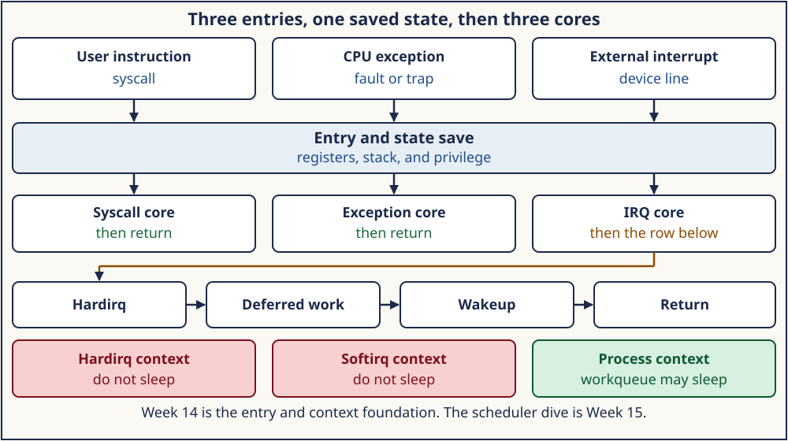

# Week 14 — Kernel Entry, Contexts, and Interrupts

**Format:** seven daily sections collected into one weekly module

**Suggested workload:** approximately 21 focused hours, adjustable to mastery

> A syscall, a page fault, and a device interrupt all steal the CPU from
> the current instruction stream. The kernel has to save state, run the
> right core, and return without sleeping in a context that must stay
> atomic. Choosing the next task is a later week.

The lab is [projects/linux-kernel-contexts](../projects/linux-kernel-contexts/).
Wrappers build through its Makefile. Kernel names below were read from
Linux 6.12, commit `adc218676eef25575469234709c2d87185ca223a`, whose
top-level `Makefile` sets `VERSION = 6`, `PATCHLEVEL = 12`, `SUBLEVEL = 0`.
The landmark script checks that snapshot and does not modify it. The host
that runs the C labs may be another kernel; the wrappers print `uname`.



## Required order: syntax, Linux 0.12, evolution, ToyOS, then 6.12

Each day opens in this order, and the order is required:

1. the few C or assembly forms that day's source actually uses;
2. the Linux 0.12 path, read while the whole entry still fits in one
   assembly file;
3. why that early design changed, in the constraint a single `iret`, a
   global `jiffies`, and a `cli`/`sti` pair could not keep;
4. the ToyOS reconstruction from Weeks 6–9;
5. the Linux 6.12 tree
   `adc218676eef25575469234709c2d87185ca223a`, then a check against current
   upstream before a symbol is treated as current.

Linux 0.12 is the first conceptual implementation. Its `int 0x80` entry,
`sys_call_table`, page-fault split, and timer IRQ make the control flow
visible. They are not the authority for `SYSCALL`/`SYSRET`, `irq_desc`,
softirqs, workqueues, or `preempt_count`. Those belong to the 6.12 tree.
The shared [Linux 0.12 map](../references/EARLY_LINUX_012_MAP.md) is the
reading method. This week adds the entry files that map does not already
walk: `kernel/system_call.s`, `kernel/asm.s`, `kernel/sched.c`, and
`mm/memory.c`.

## Why these seven days belong together

Week 14 is the Linux kernel entry and context foundation. A full scheduler
dive, including which task runs next, waits until Week 15. This week stops
at how the CPU enters the kernel, which core runs, what may be deferred,
and which contexts may sleep.

```text
user syscall          CPU exception         external interrupt
      \                    |                      /
       +-------- entry and state save -----------+
       |                   |                      |
 syscall core      exception core            IRQ core
       |                   |                      |
       |                   |                 hardirq
       |                   |                      |
       |                   |                 deferred work
       |                   |                      |
       +---------------- wakeup ------------------+
                           |
                        return
```

Hardirq and softirq context must not sleep. A workqueue worker and ordinary
process context may sleep, unless they hold a lock that forbids it. The
bands on the roadmap are that rule. They are not a scheduling class.

## Daily roadmap

### Day 1 — Kernel tree, Kconfig, kbuild, and the context map

[Day 1](sections/day-001-kernel-tree-kconfig-kbuild-and-context-map.md)
separates the snapshot (`VERSION`, `PATCHLEVEL`, `SUBLEVEL`), the options
in `Kconfig`, and the build rules that compile a unit. The context map is
which file owns syscall entry, faults, IRQ descriptors, softirqs,
workqueues, and `preempt_count`. Wrapper:
[challenges/day-001-source-map.sh](challenges/day-001-source-map.sh).

### Day 2 — System-call entry and return

[Day 2](sections/day-002-system-call-entry-and-return.md) follows
`entry_SYSCALL_64` through `do_syscall_64` and
`syscall_exit_to_user_mode`. The live x86-64 dispatch is `x64_sys_call`, a
switch. `sys_call_table` remains for tracing and is not the call path.
The C lab only shows that `syscall(SYS_getpid)` matches `getpid` and that a
pipe byte completes. Wrapper:
[challenges/day-002-syscall-entry.sh](challenges/day-002-syscall-entry.sh).

### Day 3 — Exceptions, page-fault entry, and return

[Day 3](sections/day-003-exceptions-page-fault-entry-and-return.md) reads
`exc_page_fault` and `do_user_addr_fault`. The lab's child stores through a
`PROT_NONE` mapping and the parent observes `SIGSEGV`. That is the user
symptom, not a trace of the fault handler. A second child catches
`SIGUSR1`. Wrapper:
[challenges/day-003-exception-entry.sh](challenges/day-003-exception-entry.sh).

### Day 4 — Hardware interrupts, IRQ descriptors, and handlers

[Day 4](sections/day-004-hardware-interrupts-irq-descriptors-and-handlers.md)
reads `struct irq_desc`, the action list, and `__handle_irq_event_percpu`.
`/proc/interrupts` is read only when the file can be opened. Counts are not
assertions. Reading that file is not an IRQ handler. Wrapper:
[challenges/day-004-interrupts.sh](challenges/day-004-interrupts.sh).

### Day 5 — Softirqs, threaded IRQs, and workqueues

[Day 5](sections/day-005-softirqs-threaded-irqs-and-workqueues.md) separates
three deferrals: `__do_softirq`, `request_threaded_irq`, and
`queue_work_on` into `worker_thread`. The lab's `eventfd`, `timerfd`, and
`poll` are userspace analogs and are labeled as such. Wrapper:
[challenges/day-005-deferred-work.sh](challenges/day-005-deferred-work.sh).

### Day 6 — Preemption, atomic context, and sleepability

[Day 6](sections/day-006-preemption-atomic-context-and-sleepability.md)
reads the `preempt_count` masks and `might_sleep`. `in_atomic()` is not the
driver test for "may I sleep". The lab prints the lesson table and shows
that a zero-timeout `poll` returns while a short `timerfd` wait does not.
That wait is not kernel atomic context. Wrapper:
[challenges/day-006-context-rules.sh](challenges/day-006-context-rules.sh).

### Day 7 — Entry and interrupt tracing, and a debugging report

[Day 7](sections/day-007-entry-interrupt-tracing-and-debugging-report.md)
names `trace_irq_handler_entry` and the irqsoff tracer in the tree, then
records only what this host actually produced: `uname`, `/proc/interrupts`
when readable, and `voluntary_ctxt_switches` when present. Optional
`strace`, `perf`, and tracefs print `SKIP` when they cannot run. Tracefs is
not enabled. Wrapper:
[challenges/day-007-entry-debug-report.sh](challenges/day-007-entry-debug-report.sh).

## Safety and evidence

The C programs do not create temporary files. The fault parent waits for
both children and arms a three-second alarm. Poll timeouts are 0 or 500 ms.
The landmark script is read-only; the suite hashes the kernel `Makefile`
before and after and rejects a tree that is not this v6.12 commit.

`strace` and `perf` may be missing or blocked. A readable tracefs file is
still a skip, because this lab does not turn a tracer on. A skip is not a
failed core test and it is not evidence that the entry path was traced.

## Completion checkpoint

Finishing the wrappers does not complete mastery. Answer from the source
and the logs, and leave a question blank when the run did not speak to it:

1. Which files are the snapshot, the Kconfig choice, and the kbuild rule,
   and which file owns syscall entry versus `irq_desc`?
2. Which instruction returns with `SYSRET`, and which function is the live
   x86-64 syscall dispatch?
3. What did the child `SIGSEGV` prove, and what did it not prove about
   `exc_page_fault`?
4. What does `/proc/interrupts` show when it is readable, and why is that
   not a handler trace?
5. Which of softirq, threaded IRQ, and workqueue may sleep?
6. Why is `in_atomic()` the wrong test in driver code?
7. Which optional tools ran, which printed `SKIP`, and which host `uname`
   actually ran the lab?
8. Which names did you re-read in commit
   `adc218676eef25575469234709c2d87185ca223a`?

Do not auto-fill mastery, confidence, hours, or completion. The
[quizzes](quizzes.json) sit beside this overview and do not grade the report.
Week 15 takes the scheduler from the wakeup this week only names.
