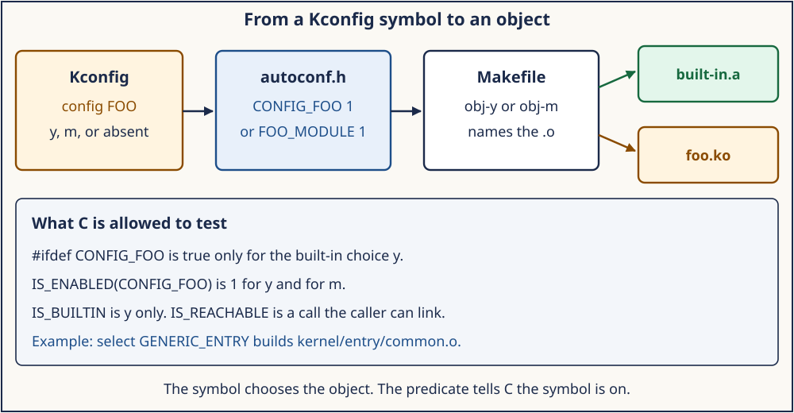
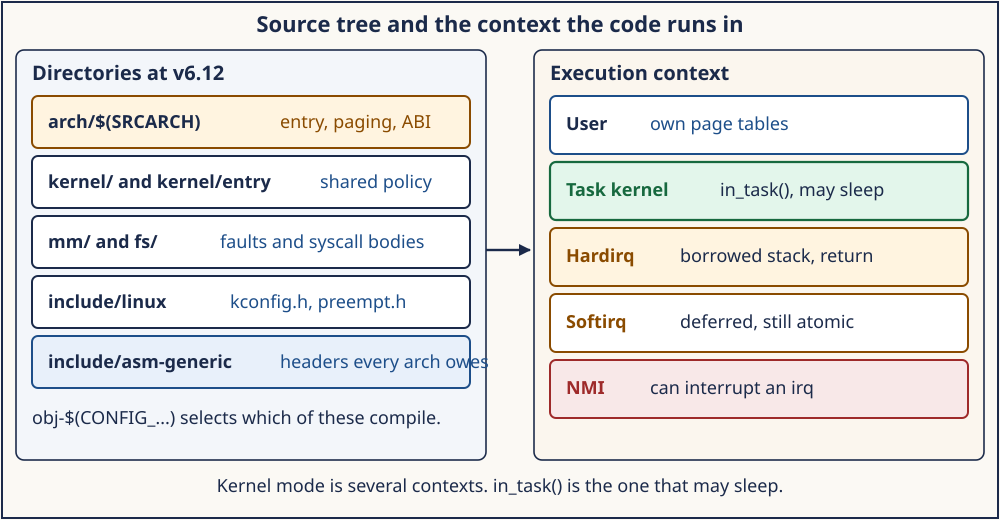

# Day 1 — The Tree, the Config Guard, and the Context

**Target time:** approximately 3 hours

- Syntax that hides a config choice or a function pointer: 30 minutes
- Linux 0.12's flat tree, then why Kconfig and `arch/` appeared: 45 minutes
- The pinned 6.12 map from symbol to object, and the context map: 50 minutes
- One navigation trace on the local tree: 25 minutes
- Mastery, then the wrapper: 30 minutes

> You have `arch/x86/entry/entry_64.S` open. Which commit is this file from,
> which config symbol decided the entry objects are linked, and which
> execution context is the CPU in when that code runs?

Weeks 6–9 built one small kernel whose files you can hold in your head.
Weeks 10–12 followed processes, threads, and I/O through a modern
`task_struct` and the VFS. The next path is the kernel itself: how the
source is split, how a config symbol becomes a translation unit, and
which context a line of that code is allowed to run in. Syscall entry is
Day 2. Page-fault entry is Day 3. Interrupts, softirqs, and scheduling
stay later. Today is the map you need before those paths are readable.

The excerpts below are from the local tree
`adc218676eef25575469234709c2d87185ca223a`, tag `v6.12`, commit
`adc218676eef`. Field layout and line numbers in a later mainline release
can move. The names quoted here are what this revision contains.

## 1. Syntax needed for this source

Four notations show up before any entry path makes sense: a preprocessor
guard, a macro that hides a guard, a function pointer, and an assembly
label that the linker treats as a function.

A guard keeps a declaration out of the translation unit when a symbol is
absent:

```c
#ifdef CONFIG_SMP
void kick_remote_cpu(void);
#endif
```

`#ifdef` tests whether the name is defined. In this tree, `CONFIG_FOO=y`
becomes `#define CONFIG_FOO 1` in the generated autoconf header.
`CONFIG_FOO=m` becomes `#define CONFIG_FOO_MODULE 1` and leaves
`CONFIG_FOO` itself undefined. A guard written `#ifdef CONFIG_FOO`
therefore compiles the block for a built-in choice and drops it for a
module choice.

`include/linux/kconfig.h` (lines 46–73) answers that with macros that
expand to the integer 1 or 0, so they can sit inside an `if`:

```c
#define IS_BUILTIN(option) __is_defined(option)
#define IS_MODULE(option) __is_defined(option##_MODULE)
#define IS_ENABLED(option) __or(IS_BUILTIN(option), IS_MODULE(option))
```

`IS_ENABLED(CONFIG_SMP)` is 1 when the symbol is `y` or `m`.
`IS_BUILTIN` is 1 only for `y`. `IS_REACHABLE` (lines 65–66) is 1 when
the caller can actually call the function: built-in code may not call a
function that lives only in a module. The helper `__is_defined` (lines
41–43) works by pasting the option onto `__ARG_PLACEHOLDER_`. A defined
option that expands to `1` matches `#define __ARG_PLACEHOLDER_1 0,` and
the following argument-picking macro selects 1. An undefined option
leaves junk in the first argument and the macro selects 0. The point of
the trick is that the test is usable in preprocessor conditions and in
ordinary C expressions.

A function pointer names code the way an integer names a file. The type
in `arch/x86/include/asm/syscall.h` (lines 20–21) is the modern form of
the 0.12 system-call table:

```c
typedef long (*sys_call_ptr_t)(const struct pt_regs *);
extern const sys_call_ptr_t sys_call_table[];
```

`sys_call_table[i]` is an address of a function that receives the saved
registers and returns a `long`. The caller does not spell the callee's
name. The table slot does.

An initcall is the same idea with a section attribute. `core_initcall`
in `include/linux/init.h` (line 300) stores a function pointer where the
linker will gather it:

```c
#define core_initcall(fn) __define_initcall(fn, 1)
```

The non-LTO form (lines 268–270) is a static pointer placed in a named
section:

```c
static initcall_t __name __used \
    __attribute__((__section__(__sec))) = fn;
```

Boot walks that section and calls each pointer. The C source never
writes a central list of every subsystem's init function.

Assembly entry points use a macro so the symbol type is right for
traces and for the linker. Day 2 reads `SYM_CODE_START(entry_SYSCALL_64)`.
Today it is enough to see that the label is the address the CPU will
fetch, and that a later `call do_syscall_64` is an ordinary call once
the kernel stack and the saved registers exist.

## 2. Linux 0.12 first: one machine, one Makefile, one table

Linux 0.12 is still the whole kernel in a handful of directories:
`boot/`, `init/`, `kernel/`, `mm/`, `fs/`, `lib/`, `include/`, and
`tools/`, plus driver objects under `kernel/blk_drv` and
`kernel/chr_drv`. There is no `arch/` tree. The machine is the 80386.
The top Makefile names the compiler and then lists the archives that
become the image: `kernel/kernel.o`, `mm/mm.o`, `fs/fs.o`, the driver
archives, and `lib/lib.a`. `kernel/Makefile` lists the objects of that
archive by hand, including `sched.o`, `system_call.o`, `traps.o`, and
`fork.o`. A `.c` or `.s` file in that list is in the kernel. A file
left off the list is not.

Configuration is a header of `#define` lines, not a menu language. The
build does not generate a tristate `CONFIG_*` symbol that can mean
built-in, module, or absent. Loadable modules, as 6.12 uses them, are
not this kernel's problem.

The one indirect call that matters for the rest of the week is the
system-call table. `kernel/system_call.s` receives `int 0x80` with the
call number in `%eax` and the arguments already in registers. The entry
rejects a number past the table, reloads the kernel data segments, and
calls through the table:

```asm
system_call:
	cmpl $nr_system_calls-1,%eax
	ja bad_sys_call
	push %ds
	push %es
	push %fs
	pushl %edx
	pushl %ecx		# push %ebx,%ecx,%edx as parameters
	pushl %ebx		# to the system call
	movl $0x10,%edx		# set up ds,es to kernel space
	mov %dx,%ds
	mov %dx,%es
	movl $0x17,%edx		# fs points to local data space
	mov %dx,%fs
	call sys_call_table(,%eax,4)
	pushl %eax
```

`nr_system_calls` is 72, so `%eax` above 71 goes to `bad_sys_call`,
which returns `-ENOSYS` with `iret`. The addressing mode
`sys_call_table(,%eax,4)` is base plus index times four: each slot is
a 32-bit function pointer. `include/linux/sys.h` defines that array,
`fn_ptr sys_call_table[]`, starting `sys_setup`, `sys_exit`, `sys_fork`,
`sys_read`, `sys_write`. After the call, the same file checks
`current->state` and `current->counter` and may `jmp schedule` before
`iret`.

Page faults already have their own assembly entry, `mm/page.s`. Day 3
reads it. The point today is the shape: hardware transfers to a label,
the label builds a kernel context, C does the work, `iret` returns.

What carries forward is the directory split, the idea that a build list
selects objects, and a function-pointer table indexed by a number the
user put in a register. The historical parts are the single architecture,
the hand-written object list, the segment reloads (`0x10` kernel data,
`0x17` local data), the 32-bit `int 0x80` frame, and a compile-time
table of 72 calls.

The week 10–12 [0.12 map](../../references/EARLY_LINUX_012_MAP.md)
indexes processes and files. This day's early files are
`kernel/system_call.s`, `include/linux/sys.h`, `kernel/Makefile`, and
`mm/page.s`. Develop against the 6.12 tree below.

## 3. Evolution: why the flat tree and the `#ifdef` stopped scaling

Three pressures broke the 0.12 picture.

The first is a second architecture. A kernel that also runs on a
different instruction set cannot keep `system_call.s` and `page.s` as
the only entry files in a shared `kernel/` and `mm/`. The instruction
that enters the kernel, the register that holds the call number, and
the page-fault status word are architecture facts. Scheduling policy,
the page-fault resolver, and the filesystem are not. The split that
survives is `arch/<name>/` for the machine, and `kernel/`, `mm/`, `fs/`,
`net/`, `drivers/`, and `lib/` for work that should read the same way
on every machine. Shared declarations that every architecture must
supply live as names in `include/asm-generic/Kbuild` (`mandatory-y`,
starting at line 7: `atomic.h`, `barrier.h`, `current.h`, and the rest).
An architecture provides the header or the build generates it from the
generic one. That is the boundary Day 2 and Day 3 keep crossing:
`kernel/entry/common.c` is the shared enter/exit work, and
`arch/x86/entry/entry_64.S` is the x86-64 instruction sequence.

The second pressure is the option that is neither always-on nor
always-off. A driver can be built in, built as a module, or left out.
A shell script that rewrote a header of `#define` lines could not
express the dependency tree, the module case, or a menu that hides
options whose parent is off. The language that this tree actually uses
is documented in `Documentation/kbuild/kconfig-language.rst`. A symbol
is a `bool` or a `tristate`. `depends on` hides a child when the parent
is off. The top `Kconfig` (lines 6–32) only pulls other files in:

```text
mainmenu "Linux/$(ARCH) $(KERNELVERSION) Kernel Configuration"
source "init/Kconfig"
source "kernel/Kconfig.freezer"
source "mm/Kconfig"
source "fs/Kconfig"
source "drivers/Kconfig"
```

The selected values land in `.config` and in
`include/generated/autoconf.h`. `IS_ENABLED` exists because a module
choice must still be visible to C that is compiled into the core, while
`#ifdef CONFIG_FOO` stays false for that choice.

The third pressure is the object list. Typing every `.o` into one
Makefile ties the image to a single machine and a single configuration.
Kbuild's rule, in `scripts/Makefile.lib` (lines 28–43), is smaller than
a build tutorial and is the whole idea: a directory name written in
`obj-y` becomes that directory's `built-in.a`, and `obj-m` contributes
a module. `kernel/Makefile` shows the local form (lines 6–17):

```text
obj-y     = fork.o exec_domain.o panic.o \
            ...
            signal.o sys.o umh.o workqueue.o pid.o task_work.o \
            ...
obj-$(CONFIG_USERMODE_DRIVER) += usermode_driver.o
obj-$(CONFIG_MULTIUSER) += groups.o
```

`fork.o` is in the built-in kernel. `usermode_driver.o` is compiled when
`CONFIG_USERMODE_DRIVER` is enabled. The top Makefile still records the
architecture selection that chooses which `arch/` tree participates
(lines 381–392): `ARCH ?= $(SUBARCH)`, then `SRCARCH` folds `i386` and
`x86_64` onto `arch/x86`. The link of `vmlinux` uses
`arch/$(SRCARCH)/kernel/vmlinux.lds` (line 1126). This day stops at that
relationship. Recipe order, `syncconfig`, modules_install, and packaging
are logistics around the same idea, and they are not the concept.

What survived from 0.12 is a directory per job, a build list that
selects objects, and a function pointer where the set of callees is data.
What changed is who is allowed to add an object: a Kconfig symbol and an
`obj-$(CONFIG_...)` line, with architecture code behind `arch/$(SRCARCH)`.

## 4. ToyOS reconstruction

ToyOS is the 0.12 shape with the lessons of Weeks 6–9 kept explicit.
The files are few enough to name: `src/arch.c` builds the GDT and IDT,
`src/isr.S` is the entry assembly, `src/process.c` is the syscall
dispatch, `src/memory.c` is the user-copy check. There is no Kconfig
language. The config guard is a C macro, `CONFIG_MILESTONE`, tested with
`#if` so that a later week can compile more of the same tree.

The function-pointer table is `isr_stub_table` in `src/isr.S` (lines
105–110), one address per exception vector. `arch_init` in `src/arch.c`
(lines 207–213) stores those addresses in the IDT. Vector 128 is
installed only when the milestone allows user syscalls, and its gate
attribute is `0xee` so ring 3 may enter. Vector 32 is the timer. The
C function `interrupt_handler` then branches on `frame->vector`: 32
ticks the scheduler, 128 calls `syscall_dispatch`, 14 reports a page
fault. That `if` on a vector number is the same design as a table of
function pointers, written out because the teaching kernel has three
cases.

Contexts in ToyOS are still few, and that is why they are visible. User
code runs at ring 3 with its own page-table root. Any entry through the
IDT runs `isr_common` on the kernel stack whose top was stored in
`tss.rsp[0]` by `arch_set_kernel_stack`. The handler returns with
`iretq`. There is no softirq, no workqueue, and no NMI stack policy.
When a later Linux function says it may run only `in_task()`, ToyOS has
exactly one such kernel context: the path that entered for this process
and will `iretq` back to it.

## 5. Linux 6.12: pin the tree, then follow a symbol to an object

Start with the version, or every later line number is unverifiable.
The top of `Makefile` is the contract:

```text
VERSION = 6
PATCHLEVEL = 12
SUBLEVEL = 0
EXTRAVERSION =
NAME = Baby Opossum Posse
```

`git rev-parse HEAD` in `/home/jd/Documents/linux-6.12` prints
`adc218676eef25575469234709c2d87185ca223a`. `git describe --exact-match`
prints `v6.12`. A path cited from a different major line, or from
whatever kernel happens to be installed, is a different program. The
installed running kernel and this source tree are allowed to differ.
Quotes in this week name the tree.

The directories you actually open:

```text
arch/x86/entry/     x86-64 syscall and exception assembly
arch/x86/mm/        x86 page-fault classification
arch/arm64/kernel/  AArch64 vectors and syscall dispatch
arch/riscv/kernel/  RISC-V trap entry and scause decode
kernel/entry/       shared enter-from-user and exit-to-user work
kernel/             signals, forks, softirqs, the task
mm/                 handle_mm_fault and the address space
fs/                 read, write, open, once the syscall has entered
include/linux/      shared C headers, including kconfig.h and preempt.h
include/asm-generic/ headers every architecture owes
Documentation/kbuild/ the Kconfig and Kbuild languages
```

`arch/x86/Kconfig` selects the shared entry implementation. Inside
`config X86` (line 164):

```text
select GENERIC_ENTRY
```

`kernel/entry/Makefile` turns that symbol into objects (line 12):

```text
obj-$(CONFIG_GENERIC_ENTRY) += common.o syscall_user_dispatch.o
```

`common.o` is `kernel/entry/common.c`, which defines
`syscall_trace_enter` and `exit_to_user_mode_loop`. The architecture
Makefile `arch/x86/entry/Makefile` (lines 14–15) always builds the x86
entry objects:

```text
obj-y := entry.o entry_$(BITS).o syscall_$(BITS).o
obj-y += common.o
```

`BITS` is 32 or 64, so a 64-bit build compiles `entry_64.o` from
`entry_64.S` and `syscall_64.o` from `syscall_64.c`. The Kconfig choice
`64BIT` in `arch/x86/Kconfig` (lines 3–8) is what makes `ARCH=x86_64`
a 64-bit kernel. The chain is the diagram: a symbol, a generated
macro, an `obj-*` line, an object in the link.



*A `y` symbol compiles into `built-in.a`. An `m` symbol compiles as a module. An absent symbol produces no object. `IS_ENABLED` sees both `y` and `m`.*

Two headers are the daily navigation tools. `include/linux/kconfig.h`
is the guard language from section 1. `include/linux/sys.h` in this
same tree is the historical name with the body removed: the comment on
lines 5–7 says the file is no longer used. The live table is generated
under `arch/x86/entry/`. When a 0.12 habit says "open `include/linux/sys.h`
for the call table," this revision sends you elsewhere. That is the
version discipline in one file.

Source discipline for the rest of the week:

1. The stable idea is the one you can say without a version: a number
   selects a function, a fault status word selects a handler, a task
   has a kernel stack.
2. The historical detail stays in the 0.12 quote: segment numbers,
   `int 0x80`, a 72-entry array written out in a header.
3. The 6.12 check is a path and a line in commit `adc218676eef`. If the
   line is not there, the explanation is wrong for this tree.

## 6. The execution-context map

A path is not readable until you know which context it may run in.
`include/linux/preempt.h` (lines 118–133) is the map the kernel itself
uses. The counters live in the preemption count:

```c
#define in_nmi()               (nmi_count())
#define in_hardirq()           (hardirq_count())
#define in_serving_softirq()   (softirq_count() & SOFTIRQ_OFFSET)
#define in_task()              (!(preempt_count() & (NMI_MASK | HARDIRQ_MASK | SOFTIRQ_OFFSET)))
```

The `in_task` line above is the non-PREEMPT_RT form. PREEMPT_RT keeps
softirq state in a different word; the meaning of the predicates stays
the one the comment states.

```text
Context            How you entered                 What the code may do
------             ----------------                 --------------------
User               ordinary instructions           its own address space
Task, kernel       syscall, fault, exception       sleep, lock, copy user
                   kthread, workqueue              memory, take mmap_lock
Hardirq            device interrupt                finish and return;
                                                   the interrupted context
                                                   is waiting on this stack
Softirq            raised by an interrupt, run     deferred work that is
                   before leaving irq, or by       still atomic with
                   a ksoftirqd task                respect to sleeping
NMI                non-maskable interrupt          almost nothing that
                                                   an interrupted irq
                                                   might already hold
```

A syscall runs `in_task()`. It is kernel mode, on that task's kernel
stack, and the scheduler may switch away from it if it sleeps. A
hardirq is a different context. The CPU borrowed a stack,
`in_hardirq()` is true, and the handler's job is to return to the
interrupted context. Sleeping there leaves the interrupted context
stacked underneath a context that will not be scheduled. Softirq is the
deferred half of that idea: the interrupt acknowledges the device and
raises work that runs soon after, still with sleeping disabled unless a
ksoftirqd thread has taken over. NMI can interrupt an interrupt. Code
that runs there cannot take a lock an IRQ handler might hold.

Day 2's `do_syscall_64` is task context. Day 3's page fault is usually
task context too, including a fault taken while a syscall copies from
user memory. A fault with `faulthandler_disabled()` or with no `mm` is
the kernel telling you this context must not sleep inside the fault
handler. Those predicates are Day 3. The map is today's.



*Generic directories hold policy. `arch/` holds the entry sequence. The context predicates in `preempt.h` decide what that code may do.*

The kernel stack belongs to the context. On x86-64 a syscall switches
to the task kernel stack in software, because the `SYSCALL` instruction
does not. An interrupt may use an interrupt stack. ToyOS has the small
version: one `tss.rsp[0]` per entry from user mode. The 6.12 picture
adds per-CPU stacks and per-context counters so a function can ask
which context it is in without guessing from the call chain.

## 7. WHY the boundaries are where they are

The directory boundary exists so a change to the page-fault resolver in
`mm/` can be reviewed once, while the line that reads `CR2` stays in
`arch/x86/mm/fault.c` because only that architecture has `CR2`. Putting
the resolver in `arch/x86` would fork it for AArch64 and RISC-V. Putting
the `CR2` read in `mm/` would make `mm/` false on every other machine.

The Kconfig boundary exists so the image you boot is a subset of the
tree you cloned. `obj-y` is the subset you cannot turn off in this
Makefile. `obj-$(CONFIG_FOO)` is the subset a symbol controls. The
preprocessor then needs `IS_ENABLED` so C can mention a function that
might live in a module without pretending the symbol is a plain
`#define CONFIG_FOO`.

The context boundary exists because the CPU has one privilege state and
many reasons to be in it. Kernel mode alone does not tell you whether
sleeping is possible. `in_task()` does. Entry code is the code that
makes those predicates true or false at the right moment. Day 2 shows
that work on the syscall path. Day 3 shows it on the fault path.

## 8. Execution trace: opening this tree on purpose

This trace is a reading order, not a boot.

```text
1. Confirm the commit.
   git -C /home/jd/Documents/linux-6.12 rev-parse HEAD
   adc218676eef25575469234709c2d87185ca223a
   git describe --exact-match HEAD  →  v6.12
   Makefile lines 2–6: VERSION 6, PATCHLEVEL 12, SUBLEVEL 0

2. Confirm which architecture tree a host build would enter.
   Makefile lines 381–392: ARCH defaults to the host sub-architecture.
   x86_64 and i386 both set SRCARCH=x86, so the files live in arch/x86.

3. Confirm the entry objects.
   arch/x86/Kconfig line 164 selects GENERIC_ENTRY.
   kernel/entry/Makefile line 12 builds common.o from that symbol.
   arch/x86/entry/Makefile lines 14–15 build entry_64.o and syscall_64.o
   when BITS is 64.

4. Confirm the context vocabulary before reading entry_64.S.
   include/linux/preempt.h lines 126–132: in_nmi, in_hardirq,
   in_serving_softirq, in_task.

5. Stop at the first instruction of the syscall path, and leave it
   for Day 2.
   arch/x86/entry/entry_64.S line 87: SYM_CODE_START(entry_SYSCALL_64)
   The comment on lines 62–66 records what the CPU has already done:
   rip is in rcx, rflags is in r11, and rsp is still the user stack.
```

At step 5 you know the file is in this commit, you know why it was
linked, and you know the context you are about to enter is a transition
from user mode into task context on the kernel stack. You do not yet
need the `SYSRET` conditions or the seccomp order. Those are the next
day's trace.

## 9. Safe evidence

Run
[`../challenges/day-001-source-map.sh`](../challenges/day-001-source-map.sh)
after the explanation. The wrapper prints the commit, the version lines,
and the landmarks above. It reads source. It does not configure, compile,
or boot a kernel, and it does not change the tree.

Record four lines in your notes:

- the full commit and `v6.12`;
- one `obj-$(CONFIG_...)` line and the Kconfig symbol that feeds it;
- the `in_task` predicate and the context it describes;
- the first label of `entry_SYSCALL_64`, left unread past the stack switch.

A grep hit is evidence that the file in this revision matches the notes.
It is not evidence that a particular distribution kernel was built with
that symbol set to `y`. The running kernel's config is `/proc/config.gz`
or `/boot/config-$(uname -r)` when those files exist, and it is a
different artifact from this source pin.

## 10. Architecture lens — x86-64, AArch64, and RISC-V

The generic directories (`kernel/entry`, `mm`, `fs`) are the ones the
three architectures share. The entry instruction is not shared.

On x86-64 the system-call entry label is `entry_SYSCALL_64` in
`arch/x86/entry/entry_64.S`. Exceptions use an IDT gate whose stub the
`idtentry` macro emits in the same file. The page-fault status word is
an error code pushed by the CPU, with the bit names in
`arch/x86/include/asm/trap_pf.h`. Day 2 and Day 3 read those files.
The architecture fact is: `SYSCALL` loads `rip` from an MSR and leaves
`rsp` alone, so the kernel switches stacks itself.

On AArch64 the vector table is `vectors` in `arch/arm64/kernel/entry.S`
(lines 519–530), sixteen slots for exception level, stack, and
synchronous versus IRQ, FIQ, and SError. A synchronous exception from
64-bit EL0 lands in `el0t_64_sync_handler`, which reads `esr_el1` and
switches on the exception class. The class `ESR_ELx_EC_SVC64` is the
system call. A data abort is a different class. The register width, the
exception level, and the syndrome register are AArch64 facts. The call
into `kernel/entry` for enter-from-user and exit-to-user is the shared
policy.

On RISC-V one label, `handle_exception` in `arch/riscv/kernel/entry.S`
(line 95), receives traps. The cause CSR's sign bit distinguishes an
interrupt from an exception (`bge` at line 183). The low bits index
`excp_vect_table` (lines 430–447). Cause 8 is the user environment call.
Causes 12, 13, and 15 are instruction, load, and store page faults.
There is no single page-fault cause and no IDT. The shared C after the
table lookup is still `do_trap_ecall_u` into the generic syscall enter
path, and `do_page_fault` into the generic fault resolver.

Each architecture has a hardware status word and a kernel label. The
6.12 tree puts the status word's decode in `arch/` and the policy that
runs after the decode in `kernel/` and `mm/`. `IS_ENABLED` and
`obj-$(CONFIG_...)` are how a build keeps the other two architectures'
objects out of an x86 image.

## 11. Mastery: Explain · Draw · Observe · Build

### Explain

The 0.12 kernel is a handful of directories, a handwritten object list,
and `sys_call_table(,%eax,4)`. Linux 6.12 at `adc218676eef` keeps the
directory split, replaces the object list with Kconfig plus
`obj-$(CONFIG_...)`, and puts machine entry under `arch/$(SRCARCH)`.
`IS_ENABLED` is how C sees a `y` or `m` choice. `in_task`,
`in_hardirq`, `in_serving_softirq`, and `in_nmi` are how a function
knows which context it is in. A syscall is task context on the task's
kernel stack. A hardirq is a borrowed stack that must return.

### Draw

1. The directory map: `arch/x86`, `kernel/entry`, `mm`, `fs`, and an
   arrow from a syscall label in `arch/` into `do_syscall_64` and then
   into `mm` or `fs`.
2. The config chain: `select GENERIC_ENTRY` → `CONFIG_GENERIC_ENTRY` →
   `obj-$(CONFIG_GENERIC_ENTRY) += common.o` → `kernel/entry/common.c`.
3. Four contexts stacked: user, task-kernel, hardirq, NMI, with the
   predicate that is true in each.

### Observe

On the wrapper's output, point at the commit and at one line number you
can open. Change nothing. If a quoted line is not in your tree, stop
and re-check `git rev-parse HEAD` before you trust any later day.

### Build

Add a one-page index to your notes, in your own words, with these
columns: path, one symbol you will look up there, and the context that
code runs in. Include `entry_64.S`, `kernel/entry/common.c`,
`arch/x86/mm/fault.c`, `arch/arm64/kernel/entry-common.c`, and
`arch/riscv/kernel/entry.S`. You will use the index on Days 2 and 3.

### Why? notebook

1. Why does `SRCARCH` fold `x86_64` and `i386` into `arch/x86`?
2. Why does `#ifdef CONFIG_FOO` stay false when the symbol is `m`?
3. Why is `IS_REACHABLE` a different test from `IS_ENABLED`?
4. Why is `include/linux/sys.h` almost empty in this revision?
5. Why does a second architecture force an `arch/` directory?
6. Why is "we are in kernel mode" too weak a statement to justify
   sleeping?
7. Why does ToyOS install vector 128 with attribute `0xee` and the
   exception vectors with `0x8e`?
8. Why does the source pin stay on `v6.12` when a newer mainline exists?

**Next:** Day 2 follows `entry_SYSCALL_64` from the `SYSCALL` instruction
through `do_syscall_64` and back with `SYSRET` or `IRET`.
