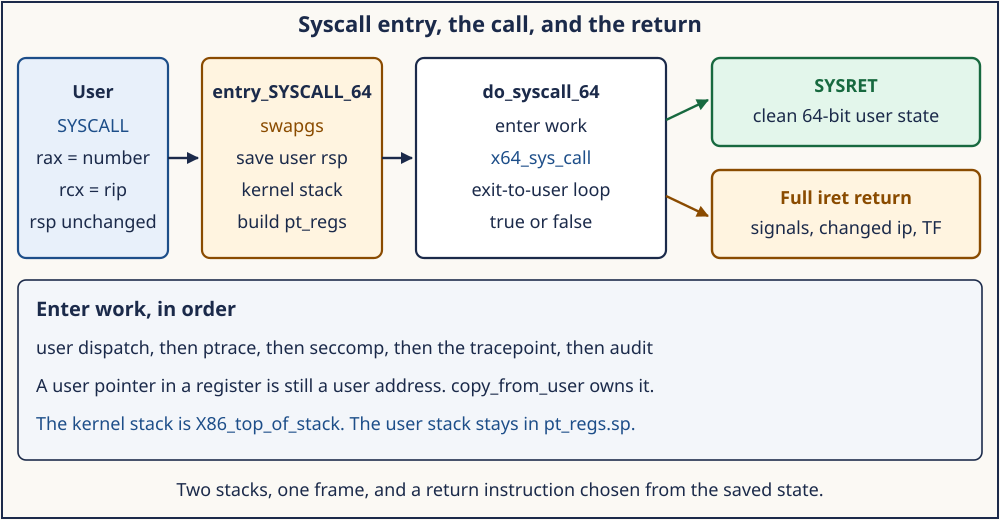
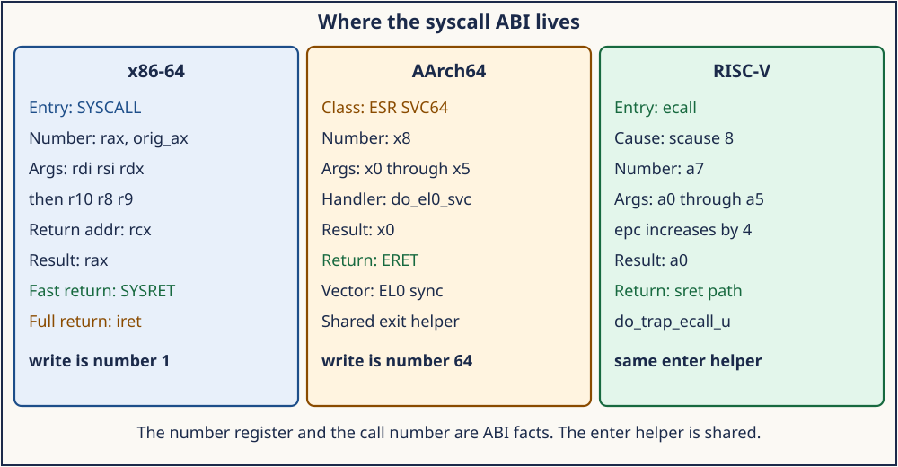

# Day 2 — System-Call Entry and Return

**Target time:** approximately 3 hours

- The assembly frame and the table: 35 minutes
- Linux 0.12 `int 0x80`, then the fast entry and the exit work: 45 minutes
- `entry_SYSCALL_64` through `do_syscall_64` and back: 55 minutes
- One trace of a `write`, then the three ABIs: 30 minutes
- Mastery, then the wrapper: 25 minutes

> A user program executes `SYSCALL` with `1` in `%rax`. Where is the
> kernel stack, who may change the call number before the function runs,
> and which instruction returns to user mode?

Day 1 put `entry_SYSCALL_64` on the map and left it unread. This day
reads it. The path is the same idea as Linux 0.12: a deliberate entry
from user mode, a number, a table, a C function, a return that restores
user state. The 6.12 path adds a software stack switch, a `pt_regs`
image, seccomp and audit before the call, and a return that uses
`SYSRET` only when the saved user state still matches what `SYSRET` can
restore.

The excerpts are from `/home/jd/Documents/linux-6.12`, tag `v6.12`,
commit `adc218676eef25575469234709c2d87185ca223a`. Line numbers belong
to that tree.

## 1. Syntax needed for this source

The entry file is assembly with macros. `SYM_CODE_START(name)` emits a
global code symbol. `pushq $__USER_DS` pushes an immediate. `pushq %r11`
pushes a register. `movq PER_CPU_VAR(...), %rsp` loads a per-CPU
address into the stack pointer. `movslq %eax, %rsi` sign-extends the
32-bit call number into the second argument register. `call do_syscall_64`
is an ordinary call once `%rsp` is the kernel stack and `%rdi` points
at the saved registers.

The saved image is `struct pt_regs`. On this path the pushes build it
from the top of the frame downward: `ss`, `sp`, `flags`, `cs`, `ip`,
`orig_ax`, then the general registers. Later C reads `regs->orig_ax`
for the number the user placed in `%rax`, and `regs->ax` for the value
that will be returned. Those two fields are different on purpose.
`orig_ax` remembers the request. `ax` becomes the result.

A macro hides the C function that the table calls.
`SYSCALL_DEFINE3(read, ...)` in `include/linux/syscalls.h` (lines
223–234 and 243–261) expands into metadata plus a real function
`__do_sys_read`, and an alias `sys_read`. The x86 wrapper in
`arch/x86/include/asm/syscall_wrapper.h` (lines 223–235) adds
`__x64_sys_read(const struct pt_regs *)`, which pulls arguments out of
the frame. The argument order for the 64-bit ABI is fixed at lines
56–59:

```c
#define SC_X86_64_REGS_TO_ARGS(x, ...)				\
	__MAP(x,__SC_ARGS					\
		,,regs->di,,regs->si,,regs->dx			\
		,,regs->r10,,regs->r8,,regs->r9)
```

The fourth argument is `regs->r10`, not `regs->cx`. The `SYSCALL`
instruction itself writes the return address into `%rcx`, so the ABI
passes the fourth argument in `%r10`. The stub moves it into the place
the C function expects.

The table is no longer an array indexed in assembly. `x64_sys_call` is
a switch whose cases are generated from the same list that used to be
the array. A function pointer is still the idea. The control flow is a
`switch` so the compiler can see every target.

## 2. Linux 0.12 first: `int 0x80` and `sys_call_table`

In 0.12 the user executes `int $0x80` with the number in `%eax` and the
arguments in `%ebx`, `%ecx`, and `%edx`. The CPU pushes the user flags,
the user `cs`, and the user `eip`, looks up IDT vector 128, and enters
`system_call` in `kernel/system_call.s` at kernel privilege. The
handler checks the number, reloads segments, and calls the table:

```asm
system_call:
	cmpl $nr_system_calls-1,%eax
	ja bad_sys_call
	push %ds
	push %es
	push %fs
	pushl %edx
	pushl %ecx		# push %ebx,%ecx,%edx as parameters
	pushl %ebx		# to the system call
	movl $0x10,%edx		# set up ds,es to kernel space
	mov %dx,%ds
	mov %dx,%es
	movl $0x17,%edx		# fs points to local data space
	mov %dx,%fs
	call sys_call_table(,%eax,4)
	pushl %eax
	movl current,%eax
	cmpl $0,state(%eax)	# state
	jne reschedule
	cmpl $0,counter(%eax)	# counter
	je reschedule
```

`nr_system_calls` is 72. `%eax` above 71 takes `bad_sys_call`, which
sets `%eax` to `-ENOSYS` and executes `iret`. A legal number uses
`sys_call_table(,%eax,4)`: the slot is a 32-bit function pointer, and
the three pushed registers are the C arguments. `include/linux/sys.h`
writes the array out, beginning `sys_setup`, `sys_exit`, `sys_fork`,
`sys_read`, `sys_write`, `sys_open`, `sys_close`.

The return path pops the saved registers and executes `iret`, which
restores `eip`, `cs`, and flags from the CPU's interrupt frame. Before
that, the code may jump to `schedule` when the task is no longer
runnable or its counter is zero, and it may call `do_signal` when a
signal is pending and the interrupted frame was user mode. The durable
idea is already here: enter, range-check the number, call through a
table, then consider reschedule and signals before returning to user
mode.

What stays behind in 0.12 is the mechanism that implements the idea.
The gate is `int 0x80`. The CPU switches stacks using the TSS. The
kernel reloads `%ds`, `%es`, and `%fs` by hand. The table has 72
entries and lives in a header. There is one ABI. There is no seccomp,
no audit, and no separate `SYSRET` path, because the 80386 has `iret`
for this return.

## 3. Evolution: fast entry, several tables, work before and after the call

`int 0x80` still works as a compatibility entry, and it is a poor fit
for the common case. The instruction behaves like a general software
interrupt: it can arrive from any vector the IDT allows, it pushes a
frame, and it returns with `iret`. A dedicated instruction can do less.
On x86-64, `SYSCALL` saves the user `rip` in `%rcx`, saves `rflags` in
`%r11`, masks a set of flag bits, and loads `cs` and the kernel `rip`
from MSRs. It does not write the stack and it does not change `%rsp`.
The kernel switches stacks in software and builds the `pt_regs` image
the rest of the kernel already expects. `SYSRET` reverses the dedicated
path. It is faster, and it restores a smaller, stricter set of state
than `iret`. That strictness is why 6.12 sometimes refuses `SYSRET` and
falls back to the full return.

The single array also stopped being the whole ABI. A 64-bit process, a
32-bit process on a 64-bit kernel, and the x32 ABI do not share numbers
or register assignments. The numbers live in
`arch/x86/entry/syscalls/syscall_64.tbl`. The generated header is
included twice: once to declare `__x64_*` functions, once to emit the
`switch` inside `x64_sys_call`. `include/linux/sys.h` in this revision
says it is no longer used. The 0.12 file and the 6.12 file share a
name and not a role.

Work accumulated on both sides of the call. A tracer must be able to
change the number. Seccomp must see the number after the tracer.
Audit must record the arguments that will actually be used. A
tracepoint must run where probes can still change the number. That
order is policy, and it is shared, so it moved to
`kernel/entry/common.c` behind `CONFIG_GENERIC_ENTRY`. The
architecture file keeps the instructions. The generic file keeps the
checks.

The return accumulated the same way. Signals, `ptrace` stops, and
`TIF_NEED_RESCHED` have to run before user mode resumes, with
interrupts briefly enabled and then disabled again so the check is not
stale. `exit_to_user_mode_loop` is that loop. 0.12's `reschedule` and
`do_signal` tests are the ancestor. The modern loop also covers
uprobes, live-patch state, and resume work.

Hardening sits on the fast return. `SYSRET` with a non-canonical
`%rcx` has faulted in kernel mode on real CPUs, and a user program
chooses the address that will land in `%rcx`. The C helper therefore
returns false when the saved user state is not a clean 64-bit return,
and the assembly takes the `iret` path instead. A bounds-checked call
number uses `array_index_nospec` so a speculated index cannot pull a
table target from outside the table.

## 4. ToyOS reconstruction

ToyOS keeps the 0.12 instruction on purpose. Week 8's ABI is a DPL-3
interrupt gate, not `SYSCALL`/`SYSRET`. `arch_init` in
`projects/toyos/src/arch.c` (lines 212–213) installs vector 128 only
when `CONFIG_MILESTONE >= 8`:

```c
set_idt_gate(128, syscall_int_stub, 0, 0xee);
```

Attribute `0xee` is an interrupt gate that ring 3 may use. The other
exception gates use `0x8e`, which ring 3 may not use. `syscall_int_stub`
in `src/isr.S` (lines 59–63) pushes a zero error code and the vector
128, then falls into `isr_common`, which pushes the general registers
and calls `interrupt_handler` with `%rdi` pointing at that frame.
`interrupt_handler` sees vector 128 and calls `syscall_dispatch`.

`syscall_dispatch` in `src/process.c` (lines 184–262) switches on
`frame->rax`. The teaching numbers are an `enum` in the same file:
`SYS_WRITE` is 1, `SYS_GETPID` is 2, `SYS_READ` is 6. Linux x86-64 also
uses 1 for `write` and uses 0 for `read` and 39 for `getpid`. The match
on `write` is a coincidence of two small integers. The contract is the
enum, not the Linux table. A missing number returns `-38`, the same
`-ENOSYS` value 0.12 used. `SYS_WRITE` copies from the user pointer in
`frame->rsi` through `copy_from_user` before it looks at the bytes.
The length is capped by `MAX_IO`. The result is written back to
`frame->rax`. `isr_common` pops the registers and executes `iretq`.

That is the whole mechanism in one screen: hardware entry, saved
registers, a number, a C switch, a checked copy, a result in `%rax`,
`iretq`. Linux 6.12 adds the fast instruction, the generic enter/exit
work, and the conditions on `SYSRET`. It does not replace the idea.

## 5. Linux 6.12 x86-64: from `SYSCALL` to `do_syscall_64`

`arch/x86/entry/entry_64.S` documents the hardware contract in the
comment at lines 62–77, then implements it. The instruction has already
put the user `rip` in `%rcx` and the user flags in `%r11`. `%rsp` is
still the user stack. `%rax` is the call number. Arguments are in
`%rdi`, `%rsi`, `%rdx`, `%r10`, `%r8`, and `%r9`.

```asm
SYM_CODE_START(entry_SYSCALL_64)
	UNWIND_HINT_ENTRY
	ENDBR

	swapgs
	/* tss.sp2 is scratch space. */
	movq	%rsp, PER_CPU_VAR(cpu_tss_rw + TSS_sp2)
	SWITCH_TO_KERNEL_CR3 scratch_reg=%rsp
	movq	PER_CPU_VAR(pcpu_hot + X86_top_of_stack), %rsp
```

`swapgs` exchanges the user `GS` base for the kernel per-CPU base, which
is what makes `PER_CPU_VAR` address this CPU's data. The user `%rsp` is
saved in `TSS.sp2` because the next instruction may overwrite `%rsp`
while switching CR3. `X86_top_of_stack` is the top of this task's kernel
stack. Only after that load is it safe to push.

The pushes at lines 100–109 build `pt_regs`: user `ss`, the saved user
`rsp`, `r11` as flags, user `cs`, `%rcx` as `ip`, then `%rax` as
`orig_ax`. `PUSH_AND_CLEAR_REGS` saves the rest and sets the value that
will sit in `%rax` to `-ENOSYS` until a real call replaces it. `%rdi`
is set to `%rsp`, so the C function receives the frame. `%rsi` receives
the sign-extended number. Then:

```asm
	call	do_syscall_64		/* returns with IRQs disabled */
```

`do_syscall_64` in `arch/x86/entry/common.c` (lines 75–129) returns a
boolean: true means `SYSRET` is allowed. The assembly tests that boolean
unless this is a Xen PV guest, which always takes the `iret` path
(lines 130–131). The `SYSRET` sequence restores registers, switches back
to the user CR3, executes `swapgs`, and executes `sysretq` (lines
137–166). Anything the C helper rejects jumps to
`swapgs_restore_regs_and_return_to_usermode`, the full return.



*`SYSCALL` leaves the user stack pointer in place. The kernel switches stacks, and `SYSRET` is used only when the saved user state is still a clean 64-bit return.*

The C helper itself is the policy boundary:

```c
__visible noinstr bool do_syscall_64(struct pt_regs *regs, int nr)
{
	add_random_kstack_offset();
	nr = syscall_enter_from_user_mode(regs, nr);
	instrumentation_begin();
	if (!do_syscall_x64(regs, nr) && !do_syscall_x32(regs, nr) && nr != -1) {
		regs->ax = __x64_sys_ni_syscall(regs);
	}
	instrumentation_end();
	syscall_exit_to_user_mode(regs);
	/* SYSRET checks follow, then return true or false */
}
```

`add_random_kstack_offset` slides the stack a little so the kernel
stack address is not a stable target. `do_syscall_x64` (lines 42–56)
accepts the call when the unsigned number is below `NR_syscalls`,
clamps the index with `array_index_nospec`, and calls `x64_sys_call`.
A number that misses both the 64-bit table and the x32 table, and is
not the explicit skip value `-1`, becomes `ni_syscall`, which returns
`-ENOSYS`.

The `SYSRET` checks are the interesting part of the boolean. The helper
returns false when `rcx` no longer equals the saved `ip`, when `r11` no
longer equals the saved flags, when `cs` or `ss` differ from the user
selectors `SYSRET` would restore, when `ip` is at or above
`TASK_SIZE_MAX`, or when the flags contain `RF` or `TF`. The comment at
lines 110–115 states why the address check exists: on Intel CPUs,
`SYSRET` with a non-canonical `RCX` raises `#GP` in kernel mode, and
the user chose that address. `TASK_SIZE_MAX` is the bound the kernel
uses for a user instruction pointer. A false return selects `iret`,
which can restore the general case, including a signal frame whose
registers the kernel rewrote.

## 6. The table and the enter/exit work

`arch/x86/entry/syscalls/syscall_64.tbl` line 12 is the first data row:

```text
0	common	read			sys_read
1	common	write			sys_write
2	common	open			sys_open
3	common	close			sys_close
```

`arch/x86/entry/syscall_64.c` includes the generated list twice. Lines
19–27 keep an array for tracing. Lines 29–36 are the call:

```c
#define __SYSCALL(nr, sym) case nr: return __x64_##sym(regs);
long x64_sys_call(const struct pt_regs *regs, unsigned int nr)
{
	switch (nr) {
	#include <asm/syscalls_64.h>
	default: return __x64_sys_ni_syscall(regs);
	}
};
```

`__x64_sys_write` is the stub from section 1. It calls `__do_sys_write`
with `regs->di`, `regs->si`, and `regs->dx`. That function is the body
`SYSCALL_DEFINE3(write, ...)` supplies. The body is allowed to sleep.
It runs `in_task()`, on the kernel stack the assembly just installed.

Before the switch, `syscall_enter_from_user_mode` in
`include/linux/entry-common.h` (lines 190–201) calls
`enter_from_user_mode`, enables interrupts, and runs
`syscall_enter_from_user_mode_work`. That work function (lines 163–170)
calls `syscall_trace_enter` when `SYSCALL_WORK_ENTER` is set.
`syscall_trace_enter` in `kernel/entry/common.c` (lines 28–71) is the
policy:

```text
SYSCALL_WORK_SYSCALL_USER_DISPATCH   may skip the call
SYSCALL_WORK_SYSCALL_TRACE / EMU     ptrace may change the number
SYSCALL_WORK_SECCOMP                 seccomp sees the tracer's result
read the number again
SYSCALL_WORK_SYSCALL_TRACEPOINT      tracepoint, then read the number
audit_syscall_entry                  record the arguments
```

Seccomp runs after `ptrace` because the comment says so: the filter
must observe a number the tracer changed. The tracepoint runs after
seccomp, and a probe there can change the number again, so the function
re-reads it. Audit records the number that remains. A return of `-1`
from this helper makes `do_syscall_64` skip the real call. The user
still gets a system-call return; the function that runs is `ni_syscall`
or the value the tracer left behind.

After the call, `syscall_exit_to_user_mode` reaches
`exit_to_user_mode_loop` (lines 90–133). With interrupts enabled one
work item at a time, the loop handles `_TIF_NEED_RESCHED` by calling
`schedule`, delivers signals through `arch_do_signal_or_restart`, runs
uprobes and live-patch updates, and runs `resume_user_mode_work`. It
then disables interrupts and reads the flags again. The loop ends when
no exit-to-user work remains. The assembly return that follows observes
the registers the signal path may have changed. A restarted `write`
shows up as a return to the `SYSCALL` instruction, not as a second
entry invented in the assembly file.

## 7. The kernel stack and the user-copy boundary

Two addresses must not be confused. The user stack is the `%rsp` saved
in `TSS.sp2` and pushed as `pt_regs->sp`. The kernel stack is the
pointer loaded from `pcpu_hot + X86_top_of_stack`. Pushes after that
load belong to the kernel. A bug that pushed before the load would
write the user stack while running in kernel mode.

The other boundary is the pointer the user passed as an argument.
`regs->si` on a `write` is a user virtual address. It is not a pointer
the kernel may dereference. `copy_from_user` and `get_user` exist so
the copy runs with an exception handler registered for the faulting
instruction. On x86-64, `get_user` in `arch/x86/include/asm/uaccess.h`
(line 108) is the single-value form. The copy path in
`arch/x86/include/asm/uaccess_64.h` (lines 121–135) brackets the
copying instruction with `stac()` and `clac()`, which set and clear the
AC flag so SMAP allows the kernel to touch a user address for the
duration of that instruction. The fault label is
`_ASM_EXTABLE_UA(1b, 2b)` (line 131), an exception-table entry of type
`EX_TYPE_UACCESS` (`arch/x86/include/asm/asm.h` lines 229–230). Day 3
follows what happens when that instruction faults. Today the rule is
the boundary: the syscall stub receives the address in a register, and
only the user-access helpers may use it.

ToyOS draws the same line in a smaller function. `copy_from_user` in
`projects/toyos/src/memory.c` (lines 275–280) rejects a null
destination and a length above 4096, then translates the user address
in that process's page tables. A failed translation returns false, and
`syscall_dispatch` stores `-14` (`-EFAULT`) in `frame->rax`. Linux adds
the exception table so a fault inside the copy becomes `-EFAULT`
without crashing the kernel. The rule both kernels are enforcing is
identical: a user address is interpreted by the user page tables, and
only on purpose.

## 8. WHY the return has two instructions

`SYSRET` is the return that matches a `SYSCALL` which did not change
privilege-sensitive fields beyond what the MSRs already describe. It
requires `%rcx == rip` and `%r11 == rflags` because that is where the
instruction takes them from. A signal handler's frame breaks that
equality: the kernel wants user mode to resume at the handler, with
flags and a stack the handler expects. `iret` can load that frame.
`SYSRET` cannot. The boolean from `do_syscall_64` is how the C path
tells the assembly which instruction is honest.

The enter-work order has a similar reason. If seccomp ran before
`ptrace`, a tracer could not see the call the filter will judge, and a
filter could not see the number the tracer substituted. The source
puts `ptrace` first and says why. Audit comes last among those steps
so the recorded arguments are the ones the call will use.

The stack switch has a hardware reason. `SYSCALL` does not change
`%rsp`. Leaving the user stack in place would let a user pointer decide
where the kernel pushes `pt_regs`. Saving `%rsp` to `TSS.sp2` and
loading `X86_top_of_stack` is the kernel choosing its own stack before
the first push.

## 9. Execution trace: `write(1, buf, 3)` on x86-64

Assume a 64-bit process, `syscall` instruction, number 1, file
descriptor 1, a user pointer in `%rsi`, and length 3 in `%rdx`. Ignore
seccomp and `ptrace`; the bits in the thread flag are clear.

```text
User
  %rax = 1, %rdi = 1, %rsi = buf, %rdx = 3
  SYSCALL
    hardware: %rcx = user rip, %r11 = rflags, %rsp unchanged

entry_SYSCALL_64
  swapgs
  save user %rsp in TSS.sp2
  SWITCH_TO_KERNEL_CR3
  %rsp = X86_top_of_stack
  push ss, user rsp, r11, cs, rcx, rax
  PUSH_AND_CLEAR_REGS, with the working %rax set to -ENOSYS
  %rdi = pt_regs, %rsi = sign-extended 1
  call do_syscall_64

do_syscall_64
  syscall_enter_from_user_mode: enter_from_user_mode, sti,
      no syscall-work bits, so nr stays 1
  do_syscall_x64: 1 < NR_syscalls, array_index_nospec,
      x64_sys_call case 1 → __x64_sys_write(regs)
  __do_sys_write(fd=regs->di, buf=regs->si, count=regs->dx)
      copy_from_user of 3 bytes, then the file operation
      result stored through regs->ax
  syscall_exit_to_user_mode: no TIF work
  rcx still equals ip, r11 equals flags, cs and ss are the user
      selectors, ip < TASK_SIZE_MAX, TF and RF clear
  return true

entry_SYSCALL_64
  SYSRET path: restore regs, user CR3, swapgs, sysretq
User
  %rax = 3, %rip = the instruction after SYSCALL
```

A second pass with a pending signal takes the same entry and the same
`__x64_sys_write`. `exit_to_user_mode_loop` sees `_TIF_SIGPENDING`,
runs `arch_do_signal_or_restart`, and may change `regs->ip`. The
`SYSRET` check `regs->cx != regs->ip` then fails, the helper returns
false, and the assembly uses the full user return. The bytes still
moved. The return instruction changed because the frame stopped being
a plain `SYSCALL` return.

## 10. Safe evidence

Run
[`../challenges/day-002-syscall-entry.sh`](../challenges/day-002-syscall-entry.sh).
The wrapper checks the pinned tree: the `entry_SYSCALL_64` label, the
`do_syscall_64` call, the `write` row in `syscall_64.tbl`, and the
ToyOS vector-128 gate. It does not trace a production workload, and it
does not read another process's memory. It then runs a userspace lab:
`syscall(SYS_getpid)` matches `getpid`, and one pipe byte completes.
That result is a completed syscall, not a trace of `SYSRET`.

A user-space `strace` of a small `write` is optional confirmation that
the number which leaves libc is the number in the table. `strace` sees
the libc side of the ABI. The stack switch and the `SYSRET` boolean are
visible in the source, not in that trace. Record the source lines, and
record one `strace` line only if you ran it: the number, the
descriptor, and the returned count.

## 11. Architecture lens — x86-64, AArch64, and RISC-V

The three machines enter the same generic helpers and pass different
registers.



*The C helpers match. The register names and the instruction that enters the kernel belong to the architecture.*

x86-64, this file. Number in `%rax` (`orig_ax`). Arguments in `%rdi`,
`%rsi`, `%rdx`, `%r10`, `%r8`, `%r9`. Return address in `%rcx`, flags
in `%r11`, result in `%rax`. Entry instruction `SYSCALL`, fast return
`SYSRET`, full return `iret`. The fourth argument register is `%r10`
because `%rcx` is occupied by the return address. Table numbers for the
common calls start at 0 for `read` (`syscall_64.tbl` lines 12–15).

AArch64. `arch/arm64/kernel/entry-common.c` `el0_svc` (lines 706–713)
calls `enter_from_user_mode`, drops the DAIF mask, calls `do_el0_svc`,
and calls `exit_to_user_mode`. `do_el0_svc` in
`arch/arm64/kernel/syscall.c` (lines 149–151) passes `regs->regs[8]` as
the number. That register is `x8`. Arguments are `x0` through `x5`, and
the result is written back through `syscall_set_return_value`. The
vector that got here is the synchronous 64-bit EL0 slot, and the
syndrome class is `ESR_ELx_EC_SVC64` (value `0x15` in
`arch/arm64/include/asm/esr.h` line 32), decoded by
`el0t_64_sync_handler` (lines 724–731). There is no `SYSRET` boolean.
The exception return instruction is `ERET`, and it restores the saved
program state. The generic table in `include/uapi/asm-generic/unistd.h`
numbers `openat` 56, `read` 63, and `write` 64. Those numbers are not
the x86-64 numbers. A program compiled for AArch64 loads 64 to write.

RISC-V. `handle_exception` in `arch/riscv/kernel/entry.S` saves the
user trap frame and indexes `excp_vect_table` by the exception code.
Slot 8 is `do_trap_ecall_u` (line 439). In
`arch/riscv/kernel/traps.c` (lines 314–345) the number is `regs->a7`.
The function adds 4 to `regs->epc` so the return skips the `ecall`,
saves `a0` in `orig_a0`, stores `-ENOSYS` in `a0`, calls
`syscall_enter_from_user_mode`, calls `syscall_handler` when the number
is in range, and calls `syscall_exit_to_user_mode`.
`syscall_get_nr` in `arch/riscv/include/asm/syscall.h` (lines 27–30)
reads `a7`. Arguments are `a0` through `a5`. The result comes back in
`a0`. The cause value 8 is an architecture constant
(`EXC_SYSCALL` in `arch/riscv/include/asm/csr.h` line 99), not an x86
vector and not an AArch64 exception class.

Across all three, `syscall_enter_from_user_mode` and
`syscall_exit_to_user_mode` are the shared policy. The stack that
holds `pt_regs` is kernel memory. The pointers inside the argument
registers are user addresses until a user-access helper translates
them. Day 3 is what happens when that translation faults.

## 12. Mastery: Explain · Draw · Observe · Build

### Explain

0.12 enters through `int 0x80`, range-checks `%eax`, calls
`sys_call_table(,%eax,4)`, and returns with `iret`, after considering
schedule and signals. Linux 6.12 at `adc218676eef` enters x86-64
through `SYSCALL`, switches to the kernel stack, builds `pt_regs`, and
calls `do_syscall_64`. Enter work runs user-dispatch, `ptrace`,
seccomp, the tracepoint, and audit, in that order. `x64_sys_call`
switches to `__x64_sys_*`, which unpacks registers with `r10` as the
fourth argument. Exit work loops on thread flags. `SYSRET` runs only
when the helper returns true. A user pointer is copied with a helper
that has an exception-table entry.

### Draw

1. The x86-64 timeline from section 9, with the user stack and the
   kernel stack labeled at the moment of the first `pushq`.
2. The enter-work order as six boxes, and the exit loop as a separate
   box after the call.
3. Three columns for the number register and the result register on
   x86-64, AArch64, and RISC-V.

### Observe

From the wrapper, record the `syscall_64.tbl` line for `write` and the
ToyOS `set_idt_gate` line for vector 128. State which instruction each
kernel uses to enter, and which value is `-ENOSYS` in each.

### Build

Write a ten-line comment, in your notes, for a toy `ecall`/`SYSCALL`
dispatcher that rejects an out-of-range number with `-38` and otherwise
calls `table[n](frame)`. Then annotate the comment with the 6.12
function that implements each step: range check, enter work, call,
exit work, fast return versus full return.

### Why? notebook

1. Why does the x86-64 ABI pass argument 4 in `%r10`?
2. Why does `entry_SYSCALL_64` save `%rsp` before it switches `CR3`?
3. Why is `regs->orig_ax` distinct from `regs->ax`?
4. Why does seccomp run after `ptrace` in `syscall_trace_enter`?
5. Why does `do_syscall_64` return false when `regs->ip` is at or
   above `TASK_SIZE_MAX`?
6. Why is ToyOS's vector 128 a DPL-3 interrupt gate?
7. Why is AArch64 `write` number 64 when x86-64 `write` is number 1?
8. Why does RISC-V add 4 to `epc` before the syscall runs?
9. Why must `copy_from_user` exist when the pointer is already in a
   kernel register?

**Next:** Day 3 follows a page fault from the vector or the syndrome
register through the fixup table or `handle_mm_fault`, and back.
