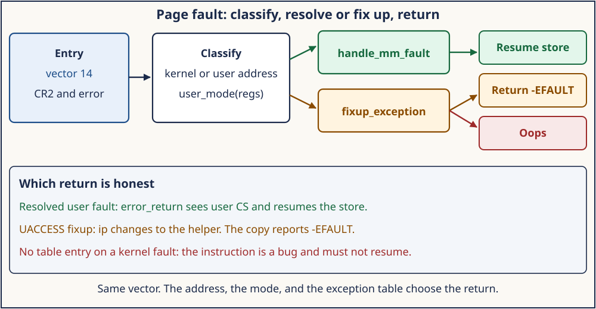
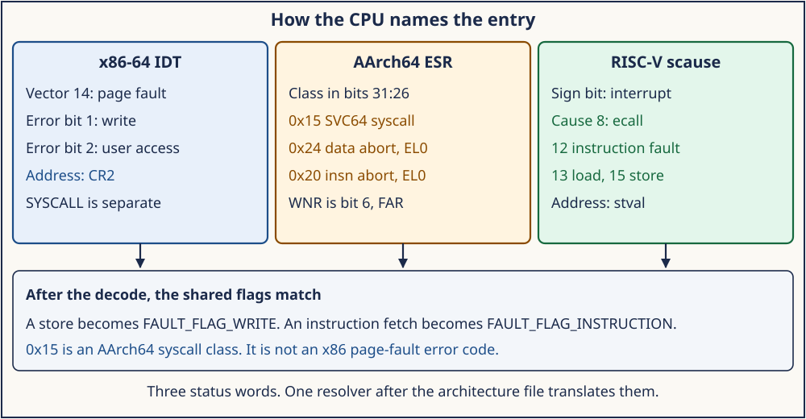

# Day 3 — Exceptions, Page-Fault Entry, and Return

**Target time:** approximately 3 hours

- The trap frame and the error-code bits: 30 minutes
- Linux 0.12 `page.s`, then fixups and the generic resolver: 45 minutes
- The 6.12 x86 fault path, user versus kernel: 55 minutes
- AArch64 `ESR` and RISC-V `scause`, carefully: 35 minutes
- Mastery, then the wrapper: 25 minutes

> A store touches a not-present user page. Which status word says
> "write," which function may sleep to satisfy it, and how does the
> CPU get back to the store?

Day 2 entered the kernel on purpose. This day enters because an
instruction could not complete. The page fault is the exception that
the rest of the kernel depends on: demand paging, copy-on-write, and
the user-copy helpers all come back through it. The classification is
wider than a page fault. A breakpoint, a general-protection fault, and
an interrupt are different entries. Today keeps them apart, then follows
the page fault until it either fixes the mapping, applies an exception
table entry, or stops the task.

The excerpts are from `/home/jd/Documents/linux-6.12`, tag `v6.12`,
commit `adc218676eef25575469234709c2d87185ca223a`.

## 1. Syntax needed for this source

An x86-64 exception frame is the architectural interrupt frame plus the
registers the kernel pushes. The CPU pushes `SS`, `RSP`, `RFLAGS`,
`CS`, and `RIP` when privilege changes. For some vectors it also pushes
an error code. For the others the stub pushes a zero so the frame has
one layout. `struct pt_regs` is that image. `regs->ip` is the faulting
instruction. `regs->orig_ax` holds the error code until the stub
replaces it with `-1`, because this entry is not a syscall and must
not be restarted as one.

The error code is a bitfield. `arch/x86/include/asm/trap_pf.h` (lines
7–30) names the page-fault bits:

```c
enum x86_pf_error_code {
	X86_PF_PROT  = BIT(0),   /* 0 not present, 1 protection */
	X86_PF_WRITE = BIT(1),   /* 0 read, 1 write */
	X86_PF_USER  = BIT(2),   /* 0 supervisor access, 1 user access */
	X86_PF_RSVD  = BIT(3),
	X86_PF_INSTR = BIT(4),
	X86_PF_PK    = BIT(5),
	X86_PF_SHSTK = BIT(6),
	X86_PF_SGX   = BIT(15),
	X86_PF_RMP   = BIT(31),
};
```

`error_code & X86_PF_WRITE` is the C form of "bit 1 is set." Bit 2 is
the CPU's statement about the access, which is a different fact from
`user_mode(regs)`, the privilege of the interrupted program. Day 3
turns on that difference: a kernel `get_user` runs at supervisor
privilege while touching a user address, so bit 2 can be clear and
`user_mode(regs)` can still be true.

Assembly stubs are generated by the `idtentry` macro in
`arch/x86/entry/entry_64.S` (lines 329–365). The parameter
`has_error_code` selects whether the stub pushes a dummy `-1` into
`orig_ax`. `idtentry_body` (lines 288–316) calls `error_entry`, passes
`pt_regs` in `%rdi` and, when there is an error code, that code in
`%rsi`, then `jmp error_return`.

A fault that the kernel expected is an exception-table entry, not a
branch the C source writes by hand. `_ASM_EXTABLE_UA(from, to)` in
`arch/x86/include/asm/asm.h` (lines 229–230) records the faulting
instruction and a recovery instruction with type `EX_TYPE_UACCESS`.
`fixup_exception` searches that table by the faulting `ip`.

## 2. Linux 0.12 first: `mm/page.s` and two C functions

The 80386 raises vector 14, pushes an error code, and loads `CR2` with
the faulting linear address. `mm/page.s` is the stub. It swaps the
error code into `%eax`, saves a few registers, loads the kernel data
segments, pushes `CR2` and the error code, and branches on bit 0:

```asm
page_fault:
	xchgl %eax,(%esp)
	pushl %ecx
	pushl %edx
	push %ds
	push %es
	push %fs
	movl $0x10,%edx
	mov %dx,%ds
	mov %dx,%es
	mov %dx,%fs
	movl %cr2,%edx
	pushl %edx
	pushl %eax
	testl $1,%eax
	jne 1f
	call do_no_page
	jmp 2f
1:	call do_wp_page
2:	addl $8,%esp
	pop %fs
	pop %es
	pop %ds
	popl %edx
	popl %ecx
	popl %eax
	iret
```

`testl $1,%eax` inspects the present/protection bit. A clear bit means
the page-table walk found no present page, and the stub calls
`do_no_page`. A set bit means the page is present and the access
violated its permission, and the stub calls `do_wp_page`. Both
functions live in `mm/memory.c`. The write-protect case is how 0.12
breaks a copy-on-write page after `fork`. The not-present case is how
it brings a page in. On the way out the stub pops the frame and
executes `iret`, which resumes the faulting instruction now that the
mapping exists.

What carries forward is the split. Hardware reports an address and a
reason. A tiny stub builds a kernel context and chooses a C function.
The C function changes a page table. `iret` runs the faulting
instruction again. The historical limits are just as important. The
stub branches only on bit 0. It does not search an exception table, so
a kernel fault on a bad pointer and a user fault on an unmapped page
share the same two calls. It does not separate an instruction fetch
from a data access. It is a uniprocessor 32-bit kernel with one page
size and no SMAP. The 386 error code already has the write bit and the
user bit; this stub does not consult them.

`kernel/system_call.s` from Day 2 and `mm/page.s` are two entries into
one kernel. The syscall is deliberate. The page fault is forced. Both
return with `iret`.

## 3. Evolution: one resolver, many status words, a prepared fault

The 0.12 branch does not survive contact with more than one
architecture, or with a kernel that must touch user addresses on
purpose.

The resolver moved. Demand paging, copy-on-write, and stack growth are
properties of a virtual memory area, not of the 386 error code.
`handle_mm_fault` in `mm/memory.c` is that shared function. Each
architecture translates its own status word into the flags the shared
function already understands: `FAULT_FLAG_WRITE`,
`FAULT_FLAG_INSTRUCTION`, and `FAULT_FLAG_USER`. x86 packs those facts
into one error code. AArch64 reports a data abort or an instruction
abort as different exception classes, and reports write-not-read as a
bit in the syndrome. RISC-V reports three different exception causes
for instruction, load, and store page faults. The shared function never
reads `CR2`, `ESR`, or `scause`.

The stub generator replaced the hand-written `page.s`. Vector 14 is one
of many. The `idtentry` macro emits a stub per vector so a missing
error-code push cannot mis-align `pt_regs`. Interrupts reuse the same
body with a vector number in the error-code slot. The classification
—"which entry is this?"—is a macro argument and an IDT vector, not a
copied prologue.

Expected kernel faults became data. `copy_from_user` contains an
instruction that is allowed to fault. The exception table pairs that
instruction with a recovery address. `fixup_exception` runs before the
kernel declares the fault fatal. 0.12 had no such table: a bad kernel
pointer in a syscall was not a recoverable `-EFAULT` in the modern
sense. The table is also why a user-access helper and an ordinary
kernel dereference are different bugs. The helper has a fixup. The
ordinary dereference does not, and a fault there is an oops.

Return hardened along the way. `error_return` in `entry_64.S` (lines
1088–1093) tests the saved `CS`:

```asm
testb	$3, CS(%rsp)
jz	restore_regs_and_return_to_kernel
jmp	swapgs_restore_regs_and_return_to_usermode
```

A fault from kernel mode restores kernel registers and returns with the
kernel `GS` and kernel page tables still in place. A fault from user
mode takes the user return, which runs the same exit work Day 2 showed:
signals and reschedule before user instructions resume. A fixup that
changes `regs->ip` returns to the recovery instruction, not to the
faulting load. That is the modern form of "resume the faulting
instruction," with a second choice for faults the kernel prepared for.

SMAP and the RISC-V `SUM` bit are the hardware half of the same
boundary. Supervisor mode does not accidentally accept a user address.
The user-access helper turns that permission on for one copy and turns
it off again. A fault with the permission off is a kernel bug, and the
handler says so instead of resolving it as a user page.

## 4. ToyOS reconstruction

ToyOS classifies exceptions by vector and prints the 386 error-code
bits. It does not resolve the fault. That limit is the lesson: entry
and resolution are separate, and this kernel has only the entry.

`src/isr.S` uses two macros. `ISR_NOERR` pushes a zero error word.
`ISR_ERR` does not, because the CPU already pushed one. Vector 14 is
`ISR_ERR 14` (line 33). `isr_common` pushes the general registers and
calls `interrupt_handler`. The frame layout in `include/toyos.h` (lines
11–16) matches that push order: the general registers, then `vector`,
`error`, `rip`, `cs`, `rflags`, `rsp`, and `ss`.

`interrupt_handler` in `src/arch.c` handles three vectors before the
exception report. Vector 32 is the timer. Vector 128 is the Day 2
syscall. Vector 3 is the breakpoint self-test. Anything else prints the
name. Vector 14 then reads `CR2` and decodes the same bits as
`trap_pf.h`:

```c
if (frame->vector == 14U) {
    uint64_t address;
    __asm__ volatile ("mov %%cr2, %0" : "=r"(address));
    serial_write("PAGE-FAULT address=");
    serial_hex(address);
    serial_write(" flags=");
    serial_write((frame->error & 1U) != 0U ? "protection " : "not-present ");
    serial_write((frame->error & 2U) != 0U ? "write " : "read ");
    serial_write((frame->error & 4U) != 0U ? "user " : "supervisor ");
    /* reserved-bit and instruction-fetch follow */
}
```

Bit 0 selects the words "protection" and "not-present." Bit 1 selects
"write" and "read." Bit 2 selects "user" and "supervisor." That is the
0.12 status word, printed rather than dispatched to `do_no_page` and
`do_wp_page`. If `EXPECT_FAULT` is 2, vector 14 is the expected
self-test and the kernel exits. Otherwise it panics. There is no
exception table and no `handle_mm_fault`. A faulting user store does
not resume. Linux 6.12 is what you add when the store must resume: a
search of the fixup table, or a change to the page tables, then
`error_return`.

## 5. Linux 6.12 x86-64: classify, then resolve or fix up

The IDT entry for the page fault is declared in
`arch/x86/include/asm/idtentry.h` (line 623):

```c
DECLARE_IDTENTRY_RAW_ERRORCODE(X86_TRAP_PF, exc_page_fault);
```

`DEFINE_IDTENTRY_RAW_ERRORCODE` (lines 180–181) expands to a C function
that receives `struct pt_regs *` and `unsigned long error_code`, and
does not itself call `irqentry_enter`. The page-fault body wants to
decide that for itself, because a fault in kernel mode on a user
address may sleep, and the usual interrupt-entry RCU sequence would be
the wrong context.

`exc_page_fault` in `arch/x86/mm/fault.c` (lines 1493–1542) reads the
address, enters, and dispatches:

```c
DEFINE_IDTENTRY_RAW_ERRORCODE(exc_page_fault)
{
	irqentry_state_t state;
	unsigned long address;

	address = cpu_feature_enabled(X86_FEATURE_FRED)
		? fred_event_data(regs) : read_cr2();
	/* kvm async page fault may consume the event and return */
	state = irqentry_enter(regs);
	instrumentation_begin();
	handle_page_fault(regs, error_code, address);
	instrumentation_end();
	irqentry_exit(regs, state);
}
```

On a machine without FRED, the address is `CR2`, the same register
0.12 read. `handle_page_fault` (lines 1468–1491) traces the fault and
splits on the address:

```c
if (unlikely(fault_in_kernel_space(address)))
	do_kern_addr_fault(regs, error_code, address);
else
	do_user_addr_fault(regs, error_code, address);
```

`fault_in_kernel_space` (lines 1119–1130) is true when the address is
at or above `TASK_SIZE_MAX`, with a special case for the vsyscall page.
A kernel address takes `do_kern_addr_fault`, which may apply a spurious
fault check or a kprobe and otherwise calls `bad_area_nosemaphore`.
That path reaches `kernelmode_fixup_or_oops` (lines 720–728): if
`fixup_exception` finds a table entry it returns, and the recovery
`ip` is what `error_return` will resume. If it does not find one, the
fault is an oops.

A user address takes `do_user_addr_fault` (lines 1210–1306 and
following). Several rejects happen before any lock. An instruction
fetch from user memory while the CPU was in kernel mode, with the
erratum check set aside, is fatal: the kernel does not execute from a
user page. A reserved bit in a user page-table entry is a bad page
table. SMAP, when the access is a supervisor access (`X86_PF_USER`
clear), AC is clear, and the feature is on, is fatal (lines 1257–1265):
the kernel touched a user address without `stac()`. A fault while
page faults are disabled, or with no `mm`, goes to
`bad_area_nosemaphore` and from there to the fixup table (lines
1268–1274). That is the context check from Day 1, applied: an atomic
context must not sleep in `handle_mm_fault`.

The flags passed to the resolver are built from the error code and from
the frame, and the source comments on the user bit (lines 1300–1306):

```c
if (error_code & X86_PF_WRITE)
	flags |= FAULT_FLAG_WRITE;
if (error_code & X86_PF_INSTR)
	flags |= FAULT_FLAG_INSTRUCTION;
if (user_mode(regs))
	flags |= FAULT_FLAG_USER;
```

`FAULT_FLAG_USER` follows `user_mode(regs)`, the privilege in the saved
`CS`, rather than `X86_PF_USER`. A `copy_from_user` inside a syscall
is a kernel-mode access to a user address. The access bit in the error
code describes the access. The mode bit in `CS` describes the
interrupted program. The fault is still that program's fault for
accounting and for signal delivery, which is why the flag follows
`CS`.

From there the handler looks up the VMA and calls `handle_mm_fault` in
`mm/memory.c` (lines 6042–6043):

```c
vm_fault_t handle_mm_fault(struct vm_area_struct *vma, unsigned long address,
			   unsigned int flags, struct pt_regs *regs)
```

Copy-on-write, a not-present anonymous page, and a file fault are
inside that function and the routines it calls. They are the
descendants of `do_wp_page` and `do_no_page`. A failure to resolve
becomes a signal for a user fault, or the fixup-or-oops path for a
kernel fault. `local_irq_disable` at the end of `handle_page_fault`
puts interrupts back off before `irqentry_exit`, matching what
`error_return` asserts.



*A prepared kernel fault changes `ip` and returns to the helper. A resolved user fault returns to the store. An unprepared kernel fault is an oops.*

`fixup_exception` in `arch/x86/mm/extable.c` (lines 300–336) searches
by `regs->ip`. The entry's type selects the handler. `EX_TYPE_UACCESS`
is the user-copy case. The handler sets the return value and the
instruction pointer so the helper returns `-EFAULT` to the syscall.
The store or load that faulted does not re-execute. The syscall
returns. That is the user-copy boundary from Day 2, closed.

## 6. WHY a fault returns to different instructions

A not-present user store returns to the store. The page tables now
contain a present page, and the store will complete. Returning anywhere
else would skip the write the program asked for.

A `copy_from_user` fault returns to the fixup, not to the copying
instruction. Re-executing the copy would fault again on the same bad
address. The helper's contract is to stop and report `-EFAULT`. The
exception table is how the fault path learns that contract, because the
fault arrives far away from the helper's source line, with only `ip`
to identify the instruction.

A kernel NULL dereference has no table entry and must not resume. The
instruction is a bug. `oops` stops the task and prints `CR2`. Resuming
would run the bug again.

The two status bits that people fold together stay apart for the same
reason. `X86_PF_USER` answers "did this access use a user permission?"
`user_mode(regs)` answers "was the interrupted program in user mode?"
`get_user` needs both answers. SMAP uses the first. Signal delivery and
`FAULT_FLAG_USER` use the second.

## 7. Execution trace: two faults, one vector

Both faults enter through vector 14, `exc_page_fault`, and
`read_cr2()`. They split inside `handle_page_fault`.

```text
A. User store through a not-present user page

  User instruction: mov %eax, (%rdi) with %rdi in the user half
  CPU: vector 14, error code with bit 1 set (write) and bit 2 set
       (user access), bit 0 clear (not present), CR2 = %rdi
  idtentry stub: error_entry, call exc_page_fault
  fault_in_kernel_space(CR2) is false
  do_user_addr_fault:
      user_mode(regs) is true, so FAULT_FLAG_USER
      X86_PF_WRITE sets FAULT_FLAG_WRITE
      VMA lookup succeeds
      handle_mm_fault allocates or copies a page
  irqentry_exit
  error_return sees user CS and takes the user return
  The mov executes again and completes

B. Kernel copy_from_user of a bad user pointer, inside write()

  The faulting instruction is the copy, marked _ASM_EXTABLE_UA
  CPU: vector 14, CR2 = the bad pointer
      X86_PF_USER is clear if this was a supervisor access
      user_mode(regs) is true, because the syscall came from user mode
  do_user_addr_fault builds flags, then cannot resolve the address
  kernelmode_fixup_or_oops → fixup_exception finds EX_TYPE_UACCESS
  regs->ip becomes the recovery label
  The copy helper returns -EFAULT to __do_sys_write
  Day 2's exit path returns that error to user mode
```

Trace A changes page tables and resumes the store. Trace B changes
`ip` and resumes the helper. The vector number was 14 in both. The
status word, the mode, and the exception table decide which return is
legal.

## 8. Safe evidence

Run
[`../challenges/day-003-exception-entry.sh`](../challenges/day-003-exception-entry.sh).
The wrapper reads the pinned tree and the ToyOS fault print. It checks
that vector 14 is an `ISR_ERR` stub, that `trap_pf.h` names
`X86_PF_WRITE` as bit 1, and that `exc_page_fault` reads `CR2` unless
FRED is in use. It does not inject a fault into the running kernel.
It then runs a userspace child: a `PROT_NONE` store is observed as
`SIGSEGV`, and a second child catches `SIGUSR1`. Those are host
symptoms, not a trace of `exc_page_fault`.

ToyOS's expected page-fault self-test is the safe dynamic evidence for
the entry half: a known vector, a printed `CR2`, and a printed bit
decode, then a controlled exit. Resolving the fault and resuming the
store is the 6.12 behavior you read in `handle_mm_fault`. Do not
provoke an oops on a machine whose disk you care about in order to see
trace B. The exception-table type in `extable.c` is the evidence for
that path.

## 9. Architecture lens — x86-64, AArch64, and RISC-V

The three architectures do not share a status-word layout. Comparing
them means naming the register and the field, then showing which shared
flag it becomes.



*x86 uses an IDT vector plus an error code. AArch64 uses an exception class in ESR. RISC-V uses scause, with the sign bit marking an interrupt.*

x86-64, summarized from section 5. One vector, 14, for page faults.
The error code's bit 0 is present versus protection, bit 1 is write,
bit 2 is a user access, bit 4 is an instruction fetch. `CR2` holds the
address. `user_mode(regs)` comes from `CS`, not from bit 2.
`error_return` uses the low two bits of the saved `CS` to choose the
kernel return or the user return.

AArch64 reports the class in `ESR_ELx`, bits starting at shift 26.
`arch/arm64/include/asm/esr.h` defines the values this tree uses:

```text
ESR_ELx_EC_SVC64     0x15    syscall from 64-bit EL0
ESR_ELx_EC_IABT_LOW  0x20    instruction abort, lower EL
ESR_ELx_EC_IABT_CUR  0x21    instruction abort, current EL
ESR_ELx_EC_DABT_LOW  0x24    data abort, lower EL
ESR_ELx_EC_DABT_CUR  0x25    data abort, current EL
ESR_ELx_WNR          bit 6   write, inside a data abort
```

`ESR_ELx_EC(esr)` at line 74 shifts the class out. `el0t_64_sync_handler`
in `arch/arm64/kernel/entry-common.c` (lines 724–737) switches on that
class. `ESR_ELx_EC_SVC64` calls `el0_svc`, which is Day 2's path.
`ESR_ELx_EC_DABT_LOW` calls `el0_da`. `ESR_ELx_EC_IABT_LOW` calls
`el0_ia`. Those are different cases, not bits in one page-fault error
code. The faulting address is `FAR_EL1`, not a general-purpose register
and not `CR2`. `do_mem_abort` in `arch/arm64/mm/fault.c` (lines
874–891) looks up a `fault_info` row from the low bits of the syndrome
and, for a user-mode fault that the row does not handle, delivers a
signal. A kernel-mode fault that the row does not handle calls
`die_kernel_fault`. The class numbers are not x86 vectors: `0x14` is
not page-fault vector 14, and `0x15` is a syscall class rather than an
x86 error-code bit. Write-not-read lives at bit 6 of the syndrome
(`ESR_ELx_WNR`, lines 85–86), not at bit 1.

RISC-V reports a cause in `scause`, saved as `PT_CAUSE` by
`handle_exception` (`arch/riscv/kernel/entry.S` lines 152–158). The
sign bit is the interrupt bit: `bge s4, zero` at line 183 means the
value is an exception, and the handler indexes `excp_vect_table`. An
interrupt goes to `do_irq` instead. The exception codes in
`arch/riscv/include/asm/csr.h` (lines 90–104) are small integers with
gaps:

```text
EXC_SYSCALL            8     user environment call
EXC_INST_PAGE_FAULT   12
EXC_LOAD_PAGE_FAULT   13
EXC_STORE_PAGE_FAULT  15
```

There is no cause value that means "page fault" in general, and there
is no error-code bitfield riding along with the cause. The store versus
load distinction is which cause arrived. `excp_vect_table` (lines
443–447) points causes 12, 13, and 15 at `do_page_fault`, and cause 8
at `do_trap_ecall_u`. `handle_page_fault` in `arch/riscv/mm/fault.c`
(lines 223–286) reads `regs->cause` and `regs->badaddr`. A store cause
sets `FAULT_FLAG_WRITE`. An instruction-fault cause sets
`FAULT_FLAG_INSTRUCTION`. User mode sets `FAULT_FLAG_USER`. The address
then goes to `handle_mm_fault`, the same shared function x86 uses.

The RISC-V user-access check is the `SUM` bit in `sstatus`, and its
polarity is the opposite of a casual reading of SMAP. In
`handle_page_fault` (lines 274–278), a kernel-mode fault on an address
below `TASK_SIZE` while `SUM` is clear is illegal:

```c
if (!user_mode(regs) && addr < TASK_SIZE && unlikely(!(regs->status & SR_SUM))) {
	if (fixup_exception(regs))
		return;
	die_kernel_fault("access to user memory without uaccess routines",
			 addr, regs);
}
```

`SUM` set means the supervisor is allowed to touch user memory. The
entry path clears `SUM` on the way in (`SR_SUM` in the `csrrc` at
`entry.S` line 146) and the copy routine sets it only around the copy.
A fault with `SUM` clear still tries `fixup_exception` first, then dies.
That is the same policy as the x86 SMAP check, expressed with a
different bit and the opposite "permission present" polarity. SMAP's
AC flag, when set, permits the access. `SUM`, when set, permits the
access. The page-fault error-code bit `X86_PF_USER` is not either of
those flags.

Folding these into one sentence — "the fault register's write bit" —
mis-teaches all three. x86 bit 1 of the error code, AArch64 bit 6 of
`ESR` inside a data-abort class, and RISC-V cause 15 are three
encodings of a store. The shared encoding is `FAULT_FLAG_WRITE`, and it
appears only after the architecture file has translated.

Return follows the same split. x86 `error_return` tests saved `CS`.
AArch64 exception return is `ERET` after `exit_to_user_mode` or the
kernel return path in the vector code. RISC-V `ret_from_exception`
restores `sepc` and `sstatus` from the trap frame. A fixup that rewrote
the saved PC returns to the helper on every architecture. A resolved
fault returns to the faulting instruction on every architecture. The
instruction that performs the return is the architecture's.

## 10. Mastery: Explain · Draw · Observe · Build

### Explain

0.12 `page.s` reads `CR2`, branches on error-code bit 0, calls
`do_no_page` or `do_wp_page`, and returns with `iret`. Linux 6.12 at
`adc218676eef` enters x86 vector 14 through `exc_page_fault`, reads
`CR2`, and splits on `fault_in_kernel_space`. A user address may reach
`handle_mm_fault` with flags taken from the error code and from
`user_mode(regs)`. A kernel fault looks for an exception-table entry
first. `EX_TYPE_UACCESS` returns `-EFAULT` to the copy helper.
`error_return` chooses the kernel or user restore from the saved `CS`.
AArch64 classifies with `ESR_ELx_EC_*` and reports writes in
`ESR_ELx_WNR`. RISC-V classifies with `scause` values 8, 12, 13, and
15, and uses `SUM` as the supervisor user-access permission.

### Draw

1. Trace A and trace B from section 7 on one picture, splitting after
   `handle_page_fault`.
2. The x86 error-code bits 0, 1, 2, and 4, each with the flag or check
   that consumes it.
3. Three status words side by side: x86 error code, AArch64 `ESR`
   class plus `WNR`, RISC-V `scause` exception code. Arrow each store
   encoding at `FAULT_FLAG_WRITE`.

### Observe

From the wrapper, record the ToyOS bit masks (`1U`, `2U`, `4U`) and
the `trap_pf.h` enumerator values, and state that they describe the
same 386 error code. Record one AArch64 class value and one RISC-V
cause value from the wrapper's grep, and state which shared flag each
becomes.

### Build

In your notes, write the body of a function
`classify(error_code, user_mode)` that returns the three
`FAULT_FLAG_*` bits x86 sets in `do_user_addr_fault`. Then write the
RISC-V version that switches on `cause` instead of masking bits. The
two functions may call the same `handle_mm_fault`. They may not share
a bit test.

### Why? notebook

1. Why does `ISR_ERR` skip the zero push that `ISR_NOERR` performs?
2. Why does 0.12 `page.s` call `do_wp_page` when bit 0 is set?
3. Why is `FAULT_FLAG_USER` taken from `user_mode(regs)` when the
   error code already has `X86_PF_USER`?
4. Why does SMAP kill a supervisor access with AC clear before the
   VMA lookup?
5. Why does a `copy_from_user` fault return to the fixup instead of
   the copying instruction?
6. Why is `ESR_ELx_EC_SVC64` (0x15) not "page fault, error code 0x15"?
7. Why do RISC-V loads and stores have different exception causes?
8. Why does a kernel fault with RISC-V `SUM` clear try
   `fixup_exception` before it dies?
9. Why does `error_return` test the saved `CS` with `testb $3`?

**Next:** [Day 4](day-004-hardware-interrupts-irq-descriptors-and-handlers.md)
follows the device line. Softirqs and sleepability come after that.
Choosing the next task is Week 15, not this fault path. The entry
instruction and the page-fault resolver now have a path you can read
in this tree. Passing the wrapper does not complete mastery.
