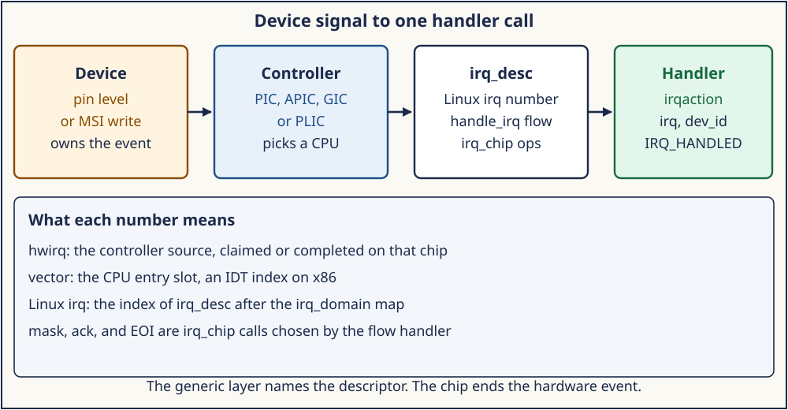
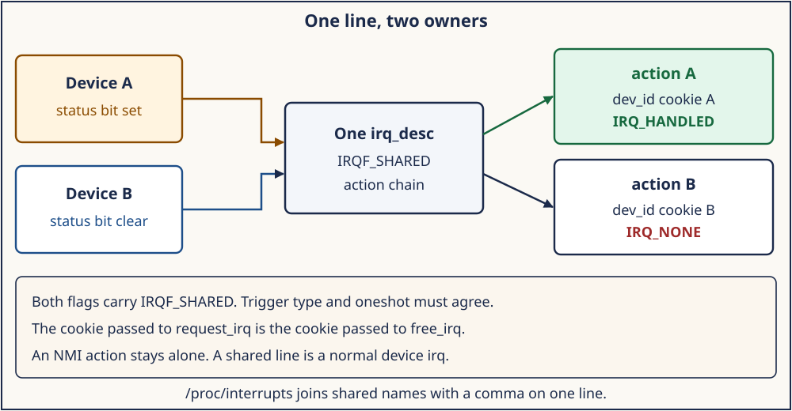

# Day 4 — Hardware Interrupts, IRQ Descriptors, and Handlers

**Target time:** approximately 3 hours

- An IRQ is a different entry from a fault: 25 minutes
- Linux 0.12's 8259 and fixed IDT slots: 40 minutes
- `irq_desc`, sharing, affinity, and chip order: 80 minutes
- Mastery, then the wrapper: 25 minutes

> A device asks for service. A controller turns that request into a CPU
> entry. Linux names the entry with an `irq_desc` and walks a chain of
> handlers. Mask, acknowledge, and end-of-interrupt stay with the chip.

Day 3 entered because an instruction could not finish. This day enters
because a device asked. The classification stays: a page fault, a
system call, and a device IRQ share a saved context and reach different
functions. Today follows the device path from the controller to
`action->handler`.

The 6.12 excerpts are from `/home/jd/Documents/linux-6.12`, tag `v6.12`,
commit `adc218676eef25575469234709c2d87185ca223a`. The 0.12 excerpts are
from the historic `linux-0.12` tree. Record `uname -r` before you treat
a 6.12 line number as true of the booted kernel.

## 1. Syntax needed for this source

The handler is a function pointer. A shared line is a linked list. The
controller operation is another function pointer on a struct.

```c
typedef irqreturn_t (*irq_handler_t)(int irq, void *dev_id);

struct irqaction {
    irq_handler_t handler;
    void *dev_id;
    struct irqaction *next;
};

struct irq_chip {
    void (*irq_ack)(struct irq_data *data);
    void (*irq_mask)(struct irq_data *data);
    void (*irq_eoi)(struct irq_data *data);
};
```

`dev_id` is the cookie the driver passed to `request_irq`. `next` is
how a second driver joins the same Linux irq number. Any chip pointer
may be NULL. A flow handler tests the pointer before it calls through
it.

An x86 gate is a different object. `include/asm/system.h` in Linux 0.12
builds an IDT entry from a type and a DPL. Type 14 is an interrupt
gate: the CPU clears IF. Type 15 is a trap gate: IF is left as it was.
DPL 0 accepts the gate from the kernel. DPL 3 is what makes a software
`int` reachable from user mode. Day 2 used DPL 3 for the syscall. A
device IRQ uses the interrupt-gate form.

## 2. An IRQ and an exception take different entries

An exception is tied to the instruction stream. Divide error, invalid
opcode, page fault, and a system call the program executed happen
because of something the CPU was already doing. Day 3's vector 14 is
the page-fault case: `CR2` and the error code describe that access.

An interrupt is a request from outside that instruction. A timer
expires. A disk controller finishes. A network device has a packet.
The CPU finishes or aborts the current instruction according to the
architecture and vectors to a stub the kernel installed. The
interrupted instruction is the victim. It is not the cause.

Linux keeps both in one vector table on x86, then splits them in
software. Exception stubs land in trap handlers such as
`exc_page_fault`. Device IRQs on the common path land in
`common_interrupt`. NMI uses a stricter entry. The generic IRQ layer
below is the device path. A page fault does not allocate an `irq_desc`.

## 3. Linux 0.12 first: one 8259 pair and fixed IDT slots

Linux 0.12 is a uniprocessor 80386 kernel. It has no `irq_desc`, no
`irq_chip`, and no `request_irq`. The controller is a pair of Intel
8259 chips. `boot/setup.S` reprograms them in real mode, lines 152–185.
The comment says the BIOS had placed hardware interrupts at `0x08`,
which collides with CPU exception vectors, so the kernel moves them to
`0x20`–`0x2F`.

The sequence sends `0x11` to command ports `0x20` and `0xA0`, then
writes vector base `0x20` to the master data port `0x21` and base
`0x28` to the slave data port `0xA1`. Cascade identity `0x04` tells the
master that the slave hangs off IRQ2. Identity `0x02` tells the slave
its cascade id. Mode byte `0x01` selects 8086 mode. A final `0xFF` on
both data ports masks every input until a driver clears its bit.

IRQ0, the 8254 timer, therefore enters at IDT slot `0x20`. The slave's
first input enters at slot `0x28`. Those addends are the whole "irq
domain" this kernel has.

`include/asm/system.h`, lines 33–40, names the gate helpers:

```c
#define set_intr_gate(n,addr) \
	_set_gate(&idt[n],14,0,addr)

#define set_trap_gate(n,addr) \
	_set_gate(&idt[n],15,0,addr)

#define set_system_gate(n,addr) \
	_set_gate(&idt[n],15,3,addr)
```

`kernel/traps.c`, `trap_init`, lines 185–212, installs exception gates,
fills the rest of the first 48 slots with `reserved`, then overrides
slot 45 with `irq13` and slot 39 with `parallel_interrupt`. It clears
the master's IRQ2 mask (`inb_p(0x21)&0xfb`) so the cascade is visible,
and the slave's IRQ13 mask (`inb_p(0xA1)&0xdf`) for the coprocessor.

`kernel/sched.c`, `sched_init`, lines 438–443, programs the PIT and
opens the timer:

```c
	outb_p(0x36,0x43);		/* binary, mode 3, LSB/MSB, ch 0 */
	outb_p(LATCH & 0xff , 0x40);	/* LSB */
	outb(LATCH >> 8 , 0x40);	/* MSB */
	set_intr_gate(0x20,&timer_interrupt);
	outb(inb_p(0x21)&~0x01,0x21);
	set_system_gate(0x80,&system_call);
```

`&~0x01` clears the IRQ0 mask. The timer gate is type 14, DPL 0. The
syscall gate is type 15, DPL 3. Same IDT, different type and privilege.

The stub in `kernel/sys_call.s`, `_timer_interrupt`, lines 189–211,
saves registers, loads kernel data segments, increments `jiffies`, and
writes `0x20` to port `0x20`. That byte is a nonspecific
end-of-interrupt to the master 8259. Then it masks the saved CS with 3
to recover the CPL and calls `do_timer`. The EOI is early. The 8259 may
post another timer IRQ as soon as it accepts that byte.

`do_timer`, lines 346–367, charges `utime` or `stime` from the CPL.
When the user-mode quantum hits zero it calls `schedule`. A kernel-mode
tick sets `counter` to zero and returns without scheduling. Day 6
returns to that CPL test. Today the point is that the handler and the
EOI are this one stub.

The hard-disk stub, lines 235–258 of the same file, EOIs the slave at
`0xA0` and the master at `0x20`, exchanges `_do_hd` with NULL, and
calls through that pointer. One planted function, not a list. A second
driver cannot join that pointer.

What carries forward is a controller that maps a wire to a vector, a
mask bit, an EOI, and a C function. The port numbers, the two-chip
cascade, and the fixed bases stay in 1992.

## 4. Evolution: APIC, MSI, domains, generic IRQ

A second CPU has no single 8259 both processors share in the 0.12 way.
An I/O APIC watches device wires and sends a message to a local APIC
on one CPU. Software chooses the target CPU. That choice is affinity.

Message signaled interrupts remove the wire. The device writes a small
message to an address the controller published. `include/linux/msi.h`,
`struct msi_msg`, lines 61–74, holds `address_lo`, `address_hi`, and
`data`. `irq_chip.irq_write_msi_msg` programs them. A message that
already names its source is a poor match for the 8259 habit of hanging
two devices on one wire. MSI lines are usually exclusive. A shared
legacy wire still exists on machines that have one.

The Linux number and the hardware number diverged. `struct irq_domain`
in `include/linux/irqdomain.h`, lines 169–176, is the map: a name, ops,
a root, and a reverse map from `hwirq` to a Linux irq. The Linux irq is
the index of an `irq_desc`. A hierarchy of domains is how an MSI domain
sits on a vector domain on an APIC. The 0.12 identity "IRQ0 is IDT
slot `0x20`" is the special case where the map is a constant addend.

The generic layer lives in `kernel/irq/`. Flow handlers know about
level, edge, and end-of-interrupt. Chip drivers fill `irq_mask`,
`irq_ack`, and `irq_eoi`. Device drivers call `request_irq`. They do
not write IDT gates.

## 5. ToyOS reconstructs the PIC path

ToyOS keeps the 0.12 shape on purpose, in long mode.
`projects/toyos/src/arch.c`, `pic_and_pit_init`, lines 183–201, sends
`0x11` to `0x20` and `0xA0`, bases `0x20` and `0x28`, cascade `0x04`
and `0x02`, then masks the master with `0xfe` so only IRQ0 is open.
The PIT divisor `11932` is about 100 Hz.

`arch_init` installs exception gates with attribute `0x8e` and puts
`irq0_stub` on vector 32. `projects/toyos/src/isr.S`, lines 52–56,
pushes a dummy error and the vector 32, then `isr_common` saves the
general registers and calls `interrupt_handler` with the frame in
`rdi`.

`interrupt_handler`, lines 252–258, increments `ticks`, writes `0x20`
to port `0x20`, and calls `scheduler_tick` when that milestone is
built. The write is the same master EOI as `_timer_interrupt`. ToyOS
has one timer handler and no `irq_desc`. The descriptor chain is what
the 6.12 reading adds.

## 6. Linux 6.12: descriptor, chip, action, and the walk

`include/linux/irqdesc.h`, lines 67–73:

```c
/* tree adc218676eef (Linux 6.12)
 * path: include/linux/irqdesc.h
 * lines: 67–73
 * function: struct irq_desc
 */
struct irq_desc {
	struct irq_common_data	irq_common_data;
	struct irq_data		irq_data;
	struct irqstat __percpu	*kstat_irqs;
	irq_flow_handler_t	handle_irq;
	struct irqaction	*action;	/* IRQ action list */
```

`handle_irq` is the flow handler. `action` is the driver chain.
`kstat_irqs` is the per-CPU counter `/proc/interrupts` prints.
`irq_data` carries the Linux irq, the hwirq, the chip, and the domain.
`lock` is the `raw_spinlock_t` the flow handler holds around the chip
calls.

`include/linux/irq.h`, lines 501–512, is the chip: `irq_ack`,
`irq_mask`, `irq_mask_ack`, `irq_unmask`, `irq_eoi`, and
`irq_set_affinity` just below them. `kernel/irq/chip.c`,
`mask_ack_irq`, lines 409–418, calls `irq_mask_ack` when it is set and
otherwise calls `irq_mask` plus `irq_ack`.

`include/linux/interrupt.h`, lines 122–136, is the registration:
`handler`, `dev_id`, `next`, `thread_fn`, `thread`, `irq`, `flags`,
and `name`. `handler` is the hardirq function. `thread_fn` is Day 5.
`IRQF_SHARED` is `0x00000080` at line 74.

`request_irq`, lines 168–172, calls `request_threaded_irq` with a NULL
thread function and adds `IRQF_COND_ONESHOT`. Return codes are in
`include/linux/irqreturn.h`, lines 11–15: `IRQ_NONE` is 0,
`IRQ_HANDLED` is 1, `IRQ_WAKE_THREAD` is 2.



*The controller picks a CPU and a hardware number. The domain names an irq_desc. The flow handler calls the action.*

On x86-64 the entry stubs push the vector. `arch/x86/entry/entry_64.S`,
lines 367–378, says the vector occupies the error-code slot and the
common path is cache-line aligned. `arch/x86/kernel/irq.c`,
`call_irq_handler`, lines 252–259, reads `vector_irq[vector]` on this
CPU. A real descriptor goes to `handle_irq`, which on x86-64 calls
`generic_handle_irq_desc`, which is `desc->handle_irq(desc)`.

`kernel/irq/handle.c`, `__handle_irq_event_percpu`, lines 147–163,
walks the chain:

```c
/* tree adc218676eef (Linux 6.12)
 * path: kernel/irq/handle.c
 * lines: 147–163
 * function: __handle_irq_event_percpu
 */
	for_each_action_of_desc(desc, action) {
		irqreturn_t res;

		trace_irq_handler_entry(irq, action);
		res = action->handler(irq, action->dev_id);
		trace_irq_handler_exit(irq, action, res);

		if (WARN_ONCE(!irqs_disabled(),"irq %u handler %pS enabled interrupts\n",
			      irq, action->handler))
			local_irq_disable();
```

Trace one exclusive line. The local APIC presents a vector. The IDT
stub enters `common_interrupt`. `vector_irq[vector]` yields the
descriptor. The flow handler talks to the chip and calls
`handle_irq_event`. That function drops `desc->lock` for the walk
(lines 202–214) and takes it again after. The action runs with the
Linux irq number and the driver's cookie.

`common_interrupt`, lines 278–288, calls `apic_eoi` only when
`call_irq_handler` returns nonzero. That return is the unused-vector
path. The successful path ends the interrupt in the chip.
`arch/x86/kernel/apic/vector.c`, `apic_ack_irq`, lines 907–910, calls
`irq_move_irq` and then `apic_eoi`.

## 7. Shared IRQ ownership

`kernel/irq/manage.c`, `__setup_irq`, lines 1617–1648, runs when a
second action arrives. The comment says both flag words must have
`IRQF_SHARED`, the trigger type must match, and oneshot must agree.
NMI lines cannot be shared. The test is:

```c
		if (!((old->flags & new->flags) & IRQF_SHARED) ||
		    (oldtype != (new->flags & IRQF_TRIGGER_MASK)))
			goto mismatch;
```

The `mismatch` label at line 1840 prints `Flags mismatch irq %d`.
`request_threaded_irq`, lines 2172–2173, rejects a shared request whose
`dev_id` is NULL, because `free_irq` finds the action by that cookie.
The kernel-doc at lines 2139–2140 says the same thing.

Each handler reads its own device and returns `IRQ_NONE` when the
status bit is clear. The walk ORs the return values. `note_interrupt`
watches a line nobody claims. A handler that returns `IRQ_HANDLED` for
a foreign event hides the real owner.



*Device A handles the event. Device B returns IRQ_NONE. Each cookie is the argument free_irq will need.*

`kernel/irq/proc.c`, `show_interrupts`, lines 522–526, prints the chain
with commas:

```c
	action = desc->action;
	if (action) {
		seq_printf(p, "  %s", action->name);
		while ((action = action->next) != NULL)
			seq_printf(p, ", %s", action->name);
	}
```

A comma is evidence of sharing. It is evidence that both devices fired
only after you read their status bits, which `/proc/interrupts` does
not show.

## 8. Top-half limits and affinity

The warning in section 6 fires when a hardirq handler turns interrupts
back on. The sleep rules are Day 6. The consequences that matter today:

- The handler does not take a mutex, allocate with `GFP_KERNEL`, or
  copy from a user address that might fault.
- It leaves the device quiet enough that the same event will not be
  redelivered the instant the flow unmasks or sends EOI.
- It returns `IRQ_HANDLED`, `IRQ_NONE`, or `IRQ_WAKE_THREAD`. The last
  without a `thread_fn` hits `warn_no_thread` in the same loop.
- It does not assume it holds `desc->lock`. The walk drops that lock.

`irq_set_affinity` in `kernel/irq/manage.c`, lines 472–482, takes a
cpumask and fails when the mask has no online CPU. The call reaches
`chip->irq_set_affinity` when the chip implements it. The 8259 has
nowhere to store a CPU mask. An I/O APIC or a GIC redistributor can
steer the next interrupt. An interrupt a CPU has already accepted is
not steered by the next write. `apic_ack_irq` runs `irq_move_irq` at
EOI so a pending move completes on a boundary the hardware understands.

`/proc/irq/N/smp_affinity` is the userspace view on kernels that export
it. This day's wrapper reads `/proc/interrupts`. It does not write
affinity. `IRQF_NOBALANCING` and `IRQF_PERCPU` opt a line out of being
moved. A local APIC timer is per CPU. It is not a device wire you aim
at another package.

## 9. Architecture lens: mask, ack, and EOI

The order is the flow handler plus the chip. Three handlers in
`kernel/irq/chip.c` are the patterns.

Level. `handle_level_irq`, lines 628–650, calls `mask_ack_irq`, runs
the handler, then `cond_unmask_irq`. A level line stays asserted while
the device is requesting service. Masking stops a reentry until the
handler has cleared the device. The kernel-doc at lines 619–626 says
that directly.

Edge. `handle_edge_irq`, lines 787–834, acknowledges once, then loops
while `IRQS_PENDING` is set. An edge that arrives during the handler is
latched. The comment at lines 772–785 says the edge must be acked to be
reenabled, and that a second edge may require a mask depending on the
controller.

Fast EOI. `handle_fasteoi_irq`, lines 678–736, runs the handler and
then `chip->irq_eoi` through `cond_unmask_eoi_irq`. The comment says
the chip receives a single end callback. Oneshot threaded interrupts
mask until the thread finishes. `IRQCHIP_EOI_THREADED` can defer that
EOI until unmask. Day 5 is the thread.

x86. The successful device path uses `apic_ack_irq`, which writes the
local APIC EOI register. `common_interrupt` writes that register itself
only for a vector with no descriptor.

ARM GICv3. `drivers/irqchip/irq-gic-v3.c`, `gic_mask_irq`, lines
462–464, pokes `GICD_ICENABLER`. `gic_eoi_irq`, lines 695–698, writes
the hwirq to `ICC_EOIR1_EL1` and issues `isb`. The end register is a
system register, not port `0x20`. The erratum path writes
`GICD_ICACTIVER` after a `dsb`. Priority masking through `ICC_PMR_EL1`
is a further switch in this file. The order "write EOIR, then
deactivate" is a GICv3 rule.

RISC-V PLIC. `drivers/irqchip/irq-sifive-plic.c`, lines 369–387, claims
by reading `CONTEXT_CLAIM` and calls `generic_handle_domain_irq`.
`plic_irq_eoi`, lines 154–164, writes the hwirq back to that register.
The comment says claim, then complete, and that the complete enables
the source again. The claim read is the acknowledge. The write is the
completion. There is no 8259 EOI byte and no LAPIC EOI register.

Same Linux objects, three chip sequences. Read `desc->handle_irq` and
the chip pointers before you decide which write happens first.

## 10. Execution trace: one timer, then one shared line

Trace the 0.12 timer with the objects that exist in that tree.

1. The PIT counts down and asserts IRQ0 on the master 8259.
2. The master presents vector `0x20` because setup wrote that base.
3. The IDT interrupt gate at slot `0x20` clears IF and enters
   `_timer_interrupt`.
4. The stub increments `jiffies` and writes `0x20` to port `0x20`.
5. `do_timer` charges the current task and may call `schedule` when
   the interrupted CPL is 3 and the quantum is spent.
6. `ret_from_sys_call` restores the frame. IF returns with the
   interrupted `EFLAGS`.

There is no domain lookup and no action list. The vector number is the
Linux identity of the line.

Trace a shared level line on the 6.12 x86 path. The numbers below are
roles, not a claim about your machine's `/proc/interrupts`.

1. Two drivers have called `request_irq` with `IRQF_SHARED`, the same
   trigger flags, and distinct `dev_id` cookies. `__setup_irq` linked
   the second `irqaction` onto `desc->action`.
2. The device that owns the event asserts the wire. The I/O APIC
   delivers a vector to one CPU's local APIC, chosen from the affinity
   mask.
3. `common_interrupt` reads `vector_irq[vector]` and calls
   `desc->handle_irq`. For a level flow that is `handle_level_irq`.
4. `mask_ack_irq` masks the line. The wire may stay asserted. The
   controller will not present it again until the unmask.
5. `__handle_irq_event_percpu` calls driver A. Driver A sees its status
   bit and returns `IRQ_HANDLED`. Driver B sees a clear bit and returns
   `IRQ_NONE`.
6. `cond_unmask_irq` unmasks because the line is enabled and
   `threads_oneshot` is clear. `apic_ack_irq` writes the local APIC EOI
   when this chip's flow reaches `irq_eoi`. The exact call sits in the
   chip, which for the APIC vector domain is `apic_ack_irq`.
7. `show_interrupts` will later print both names joined by a comma, and
   `kstat_irqs` will have incremented on the CPU that ran step 3.

A GICv3 trace replaces steps 2 and 6. The redistributor presents the
interrupt, `gic_mask_irq` clears an enable bit, and `gic_eoi_irq`
writes `ICC_EOIR1_EL1`. A PLIC trace claims by reading `CONTEXT_CLAIM`
and completes by writing the hwirq back. The action walk in step 5 is
the part that stays.

## 11. Spurious lines, depth, and a disconnected irq

`note_interrupt`, called from `handle_irq_event_percpu` when the irq is
not marked `no_debug`, watches the OR of the action return values. A
line that keeps returning `IRQ_NONE` increments `irqs_unhandled` on the
descriptor. The fields are in `struct irq_desc`: `irq_count`,
`last_unhandled`, and `irqs_unhandled` (`include/linux/irqdesc.h`,
lines 78–80). The core can then try to quiet a stuck line. That
accounting is why a shared handler must return `IRQ_NONE` when the
device is idle. Returning `IRQ_HANDLED` for every invocation makes a
stuck peer look healthy.

`depth` on the same struct counts nested `disable_irq` calls. The
comment in the header calls it disable-depth. The line stays masked
until the matching enables bring the depth back to zero. This is a
software nest count. It is not the hardware mask bit by itself. The
flow handler consults `irqd_irq_disabled` and leaves a disabled line
masked, setting `IRQS_PENDING` so a later enable can replay it.
`handle_level_irq` does that at lines 642–644 when `action` is missing
or the irq is disabled.

`IRQ_NOTCONNECTED` is `(1U << 31)` in `include/linux/interrupt.h`, lines
140–148. `request_threaded_irq` returns `-ENOTCONN` immediately when
the irq number equals that sentinel (lines 2156–2157). The comment says
a PCI device whose interrupt is not wired gets this value so the driver
can tell "not connected" from a generic failure. It is not a vector,
and it is not a line you will find in `/proc/interrupts`.

None of these three mechanisms exist in Linux 0.12. A spurious disk
interrupt there calls `_unexpected_hd_interrupt` because `do_hd` was
NULL. The 6.12 version is a counter, a depth, and a sentinel number,
each with a different job.

## 12. Safe evidence

Run
[`../challenges/day-004-interrupts.sh`](../challenges/day-004-interrupts.sh).
The wrapper greps the pinned tree for the gate helper, `IRQF_SHARED`,
`handle_level_irq`, `gic_eoi_irq`, and the PLIC claim comment. When
`/proc/interrupts` is readable it prints a short summary and any line
that contains a comma. It does not write `smp_affinity`, load a module,
or call `request_irq`.

Before you run it, write three predictions. Which field on a numbered
line is the chip name. Whether any line contains a comma, and what
section 7 says that comma means. Which lines are words rather than
numbers. On x86, `arch_show_interrupts` adds names such as `NMI` and
`LOC` after the numbered irqs. Day 7 reads that function.

## 13. Mastery: Explain · Draw · Observe · Build

### Explain

A page fault and a device IRQ can share a saved frame and still reach
different functions. Linux 0.12 stores the timer at IDT slot `0x20` and
writes EOI to port `0x20`. A GICv3 machine keeps the idea of a mask and
an end operation and uses `GICD_ICENABLER` and `ICC_EOIR1_EL1`.
`irq_desc->handle_irq` is the flow. `irqaction->handler` is the driver.
A shared registration passes a non-NULL `dev_id`. `IRQ_NONE` means this
device did not own the event. `handle_level_irq` masks before the
driver. `handle_fasteoi_irq` ends through `irq_eoi`.

### Draw

1. The path figure with three numbers: hwirq, vector, Linux irq. Use a
   line from `/proc/interrupts` if you have one, or the 0.12 timer
   (wire 0, vector `0x20`, no domain).
2. Two actions on one descriptor, and the `free_irq` cookie that
   removes only one of them.
3. Level versus fast-EOI: where mask sits relative to the handler, and
   where EOI sits.

### Observe

From the wrapper, record `uname -r` and one numbered line's chip field.
If a comma appears, copy both names. If the tree grep finds
`gic_eoi_irq` and `plic_irq_eoi`, record that both exist in this commit
and that a running machine uses one of them.

### Build

Write a one-page trace of one interrupt from the device to the return.
Use the 0.12 timer if you want the whole stub in view, and name the
6.12 objects that replace the `outb` to port `0x20`. End with the
sentence you will stand on: mask, ack, and EOI order come from the flow
handler and the `irq_chip`.

### Why? notebook

1. Why does 0.12 `setup.S` move the 8259 bases from `0x08` to `0x20`?
2. Why is the timer gate type 14 while the syscall gate is type 15
   with DPL 3?
3. Why does `_timer_interrupt` write port `0x20` before `do_timer`?
4. Why is `vector_irq[vector]` not the same integer as the Linux irq
   on a modern x86 machine?
5. Why does `__setup_irq` require both actions to pass `IRQF_SHARED`?
6. Why does `free_irq` need the same `dev_id` the driver passed in?
7. Why does `handle_level_irq` mask before the driver runs?
8. Why does `common_interrupt` call `apic_eoi` on the failure return?
9. Why is a PLIC complete a write of the hwirq, not a write of `0x20`?

**Next:** Day 5 moves the long part of the handler out of hardirq into
a softirq, a threaded handler, or a workqueue. The descriptor and the
chip order from this day stay in place. What changes is which context
runs after the top half returns.

Sleep rules for that later context are Day 6.
