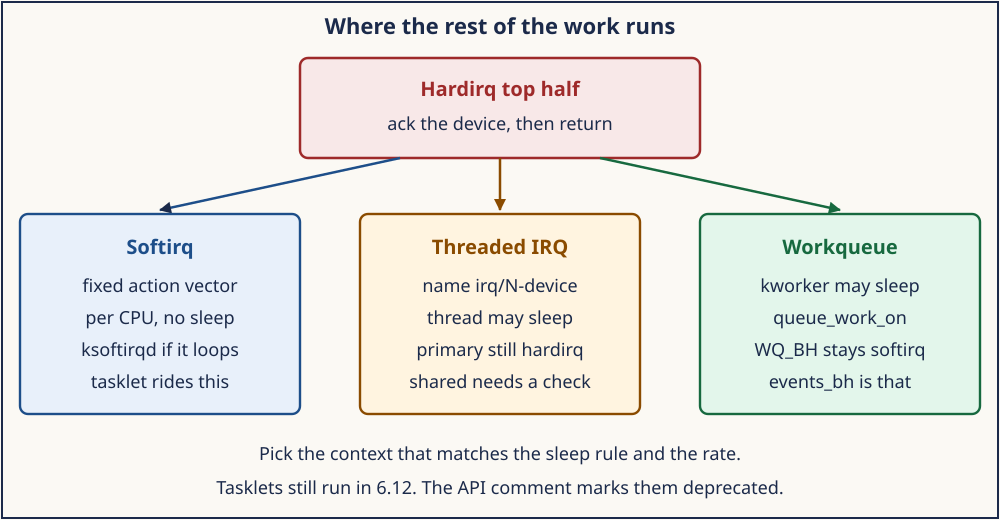
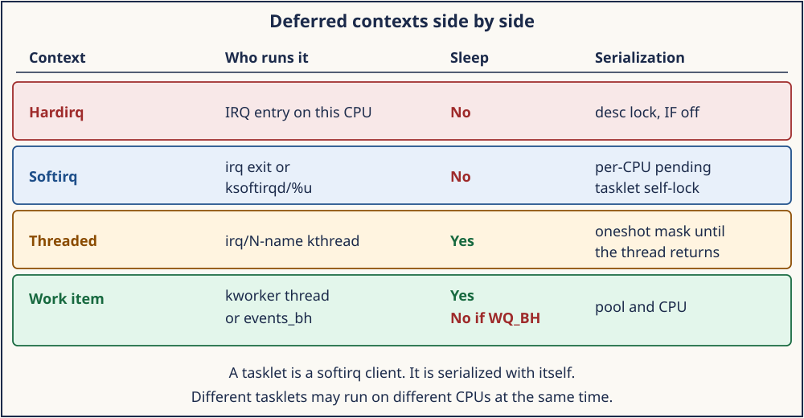

# Day 5 — Softirqs, Threaded IRQs, and Workqueues

**Target time:** approximately 3 hours

- Why the hardirq path has to end: 25 minutes
- What Linux 0.12 deferred, and the table it does not have: 35 minutes
- Softirq, tasklet, threaded IRQ, and workqueue in 6.12: 80 minutes
- Mastery, then the wrapper: 25 minutes

> The hardirq handler acknowledges the device and returns. The rest of
> the work runs in a context that matches its length and its need to
> sleep. Linux 6.12 has softirqs, threaded IRQ handlers, and workqueues.
> Tasklets still run, and the header marks that API deprecated.

Day 4 ended in `action->handler`. This day is what that function is
allowed to start, and who finishes it.

The 6.12 excerpts are from `/home/jd/Documents/linux-6.12`, tag `v6.12`,
commit `adc218676eef25575469234709c2d87185ca223a`. The 0.12 excerpts are
from the historic `linux-0.12` tree. Record `uname -r` beside any line
you copy from the booted kernel.

## 1. Syntax needed for this source

A pending set is a bitmask. A handler table is an array of function
pointers indexed by that bit. A work item is a struct on a list.

```c
unsigned long pending;
void (*action)(void);

while ((bit = ffs(pending))) {
    action();
    pending >>= bit;
}

struct work_struct {
    atomic_long_t data;
    struct list_head entry;
    work_func_t func;
};
```

`ffs` returns the index of the least significant set bit, one-based.
Shifting `pending` by that count drops the bit just handled. The
softirq function pointer has no `dev_id`. The action looks at per-CPU
data.

The work item's `data` word packs flags and a pool pointer. `entry` is
the list node. `func` runs later. The caller of `queue_work_on` does
not call `func`.

## 2. Why the rest of the work leaves the hardirq

Day 4's top half runs with the interrupted context still on the stack
and, on the normal path, with the CPU's interrupt mask closed. A packet
copy or a sleep either holds that mask or reopens it and accepts
nesting. Linux 0.12 already shows the pressure. `do_timer` runs inside
`_timer_interrupt` after the EOI. The EOI lets the 8259 raise another
timer interrupt. Anything slow in that function delays every other
interrupt and the task that was running.

The split is: the hardirq path records the event and quiets the device;
a later context does the long part. That later context has to answer
three questions. Which CPU runs it? May it sleep? What stops two runs
of the same work from overlapping?

## 3. Linux 0.12 first: queues and pointers, no bottom-half table

A search of the Linux 0.12 tree finds no `bh_base`, no `bh_active`, and
no `bh_mask`. The bottom-half bitmap is a later design. This kernel
defers work with three mechanisms you can read end to end. Do not paste
a 32-slot `bh_base` into this tree.

The timer list is walked inside the interrupt. `kernel/sched.c`,
`do_timer`, lines 351–361:

```c
	if (next_timer) {
		next_timer->jiffies--;
		while (next_timer && next_timer->jiffies <= 0) {
			void (*fn)(void);

			fn = next_timer->fn;
			next_timer->fn = NULL;
			next_timer = next_timer->next;
			(fn)();
		}
	}
```

`fn` runs before `_timer_interrupt` returns. The list is the ancestor
of timer softirq in the sense that a tick drains expired callbacks.
The callback's context is the timer interrupt. `do_timer` also calls
`schedule` when the user-mode quantum expires and the CPL is not zero
(lines 364–367). A kernel-mode tick does not reschedule. There is no
separate bottom-half pass after the stub.

The hard disk uses a planted function pointer. `kernel/sys_call.s`,
lines 251–258:

```asm
	xorl %edx,%edx
	xchgl _do_hd,%edx
	testl %edx,%edx
	jne 1f
	movl $_unexpected_hd_interrupt,%edx
1:	outb %al,$0x20
	call *%edx		# "interesting" way of handling intr.
```

`xchgl` takes `do_hd` and clears it. The driver stored the completion
function before starting the command. One pointer, one CPU, no chain.
The floppy stub does the same with `do_floppy`.

The tty path is the one that wakes a sleeper later.
`kernel/chr_drv/tty_io.c`, `sleep_if_empty`, lines 97–103, closes
interrupts with `cli`, sleeps on `queue->proc_list` while the queue is
empty, and opens interrupts with `sti`. The keyboard interrupt fills
the queue and wakes the sleeper. The bytes move in the interrupt. The
reader runs afterward because it was asleep. `cli` is the lock. There
is one CPU, so closing IF is enough.

What carries forward is the split between "the device is quiet" and
"a process consumes the data," plus a queue and a sleep. What stays in
1992 is timer callbacks inside the interrupt and one global function
pointer per block device.

## 4. Evolution: bitmap, softirq, tasklet, thread, workqueue

Later uniprocessor kernels added a bottom-half bitmap: pending bits, a
mask, and a table of functions run on the way out of an interrupt.
That design is not in the 0.12 tree opened here, so this file does not
invent line numbers for it. The properties people used it for show up
in the 6.12 successors: a small fixed set of deferred slots, run soon
without scheduling a process, and serialized on one CPU because there
was one CPU.

SMP breaks "one CPU implies one run." Softirqs keep the pending bitmask
and make it per CPU. Tasklets sit on two of those slots and add "this
callback does not run on two CPUs at once." Threaded IRQs move the long
part into a kernel thread that may sleep. Workqueues move other work
onto worker threads. One workqueue flag runs the function back in
softirq context.

`include/linux/interrupt.h` still contains both generations of advice.
Lines 549–553 tell you not to add a new softirq number:

```c
/* tree adc218676eef (Linux 6.12)
 * path: include/linux/interrupt.h
 * lines: 549–553
 */
/* PLEASE, avoid to allocate new softirqs, if you need not _really_ high
   frequency threaded job scheduling. For almost all the purposes
   tasklets are more than enough. F.e. all serial device BHs et
   al. should be converted to tasklets, not to softirqs.
 */
```

Lines 626–632, immediately above `struct tasklet_struct`, say:

```c
/* Tasklets --- multithreaded analogue of BHs.

   This API is deprecated. Please consider using threaded IRQs instead:
   https://lore.kernel.org/lkml/20200716081538.2sivhkj4hcyrusem@linutronix.de
```

Both comments are in this commit. The first is about the scarce softirq
vector: do not add an eleventh `NR_SOFTIRQS` entry for a device. The
second is about the tasklet API: consider a threaded IRQ for new code.
The second does not delete the first. The first does not cancel the
deprecation. Tasklets are compiled, exported, and called by existing
drivers in 6.12. "Removed" would be false. "The recommended API for new
code" would also be false, because the struct comment says deprecated.

Two helpers carry a narrower warning. `tasklet_disable_in_atomic`,
lines 736–738, says "Do not use in new code." `tasklet_unlock_spin_wait`
in `kernel/softirq.c`, lines 843–846, says the same about waiting for a
tasklet from atomic context. Those sentences are about those waits.
They are not a removal of `tasklet_schedule`.

The header still documents the runtime rules at lines 631–646. A
tasklet runs on one CPU at a time. Different tasklets may run on
different CPUs. A second schedule while one is queued collapses to one
run. A schedule while it is running reschedules it. Anything shared
with a different tasklet uses a spinlock.

## 5. ToyOS runs the tick inside the interrupt

ToyOS has the 0.12 timer shape. Vector 32 in `interrupt_handler`
increments `ticks`, writes the PIC EOI, and calls `scheduler_tick`
before it returns. There is no softirq pending word, no `ksoftirqd`,
and no `irq/N-name` thread. The scheduler tick is part of the interrupt
stack. Linux 6.12's `TIMER_SOFTIRQ` is the later split of that work.

## 6. The softirq vector and who runs it

The fixed enum is `include/linux/interrupt.h`, lines 555–569:

```c
enum
{
	HI_SOFTIRQ=0,
	TIMER_SOFTIRQ,
	NET_TX_SOFTIRQ,
	NET_RX_SOFTIRQ,
	BLOCK_SOFTIRQ,
	IRQ_POLL_SOFTIRQ,
	TASKLET_SOFTIRQ,
	SCHED_SOFTIRQ,
	HRTIMER_SOFTIRQ,
	RCU_SOFTIRQ,    /* Preferable RCU should always be the last softirq */

	NR_SOFTIRQS
};
```

Ten slots. `HI_SOFTIRQ` runs tasklet-hi. `TASKLET_SOFTIRQ` runs
ordinary tasklets. `open_softirq` installs the function. Adding a name
here is the allocation the comment in section 4 asks you to avoid.

`raise_softirq` saves the interrupt mask and calls
`raise_softirq_irqoff`. `kernel/softirq.c`, lines 667–684:

```c
/* tree adc218676eef (Linux 6.12)
 * path: kernel/softirq.c
 * lines: 667–684
 * function: raise_softirq_irqoff
 */
inline void raise_softirq_irqoff(unsigned int nr)
{
	__raise_softirq_irqoff(nr);
	/*
	 * If we're in an interrupt or softirq, we're done
	 * (this also catches softirq-disabled code). We will
	 * actually run the softirq once we return from
	 * the irq or softirq.
	 *
	 * Otherwise we wake up ksoftirqd to make sure we
	 * schedule the softirq soon.
	 */
	if (!in_interrupt() && should_wake_ksoftirqd())
		wakeup_softirqd();
}
```

A raise from hardirq sets the per-CPU pending bit and returns.
`__irq_exit_rcu`, lines 627–637, subtracts `HARDIRQ_OFFSET` and, when
the pending mask is set and the CPU is no longer in interrupt context,
calls `invoke_softirq`.

`handle_softirqs` bounds the loop with `MAX_SOFTIRQ_TIME` and
`MAX_SOFTIRQ_RESTART`. Lines 542–561 call `h->action()` and complain if
`preempt_count` changes across the call. If the mask is still set when
the budget runs out, the function wakes `ksoftirqd`. The thread's
`comm` is `ksoftirqd/%u` (line 971).

The action runs with the softirq count raised. `ksoftirqd` is a task.
The actions it enters are still softirq context for
`in_serving_softirq`. Day 6 draws that bit. Sleeping in the action is
the bug `might_sleep` reports.

Each CPU has its own pending mask. The same softirq number can run on
two CPUs at once. The action uses per-CPU lists or a lock. A tasklet is
the exception inside that rule.



*Softirq stays non-sleeping and per CPU. A threaded handler may sleep. A normal work item may sleep. WQ_BH stays in softirq context.*

## 7. Tasklets: still here, marked deprecated, serialized with themselves

`tasklet_schedule` sets `TASKLET_STATE_SCHED` and, if it was clear,
queues the tasklet on this CPU's `tasklet_vec` and raises
`TASKLET_SOFTIRQ`. If the bit was already set, the second schedule does
not queue a second copy.

`tasklet_action_common`, lines 763–792, pulls that per-CPU list and
tries `tasklet_trylock`. On SMP the lock is `TASKLET_STATE_RUN`. The
same tasklet running on another CPU fails the trylock and is put back.
Different tasklets take different struct bits, so they overlap. On a
uniprocessor build the trylock returns true, which matches the old one
CPU story.

`tasklet_kill` prints `Attempt to kill tasklet from interrupt` when
`in_interrupt` is true, then waits until the scheduled bit clears. That
wait sleeps. It belongs in process context.

Status line for this commit: the implementation runs. The API comment
says deprecated and names threaded IRQs. Existing drivers still call
`tasklet_setup`. New code in this course follows the deprecation
comment. The older "tasklets are more than enough" sentence remains the
reason not to add a softirq slot for a device.

## 8. Threaded IRQs

`request_threaded_irq` takes a primary `handler` and a `thread_fn`.
The kernel-doc in `kernel/irq/manage.c`, lines 2126–2146, is the
contract. The primary still runs in hardirq context and checks whether
this device raised the line. If it did, it quiets the device and
returns `IRQ_WAKE_THREAD`. The comment says this split is required for
shared interrupts. `IRQF_ONESHOT` runs `thread_fn` with the line
masked.

`__handle_irq_event_percpu` calls `__irq_wake_thread` for
`IRQ_WAKE_THREAD`. Waking every thread on a shared chain for every edge
would be wrong. The primary is the filter.

`setup_irq_thread`, lines 1457–1488, creates `irq/%d-%s`, or
`irq/%d-s-%s` for a secondary forced thread. It holds a reference on
the `task_struct` so a late interrupt does not touch a freed task. It
sets `IRQTF_AFFINITY` so the thread moves onto the CPUs the irq
affinity names.

A primary that returns `IRQ_HANDLED` does not wake the thread. The
oneshot unmask path from Day 4 then runs because `threads_oneshot` is
clear. The thread function itself may sleep. A stuck thread holds a
oneshot mask and the device stays quiet. `synchronize_irq` waits on
`threads_active` for that reason.

`force_irqthreads` threads handlers that did not ask for it.
`IRQF_NO_THREAD` opts out. New device code in this lesson follows the
kernel-doc: a primary that can return `IRQ_NONE`, and a `thread_fn`
when the rest may sleep.

## 9. Workqueues, including the ones that do not sleep

`include/linux/workqueue_types.h`, lines 16–20, is `struct work_struct`:
`data`, `entry`, and `func`. `queue_work_on` is declared at
`include/linux/workqueue.h` lines 586–587. A worker thread calls
`func`. That worker is process context. Sleeping blocks the worker, not
the interrupted task.

`WQ_BH` is the exception. Line 370:

```c
	WQ_BH			= 1 << 0, /* execute in bottom half (softirq) context */
```

`kernel/workqueue.c` allocates `system_bh_wq` as `events_bh` with that
flag (line 7802). Lines 5671–5675 say BH workqueues share a single
execution context per CPU. A function queued there follows the softirq
sleep rule. `queue_work` does not tell you the context until you see
which workqueue.

The pending bit collapses a second queue of the same item while the
first is still pending. Flush and cancel wait in process context.
Calling them from the hardirq handler is the same class of mistake as
`tasklet_kill` from interrupt context.

## 10. Context and serialization



*Hardirq and softirq stay non-sleeping. The threaded handler and a normal worker may sleep. WQ_BH follows the softirq row.*

| Context | Runs as | Sleep | Same work overlaps? |
| --- | --- | --- | --- |
| Hardirq handler | IRQ entry on that CPU | no | `desc->lock` covers this irq |
| Softirq action | irq exit or `ksoftirqd/%u` | no | same slot may run on two CPUs |
| Tasklet | `TASKLET_SOFTIRQ` or `HI_SOFTIRQ` | no | one tasklet, one CPU |
| Threaded IRQ | `irq/N-name` | yes | oneshot holds the line |
| Worker | kworker | yes | one item is not queued twice while pending |
| `WQ_BH` item | `events_bh` | no | one BH context per CPU |

High-rate per-CPU work that already has a softirq slot stays there.
Device work that must sleep becomes a threaded IRQ. A retry or a free
that is not the interrupt itself goes to a normal workqueue. A tasklet
is the cell older drivers used for non-sleeping self-serialized work.
The 6.12 header tells new code to consider a threaded IRQ instead.

## 11. One pending bit, from raise to action

Take `TIMER_SOFTIRQ`. The timer hardirq raises that bit with interrupts
still off. `raise_softirq_irqoff` sees `in_interrupt` true and does not
wake `ksoftirqd` yet. The hardirq returns. `__irq_exit_rcu` drops
`HARDIRQ_OFFSET`. The pending mask is nonempty, so `invoke_softirq`
runs.

`ffs` picks the lowest set bit, so `HI_SOFTIRQ` runs before
`TIMER_SOFTIRQ` when both are pending. `h->action()` for the timer slot
is the timer subsystem's softirq, not the device's hardirq handler.
`kstat_incr_softirqs_this_cpu` is the counter `/proc/softirqs` shows.
If `preempt_count` changes across the action, the core prints the
"huh, entered softirq" line and repairs the count. That print is a bug
report.

When the restart budget is spent, `wakeup_softirqd` runs and the
interrupted task gets the CPU back. The softirq thread later enters
`handle_softirqs` again. Lockdep accounts for the handoff.
`lockdep_softirq_start`, lines 485–496, drops the hardirq lockdep state
for the softirq pass, and `lockdep_softirq_end` restores it, so a lock
taken in the softirq is not recorded as a hardirq lock.

`trace_softirq_entry` and `trace_softirq_raise` are the optional
tracefs names Day 7 mentions. Reading `/proc/softirqs` twice is enough
to see the timer row move.

## 12. Three drivers, three choices

The table in section 10 is easier to trust on three concrete jobs.

A network receive that already owns `NET_RX_SOFTIRQ` builds a per-CPU
list in the hardirq, raises that softirq, and returns. The softirq
action walks the list. It may run on every CPU that received a packet.
It does not take a mutex. If the walk exceeds the softirq budget,
`ksoftirqd/%u` continues it. That is the high-rate cell.

A sensor driver that must wait for a completion or take a mutex uses
`request_threaded_irq`. The primary reads the status register. A
foreign device on a shared line gets `IRQ_NONE`. The owning device is
quieted, the primary returns `IRQ_WAKE_THREAD`, and `irq/N-name` runs
`thread_fn` with `IRQF_ONESHOT` holding the line masked. The thread
may sleep. It may not forget to re-enable the device, because the
oneshot mask stays until the thread returns.

A driver's `remove` path has to free a buffer the interrupt might still
touch. That free is not the interrupt handler. `queue_work_on` puts a
`work_struct` on a normal workqueue. The kworker sleeps if it must.
The hardirq only queues. If someone instead uses `system_bh_wq`, the
function runs as `WQ_BH` and the sleep is illegal again. The workqueue
pointer is part of the decision, not a decoration.

A fourth job, an old driver with a tasklet, stays understandable and
stays legacy. `tasklet_schedule` from the hardirq raises
`TASKLET_SOFTIRQ`. The callback does not sleep. It does not run beside
itself. New code that wants that shape and also wants to sleep uses the
threaded IRQ. New code that wants that shape and must not sleep can
still use a per-CPU list inside an existing softirq, which is what the
"avoid new softirqs" comment is protecting. It does not require a new
tasklet.

`handle_softirqs` refuses to be the place those long jobs hide. After
the action loop, lines 569–577:

```c
/* tree adc218676eef (Linux 6.12)
 * path: kernel/softirq.c
 * lines: 569–577
 * function: handle_softirqs
 */
	local_irq_disable();

	pending = local_softirq_pending();
	if (pending) {
		if (time_before(jiffies, end) && !need_resched() &&
		    --max_restart)
			goto restart;

		wakeup_softirqd();
	}
```

`need_resched` is a flag Day 6 names and Week 15 explains. Here it is
only the reason the softirq pass gives the CPU back. The pending bits
remain set. `ksoftirqd` will observe them. A design that needed the
hardirq exit path to finish a userspace copy has already chosen the
wrong context.

The three jobs also name what you will look up in `/proc`. The network
job moves `NET_RX` in `/proc/softirqs`. The sensor job creates a
`irq/N-name` task. The deferred free creates a `kworker` task and does
not, by itself, add a row to `/proc/softirqs`. A tasklet job moves
`TASKLET` or `HI` and does not create a task of its own. Seeing a
kworker therefore does not tell you an interrupt fired. Seeing
`NET_RX` move does not tell you which device. Day 7 keeps those
hypotheses apart.

## 13. Safe evidence

Run
[`../challenges/day-005-deferred-work.sh`](../challenges/day-005-deferred-work.sh).
The wrapper greps the pinned tree for the deprecation sentence, the
softirq enum, `ksoftirqd/%u`, and `WQ_BH`. When `/proc/softirqs` is
readable it prints the header and the tasklet rows. It scans command
names for `ksoftirqd/` and `irq/`. It does not raise a softirq or
change a thread's affinity.

Predict before you run. The columns are CPUs. The row names match the
enum. `ksoftirqd/0` is a task whose softirq actions are still softirq
context. An `irq/N-name` line is a threaded handler. There is no
`/proc/tasklets`. Tasklet runs show up as the `TASKLET` or `HI` row.
The same wrapper then polls an `eventfd` and a `timerfd`. Those are
userspace analogs. `not_a_softirq`, `not_an_irq_handler`, and
`not_a_workqueue` mark that limit.

## 14. Mastery: Explain · Draw · Observe · Build

### Explain

`do_timer` in Linux 0.12 runs timer callbacks before the stub returns.
`TIMER_SOFTIRQ` is the later home for that work. The 0.12 tree has no
bottom-half table. The two `interrupt.h` comments you quote are the
"avoid new softirqs" paragraph and the "This API is deprecated"
paragraph. `raise_softirq` from hardirq sets a bit. `invoke_softirq`
on the way out calls the action, or `ksoftirqd/%u` does it later. A
shared threaded IRQ keeps a hardirq primary so it can return
`IRQ_NONE`. `IRQ_WAKE_THREAD` wakes `thread_fn`. `WQ_BH` puts
`work_struct.func` in softirq context.

### Draw

1. The choice figure for a device that must take a mutex: primary,
   `irq/N-name`, oneshot mask.
2. The same device if it only enqueues a per-CPU list: the softirq
   slot, and the fact that the slot may run on two CPUs.
3. One tasklet struct with `TASKLET_STATE_SCHED` and
   `TASKLET_STATE_RUN`, and a second tasklet that is allowed to run
   beside it.

### Observe

From the wrapper, record `uname -r` and one softirq row whose count
moved, or the row you sampled once if you only read the file one time.
Copy one `ksoftirqd` name and, if present, one `irq/` name. If the grep
prints both tasklet comments, quote the deprecated sentence in your
notes and the sentence that still says tasklets are enough for avoiding
a new softirq number.

### Build

Write half a page that places a tasklet in 6.12 without overclaiming.
State that the code runs. Quote both comments. Say which context a new
sleeping handler should use. End with the serialization sentence: a
tasklet is exclusive with itself and concurrent with other tasklets.

### Why? notebook

1. Why does 0.12 call timer callbacks from `do_timer` instead of from a
   second pass?
2. Why is the absence of `bh_base` in that tree a fact about 0.12, and
   a bottom-half bitmap a later design?
3. Why can `NET_RX_SOFTIRQ` run on two CPUs at once?
4. Why does `tasklet_trylock` exist if softirqs already have a per-CPU
   list?
5. Why does the deprecation comment not mean `tasklet_schedule` is
   compiled out of v6.12?
6. Why does a shared threaded IRQ still need a hardirq primary?
7. Why does `IRQF_ONESHOT` keep the line masked until the thread
   returns?
8. Why is `events_bh` a workqueue that still must not sleep?
9. Why does `handle_softirqs` wake `ksoftirqd` instead of looping until
   the pending mask is empty?

**Next:** Day 6 names the counter that makes "may I sleep here?" a
check, and keeps the scheduler's run-queue policy for Week 15.
The counter is the subject. The policy is not.
