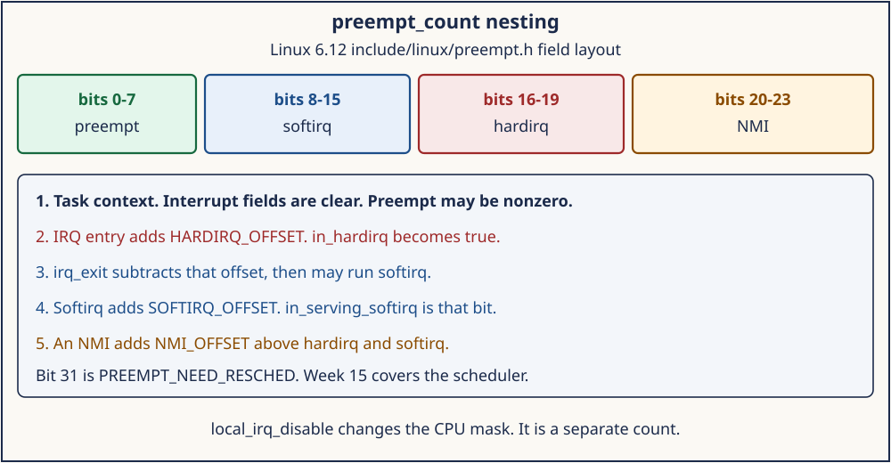
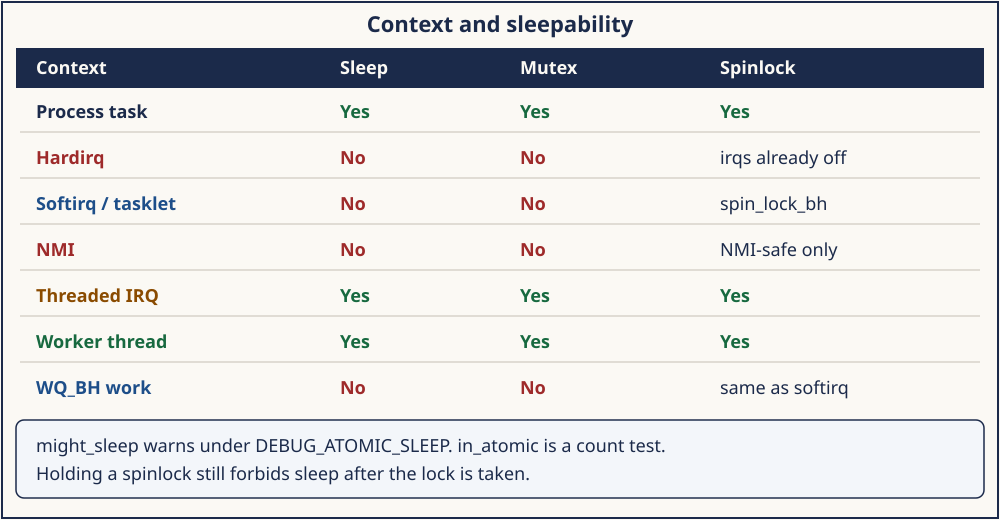

# Day 6 — Preemption, Atomic Context, and Sleepability

**Target time:** approximately 3 hours

- `cli` in Linux 0.12 versus a counter any helper can read: 35 minutes
- `preempt_count` fields, hardirq, softirq, and NMI: 70 minutes
- Sleep rules, `might_sleep`, and lockdep: 45 minutes
- Mastery, then the wrapper: 25 minutes

> A helper three calls down from an interrupt does not remember the stub
> that entered it. Linux records that fact in `preempt_count`. Sleeping
> is legal only in some of those fields. The scheduler that would run
> after a legal sleep is Week 15.

Day 4 placed the driver in hardirq. Day 5 moved some of the work to a
softirq, a thread, or a workqueue. This day is the rule those choices
are enforcing.

The 6.12 excerpts are from `/home/jd/Documents/linux-6.12`, tag `v6.12`,
commit `adc218676eef25575469234709c2d87185ca223a`. Record `uname -r`
before you treat a line as true of the booted kernel. The wrapper's
source check requires this commit.

## 1. Syntax needed for this source

`preempt_count` is one integer used as several small counters. A shift
selects a field. A mask isolates it. Adding a constant enters a
context. Subtracting the same constant leaves it.

```c
#define PREEMPT_BITS    8
#define SOFTIRQ_BITS    8
#define HARDIRQ_BITS    4
#define NMI_BITS        4

#define PREEMPT_SHIFT   0
#define SOFTIRQ_SHIFT   (PREEMPT_SHIFT + PREEMPT_BITS)
#define HARDIRQ_SHIFT   (SOFTIRQ_SHIFT + SOFTIRQ_BITS)
#define NMI_SHIFT       (HARDIRQ_SHIFT + HARDIRQ_BITS)

#define HARDIRQ_OFFSET  (1UL << HARDIRQ_SHIFT)
#define in_hardirq()    (hardirq_count())
```

Bits 0–7 are the preemption depth. Bits 8–15 are the softirq field.
Bits 16–19 are hardirq. Bits 20–23 are NMI. Those ranges are what
`include/linux/preempt.h` states at lines 14–31. The high bit,
`PREEMPT_NEED_RESCHED`, is a flag the scheduler consults. Week 15 is
where that flag becomes a run-queue decision. This day only needs to
know the bit is not one of the four context counters.

A nonzero hardirq, softirq-serving, or NMI field means this context
must not sleep. A nonzero preemption field means "do not preempt me
here." Those are related and they are not the same test. Holding a
spinlock is a third reason not to sleep, and on a non-preemptible
kernel the preemption field may not move when the lock is taken.

## 2. Linux 0.12 first: `cli`, `sti`, and a CPL test

Linux 0.12 has no `preempt_count`. `include/asm/system.h`, lines 16–17,
is the whole interrupt mask API:

```c
#define sti() __asm__ ("sti"::)
#define cli() __asm__ ("cli"::)
```

`cli` clears IF. `sti` sets it. There is one CPU, so closing IF is
mutual exclusion against every interrupt stub. `sleep_if_empty` in
`kernel/chr_drv/tty_io.c` wraps the empty-queue wait in `cli` and
`sti`. The sleep itself is `interruptible_sleep_on`, which is process
context that has chosen to wait. The timer stub does not call it.

`do_timer` in `kernel/sched.c`, lines 364–367, is the other half of the
convention:

```c
	if ((--current->counter)>0) return;
	current->counter=0;
	if (!cpl) return;
	schedule();
```

`cpl` came from the low two bits of the saved CS. A tick that
interrupted the kernel returns without `schedule`. A tick that
interrupted user mode may schedule. The kernel does not ask a counter
whether this is atomic. It relies on the stub not calling `schedule`
except through this test, and on drivers not calling `sleep_on` from
the interrupt body. A helper three calls down has no way to check. The
convention works while every author remembers the stub.

What carries forward is the split between "this code owns the CPU until
it returns" and "this code may wait." What stays in 0.12 is encoding
that split only as IF and as a CPL test in one function.

## 3. Evolution: one word any helper can read

Nesting breaks a single IF bit. A hardirq that raises a softirq on the
way out is two contexts on one stack. An NMI can arrive while IF is
already clear. A second CPU does not share IF. The kernel needed a
value a helper could read without knowing which stub called it.

`preempt_count` is that value. `preempt_disable` adds
`PREEMPT_OFFSET` when `CONFIG_PREEMPT_COUNT` is set, and adds nothing
when it is not (`include/linux/preempt.h`, lines 148–151). Softirq
entry adds `SOFTIRQ_OFFSET`. `__irq_enter` in `include/linux/hardirq.h`,
lines 34–39, adds `HARDIRQ_OFFSET`, tells lockdep, and accounts the
time. `__nmi_enter`, lines 107–113, adds `NMI_OFFSET + HARDIRQ_OFFSET`
together, so an NMI is visible to both `in_nmi` and `in_hardirq`. The
comment above it says NMI entry can nest up to 15 times because
`NMI_BITS` is 4.

`might_sleep` is the check a sleeping function leaves at its door.
Under `CONFIG_DEBUG_ATOMIC_SLEEP`, `include/linux/kernel.h` lines
93–106 define it as `__might_sleep` plus `might_resched`. Without that
config, line 148 is only `might_resched`. The bug print and the
voluntary preemption point are different jobs packed into one macro.
Week 15 explains what a reschedule does with a run queue. This week
stops at "this is a legal place to ask."

## 4. ToyOS has `sti` and no counter

`interrupts_enable` in `projects/toyos/src/arch.c` is the `sti`
instruction. The timer path writes the PIC EOI and returns. It does not
wait. There is no per-task preemption count and no `might_sleep`. The
toy can still teach the rule in words: the stub acknowledges the
controller and returns. The host lab in section 12 prints that rule as
data. Neither one reads a Linux `preempt_count`.

## 5. The fields in this tree

`include/linux/preempt.h`, lines 14–53, is the map. The comment is
worth reading as the specification:

```c
/* tree adc218676eef (Linux 6.12)
 * path: include/linux/preempt.h
 * lines: 27–31 and 50–55
 * function: preempt_count field macros
 */
 *         PREEMPT_MASK:	0x000000ff
 *         SOFTIRQ_MASK:	0x0000ff00
 *         HARDIRQ_MASK:	0x000f0000
 *             NMI_MASK:	0x00f00000
 * PREEMPT_NEED_RESCHED:	0x80000000
 */
#define HARDIRQ_OFFSET	(1UL << HARDIRQ_SHIFT)
#define NMI_OFFSET	(1UL << NMI_SHIFT)
#define SOFTIRQ_DISABLE_OFFSET	(2 * SOFTIRQ_OFFSET)
```

`SOFTIRQ_OFFSET` is bit 8, the least significant softirq bit.
`SOFTIRQ_DISABLE_OFFSET` is twice that, so `local_bh_disable` sets bit
9. `in_serving_softirq` tests bit 8 only:

```c
#define in_serving_softirq()	(softirq_count() & SOFTIRQ_OFFSET)
```

A CPU inside `__do_softirq` has bit 8 set. A CPU that called
`local_bh_disable` and is still in process context has bit 9 set and
bit 8 clear. `in_softirq` is the whole softirq mask, so it is true for
both. `in_interrupt` on a non-RT kernel is `irq_count()`, which
includes the softirq mask, so BH-disabled code counts as
`in_interrupt` even though it is not serving a softirq. The names are
easy to swap. The masks are the definition.

`CONFIG_PREEMPT_RT` changes `softirq_count` to
`current->softirq_disable_cnt & SOFTIRQ_MASK` (lines 110–116). The
field diagram in the comment is the non-RT layout. Quote the `ifdef`
when you are on an RT kernel. This lesson's sleep table is the same
either way: softirq context does not sleep.

`interrupt_context_level`, lines 81–99, folds the masks into 0, 1, 2,
or 3:

```c
 *  0 - normal context
 *  1 - softirq context
 *  2 - hardirq context
 *  3 - NMI context
 */
	level += !!(pc & (NMI_MASK));
	level += !!(pc & (NMI_MASK | HARDIRQ_MASK));
	level += !!(pc & (NMI_MASK | HARDIRQ_MASK | SOFTIRQ_OFFSET));
```

NMI entry added both NMI and hardirq offsets, so the first two terms
fire, and the third term fires because the hardirq bit is set. The
level is 3. A plain hardirq fires the second and third terms: level 2.
A serving softirq fires only the third term, because that term looks
at `SOFTIRQ_OFFSET` and not at the BH-disable bit. Level 1. BH-disabled
process context stays level 0. That is why "bottom halves are off" is
not the same sentence as "I am inside a softirq."



*Bits 0–7 preempt, 8–15 softirq, 16–19 hardirq, 20–23 NMI. Hardirq exit may then run softirq and add SOFTIRQ_OFFSET.*

## 6. Process, hardirq, softirq, NMI

Process context is `in_task`: the NMI, hardirq, and serving-softirq
bits are clear (lines 129–132). A system call, a kernel thread, and a
workqueue worker start here. Sleep is legal until something in this
section disables it.

Hardirq context is `in_hardirq`, which is `hardirq_count()`.
`__irq_enter` added `HARDIRQ_OFFSET`. Day 4's `action->handler` runs
here. The warning in `__handle_irq_event_percpu` fires if the handler
enables interrupts. Sleeping here is the bug.

Softirq context is `in_serving_softirq`. Day 5's `h->action`, including
tasklets, runs here. `ksoftirqd` is a task, and the actions it enters
still have `SOFTIRQ_OFFSET` set. Sleeping in the action is the same
bug as sleeping in the hardirq handler.

NMI context is `in_nmi`. `__nmi_enter` also raised the hardirq field,
so `in_hardirq` is true as well. The extra constraint is that the locks
you take must be safe against an NMI that interrupted the owner of an
ordinary spinlock. `handle_fasteoi_nmi` in Day 4 runs one action and
does not share the line. This day does not add a second NMI handler.
It only records that NMI is a stricter atomic context than hardirq.

Threaded IRQ handlers and ordinary kworkers are process context. They
may sleep. `WQ_BH` work runs in softirq context, which is Day 5's
`events_bh`. The workqueue pointer decides. The function pointer does
not.

## 7. Spinlocks and the local interrupt mask

`local_irq_disable` is the modern `cli`, plus a trace hook when
`CONFIG_TRACE_IRQFLAGS` is on. `include/linux/irqflags.h`, lines
200–213:

```c
#define local_irq_disable()				\
	do {						\
		bool was_disabled = raw_irqs_disabled();\
		raw_local_irq_disable();		\
		if (!was_disabled)			\
			trace_hardirqs_off();		\
	} while (0)

#define local_irq_save(flags)				\
	do {						\
		raw_local_irq_save(flags);		\
		if (!raw_irqs_disabled_flags(flags))	\
			trace_hardirqs_off();		\
	} while (0)
```

The saved flags are the previous mask, so `local_irq_restore` does not
turn interrupts on if they were already off. That is the nest `cli`
cannot express with a single bit unless the caller remembers the old
IF. `preempt_count` does not move. Disabling the local interrupt mask
is not `in_hardirq`.

`spin_lock_irqsave` in `include/linux/spinlock.h`, lines 379–382, takes
the lock and saves the interrupt mask together:

```c
#define spin_lock_irqsave(lock, flags)				\
do {								\
	raw_spin_lock_irqsave(spinlock_check(lock), flags);	\
} while (0)
```

You use that form when process context and a hardirq handler share the
data. The handler runs with IRQs already off on the normal path and
takes the lock with the irqsave form or with the knowledge that IRQs
are off. Process context must not take the plain `spin_lock` and then
be interrupted by the handler that needs the same lock. `spin_lock_bh`
is the matching form when the other side is a softirq: it disables
bottom halves and, when preemption counts, disables preemption.
`SOFTIRQ_LOCK_OFFSET` at line 177 is `SOFTIRQ_DISABLE_OFFSET` plus the
preemption-lock offset.

On `CONFIG_PREEMPT_RT`, `PREEMPT_LOCK_OFFSET` is 0 (lines 157–161).
RT locks do not disable preemption the way a non-RT spinlock does.
The sleep rule you can carry without an RT course is: do not sleep
while you hold a spinlock, and do not take a mutex from hardirq,
softirq, or NMI.

A mutex sleeps. `down` and `wait_event` sleep. `kmalloc(GFP_KERNEL)`
can sleep. `copy_from_user` can fault and sleep, which is why Day 3's
fixup path exists and why a hardirq handler does not call it.
`queue_work_on` from atomic context is legal when the queue operation
itself does not sleep. The function it queues is the thing that might
sleep later, in the worker.

## 8. Who may sleep



*Process context, a threaded IRQ, and a normal worker may sleep. Hardirq, softirq, NMI, and WQ_BH may not. A spinlock forbids sleep after it is taken.*

| Context | Sleep | Mutex | Spinlock |
| --- | --- | --- | --- |
| Process task | yes | yes | yes, then do not sleep |
| Hardirq | no | no | with IRQs already off |
| Softirq or tasklet | no | no | `spin_lock_bh` from process side |
| NMI | no | no | only an NMI-safe lock |
| Threaded IRQ | yes | yes | yes, then do not sleep |
| Worker thread | yes | yes | yes, then do not sleep |
| `WQ_BH` work | no | no | same as softirq |

The lab in section 12 prints five of these rows: hardirq, softirq,
`wq_bh`, `worker_thread`, and process. NMI and the threaded-IRQ row
are in this table because the source distinguishes them. The lab does
not claim to have entered those contexts.

## 9. `might_sleep` and lockdep

Under `CONFIG_DEBUG_ATOMIC_SLEEP`, `__might_sleep` in
`kernel/sched/core.c`, lines 8571–8585, checks `current`'s task state
and then calls `__might_resched` with a zero offset:

```c
void __might_sleep(const char *file, int line)
{
	unsigned int state = get_current_state();
	WARN_ONCE(state != TASK_RUNNING && current->task_state_change,
			"do not call blocking ops when !TASK_RUNNING; "
			"state=%x set at [<%p>] %pS\n", state,
			(void *)current->task_state_change,
			(void *)current->task_state_change);

	__might_resched(file, line, 0);
}
```

`__might_resched`, lines 8610–8634, returns immediately when the
preempt count matches the allowed offset, interrupts are enabled, and
a few other quiet conditions hold. Otherwise it prints:

```text
BUG: sleeping function called from invalid context at %s:%d
```

That line is the runtime form of this day's table. It is compiled in
when the debug option is on. A production kernel can define
`might_sleep` as only `might_resched` and never print it. The absence
of the print is not permission to sleep.

`in_atomic` is the tempting shortcut and the wrong one for driver code.
Lines 179–186:

```c
 * Are we running in atomic context?  WARNING: this macro cannot
 * always detect atomic context; in particular, it cannot know about
 * held spinlocks in non-preemptible kernels.  Thus it should not be
 * used in the general case to determine whether sleeping is possible.
 * Do not use in_atomic() in driver code.
 */
#define in_atomic()	(preempt_count() != 0)
```

The wrapper's source check looks for that sentence and for
`#define in_atomic()	(preempt_count() != 0)`. A non-preemptible kernel
can hold a spinlock with `preempt_count` still zero. `in_atomic` is
then false while sleep is still illegal. Know the context you were
called from.

Lockdep is the other witness. `local_irq_save` records hardirqs-off
when tracing is configured. `lockdep_assert_irqs_disabled` is what
`__raise_softirq_irqoff` calls. Day 5's `lockdep_softirq_start` drops
the hardirq lockdep state for the softirq pass so a lock taken there
is not recorded as a hardirq lock. Lockdep does not choose the next
task. It records the order and the context of locks so a later acquire
can warn. Reading a lockdep splat means "this lock was taken in a
context that disagrees with an earlier take." It does not mean the
scheduler ran.

## 10. Architecture lens: the mask is not the counter

`preempt_count` is a Linux word. The architectural interrupt mask is a
different register. `local_irq_disable` reaches the register through
`raw_local_irq_disable`. The three trees in this commit are:

x86. `arch/x86/include/asm/irqflags.h`, `native_irq_disable`, lines
35–37, is `cli`. `arch_local_irq_disable` calls it when the kernel is
not using the paravirt indirection. IF is one bit. It is the 0.12
instruction with a C wrapper. It does not store the hardirq nest count.
`__irq_enter` does that in software after the CPU has already vectored.

AArch64. `arch/arm64/include/asm/irqflags.h`, `__daif_local_irq_disable`,
lines 52–56, executes `msr daifset, #3`, which masks IRQ and FIQ in
`DAIF`. `arch_local_irq_disable`, lines 71–77, uses that path or, when
priority masking is on, writes `GIC_PRIO_IRQOFF` to `ICC_PMR_EL1`. The
second form is how this kernel supports pseudo-NMIs: the CPU still
takes a higher priority, and Linux's `preempt_count` is what says the
ordinary IRQ handler must not sleep. The system register is not
`preempt_count`.

RISC-V. `arch/riscv/include/asm/irqflags.h`, `arch_local_irq_disable`,
lines 24–27, clears `SR_IE` in `sstatus` with `csr_clear`. That bit is
the supervisor interrupt enable. It is one bit, like IF. The PLIC claim
from Day 4 is a device-controller operation that happens after the CPU
has entered. Clearing `SR_IE` does not claim the PLIC, and claiming the
PLIC does not increment `preempt_count`. `__irq_enter` still does.

Three masks, one Linux counter. A bug report that says "interrupts were
disabled" has to say which fact it measured: IF, DAIF, `sstatus.SIE`,
or a `preempt_count` field.

## 11. A trace you can do on paper

Start in process context. `preempt_count` has the preemption field at
whatever `preempt_disable` nesting this task already holds. The
hardirq, softirq-serving, and NMI fields are clear. `in_task` is true.
`local_irq_disable` clears IF, DAIF, or `sstatus.SIE` and does not
change those fields.

A device interrupt arrives after `local_irq_enable`. The CPU vectors.
`__irq_enter` adds `HARDIRQ_OFFSET`. `in_hardirq` is true. `in_task` is
false. The handler calls `raise_softirq_irqoff`. The pending bit
changes. `preempt_count` does not gain `SOFTIRQ_OFFSET` yet.

`__irq_exit_rcu` subtracts `HARDIRQ_OFFSET`. If the pending mask is set
and the CPU is outside interrupt context, `invoke_softirq` adds
`SOFTIRQ_OFFSET` for the action and removes it before returning.
`in_serving_softirq` is true only across that action. A `might_sleep`
in the action hits `__might_resched` with a nonzero count and, when
the debug option is on, prints the invalid-context line.

An NMI during the hardirq calls `__nmi_enter`, which adds
`NMI_OFFSET + HARDIRQ_OFFSET` on top of the hardirq count already
present. `interrupt_context_level` becomes 3. `__nmi_exit` subtracts
the same pair. The hardirq count returns to the value `__irq_enter`
set. The paper trace is wrong if the NMI exit clears the original
hardirq bit.

`spin_lock_irqsave` from process context saves the mask and takes the
lock before the handler can run on this CPU. The handler's
`spin_lock` then waits or, if it uses the same irqsave form, runs only
after the process releases. Sleeping while that lock is held is illegal
even when `in_atomic` is false on a non-preemptible build. That is the
comment in section 9, applied to one lock.

The context lab never performs this trace. Its timerfd wait is process
context with the architectural mask left to the kernel's syscall entry.
The markers say so. Use the lab to see a legal wait. Use this paragraph
to see the count move.

## 12. What this day deliberately does not explain

`schedule`, `pick_next_task`, the run queue, and what
`PREEMPT_NEED_RESCHED` does with a sleeping task are Week 15. `do_timer`
in 0.12 calling `schedule` is enough history to see that a tick can
switch tasks. It is not the 6.12 policy. `might_resched` may be a
preemption point. This lesson treats it as "a legal place to ask," and
stops.

`need_resched` in Day 5's softirq budget is the same deferral. The
softirq pass wakes `ksoftirqd` and returns so the scheduler can run.
Which task runs is not this week's question.

The same boundary applies to lockdep. A splat names a lock and two
stacks. It does not pick the next task, and it does not change
`smp_affinity`. Copy the splat into the Day 7 report only if you
actually triggered one. This lesson's wrapper does not.

`CONFIG_PREEMPT_NONE` is still a Kconfig symbol in
`kernel/Kconfig.preempt`. The source check requires that line. On that
model, `PREEMPT_DISABLE_OFFSET` is zero unless the kernel was built
with a count anyway. The hardirq and softirq offsets remain. Sleep is
still illegal there. The preemption model changes when the scheduler
may enter. It does not make a hardirq handler a place to take a mutex.
`config PREEMPT_VOLUNTARY` is the neighboring symbol. It still does not
move the hardirq bits.

## 13. Safe evidence

The context lab at
`projects/linux-kernel-contexts/src/context_lab.c` prints five rule
lines, polls an empty `eventfd` with timeout 0, and polls a 20 ms
`timerfd` with a 500 ms cap. The markers it prints on success are
`zero_poll_immediate=yes`, `blocking_poll_waited=yes`,
`userspace_poll_is_not_kernel_context=yes`,
`kernel_preempt_claim=none`, and
`scheduler_dive=deferred_to_week_15`. The zero-timeout poll returns
without waiting. The timerfd poll waits. Both are process context.
Neither reads `preempt_count`.

Run
[`../challenges/day-006-context-rules.sh`](../challenges/day-006-context-rules.sh).
The wrapper builds that lab and runs `check-source.sh` for day 6, which
requires `PREEMPT_BITS` 8, `HARDIRQ_BITS` 4, `in_hardirq`, the
`in_atomic` warning, `__irq_enter`'s `HARDIRQ_OFFSET` add, `might_sleep`,
and `config PREEMPT_NONE`. It does not write the kernel tree.

Predict the five `rule_*_may_sleep` lines before you run it. Hardirq,
softirq, and `wq_bh` are no. The worker and process are yes. Then
predict that the zero timeout returns immediately and the timerfd wait
takes time.

## 14. Mastery: Explain · Draw · Observe · Build

### Explain

Linux 0.12 closes IF with `cli` and calls `schedule` from `do_timer`
only when the interrupted CPL is not zero. v6.12 records hardirq with
`HARDIRQ_OFFSET` inside `preempt_count`. `in_serving_softirq` is bit 8.
`local_bh_disable` uses twice that offset, so BH-disabled process
context is not serving a softirq. `__nmi_enter` adds `NMI_OFFSET` and
`HARDIRQ_OFFSET`. `might_sleep` prints under `DEBUG_ATOMIC_SLEEP`.
`in_atomic` is the wrong driver test because a non-preemptible spinlock
may not move the count. `cli`, `msr daifset, #3`, and `csr_clear` of
`SR_IE` are the architectural masks. They are not the counter.

### Draw

1. The preempt_count word with the four fields and bit 31 named but
   not explained as a scheduler.
2. A stack: process, then hardirq (`HARDIRQ_OFFSET`), then softirq on
   the way out (`SOFTIRQ_OFFSET`), then the hardirq bit cleared.
3. The sleep table, with `WQ_BH` on the softirq row and a threaded IRQ
   on the process row.

### Observe

From the wrapper, copy the five rule lines and the two poll markers.
Record that `kernel_preempt_claim=none`. If the source check prints
`commit=adc218676eef25575469234709c2d87185ca223a`, keep that beside
`uname -r`.

### Build

Pick one function you would call from a device driver: `mutex_lock`,
`queue_work_on` onto `system_bh_wq`, or `kfree` of a small object.
Write the context it may be called from, the `preempt_count` field that
would be nonzero, and whether `might_sleep` would be a legal call.
One paragraph. Do not describe `pick_next_task`.

### Why? notebook

1. Why does 0.12 `do_timer` return immediately when `cpl` is 0?
2. Why is `cli` not a nest count?
3. Why does `local_bh_disable` add `2 * SOFTIRQ_OFFSET`?
4. Why is `in_serving_softirq` false in BH-disabled process context?
5. Why does `__nmi_enter` add `HARDIRQ_OFFSET` as well as `NMI_OFFSET`?
6. Why does the `in_atomic` comment forbid driver use?
7. Why can `might_sleep` be silent on a kernel built without
   `DEBUG_ATOMIC_SLEEP`?
8. Why is `msr daifset, #3` not a write to `preempt_count`?
9. Why does the context lab's timerfd wait not prove a `preempt_count`
   value?

**Next:** Day 7 collects what you can show from `/proc`, from the
source hooks, and from an optional strace, and it keeps a guess out of
the report.
