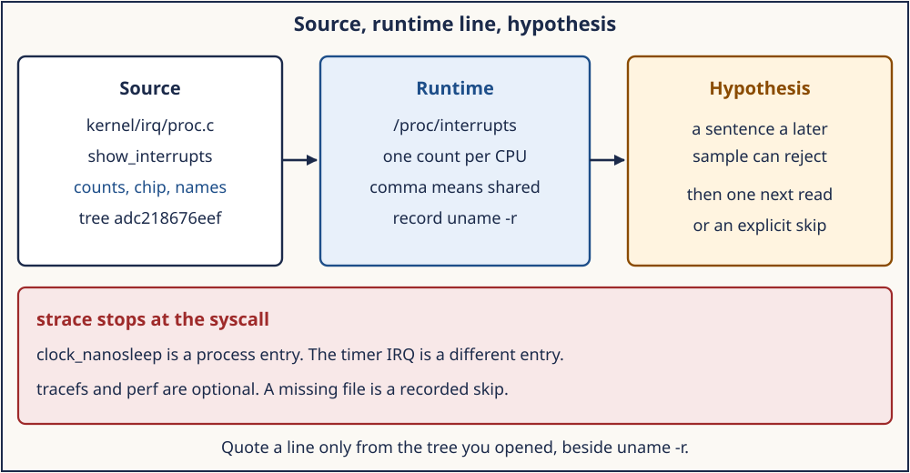
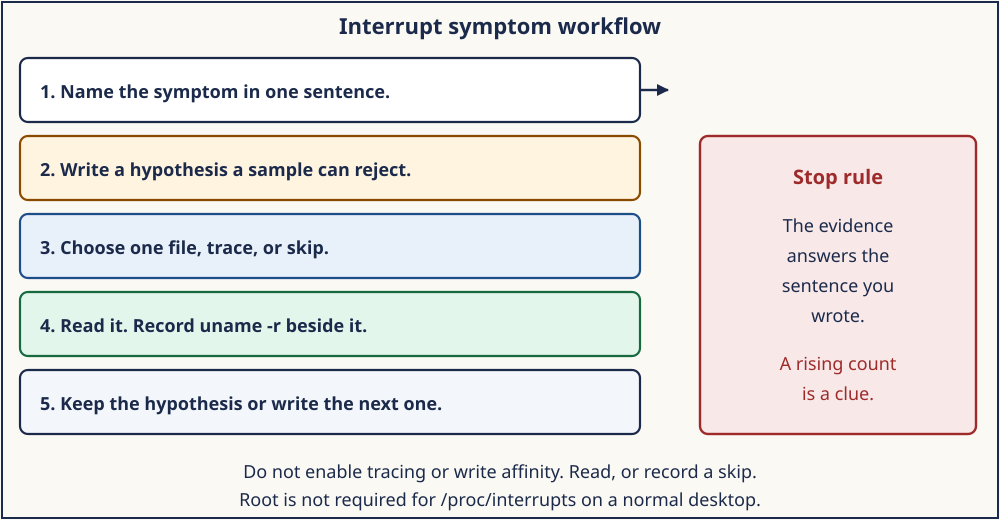

# Day 7 — Entry, Interrupt Tracing, and a Debugging Report

**Target time:** approximately 3 hours

- What Linux 0.12 could print, and what `/proc/interrupts` counts: 35 minutes
- Source hooks versus a host observation: 50 minutes
- A report that keeps a guess out of the evidence: 55 minutes
- Mastery, then the wrapper: 25 minutes

> You want evidence of one IRQ handler. Which file on this machine can
> show you a count, which source line is the hook, which tool printed
> `SKIP`, and which sentence would be a guess if you wrote it anyway?

Days 2 through 6 named entries: syscall, page fault, device IRQ,
softirq, and the `preempt_count` fields. This day is how you show your
work. A count, a source line, and a trace are different kinds of
evidence. The report says which kind you have.

The 6.12 excerpts are from `/home/jd/Documents/linux-6.12`, tag `v6.12`,
commit `adc218676eef25575469234709c2d87185ca223a`. Record `uname -r`
beside that id. The wrapper checks the commit and does not modify the
tree.

## 1. Syntax needed for this source

`/proc/interrupts` is text. A numbered line has a count per CPU, a chip
name, and one or more action names. A comma joins shared actions. A
line whose first field is a word, such as `NMI` or `LOC` on x86, comes
from the architecture's extra summary, not from `irq_desc->action`.

A tracepoint in C is an ordinary call:

```c
trace_irq_handler_entry(irq, action);
res = action->handler(irq, action->dev_id);
trace_irq_handler_exit(irq, action, res);
```

If the tracer is off, the call records nothing you can read back. If a
tracer is on, the same line is the record. Seeing the call in the
source proves the hook exists. It does not prove a tracer ran.

`strace` prints syscalls. `clock_nanosleep` is a process entry. The
timer interrupt that wakes the sleeper is a different entry. A report
that uses strace to name an IRQ handler has changed the subject.

## 2. Linux 0.12 first: printk, not `/proc/interrupts`

Linux 0.12 has no ftrace, no `trace_irq_handler_entry`, and no
`/proc/interrupts` in the modern format. The observation tools are
`printk` and the fact that `ret_from_sys_call` is one place to look
when a syscall or a timer does not return. You edit the source, rebuild,
and reboot. That is workable when the kernel is a few dozen files. It
is a poor way to ask which IRQ ran on a machine you are not willing to
rebuild.

`_unexpected_hd_interrupt` is the 0.12 version of a spurious-interrupt
report: the stub found `do_hd` NULL and called a function whose job is
to say so. There is no per-CPU counter and no comma-separated name
list. The durable idea is to separate the path from the observation.
The path is the stub. The observation is whatever you printed. A print
you did not add is not evidence.

## 3. Evolution: counters, tracepoints, and a syscall observer

Rebuilding to add a `printk` does not scale, and a `printk` inside a
hardirq handler can itself be the bug. The kernel grew a counter file
and tracepoints on the handler path.

`/proc/interrupts` is the counter view from Day 4.
`kernel/irq/proc.c`, `show_interrupts`, walks irq numbers and prints
`kstat_irqs` per online CPU, the chip name, the hwirq when a domain
exists, and the action names. That file answers "how many times did
this Linux irq run on this CPU, and what is it called?" It does not
answer "what did the handler do" or "which instruction was
interrupted."

Tracepoints sit on the path. `trace_irq_handler_entry` is inside
`__handle_irq_event_percpu`. `trace_softirq_entry` is inside
`handle_softirqs`. `kernel/trace/trace_irqsoff.c` holds a tracer for
how long interrupts stayed off. Turning that tracer on writes tracefs
and changes timing. This week's wrapper does not write it.

`strace` is older than those tracers and answers a different question.
It is a ptrace observer of the syscalls one process made. It shows
`clock_nanosleep`. It does not show `SYSRET` versus `IRET`, and it does
not show an IRQ the process did not invoke. `perf` can count events
when the kernel permits it. When ptrace or perf is blocked, the honest
result is `SKIP`.

## 4. ToyOS logs to the serial line

ToyOS writes `SELFTEST` and `EXCEPTION` from `interrupt_handler` in
`projects/toyos/src/arch.c`. The page-fault path prints `CR2` and the
error-code bits. That is the 0.12 method: a print on the path. The
serial line is not ftrace. A ToyOS log that says vector 32 ran is
evidence about ToyOS. It is not evidence about
`trace_irq_handler_entry` in Linux 6.12. Keep the two logs in two
paragraphs of the report.

## 5. What `show_interrupts` actually prints

`kernel/irq/proc.c`, lines 463–526, is the function behind
`/proc/interrupts` for the numbered lines. The header is one column per
online CPU. Each later line that has an action prints the irq number,
the per-CPU counts, the chip, and the names:

```c
/* tree adc218676eef (Linux 6.12)
 * path: kernel/irq/proc.c
 * lines: 497–526
 * function: show_interrupts
 */
	seq_printf(p, "%*d: ", prec, i);
	for_each_online_cpu(j)
		seq_printf(p, "%10u ", desc->kstat_irqs ? per_cpu(desc->kstat_irqs->cnt, j) : 0);
	/* chip name, then hwirq if a domain is attached */
	action = desc->action;
	if (action) {
		seq_printf(p, "  %s", action->name);
		while ((action = action->next) != NULL)
			seq_printf(p, ", %s", action->name);
	}
```

A hidden descriptor, a chained irq, or a descriptor with no action is
skipped. A zero count is still a line if an action is registered. The
count is `unsigned int` per CPU in this struct. It wraps. Two samples
close together can both show a large number. The difference is the
evidence, and only if you recorded which CPU column you subtracted.

The architecture appends its own lines when the index reaches
`ACTUAL_NR_IRQS`. `arch_show_interrupts` is weak and returns 0 in the
generic file. x86 overrides it. `arch/x86/kernel/irq.c`, lines 61–73:

```c
int arch_show_interrupts(struct seq_file *p, int prec)
{
	int j;

	seq_printf(p, "%*s: ", prec, "NMI");
	for_each_online_cpu(j)
		seq_printf(p, "%10u ", irq_stats(j)->__nmi_count);
	seq_puts(p, "  Non-maskable interrupts\n");
#ifdef CONFIG_X86_LOCAL_APIC
	seq_printf(p, "%*s: ", prec, "LOC");
	for_each_online_cpu(j)
		seq_printf(p, "%10u ", irq_stats(j)->apic_timer_irqs);
	seq_puts(p, "  Local timer interrupts\n");
```

`NMI` here is `__nmi_count`. `LOC` is the local APIC timer. They are
not `irq_desc` lines and they have no `dev_id`. A rising `LOC` means
the local timer is firing. It does not mean a device wire is stuck.
Other architectures print their own names from their own
`arch_show_interrupts`. Read the label on the line you have. Do not
import the x86 names onto a machine whose file does not contain them.



*show_interrupts produces one runtime line. A hypothesis is a sentence a later sample can reject. strace stays on the syscall side of the figure.*

## 6. Hooks you can name without enabling them

The day-7 source check looks for these strings and fails if they are
absent. They are the names a report may cite as source, after the check
has accepted the commit.

`kernel/irq/handle.c` places the handler between
`trace_irq_handler_entry(irq, action)` and
`trace_irq_handler_exit(irq, action, res)`. That is the per-action
hook from Day 4. Citing it says "the tree contains the hook." Citing
it as "I saw handler X run at time T" requires a trace you captured.

`kernel/trace/trace_irqsoff.c` contains
`static struct trace_array *irqsoff_trace`. That is the irqsoff tracer
state. `Documentation/trace/ftrace.rst` begins with the title
`ftrace - Function Tracer`. The document describes how to use the
tracer. The wrapper does not follow those steps.

`arch/x86/entry/entry_64.S` defines `SYM_CODE_START(entry_SYSCALL_64)`.
That is Day 2's syscall entry. `arch/x86/mm/fault.c` defines
`DEFINE_IDTENTRY_RAW_ERRORCODE(exc_page_fault)`. That is Day 3's fault
entry. A report about an IRQ that also mentions those symbols has to
say why they are in scope. They are in the source check because this
week's entries share a report. They are not IRQ handlers.

The check prints `source_modified=no`. It does not mount tracefs and it
does not write a tracer file.

## 7. strace stops at the syscall

Take `sleep`, or the lab's `timerfd` wait from Day 6. `strace` can show
`clock_nanosleep` or `poll` and the time it blocked. That is the
process asking to wait. The wake may be a timer interrupt, a softirq,
and a scheduler decision. strace's line does not name
`TIMER_SOFTIRQ`, `LOC`, or `apic_ack_irq`.

Use strace when the question is "which syscall did this process
enter, and what did it return?" Use `/proc/interrupts` when the
question is "which Linux irq count moved?" Use the source when the
question is "which function would run if that irq fired?" Write the
question down before you pick the tool. A tool that cannot answer the
question still produces output. Output is not an answer.

If `strace` fails because ptrace is restricted, the wrapper's optional
path prints `SKIP`. Keep the skip. Do not describe a syscall trace you
do not have. The same rule applies to `perf`. `perf stat` counts
events when it is allowed to. A permission error is a skip. It is not
a zero count.

## 8. Optional tracefs, left off

`/sys/kernel/tracing` or the older debugfs path may be readable, and
it may not be. Readable means you can see the files. It does not mean
you should write `current_tracer`. Enabling `irqsoff` or a function
tracer changes timing on the machine and is outside this week's
wrapper. The report lab prints `tracefs_written=no` for that reason.

If the directory is missing, write `tracefs=skipped` and the reason
"not mounted" or "not readable." If it is readable, write
`tracefs=present` and `enabled=no`. Both are complete observations.
A paragraph that describes events you would have seen is a hypothesis
that escaped into the results.

The events you are allowed to name from source, without claiming they
fired, include `irq_handler_entry`, `irq_handler_exit`,
`softirq_raise`, and `softirq_entry`. Day 5 raised `TIMER_SOFTIRQ`
through `raise_softirq_irqoff`, which calls `trace_softirq_raise`.
That call is in the tree. A captured trace would show it. You do not
have that capture unless your log says you do.

## 9. Hypotheses that a sample can reject

A hypothesis is one sentence a measurement can make false. These are
the shapes that fit this week. They are examples of form. They are not
claims about your machine until you fill in a number you read.

- "The comma on irq N joins names A and B, so those two actions share
  one `irq_desc`." A second look at `/proc/interrupts` can show the
  comma gone, which rejects the sharing claim for that boot.
- "Column CPU2 of irq N increased between sample 1 and sample 2, so
  that CPU ran the flow handler at least once." A flat column rejects
  it. The column does not say which action returned `IRQ_HANDLED`.
- "`LOC` increased, so a device driver on a numbered line is stuck."
  This one is already false as a form: `LOC` is the local timer in the
  x86 summary. Reject it by reading the label, before you sample.
- "`ksoftirqd/0` exists, so a softirq ran during my sample window."
  The task existing only shows the thread was created. The
  `/proc/softirqs` delta is the measurement that can reject "it ran
  just now."
- "strace shows `clock_nanosleep`, so I observed the timer IRQ
  handler." strace did not print the handler. The sentence is not a
  hypothesis about the log you have. It is a change of subject.

Write the sentence, then the file you will read, then what result would
make the sentence false. If you cannot name the rejecting result, you
do not have a hypothesis yet.



*Name the symptom, write a sentence a sample can reject, read one source, record uname, then keep or replace the sentence.*

## 10. Architecture lens: the summary lines are not portable

The numbered `irq_desc` lines are the generic part. The trailer is
`arch_show_interrupts`. On x86 the trailer includes `NMI`, `LOC`, and,
when SMP is on, `RES` and `CAL` for reschedule and call interrupts.
Those counts live in `irq_stats`, not in `kstat_irqs`. A GICv3 machine
prints IPIs and error counts from the arm64 implementation of the same
weak function. A RISC-V machine prints its own names. The lesson is the
same one Day 4 used for EOI: identify the file and the label before you
interpret the number.

`/proc/softirqs` is more portable across architectures because the rows
are the Linux enum: `HI`, `TIMER`, `NET_RX`, `TASKLET`, `SCHED`, `RCU`,
and the rest. The columns are still CPUs. A `TIMER` increase does not
say whether the tick came from an 8259, a local APIC, or a GIC
interrupt. It says the softirq action ran. Pair it with the interrupt
file when you need the controller.

## 11. The report lab, and what it refuses to claim

`projects/linux-kernel-contexts/src/report_lab.c` prints `uname`, checks
that `/proc/interrupts` opens and that the first line contains `CPU`,
and looks for `voluntary_ctxt_switches:` in `/proc/self/status`. A
missing file becomes `unreadable` or `absent`. The program still exits
0. It then prints:

```text
tracefs_written=no
modules_loaded=no
network_used=no
kernel_source_modified=no
scheduler_dive=deferred_to_week_15
mastery_claim=none
```

`voluntary_ctxt_switches` is a field name. The number, if you read it
yourself, says this task has given up the CPU on purpose some number of
times. It is not a run-queue diagram. Week 15 is where that number gets
a mechanism. The lab does not print the count. It prints whether the
field is present. Do not promote presence into a scheduling result.

`mastery_claim=none` means the program did not grade you. The report
you write is the grading material. A passing wrapper is evidence that
the tree and the host commands ran. It is not a filled-in trace.

The optional `make tools` target in that project may run strace or perf.
Those lines count only when the tool actually runs. A `SKIP` stays a
skip. The wrapper itself tells you that, and it points at `make tools`
as optional. You do not need root, and you do not need that target, to
finish the report.

## 12. Safe evidence

Run
[`../challenges/day-007-entry-debug-report.sh`](../challenges/day-007-entry-debug-report.sh).
It builds the report lab and runs the day-7 source check. Predict
before you run: `sysname` from `uname`, and whether `/proc/interrupts`
opened for you on Day 4. After it runs, copy `release=`, the
`proc_interrupts=` line, the context-switch field line, and
`tracefs_written=no`.

If you also run the optional tools and they skip, copy the skip line.
Do not replace it with a description of `entry_SYSCALL_64` from memory
and call that a trace. You may cite `entry_SYSCALL_64` as a source
symbol the check found. Label it `source`, not `captured`.

## 13. Two samples, and a labeled example that is not your host

Take two reads of `/proc/interrupts` a few seconds apart. Write the
clock time next to each. Pick one numbered line and one CPU column.
Subtract. A positive difference means `kstat_irqs` on that CPU
increased. It means `desc->handle_irq` ran, or at least the flow
handler reached `kstat_incr_irqs_this_cpu`, which Day 4's level and
fast-EOI paths do before the driver. It does not mean every action on
a shared line returned `IRQ_HANDLED`. The comma tells you the names.
The status registers inside the devices tell you which one fired. You
do not have those registers from this file.

A zero difference rejects "this irq ran on this CPU during the window."
It does not reject "the device is alive on another CPU." Read the other
columns before you widen the claim. Affinity from Day 4 is why one
column can move while its neighbor stays still.

A wrapped `unsigned int` can make a later sample look smaller. If the
second number is less than the first, say "the counter went backwards
or wrapped" and do not treat the subtraction as a rate. You do not need
a second tool to notice that. You need both numbers written down.

The trailer lines follow the same arithmetic and a different struct.
On x86, `LOC` is `apic_timer_irqs` in `irq_stats`, printed by
`arch_show_interrupts`. Subtracting `LOC` answers "did the local timer
run?" Subtracting a numbered line answers "did this `irq_desc` run?"
Mixing them is how a timer looks like a stuck device.

`/proc/softirqs` uses the same column layout for a different counter.
`kstat_incr_softirqs_this_cpu` in `handle_softirqs` is the increment.
A `TIMER` delta says the timer softirq action ran. It does not name the
irq that raised it. Pair the two files when the question needs both.
Leave the second file out when the question is only the irq line.

This example is a form. The numbers are not from a machine you can
cite. Replace every integer with a number you read before the line
counts as an observation.

```text
EXAMPLE, not a host log
uname -r: recorded beside the file, not invented here
sample1 irq 16 CPU0: 1000   name: ahci
sample2 irq 16 CPU0: 1004   name: ahci
delta: 4
hypothesis: CPU0 ran this irq_desc's flow during the window
reject if: the second count equals the first
kept: the delta is positive, so the flow ran at least once
not claimed: which command the adapter finished
strace: not run
tracefs: enabled=no
```

The example keeps four sentences apart. The delta is a count. The
hypothesis is the sentence the delta supports. The adapter command is
outside the file. strace and tracefs are explicit non-claims. Your
report replaces `1000` and `1004` and `ahci` with the line you actually
copied. If your second count equals the first, you write "rejected" and
stop. You do not explain what the device would have done if the count
had moved.

A second example, still not a host log, shows a label hypothesis that
needs only one sample:

```text
EXAMPLE, not a host log
line: "16:  1000  0  IR-PCI-MSI  ...  ahci, nvme"
hypothesis: one irq_desc has two actions
reject if: the line has no comma
kept by the comma, for this sample only
not claimed: both devices fired
```

Day 4's `show_interrupts` loop prints that comma from `action->next`.
One sample is enough for the sharing claim. It is not enough for a
rate. The report labels which claim it is making.

Shared-line symptoms follow the same split. "The line is shared" is
the comma. "The wrong driver is returning `IRQ_HANDLED`" is not in the
file. You would need the handler source, or a trace of
`irq_handler_exit` that you captured, to say which return value won.
Until then the report says the comma and stops.

Affinity symptoms follow the columns. "CPU3's column is the only one
moving" supports "recent deliveries went to CPU3." It does not by
itself say the affinity mask contains only CPU3. The mask is
`/proc/irq/N/smp_affinity` if that file is readable. This week's
wrappers do not write it. Reading it is optional and still not a
change. If you do not read it, do not describe the mask.

Storm symptoms are a large delta, not a story about a missing EOI.
A large delta means the flow handler ran many times. Day 4's level
path masks before the driver and unmasks after. A driver that fails to
clear a level source can make the next unmask return immediately. That
mechanism is a candidate. It becomes a conclusion only when you can
point at the handler and the device status. The count by itself is the
candidate's motive, not the verdict.

Work the five steps on that candidate so the workflow figure is a
procedure.

1. Symptom: "irq 16's count climbed by tens of thousands in one
   second." Write the two numbers. If you do not have them, this is
   not yet a symptom you measured.
2. Hypothesis: "the level source stayed asserted across unmask." Name
   the rejecting result: a handler that clears the device status, or a
   delta that stops when the device is idle. "The kernel is broken" is
   not a hypothesis. It has no rejecting sample.
3. Evidence: the `/proc/interrupts` delta, the chip name on that line,
   and `handle_level_irq` or `handle_fasteoi_irq` from the tree if you
   opened it. One of those, not all of the week's files.
4. Read and record `uname -r`. If the chip name is `IR-PCI-MSI`, say
   so. MSI often has no level wire. A level-unmask story then needs a
   different chip, or you reject the hypothesis because the line is
   not a level wire.
5. Keep or replace. A rejected level story becomes the next sentence:
   "this line is message-signaled, so the next hypothesis is about the
   device posting another MSI." Stop when the evidence answers the
   sentence you wrote. Do not enable tracefs to decorate a conclusion
   you already cannot support.

The stop rule is the right-hand box of the workflow figure. A climbing
count is a clue. It is not permission to load a module, write
affinity, or turn on `irqsoff`. Those actions change the machine. This
week's evidence is a read.

If step 4's chip name is not MSI and not a level flow you can name from
the tree, write "flow handler not identified" and stop. Guessing
`handle_level_irq` because the count was large repeats the mistake the
example is built to prevent. The figure's stop rule applies to a missing
fact the same way it applies to a rejected sentence. One sample still
cannot support a rate. Two samples that name different CPUs are two
hypotheses. Subtract each column on its own. A column you did not copy
is a column you cannot talk about.
The header row names the CPUs. Subtract only a column whose name you copied.

## 14. Write the report

Use this outline. Leave a line blank when the log is silent. A blank
line is better than a sentence you cannot point at.

1. Commit the landmark script accepted, and `uname -r` from the report
   lab. If they differ in the release string, say so. The tree id is
   the source. `uname` is the host.
2. One numbered `/proc/interrupts` line: irq, one CPU column, chip,
   name. If a comma is present, quote it and apply Day 4. If you did
   not sample twice, do not claim the count moved.
3. One architecture trailer line, or the sentence "this file's trailer
   does not use the x86 names" if `NMI` and `LOC` are absent.
4. One `/proc/softirqs` row from Day 5, labeled as a softirq count, not
   as a device.
5. The source hook you are willing to cite:
   `trace_irq_handler_entry` in `kernel/irq/handle.c`, labeled source.
6. strace or perf: `PASS` with the syscall you saw, or `SKIP`, or
   "not run." `clock_nanosleep` does not name an IRQ handler.
7. tracefs: `tracefs_written=no`, plus whether the directory was
   readable. Do not describe events.
8. One hypothesis in the form from section 9, and the observation that
   keeps it or rejects it. If you only have one sample, the honest
   hypothesis is about the label, not about a delta.
9. One sentence that Week 15, not this report, explains which task ran
   after a sleep. `scheduler_dive=deferred_to_week_15` is that sentence
   in the lab output.

A report that contains all nine, with blanks where the log is silent,
is finished. A report that explains an irqsoff trace you did not
capture is not.

## 15. Mastery: Explain · Draw · Observe · Build

### Explain

Linux 0.12 observes with `printk` and a named unexpected-interrupt
function. v6.12's `show_interrupts` prints per-CPU `kstat_irqs`, the
chip, and action names joined by commas. x86 `arch_show_interrupts`
adds `NMI` and `LOC` from `irq_stats`. `trace_irq_handler_entry` is a
hook beside the handler call. strace prints syscalls. `tracefs_written=no`
means this lab did not enable a tracer. `in_atomic` and
`preempt_count` are Day 6. They do not appear in `/proc/interrupts`.

### Draw

1. The evidence figure: source file, one `/proc` line, one hypothesis,
   and strace in its own box.
2. The five-step workflow with your actual symptom in step 1. If you
   have no symptom, use "I do not yet know whether irq N is shared."
3. Two columns, `source` and `captured`, and place
   `trace_irq_handler_entry`, `LOC`, and `clock_nanosleep` in the
   column they belong to after your run.

### Observe

From the wrapper, record `release`, `proc_interrupts`, the
context-switch field marker, and `mastery_claim=none`. Record one
source-check line that names `trace_irq_handler_entry` or
`irqsoff_trace`. Keep `SKIP` lines if you ran the optional tools.

### Build

Write the nine-line report from section 13 in your notes. Every line
that states a fact names the file or the marker it came from. The
hypothesis line includes the result that would reject it.

### Why? notebook

1. Why is a `printk` you did not add absent from the evidence?
2. Why does a comma in `/proc/interrupts` not prove both devices fired?
3. Why is a rising `LOC` a local-timer fact on x86, and a fact you must
   not import onto a file that has no `LOC` line?
4. Why does `trace_irq_handler_entry` in the source not mean you
   captured a trace?
5. Why does strace of `clock_nanosleep` not name `apic_ack_irq`?
6. Why is a readable tracefs directory still `enabled=no` in this lab?
7. Why is `voluntary_ctxt_switches` present not a scheduler explanation?
8. Why does the report lab print `mastery_claim=none`?
9. Why does a single sample support a label hypothesis and not a delta
   hypothesis?

**Next:** Week 15 takes `PREEMPT_NEED_RESCHED`, `schedule`, and the run
queue. The entries, the irq descriptor, the deferred contexts, and the
sleep rules now have a path you can cite from this tree and a report
shape that keeps a guess labeled as a guess.
