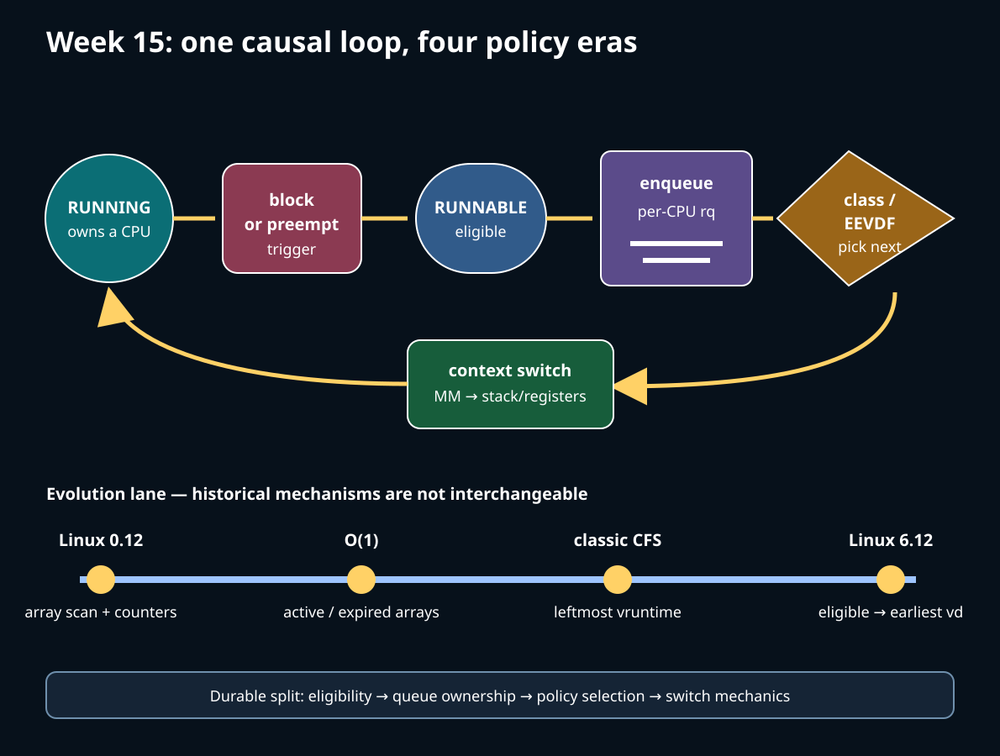

# Week 15 — Linux Scheduler Evolution

**Format:** seven detailed mechanism lessons plus bounded userspace labs

**Suggested workload:** approximately 21 focused hours, adjustable to mastery

> WHY precedes HOW. Each day first states the scheduling problem, teaches only
> the C or assembly needed to read it, walks Linux 0.12, explains the pressure
> that forced evolution, marks the exact ToyOS boundary, reads pinned Linux
> 6.12, and finishes with a bounded observation whose limits are explicit.

The lab is [projects/linux-scheduler](../projects/linux-scheduler/). Modern
source is pinned to Linux `v6.12`, commit
`adc218676eef25575469234709c2d87185ca223a`. The source checker is read-only,
matches every quoted modern landmark in normalized order, and hashes the
source Makefile before and after. Current-upstream behavior beyond this pin
is potentially changed unless independently version checked.

## Required evidence discipline

Linux 0.12 is the compact causal model, from the locally supplied commented
source PDF and [early-source map](../references/EARLY_LINUX_012_MAP.md).
Its global task array, one-CPU assumptions, counters, 80386 TSS switching,
and interrupt-masking conventions are historical. O(1) active/expired arrays
and classic CFS's leftmost-vruntime explanation are later historical eras.
Linux 6.12 fair selection uses EEVDF eligibility and virtual deadlines.

ToyOS contributes exactly what its source implements: two ring-0 tasks,
`TASK_RUNNABLE/RUNNING/BLOCKED`, round-robin selection, dedicated stacks,
a timer callback, and an x86-64 callee-saved-register `context_switch`.
It has no userspace scheduler API, wait queues, per-CPU runqueues, SMP,
EEVDF, scheduler classes, NUMA balancing, cgroups, or PI futex machinery.

## Seven-day route

1. [Day 1 — Scheduler Purpose, Causal Loop, and Architecture](sections/day-001-purpose-task-state.md) — wrapper [day 1](challenges/day-001-purpose-task-state.sh).

2. [Day 2 — Blocking, Wait Queues, and Wakeups](sections/day-002-wait-wakeup.md) — wrapper [day 2](challenges/day-002-wait-wakeup.sh).

3. [Day 3 — Per-CPU Runqueues and Context Switch](sections/day-003-runqueue-switch.md) — wrapper [day 3](challenges/day-003-runqueue-switch.sh).

4. [Day 4 — Fair Scheduling: Counters to EEVDF](sections/day-004-fair-eevdf.md) — wrapper [day 4](challenges/day-004-fair-eevdf.sh).

5. [Day 5 — Scheduler Classes and Guarantees](sections/day-005-classes-guarantees.md) — wrapper [day 5](challenges/day-005-classes-guarantees.sh).

6. [Day 6 — SMP Placement, Topology, and Control](sections/day-006-smp-placement.md) — wrapper [day 6](challenges/day-006-smp-placement.sh).

7. [Day 7 — Observation and Debugging Report](sections/day-007-debug-report.md) — wrapper [day 7](challenges/day-007-debug-report.sh).

## Safety envelope

Core tests use only this process and children, honor the inherited cpuset
mask, reap every child, arm timeouts, use no network, leave no temporary
files, and do not mount tracefs, edit cgroups, request RT policy, offline
CPUs, or create sustained pressure. Timing values are samples, never
universal latency or switch-count claims. Optional tools print honest SKIPs.

## Completion checkpoint

For each day, submit the prediction, execution path, observation/source-proof
split, limits, and completion prompt. A passing wrapper proves only that the
bounded lab contract ran. It does not record mastery or alter learner state.
