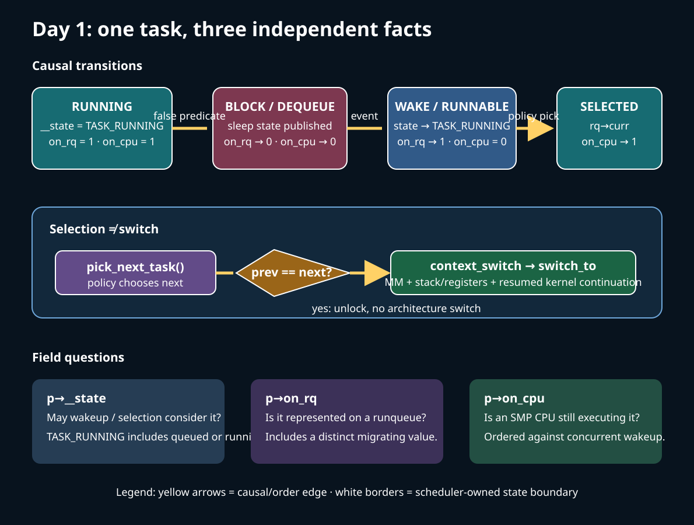
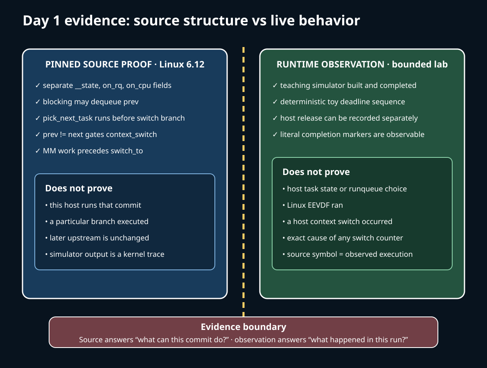

# Day 1 — Why a Scheduler Exists: State, Eligibility, and the Switch

**Target time:** approximately 3 hours

> Driving question: what must the kernel know before it can give a CPU to a task, and which part of that decision is policy rather than mechanism?



## Start with the pressure, not the algorithm

A CPU executes one instruction stream at a time, yet a system normally has more tasks than CPUs. Some tasks can make progress now; others are waiting for a pipe byte, a child, a lock, a timer, or storage. The scheduler exists to stop a waiting task from occupying a CPU and to divide finite CPU service among tasks that can run.

That gives the causal loop:

1. the current task runs until it blocks or scheduling is reconsidered;
2. blocking publishes a non-running state and removes the task from runnable competition;
3. the scheduler chooses among eligible queued tasks according to class policy;
4. the core and architecture switch execution context;
5. an external event can make a sleeper runnable again, but does not guarantee immediate execution.

Three facts are deliberately separate in modern Linux:

- `p->__state` describes sleep/wakeup eligibility. Despite the name, `TASK_RUNNING` means either runnable or currently running.
- `p->on_rq` records whether the task is represented on a runqueue (including a distinct migrating value).
- `p->on_cpu` records that an SMP CPU is still executing the task.

A task can be `TASK_RUNNING` and queued but not executing; it can be `TASK_RUNNING` and be `rq->curr`; during a switch, queue and CPU ownership transitions require ordering. Treating those fields as one “running bit” destroys the information a concurrent wakeup needs.

The architecture is similarly layered. A *trigger* (timer tick, wakeup, yield, block, or reschedule check) asks whether selection should be revisited. The scheduler *core* owns common state transitions, runqueue locking, accounting, and the call to switch. A scheduler *class* supplies policy callbacks such as enqueue, dequeue, pick, tick, and CPU selection. The architecture switch changes address-space and saved machine context. Returning to userspace is a later Week 14 boundary, not a synonym for context switching.

## Minimum syntax needed to read the path

Read `p->sched_class->pick_next_task(rq, prev)` as a call through a function pointer: the core invokes a class-specific implementation while preserving one common call site. A macro such as `for_each_active_class(class)` is a generated loop, so its iteration order is part of scheduler policy.

`READ_ONCE(x)` and `WRITE_ONCE(x, value)` force a single compiler-visible access. They do not create an entire synchronization protocol. `smp_rmb()`, acquire/release operations, and spinlock boundaries express inter-CPU ordering; their comments identify the operation they pair with.

In assembly, `switch_to(prev, next, prev)` is not a normal function that merely returns a result. It changes the stack and register context, and execution eventually resumes at a continuation belonging to whichever task is switched back in. The x86-64 callee-saved registers (`%rbx`, `%rbp`, `%r12`–`%r15`) survive ordinary C calls; a kernel context switch also has to handle stack, instruction continuation, address space, and architecture-specific thread state.

## Linux 0.12: a complete small causal path

Use `references/EARLY_LINUX_012_MAP.md`, Chapter 8.6 of the local commented Linux 0.12 PDF, printed pages 351–372. The value of this source is that the whole mechanism is visible together:

- `schedule()` checks alarms and signal effects, then scans the fixed `task[]` array.
- Only entries in `TASK_RUNNING` compete.
- The runnable task with the largest positive `counter` is selected.
- If all runnable counters are exhausted, every task's counter is recomputed from half its old value plus its static priority, and the scan repeats.
- `switch_to(next)` crosses the 80386 task-switch boundary.

The state test answers *may this task compete?* The counter answers *which eligible task wins this scan?* The switch answers *which saved execution context now owns the CPU?* Those are still useful distinctions even though none of the data structures should be projected onto current Linux.

The same chapter's sleep helpers put the current task behind a wait pointer, set a sleeping state, call `schedule()`, and later restore the older waiter. `wake_up()` changes the referenced waiter to `TASK_RUNNING`. This is enough to expose the circle “false condition → sleep → event → runnable → later selected.” It is not an SMP-safe modern wait queue: Linux 0.12 assumes one CPU, interrupt exclusion, fixed task slots, a single wait-pointer chain, a decaying counter heuristic, and hardware task switching.

## Why the design had to evolve

The compact scan couples eligibility, ranking, and switching under assumptions that disappear as the machine grows.

| Pressure | Required architectural change |
|---|---|
| More tasks | avoid a full fixed-array scan for every choice |
| Multiple CPUs | per-CPU runqueues, explicit ownership, migration, and lock ordering |
| Different service contracts | scheduler classes for stop, deadline, real-time, fair, and idle work |
| Interactive and weighted sharing | richer policy state than one decaying counter |
| Affinity, cpusets, topology, power, NUMA | selection of a legal CPU becomes distinct from ranking on that CPU |
| Concurrent sleep and wakeup | separately ordered state, `on_rq`, and `on_cpu` transitions |
| Virtualization and control groups | accounting, bandwidth, isolation, and placement constraints |

Keep the eras precise. Linux 0.12 used array scans and counters. The later O(1) scheduler used active/expired priority arrays. Classic CFS ordered fair entities by virtual runtime. Pinned Linux 6.12's fair class uses EEVDF eligibility and virtual deadlines; that is not SCHED_DEADLINE, and it is not the old CFS picker. Across those changes, the durable split remains eligibility → policy choice → common switch mechanics.

## The exact ToyOS boundary

The local source is narrower than Linux. In `projects/toyos/src/tasks.c`, `tasks[2]` holds two ring-0 kernel tasks with dedicated stacks. `schedule()` alternates IDs, avoids a `TASK_BLOCKED` task, validates the candidate stack and RIP, changes the old task to `TASK_RUNNABLE`, changes the next task to `TASK_RUNNING`, and calls `context_switch`. `scheduler_tick()` invokes that same scheduler when a current task exists.

`projects/toyos/src/switch.S` saves `%r15`, `%r14`, `%r13`, `%r12`, `%rbx`, `%rbp`, `%rsp`, and a local resume RIP into the old context, loads those values from the next context, and jumps to the next RIP. A later switch back reaches the local label and returns.

ToyOS therefore implements a two-task state filter, a fixed alternating policy, timer-triggered reconsideration, and an ABI-level kernel-stack switch. It has no user tasks, wait queues, wakeup API, SMP, `on_rq`/`on_cpu`, per-CPU runqueues, class hierarchy, affinity, EEVDF, PI, NUMA placement, cgroups, or Linux return-to-user path. `TASK_BLOCKED` is set only when a toy task finishes; it is not a reconstruction of Linux sleep/wakeup ordering.

## Linux 6.12, pinned source

All excerpts below are verbatim from commit `adc218676eef25575469234709c2d87185ca223a` (tag `v6.12`). Line ranges refer to that checkout.

The task descriptor preserves separate facts rather than one overloaded state.

**`include/linux/sched.h`, `struct task_struct`, lines 786–789**

```c
	unsigned int			__state;

	/* saved state for "spinlock sleepers" */
	unsigned int			saved_state;

```

**`include/linux/sched.h`, `struct task_struct`, lines 807–824**

```c
#ifdef CONFIG_SMP
	int				on_cpu;
	struct __call_single_node	wake_entry;
	unsigned int			wakee_flips;
	unsigned long			wakee_flip_decay_ts;
	struct task_struct		*last_wakee;

	/*
	 * recent_used_cpu is initially set as the last CPU used by a task
	 * that wakes affine another task. Waker/wakee relationships can
	 * push tasks around a CPU where each wakeup moves to the next one.
	 * Tracking a recently used CPU allows a quick search for a recently
	 * used CPU that may be idle.
	 */
	int				recent_used_cpu;
	int				wake_cpu;
#endif
	int				on_rq;
```

In `__schedule()`, preemption is not treated as blocking. A nonzero sleep state on a non-preempt schedule path either loses to a pending signal or causes the task to leave runnable competition.

**`kernel/sched/core.c`, `__schedule`, lines 6605–6620**

```c
	/*
	 * We must load prev->state once (task_struct::state is volatile), such
	 * that we form a control dependency vs deactivate_task() below.
	 */
	prev_state = READ_ONCE(prev->__state);
	if (sched_mode == SM_IDLE) {
		/* SCX must consult the BPF scheduler to tell if rq is empty */
		if (!rq->nr_running && !scx_enabled()) {
			next = prev;
			goto picked;
		}
	} else if (!preempt && prev_state) {
		if (signal_pending_state(prev_state, prev)) {
			WRITE_ONCE(prev->__state, TASK_RUNNING);
		} else {
			int flags = DEQUEUE_NOCLOCK;
```

After state handling, the core asks policy for `next`. If `prev == next`, there is no architecture switch; entering the scheduling path does not imply a context switch.

**`kernel/sched/core.c`, `__schedule`, lines 6647–6661**

```c
	next = pick_next_task(rq, prev, &rf);
picked:
	clear_tsk_need_resched(prev);
	clear_preempt_need_resched();
#ifdef CONFIG_SCHED_DEBUG
	rq->last_seen_need_resched_ns = 0;
#endif

	if (likely(prev != next)) {
		rq->nr_switches++;
		/*
		 * RCU users of rcu_dereference(rq->curr) may not see
		 * changes to task_struct made by pick_next_task().
		 */
		RCU_INIT_POINTER(rq->curr, next);
```

The generic picker has a fair-only fast path above this excerpt; otherwise it walks active classes in priority order. Idle supplies the final runnable task, hence the terminal `BUG()`.

**`kernel/sched/core.c`, `__pick_next_task`, lines 5984–6001**

```c
restart:
	prev_balance(rq, prev, rf);

	for_each_active_class(class) {
		if (class->pick_next_task) {
			p = class->pick_next_task(rq, prev);
			if (p)
				return p;
		} else {
			p = class->pick_task(rq);
			if (p) {
				put_prev_set_next_task(rq, prev, p);
				return p;
			}
		}
	}

	BUG(); /* The idle class should always have a runnable task. */
```

The switch boundary is wider than register restoration: `context_switch()` first handles MM/lazy-TLB state and lock handoff. These final lines expose the architecture transition and completion in the resumed context.

**`kernel/sched/core.c`, `context_switch`, lines 5322–5331**

```c
	/* switch_mm_cid() requires the memory barriers above. */
	switch_mm_cid(rq, prev, next);

	prepare_lock_switch(rq, next, rf);

	/* Here we just switch the register state and the stack. */
	switch_to(prev, next, prev);
	barrier();

	return finish_task_switch(prev);
```

The resulting path is:

`kernel entry → trigger/reason → rq lock and state decision → dequeue if blocking → class policy picks next → rq->curr update → context_switch → architecture switch_to → resumed kernel continuation → eventual return checks`.

The core/class/architecture boundaries matter when debugging. A sleeper omitted from selection is a state or wakeup question. A runnable queued task that waits is a class, placement, bandwidth, or capacity question. A selected task that fails during transition is a switch/MM/architecture question.

## Bounded lab: observation is not implementation proof

Run the preserved wrapper:

```sh
15-linux-scheduler-evolution/challenges/day-001-purpose-task-state.sh
```

It builds through `projects/linux-scheduler/Makefile`, runs the pinned source checker, and executes `build/scheduler_sim`, then prints `PASS week15-day1`. The simulator has three synthetic entities and repeatedly picks the smallest toy `deadline`, producing a deterministic trace and `PASS scheduler_sim deterministic`.

This proves that the teaching program built, completed within its alarm, and followed its own deterministic selection rule. It does **not** run Linux EEVDF, inspect task state, select a host runqueue, exercise a scheduler class callback, or prove a host context switch. Its explicit `simulator=teaching_model_not_linux` marker is part of the contract, not a disclaimer to ignore.



Source reading proves that the quoted fields and control flow occur in this exact 6.12 commit. It does not prove the running host uses that source. Record `uname -r` separately. A source symbol cannot turn simulator output into a kernel trace, and a context-switch counter cannot identify the cause of any individual switch.

## Reasoning checks and limits

Use these cases to test the model rather than memorizing names:

- **Runnable but not running:** verify state, `on_rq`, allowed CPU, class, throttling, and available capacity before calling it starvation.
- **Sleeping while a CPU is idle:** idle capacity cannot satisfy a false predicate or invent the missing event.
- **Scheduler entered but no switch:** `pick_next_task()` may return `prev`; reschedule flags and accounting can still be processed.
- **Switch occurred but no user return:** the next task resumes a kernel continuation. Week 14's exit-to-user work remains later.
- **Migration appears helpful:** elapsed time alone cannot separate capacity gain from cache and Week 13 NUMA-locality cost.

Connect the prior weeks explicitly. Week 10 task identity and lifetime survive selection. Week 11 synchronization creates valid sleep/wakeup edges; scheduling cannot repair a broken condition protocol. Week 12 pipes produce readiness events but userspace timing cannot name the kernel wake branch. Week 13 affinity and NUMA make legal placement different from memory locality. Week 14 entry, preemption legality, and return checks define where a reschedule request can actually be honored.

Finish by narrating one task around the entire causal loop. At each arrow label the evidence as `0.12 historical`, `ToyOS implemented`, `Linux 6.12 pinned`, `host observed`, or `hypothesis`. State one limit: current upstream beyond v6.12 is **potentially changed** until version-checked.
