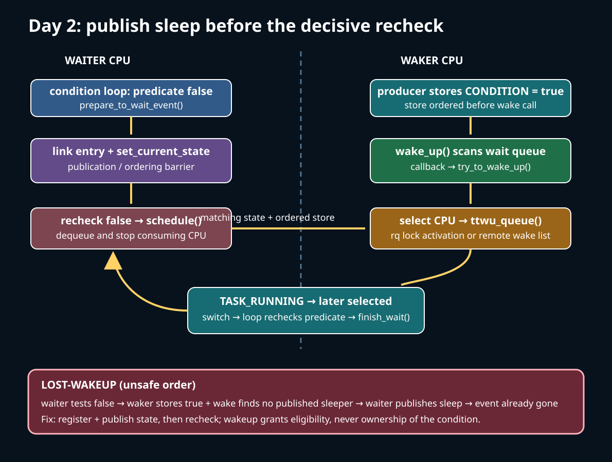
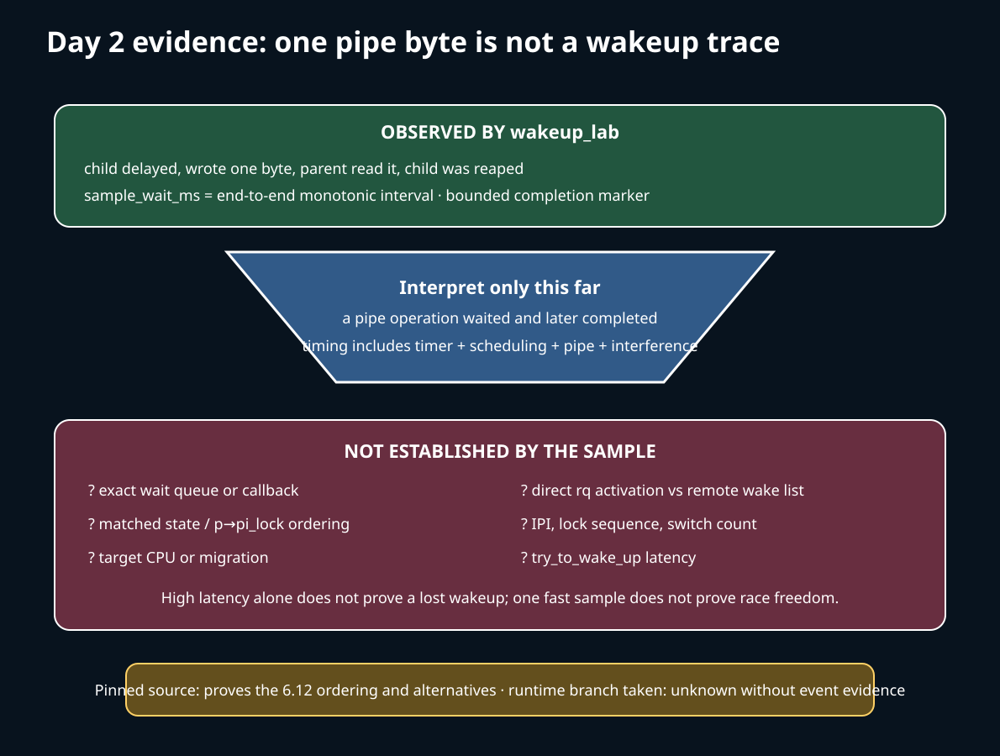

# Day 2 — Waiting Without Losing the Event

**Target time:** approximately 3 hours

> Driving question: how can a task stop consuming CPU while a condition is false without missing the change that makes the condition true?



## Why waiting is a protocol

“Sleep, then wake” is an unsafe description. Suppose a reader sees an empty buffer, a writer fills it and sends a wakeup, and only then the reader publishes that it is asleep. The wakeup found no matching sleeper; the reader can now sleep while data is available. This is the lost-wakeup race.

The durable design is a condition loop:

1. protect or otherwise synchronize access to the condition;
2. register the waiter and publish a wakeable task state;
3. test the condition after publication;
4. call the scheduler only while the condition is still false;
5. after any wakeup, recheck the condition;
6. restore running state and remove the wait entry on every exit path.

The loop is necessary because a wakeup is permission to compete, not ownership of the condition. Another consumer may win before this task runs, signals may interrupt some waits, and wake functions can select candidates without guaranteeing that the predicate remains true.

A wait queue and the scheduler solve different parts. The wait queue records *who is interested in an event* and invokes wake functions under its lock. `try_to_wake_up()` decides whether a candidate's task-state mask matches, synchronizes against scheduling, and gets an unqueued task to a runqueue. Class policy later decides when that runnable task executes.

## Minimum C and ordering syntax

Linux's `wait_event(wq, condition)` family is implemented as statement-expression macros: `({ ... })` behaves like an expression while containing declarations and a loop. A backslash continues a macro definition. `init_wait_entry()` creates a stack-local wait descriptor whose callback normally leads to `try_to_wake_up()`.

`list_empty()` asks whether a list node is linked; `list_del_init()` removes and reinitializes it. A wait entry is not the task state and neither one means “currently on a CPU.”

`set_current_state(state)` is stronger than a plain assignment: its ordering is designed to pair condition access with a waker. `__set_current_state()` lacks that full publication barrier and is used only where another synchronization rule suffices. `spin_lock_irqsave()` protects the wait-queue list while preserving interrupt state.

`state & mask` is a bit-mask match, not equality. A wakeup for `TASK_INTERRUPTIBLE` must not automatically activate a task sleeping in an unmatched state. `READ_ONCE`, `WRITE_ONCE`, `smp_rmb`, acquire loads, and spinlock barriers must be read as an ordered protocol; none is a magic global fence.

No new assembly is needed until the eventual switch. As on Day 1, `switch_to` resumes a saved kernel continuation. Waking a task changes eligibility and placement; it does not jump directly into the task's userspace instruction stream.

## Linux 0.12: see the whole path, then stop

Read Chapter 8.6 (`kernel/sched.c`, printed pages 351–372) and the pipe path in `references/EARLY_LINUX_012_MAP.md` from the local commented PDF. The early sleep helpers place `current` behind a wait pointer, set a sleeping state, call `schedule()`, and arrange restoration of an older waiter. `wake_up()` changes the referenced task to `TASK_RUNNING`.

Chapter 12's early pipe reader makes the cause concrete. While the pipe is empty, it wakes writers that might now progress, checks for EOF and pending signals, and calls `interruptible_sleep_on()` on the read wait pointer. After bytes are consumed, readers wake blocked writers. The complete event chain—buffer condition, sleep, producer change, wake, retry—is compact enough to inspect end to end.

The stable lesson is that a resource condition owns the reason for waiting and its change owns the wake event. The implementation is historical: one CPU, interrupt exclusion, inode-embedded wait pointers, a waiter chain managed by sleep helpers, and no modern SMP memory-ordering or per-CPU runqueue transfer. Do not claim that its exact helper lines are equivalent to current wait queues.

## Why modern Linux needed more machinery

One wait pointer cannot represent many waiters with different modes, exclusive wake-one behavior, poll keys, callbacks, signals, and cancellation. SMP adds the decisive race: the waker can run while the waiter is publishing state, leaving its runqueue, or still executing on another CPU. Per-CPU runqueues then make “make runnable” a question of ownership: which CPU is selected, who takes that `rq->lock`, and whether remote activation should be handed to the destination CPU.

The modern split answers those pressures:

- a wait-queue head owns a locked list of wait entries;
- `prepare_to_wait_event()` links the entry and publishes task state;
- the caller tests the real predicate in a loop and calls `schedule()`;
- `wake_up*()` scans candidates and invokes their wake functions;
- `try_to_wake_up()` serializes task state with `p->pi_lock`, then handles queued, switching, or sleeping cases;
- CPU selection chooses a legal target;
- `ttwu_queue()` either activates under the target `rq->lock` or uses a remote wake list;
- `finish_wait()` restores `TASK_RUNNING` and removes any remaining entry.

This complexity is not policy ornament. It closes races while avoiding unnecessary cross-CPU cache-line traffic.

## The exact ToyOS boundary

`projects/toyos/src/tasks.c` has `TASK_RUNNABLE`, `TASK_RUNNING`, and `TASK_BLOCKED`, but names alone do not implement Linux waiting. Its two ring-0 kernel tasks are created runnable. A task sets itself blocked only in `task_finish()`, after its work is complete. `schedule()` skips a blocked peer and otherwise alternates tasks. There is no condition predicate, wait-queue head, wait entry, prepare/finish pair, wake function, signal-interruptible wait, `p->pi_lock`, runqueue lock, target-CPU selection, or remote wake list.

`projects/toyos/src/switch.S` can save one kernel context and load another, so ToyOS reconstructs the final relinquish/resume mechanism. It cannot demonstrate that a producer and waiter avoid a lost wakeup. Adding `TASK_BLOCKED` to a diagram does not fill that boundary.

## Linux 6.12, pinned source

The following excerpts are verbatim from tag `v6.12`, commit `adc218676eef25575469234709c2d87185ca223a`. The line ranges are from that checkout.

The wait macro shows the condition loop in its real order: prepare first, test after publication, schedule through `cmd`, and always finish.

**`include/linux/wait.h`, `___wait_event`, lines 299–321**

```c
#define ___wait_event(wq_head, condition, state, exclusive, ret, cmd)		\
({										\
	__label__ __out;							\
	struct wait_queue_entry __wq_entry;					\
	long __ret = ret;	/* explicit shadow */				\
										\
	init_wait_entry(&__wq_entry, exclusive ? WQ_FLAG_EXCLUSIVE : 0);	\
	for (;;) {								\
		long __int = prepare_to_wait_event(&wq_head, &__wq_entry, state);\
										\
		if (condition)							\
			break;							\
										\
		if (___wait_is_interruptible(state) && __int) {			\
			__ret = __int;						\
			goto __out;						\
		}								\
										\
		cmd;								\
	}									\
	finish_wait(&wq_head, &__wq_entry);					\
__out:	__ret;									\
})
```

Preparation links the waiter while holding the wait-queue lock, then publishes the chosen state. The earlier signal branch in this function removes the entry while holding the same lock; the macro rechecks the condition before returning the interrupt result.

**`kernel/sched/wait.c`, `prepare_to_wait_event`, lines 291–303**

```c
	} else {
		if (list_empty(&wq_entry->entry)) {
			if (wq_entry->flags & WQ_FLAG_EXCLUSIVE)
				__add_wait_queue_entry_tail(wq_head, wq_entry);
			else
				__add_wait_queue(wq_head, wq_entry);
		}
		set_current_state(state);
	}
	spin_unlock_irqrestore(&wq_head->lock, flags);

	return ret;
}
```

Cleanup first declares the current task running. It then uses a careful lockless emptiness check and takes the queue lock if removal is still necessary.

**`kernel/sched/wait.c`, `finish_wait`, lines 356–379**

```c
void finish_wait(struct wait_queue_head *wq_head, struct wait_queue_entry *wq_entry)
{
	unsigned long flags;

	__set_current_state(TASK_RUNNING);
	/*
	 * We can check for list emptiness outside the lock
	 * IFF:
	 *  - we use the "careful" check that verifies both
	 *    the next and prev pointers, so that there cannot
	 *    be any half-pending updates in progress on other
	 *    CPU's that we haven't seen yet (and that might
	 *    still change the stack area.
	 * and
	 *  - all other users take the lock (ie we can only
	 *    have _one_ other CPU that looks at or modifies
	 *    the list).
	 */
	if (!list_empty_careful(&wq_entry->entry)) {
		spin_lock_irqsave(&wq_head->lock, flags);
		list_del_init(&wq_entry->entry);
		spin_unlock_irqrestore(&wq_head->lock, flags);
	}
}
```

`wake_up()` is a family of macros that reaches `__wake_up()`. The common scanner does not directly edit every task state: it calls each entry's wake function, honors callback results, and limits exclusive wakeups.

**`kernel/sched/wait.c`, `__wake_up_common`, lines 73–97**

```c
static int __wake_up_common(struct wait_queue_head *wq_head, unsigned int mode,
			int nr_exclusive, int wake_flags, void *key)
{
	wait_queue_entry_t *curr, *next;

	lockdep_assert_held(&wq_head->lock);

	curr = list_first_entry(&wq_head->head, wait_queue_entry_t, entry);

	if (&curr->entry == &wq_head->head)
		return nr_exclusive;

	list_for_each_entry_safe_from(curr, next, &wq_head->head, entry) {
		unsigned flags = curr->flags;
		int ret;

		ret = curr->func(curr, mode, wake_flags, key);
		if (ret < 0)
			break;
		if (ret && (flags & WQ_FLAG_EXCLUSIVE) && !--nr_exclusive)
			break;
	}

	return nr_exclusive;
}
```

The default wake callback eventually enters `try_to_wake_up()`. For a task other than `current`, the condition store must become ordered before the task-state test. `p->pi_lock` serializes concurrent wakeups and stabilizes scheduling fields used for migration; its name does not mean every wakeup performs priority inheritance.

**`kernel/sched/core.c`, `try_to_wake_up`, lines 4160–4170**

```c
	 * If we are going to wake up a thread waiting for CONDITION we
	 * need to ensure that CONDITION=1 done by the caller can not be
	 * reordered with p->state check below. This pairs with smp_store_mb()
	 * in set_current_state() that the waiting thread does.
	 */
	scoped_guard (raw_spinlock_irqsave, &p->pi_lock) {
		smp_mb__after_spinlock();
		if (!ttwu_state_match(p, state, &success))
			break;

		trace_sched_waking(p);
```

The function reads state before `on_rq`, with explicit barriers and matching comments. If the task is already queued, `ttwu_runnable()` handles that case under its current runqueue lock. If it is no longer queued, the state becomes `TASK_WAKING` before `p->pi_lock` can be released for activation.

**`kernel/sched/core.c`, `try_to_wake_up`, lines 4222–4230**

```c
		smp_acquire__after_ctrl_dep();

		/*
		 * We're doing the wakeup (@success == 1), they did a dequeue (p->on_rq
		 * == 0), which means we need to do an enqueue, change p->state to
		 * TASK_WAKING such that we can unlock p->pi_lock before doing the
		 * enqueue, such as ttwu_queue_wakelist().
		 */
		WRITE_ONCE(p->__state, TASK_WAKING);

```

Remote activation can be transferred to the destination CPU. The wake-list path marks pending work and queues the task's wake entry; the destination later processes that list under its own runqueue lock.

**`kernel/sched/core.c`, `__ttwu_queue_wakelist`, lines 3821–3829**

```c
static void __ttwu_queue_wakelist(struct task_struct *p, int cpu, int wake_flags)
{
	struct rq *rq = cpu_rq(cpu);

	p->sched_remote_wakeup = !!(wake_flags & WF_MIGRATED);

	WRITE_ONCE(rq->ttwu_pending, 1);
	__smp_call_single_queue(cpu, &p->wake_entry.llist);
}
```

`ttwu_queue()` exposes the ownership alternatives. A successful wake-list handoff returns without the waker taking the destination `rq->lock`; otherwise the waker locks that runqueue and activates the task there.

**`kernel/sched/core.c`, `ttwu_queue`, lines 3943–3955**

```c
static void ttwu_queue(struct task_struct *p, int cpu, int wake_flags)
{
	struct rq *rq = cpu_rq(cpu);
	struct rq_flags rf;

	if (ttwu_queue_wakelist(p, cpu, wake_flags))
		return;

	rq_lock(rq, &rf);
	update_rq_clock(rq);
	ttwu_do_activate(rq, p, wake_flags, &rf);
	rq_unlock(rq, &rf);
}
```

When the old CPU has finished referencing an unqueued task, selection can choose a different legal CPU. Migration updates accounting and task CPU before the common queue step.

**`kernel/sched/core.c`, `try_to_wake_up`, lines 4264–4287**

```c
		smp_cond_load_acquire(&p->on_cpu, !VAL);

		cpu = select_task_rq(p, p->wake_cpu, &wake_flags);
		if (task_cpu(p) != cpu) {
			if (p->in_iowait) {
				delayacct_blkio_end(p);
				atomic_dec(&task_rq(p)->nr_iowait);
			}

			wake_flags |= WF_MIGRATED;
			psi_ttwu_dequeue(p);
			set_task_cpu(p, cpu);
		}
#else
		cpu = task_cpu(p);
#endif /* CONFIG_SMP */

		ttwu_queue(p, cpu, wake_flags);
	}
out:
	if (success)
		ttwu_stat(p, task_cpu(p), wake_flags);

	return success;
```

The end-to-end causal chain is therefore:

`predicate false → wait entry linked + state published → predicate rechecked → schedule/dequeue → producer changes predicate → wake queue scans → state mask matches under p->pi_lock → queued/switching case resolved → CPU selected → target rq activation or remote wake-list handoff → TASK_RUNNING → later class selection → switch → predicate rechecked`.

The phrase “wake the task” compresses all of that. Use the expanded form whenever diagnosing a hang.

## Bounded lab and evidence split

Run the preserved wrapper:

```sh
15-linux-scheduler-evolution/challenges/day-002-wait-wakeup.sh
```

It builds through `projects/linux-scheduler/Makefile`, runs the pinned source checker, executes `build/wakeup_lab`, and prints `PASS week15-day2`. The program creates a pipe, forks, lets the child sleep for about 20 ms and write one byte, blocks the parent in `read()`, reaps the child, and prints `sample_wait_ms=...` plus `claim=userspace_pipe_observation_only`. A four-second alarm bounds a stuck run.

That observation proves one byte crossed the pipe, the parent returned from `read`, the child was reaped successfully, and an end-to-end monotonic-clock interval was measured on the host. It does not prove which wait queue, wake callback, target CPU, `ttwu_queue` branch, IPI, lock ordering, or number of context switches occurred. The interval includes the child's timer delay, process scheduling, pipe implementation, clock calls, and host interference; it is not `try_to_wake_up()` latency.



The verbatim excerpts establish the ordering and alternatives in this pinned 6.12 source. They do not establish that `uname -r` identifies the same build, that the pipe run took every shown branch, or that later upstream is unchanged. Optional tracing can refine live evidence, but absence or permission denial must remain `SKIP`; do not mount tracefs or alter host-wide policy for this lab.

## Lost-wakeup reasoning in practice

When a waiter hangs, ask in causal order:

1. **Predicate:** what exact resource fact is false, and under which lock or atomic protocol is it read?
2. **Publication:** was the wait entry linked and wakeable state published before the decisive recheck?
3. **Producer:** who changes the predicate, and is that change ordered before the wake call?
4. **Match:** does the wake mode match the published task state?
5. **Transfer:** was the task already queued, still `on_cpu`, activated on an `rq`, or handed to a remote wake list?
6. **Competition:** after becoming runnable, what class, affinity, bandwidth, or CPU-capacity constraint delayed execution?
7. **Loop:** did the resumed waiter recheck the predicate and clean up on every signal/error path?

Do not infer “lost wakeup” from high latency alone: the task may have become runnable and then waited for CPU service. Do not infer correctness from one fast sample: the dangerous interleaving may not have occurred. A task can also remain asleep correctly because the event did not match its state, or wake correctly and find that another consumer took the resource.

Weeks 10–14 supply the surrounding invariants. Week 10 keeps the task and referenced objects alive while it waits. Week 11 supplies predicate locks, atomics, condition loops, futex reasoning, and PI interactions. Week 12 supplies concrete descriptor readiness: pipe data, EOF, and backpressure cause wake events. Week 13 explains why the selected CPU and remote cache/NUMA cost matter after wakeup. Week 14 explains syscall/interrupt entry, legal scheduling points, preemption, and why a resumed kernel task still has a separate return-to-user path.

For completion, explain one pipe read from false predicate through recheck after wakeup. Label every claim as `Linux 0.12 historical`, `ToyOS boundary`, `Linux 6.12 pinned`, `host observation`, or `hypothesis`. End with the explicit limit: behavior after v6.12 is **potentially changed** until version-checked.
