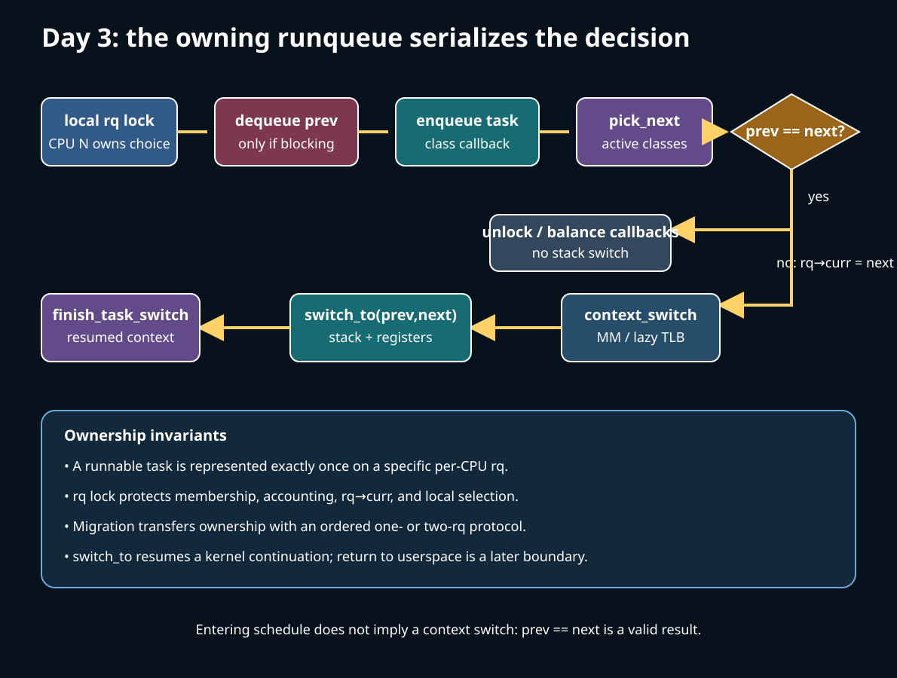
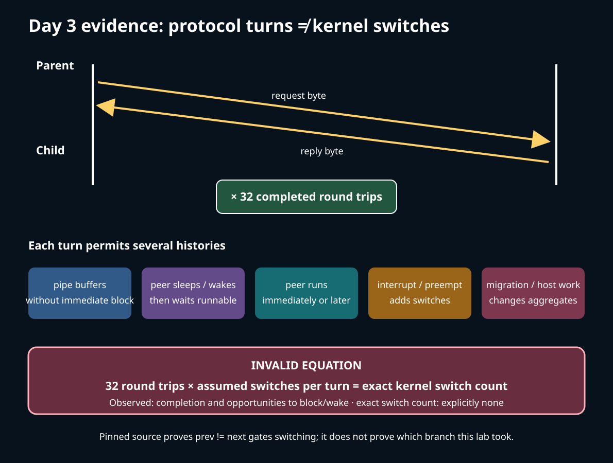

# Day 3 — Who Owns the Runnable Task?

**Target time:** approximately 3 hours

> Driving question: once a task is runnable, which CPU owns the decision to run it, and where does selection end and execution resume?



## 1. Syntax needed to read the path

Modern scheduler code is mostly ordinary C wrapped in conventions that carry locking
and policy meaning.

- `this_rq()` and `cpu_rq(cpu)` return pointers to per-CPU `struct rq` objects. Per-CPU
  does not mean lock-free: queue membership and `rq->curr` are serialized by that
  runqueue's lock.
- `p->sched_class->enqueue_task(...)` is an indirect call through a function pointer.
  The core controls the transition; the selected class maintains its own queue.
- `READ_ONCE(prev->__state)` forces one compiler load. It does not replace the
  runqueue lock, the wakeup-side lock, or the paired ordering described in comments.
- `likely(prev != next)` is a branch-prediction hint, not a correctness condition.
- `switch_to(prev, next, prev)` is a macro. The third argument receives the task that
  was switched out when this saved continuation eventually resumes.

For assembly, read `%rdi` and `%rsi` as the first two x86-64 integer arguments.
`pushq` saves on the current stack; changing `%rsp` changes which task's kernel stack
is active. A label such as `1:` is a local resume point. Saving callee-saved registers
is enough for ToyOS's C-call boundary, but not a complete Linux process switch.

## 2. Linux 0.12: one global decision is visible end to end

Start with Chapter 8.6, `kernel/sched.c`, printed pages 351–372 in the local commented
Linux 0.12 PDF, using `references/EARLY_LINUX_012_MAP.md` as the reading guide.
`schedule()` scans the fixed global `task[]` table for `TASK_RUNNING` entries and keeps
the task with the largest positive `counter`. If no runnable task has positive credit,
it recalculates every counter as half the old counter plus `priority`, then scans again.
`switch_to(next)` invokes the 80386 hardware task-switch machinery.

That small implementation exposes the durable sequence:

```text
state says runnable → policy ranks candidates → switch transfers execution
```

It does **not** expose modern ownership. There is one CPU, one global table, no remote
enqueue, no pair of runqueue locks for migration, no `on_rq`/`on_cpu` handshake, and no
separate scheduler classes. Its interrupt exclusion and hardware task switch are
historical details, not a recipe for SMP Linux.

### Check the old mechanism

Explain why a sleeping task with a large counter cannot win the scan. Then identify the
point at which `counter` stops being merely accounting and becomes a selection key.
Finally, name the first invariant that fails if two CPUs independently scan the same
array and both select the same task.

## 3. Why evolution was necessary

With several CPUs, “runnable” is not enough. A task must be queued exactly once, on a
specific CPU's runqueue, while wakeup, migration, blocking, and selection can race.
A single global queue would concentrate lock traffic and destroy locality; an unlocked
set of local queues could double-enqueue or lose a task.

Linux therefore needs explicit ownership:

1. A task's runqueue is selected subject to affinity and placement rules.
2. That runqueue's lock protects the membership transition.
3. enqueue/dequeue callbacks update both common accounting and class-private structures.
4. the owning CPU chooses from its own active classes;
5. migration transfers ownership under a defined one- or two-runqueue protocol.

Per-CPU queues trade one problem for another: they scale the common path, but now Linux
must balance load, preserve CPU affinity, avoid deadlock when two queues are locked, and
pay cache/NUMA costs when it moves execution. “CPU 3 is idle” does not imply a task may
legally or profitably move there.

## 4. Exact ToyOS boundary

Read `projects/toyos/src/tasks.c:130-160`. Its private `schedule()` chooses one of two
ring-0 kernel tasks by alternating IDs. It refuses a blocked candidate, marks the old
task runnable, marks the new task running, and calls `context_switch()`.
`scheduler_tick()` invokes the same function when a current task exists.

Read `projects/toyos/src/switch.S:1-25`. It stores `%r15`, `%r14`, `%r13`, `%r12`,
`%rbx`, `%rbp`, `%rsp`, and a resume RIP in the old `struct context`, loads the same
fields from the next context, and jumps. When the old task is later selected, it returns
through the saved local label.

ToyOS therefore implements **choose → save continuation → load continuation → resume**,
including timer-triggered and cooperative calls. It has one CPU, two statically known
kernel tasks, no `mm`, no userspace, no runqueue lock, no migration, no class callbacks,
and no Linux return-to-user work. Its state field is not evidence for Linux's `on_rq`
or `on_cpu` protocol.

## 5. Linux 6.12, pinned: queue ownership and callbacks

All excerpts below are verbatim from commit
`adc218676eef25575469234709c2d87185ca223a`. Line ranges identify this pinned tree.

**`kernel/sched/core.c`, `enqueue_task()`, lines 2015–2034:**

```c
void enqueue_task(struct rq *rq, struct task_struct *p, int flags)
{
	if (!(flags & ENQUEUE_NOCLOCK))
		update_rq_clock(rq);

	p->sched_class->enqueue_task(rq, p, flags);
	/*
	 * Must be after ->enqueue_task() because ENQUEUE_DELAYED can clear
	 * ->sched_delayed.
	 */
	uclamp_rq_inc(rq, p);

	if (!(flags & ENQUEUE_RESTORE)) {
		sched_info_enqueue(rq, p);
		psi_enqueue(p, flags & ENQUEUE_MIGRATED);
	}

	if (sched_core_enabled(rq))
		sched_core_enqueue(rq, p);
}
```

The caller supplies the already chosen `rq` and the required locking context.
The class callback changes its queue first; common utilization, scheduler-info, PSI,
and core-scheduling accounting surround it in a deliberate order.

**`kernel/sched/core.c`, `dequeue_task()`, lines 2036–2058:**

```c
/*
 * Must only return false when DEQUEUE_SLEEP.
 */
inline bool dequeue_task(struct rq *rq, struct task_struct *p, int flags)
{
	if (sched_core_enabled(rq))
		sched_core_dequeue(rq, p, flags);

	if (!(flags & DEQUEUE_NOCLOCK))
		update_rq_clock(rq);

	if (!(flags & DEQUEUE_SAVE)) {
		sched_info_dequeue(rq, p);
		psi_dequeue(p, !(flags & DEQUEUE_SLEEP));
	}

	/*
	 * Must be before ->dequeue_task() because ->dequeue_task() can 'fail'
	 * and mark the task ->sched_delayed.
	 */
	uclamp_rq_dec(rq, p);
	return p->sched_class->dequeue_task(rq, p, flags);
}
```

The boolean matters: delayed dequeue may leave an entity represented on the fair queue.
Do not reduce the modern transition to “delete a tree node.”

## 6. Linux 6.12, pinned: select under the local lock

`__schedule()` identifies the current CPU, obtains that CPU's runqueue, disables local
interrupts, and locks the queue. A blocking call differs from preemption: the former may
remove `prev`; the latter leaves runnable work eligible.

**`kernel/sched/core.c`, `__schedule()`, lines 6548–6567:**

```c
static void __sched notrace __schedule(int sched_mode)
{
	struct task_struct *prev, *next;
	/*
	 * On PREEMPT_RT kernel, SM_RTLOCK_WAIT is noted
	 * as a preemption by schedule_debug() and RCU.
	 */
	bool preempt = sched_mode > SM_NONE;
	bool block = false;
	unsigned long *switch_count;
	unsigned long prev_state;
	struct rq_flags rf;
	struct rq *rq;
	int cpu;

	cpu = smp_processor_id();
	rq = cpu_rq(cpu);
	prev = rq->curr;

	schedule_debug(prev, preempt);
```

After the lock and state/order checks, the picker runs. If `prev == next`, Linux clears
reschedule state and unlocks without switching stacks. Calling `schedule()` is therefore
not proof that a context switch happened.

**`kernel/sched/core.c`, `__schedule()`, lines 6647–6661:**

```c
	next = pick_next_task(rq, prev, &rf);
picked:
	clear_tsk_need_resched(prev);
	clear_preempt_need_resched();
#ifdef CONFIG_SCHED_DEBUG
	rq->last_seen_need_resched_ns = 0;
#endif

	if (likely(prev != next)) {
		rq->nr_switches++;
		/*
		 * RCU users of rcu_dereference(rq->curr) may not see
		 * changes to task_struct made by pick_next_task().
		 */
		RCU_INIT_POINTER(rq->curr, next);
```

The omitted continuation performs accounting and tracing, then calls
`context_switch(rq, prev, next, &rf)`. The queue remains part of a lock-handoff protocol;
selection is not an unlocked query over a snapshot.

The generic picker normally walks active classes from highest to lowest. It has a
fair-only fast path when all runnable tasks and the previous task satisfy its conditions.
That optimization must return the same policy result; it is not a second scheduler.

## 7. The switch is three boundaries, not one

First comes address-space ownership, then architecture state, then continuation cleanup.

**`kernel/sched/core.c`, `context_switch()`, lines 5322–5332:**

```c
	/* switch_mm_cid() requires the memory barriers above. */
	switch_mm_cid(rq, prev, next);

	prepare_lock_switch(rq, next, rf);

	/* Here we just switch the register state and the stack. */
	switch_to(prev, next, prev);
	barrier();

	return finish_task_switch(prev);
}
```

The preceding branch uses lazy-TLB handling for kernel threads or
`switch_mm_irqs_off()` for a user address space. `switch_to` then changes stack and
register state. The C call appears to return, but it returns when this task's saved
continuation is selected, possibly much later.

**`arch/x86/entry/entry_64.S`, `__switch_to_asm`, lines 177–191:**

```asm
SYM_FUNC_START(__switch_to_asm)
	/*
	 * Save callee-saved registers
	 * This must match the order in inactive_task_frame
	 */
	pushq	%rbp
	pushq	%rbx
	pushq	%r12
	pushq	%r13
	pushq	%r14
	pushq	%r15

	/* switch stack */
	movq	%rsp, TASK_threadsp(%rdi)
	movq	TASK_threadsp(%rsi), %rsp
```

Later lines restore the next task's callee-saved registers and jump to `__switch_to`,
which handles additional architecture thread state. `finish_task_switch()` completes
the lock handoff and deferred cleanup in the resumed context.

None of these operations is the return-to-user instruction. The chosen task first
resumes a kernel continuation. It may continue a syscall, complete scheduling cleanup,
or eventually reach Week 14's exit-to-user checks and only then execute the appropriate
architecture return.

## 8. Bounded lab: what pipe ping-pong proves

Run:

```sh
./15-linux-scheduler-evolution/challenges/day-003-runqueue-switch.sh
```

The wrapper builds the existing `projects/linux-scheduler` binaries, verifies the pinned
source anchors, and runs `switch_lab`. That program creates two pipes, forks, and performs
32 one-byte request/reply round trips under a four-second alarm.



Keep two evidence columns:

**Observed from the lab**

- the child was created and reaped successfully;
- all 32 protocol round trips completed;
- blocking pipe operations created opportunities for sleep, wakeup, and switching;
- the program explicitly reports `exact_kernel_switch_claim=none`.

**Established only by pinned source**

- queue operations dispatch through the task's scheduler class;
- the local runqueue and `rq->curr` participate in `__schedule()`;
- `prev != next` gates the architecture context-switch path;
- memory-context switching precedes `switch_to`.

The program cannot count exact kernel switches. Pipe buffering, wakeup timing, immediate
execution of the peer, interrupts, involuntary preemption, and unrelated host activity
all affect aggregate switch counters. Completion does not reveal which CPU owned either
task, whether either migrated, which class picker branch ran, or whether this host runs
the pinned 6.12 build.

## 9. Practical questions and limits

1. A task blocks after setting a sleep state. Under which runqueue lock is it removed,
   and what wakeup-side ordering prevents the event from being lost?
2. If two CPUs need to exchange tasks, why must their runqueue locks use an ordered
   protocol rather than “source then destination” on both CPUs?
3. If `prev == next`, which work in `__schedule()` still happened, and which switch
   counters must not be inferred?
4. When `next->mm == NULL`, why is copying ToyOS's register-only diagram insufficient?
5. If the ping-pong program completes faster after pinning both processes, does that
   establish fewer migrations, warmer caches, less host contention, or none of those
   without additional evidence?
6. Which event would you need to trace to distinguish enqueue on the waking CPU from
   enqueue on a remote target CPU?
7. Why can moving a task to an idle CPU improve capacity yet worsen cache or NUMA
   locality?

Stop at the version boundary: these excerpts prove implementation details only for the
pinned Linux 6.12 commit. A host observation must record `uname -r`; a statement about
later upstream is **potentially changed** until checked against a named commit.

### Completion prompt

Narrate one blocking round trip as:

```text
pipe condition → sleep state → dequeue → wake event → target rq enqueue
→ class pick → mm switch → register/stack switch → resumed kernel continuation
→ possible return to userspace
```

Label every arrow `Linux 0.12 historical`, `ToyOS implemented`, `Linux 6.12 pinned`,
`host observed`, or `not established`. The answer is incomplete if `switch_to` and
return-to-user are treated as the same boundary.
