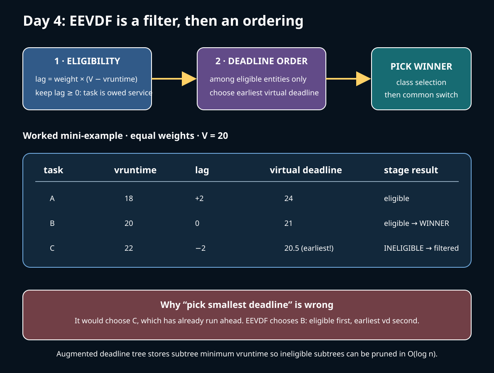
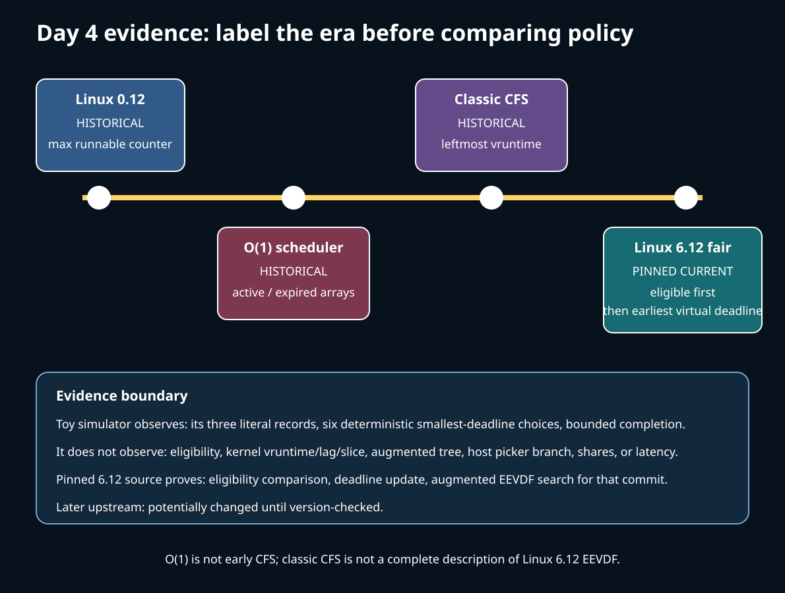

# Day 4 — Fair Service from Counters to EEVDF

**Target time:** approximately 3 hours

> Driving question: among runnable fair tasks, how did Linux move from remaining ticks to eligibility plus virtual deadlines?



## 1. Syntax and units before policy

Scheduler time fields are integers with policy-specific units. A `u64` subtraction often
becomes an `s64` comparison so wraparound can be handled under bounded assumptions.
Do not translate these expressions into wall-clock promises.

- `se->vruntime` is weighted service position in virtual time.
- `se->deadline` is an EEVDF **virtual** deadline, not a SCHED_DEADLINE absolute
  deadline and not a userspace completion time.
- `se->slice` is the current request length used to form a virtual deadline.
- `se->load.weight` changes how actual execution advances virtual time.
- `cfs_rq->avg_vruntime` and `avg_load` support an efficiently maintained weighted
  virtual-time estimate.
- `rb_node`, `rb_left`, and `rb_right` describe a red-black tree. Augmented fields
  summarize subtrees so a search can prune candidates without scanning every entity.

`calc_delta_fair(delta, se)` converts real-service-sized `delta` into weighted virtual
time. A larger fair weight advances virtual time more slowly for the same execution.
`entity_before(a, b)` and signed differences implement an ordering in this virtual domain;
they are not ordinary unsigned “less than” tests.

## 2. Linux 0.12: counters, not EEVDF

Use Chapter 8.6, `kernel/sched.c`, printed pages 351–372 of the local commented Linux
0.12 PDF and `references/EARLY_LINUX_012_MAP.md`.

For each timer tick, the running task's positive `counter` is reduced. `schedule()` scans
the fixed task table and picks a `TASK_RUNNING` task with the greatest counter. When all
runnable counters reach zero, every task receives:

```text
new counter = old counter / 2 + priority
```

The old remainder decays rather than disappearing, while static priority replenishes
credit. This is a compact service heuristic: CPU-bound tasks consume counters; sleepers
may return with credit. It has no explicit system virtual time, lag, request, eligibility
test, virtual deadline, tree, or per-CPU fair runqueue.

Worked 0.12 example: runnable A and B have counters 6 and 2. A is selected and consumes
ticks until another scheduling point changes the ranking. If both reach zero and their
priorities are 3 and 5, they become 3 and 5. This does **not** mean B has an EEVDF
deadline of 5; the number is replenished counter credit.

## 3. Why the fair scheduler evolved

The 0.12 scan costs linear work in the task-table size and assumes one CPU. More
importantly, one decaying scalar cannot cleanly separate service entitlement, wakeup
latency, request size, CPU placement, and bandwidth hierarchy.

Keep four eras separate:

1. **Linux 0.12 counters:** scan runnable tasks for greatest remaining credit; periodically
   recalculate counters.
2. **Historical O(1):** use priority-indexed active and expired arrays so choosing a
   priority does not scan all tasks. Interactivity and timeslice heuristics decide how
   tasks move through those arrays.
3. **Historical classic CFS:** charge weighted virtual runtime and choose the leftmost
   runnable entity from a vruntime-ordered red-black tree, approximating an ideal
   processor-sharing model.
4. **Pinned Linux 6.12 EEVDF:** test whether an entity is owed service, then choose the
   earliest virtual deadline among eligible entities. The fair tree is deadline ordered
   and augmented for eligibility search.

O(1) is not “early CFS,” and classic CFS's leftmost-vruntime explanation is not a full
description of Linux 6.12. The historical designs explain why bounded pick cost, weighted
service, sleeper behavior, and latency control were repeatedly revisited.

## 4. Exact ToyOS boundary

`projects/toyos/src/tasks.c:130-160` alternates between two runnable ring-0 tasks.
It has no weight, service accounting, red-black tree, request length, lag, virtual time,
or deadline. `projects/toyos/src/switch.S:1-25` changes saved continuations after that
fixed choice.

ToyOS teaches that selection and context switching are separate mechanisms. It cannot
answer which of two continuously runnable tasks is owed service. Any EEVDF values drawn
beside its two task IDs are an explanatory overlay, not ToyOS state.

The Day 4 wrapper runs `projects/linux-scheduler/src/scheduler_sim.c`. That simulator
contains three records and repeatedly chooses the smallest toy `deadline`, then increments
it. Its own output says `teaching_model_not_linux`. It omits eligibility, vruntime,
weights as Linux interprets them, augmented search, hierarchy, preemption, and SMP.

## 5. Lag and eligibility with numbers

EEVDF starts from service entitlement. In the source comment, lag for entity *i* is:

```text
lag_i = service entitled - service received
      = weight_i × (V - v_i)
```

`V` is the runqueue's weighted average virtual time and `v_i` is the entity's vruntime.
Non-negative lag means the entity has not run ahead of its entitlement and is eligible.

### Example A: eligibility filters an attractive deadline

Assume equal weights and three queued entities:

```text
entity    vruntime    lag at V=20    virtual deadline
A            18           +2               24
B            20            0               21
C            22           -2               20.5
```

C has the earliest deadline but has run ahead (`lag < 0`), so it is ineligible. A and B
are eligible; B wins because deadline 21 precedes A's 24. “Pick the smallest deadline”
alone would incorrectly choose C.

### Example B: service changes eligibility

Two equal-weight entities start at vruntimes 10 and 14, so the simple average is 12.
A has lag +2 and is eligible; B has lag -2 and is not. If A executes enough for its
vruntime to reach 14, the average becomes 14 and both are at parity. Eligibility is not
a permanent task property: accounting, enqueue/dequeue, and reweighting move the virtual
time against which it is tested.

Linux avoids a division in the hot eligibility test. It compares weighted sums while
including the current entity when it remains on the runqueue.

**`kernel/sched/fair.c`, `vruntime_eligible() / entity_eligible()`, lines 726–745:**

```c
static int vruntime_eligible(struct cfs_rq *cfs_rq, u64 vruntime)
{
	struct sched_entity *curr = cfs_rq->curr;
	s64 avg = cfs_rq->avg_vruntime;
	long load = cfs_rq->avg_load;

	if (curr && curr->on_rq) {
		unsigned long weight = scale_load_down(curr->load.weight);

		avg += entity_key(cfs_rq, curr) * weight;
		load += weight;
	}

	return avg >= (s64)(vruntime - cfs_rq->min_vruntime) * load;
}

int entity_eligible(struct cfs_rq *cfs_rq, struct sched_entity *se)
{
	return vruntime_eligible(cfs_rq, se->vruntime);
}
```

The stable concept is “owed service.” The exact maintained sums and precision choices
are pinned implementation details.

## 6. Virtual deadlines and request length

An eligible entity still needs a latency ordering. EEVDF associates a request with a
virtual deadline:

```text
virtual deadline = eligible virtual time + request / weight
```

In Linux's representation, `vruntime` is the virtual eligible-time basis and
`calc_delta_fair(slice, se)` performs the weighted conversion.

**`kernel/sched/fair.c`, `update_deadline()`, lines 1007–1029:**

```c
static bool update_deadline(struct cfs_rq *cfs_rq, struct sched_entity *se)
{
	if ((s64)(se->vruntime - se->deadline) < 0)
		return false;

	/*
	 * For EEVDF the virtual time slope is determined by w_i (iow.
	 * nice) while the request time r_i is determined by
	 * sysctl_sched_base_slice.
	 */
	if (!se->custom_slice)
		se->slice = sysctl_sched_base_slice;

	/*
	 * EEVDF: vd_i = ve_i + r_i / w_i
	 */
	se->deadline = se->vruntime + calc_delta_fair(se->slice, se);

	/*
	 * The task has consumed its request, reschedule.
	 */
	return true;
}
```

Worked request example in normalized equal-weight units: D and E are both eligible at
virtual time 100. D requests 2 units and gets deadline 102; E requests 6 and gets 106.
D is selected first. This improves latency for the shorter request, but D cannot keep
submitting short requests to run indefinitely ahead: once its service makes it
ineligible, deadline order cannot bypass the eligibility filter.

With unequal weights, the same real request produces a smaller virtual increment for the
higher-weight entity. Nice therefore affects the virtual-time slope. A virtual deadline
is still not a completion guarantee: higher scheduler classes, CPU availability,
throttling, affinity, interrupts, and blocking all sit outside this local fair choice.

## 7. Why an augmented red-black tree is needed

Deadline order and eligibility order are different. The earliest-deadline node can be
ineligible, as C was in Example A. Scanning deadline order until an eligible node appears
could be linear. Linux stores subtree minimum vruntime so an entire subtree can be
rejected when none of it can be eligible.

**`kernel/sched/fair.c`, `pick_eevdf()`, lines 888–908:**

```c
/*
 * Earliest Eligible Virtual Deadline First
 *
 * In order to provide latency guarantees for different request sizes
 * EEVDF selects the best runnable task from two criteria:
 *
 *  1) the task must be eligible (must be owed service)
 *
 *  2) from those tasks that meet 1), we select the one
 *     with the earliest virtual deadline.
 *
 * We can do this in O(log n) time due to an augmented RB-tree. The
 * tree keeps the entries sorted on deadline, but also functions as a
 * heap based on the vruntime by keeping:
 *
 *  se->min_vruntime = min(se->vruntime, se->{left,right}->min_vruntime)
 *
 * Which allows tree pruning through eligibility.
 */
static struct sched_entity *pick_eevdf(struct cfs_rq *cfs_rq)
{
```

**`kernel/sched/fair.c`, `pick_eevdf()`, lines 937–957:**

```c
	/* Heap search for the EEVD entity */
	while (node) {
		struct rb_node *left = node->rb_left;

		/*
		 * Eligible entities in left subtree are always better
		 * choices, since they have earlier deadlines.
		 */
		if (left && vruntime_eligible(cfs_rq,
					__node_2_se(left)->min_vruntime)) {
			node = left;
			continue;
		}

		se = __node_2_se(node);

		/*
		 * The left subtree either is empty or has no eligible
		 * entity, so check the current node since it is the one
		 * with earliest deadline that might be eligible.
		 */
```

The remaining search tests that node, otherwise moves right, and finally compares an
eligible current entity. Red-black balancing bounds tree height; the augmentation makes
eligibility pruning possible.

## 8. Where PELT and uclamp belong—and where they do not

PELT supplies decayed runnable/load/utilization signals. Those signals matter when Linux
asks where work should run, how busy a CPU appears, how group load is represented, or
what capacity/frequency response is appropriate. They are not the lag equation above.

Utilization clamping bounds utilization signals used by placement and frequency/capacity
decisions. `uclamp_rq_inc()` appearing in the generic enqueue path does not mean uclamp
sets `se->deadline`, grants more fair weight, or supplies a real-time reservation.

Only introduce PELT or uclamp in an EEVDF explanation when crossing from local fair
selection to SMP placement or capacity. Otherwise they obscure the mechanism being
studied.

## 9. Bounded lab and source-proof split

Run:

```sh
./15-linux-scheduler-evolution/challenges/day-004-fair-eevdf.sh
```

The wrapper builds the existing project, runs the source checker against the pinned
commit, then executes `scheduler_sim`.



**The run can prove**

- the toy model starts from its three literal records;
- at each of six steps it chooses the smallest stored toy deadline;
- its deterministic update produces the printed sequence;
- the bounded program completes.

**The run cannot prove**

- that the host chose the process through `pick_eevdf()`;
- that any printed integer equals a kernel vruntime, lag, slice, or deadline;
- fair CPU shares, wakeup latency, tree shape, PELT values, or uclamp behavior;
- that the running kernel is Linux 6.12 at the pinned commit.

**Pinned source can prove** the eligibility comparison, deadline update, and augmented
selection shown above for that commit. It cannot prove live host behavior.

## 10. Practical questions and limits

1. In Example A, why does deadline 20.5 lose to deadline 21?
2. If A's nice value changes, which quantities must be recomputed or interpreted with
   the new weight? Why is “nice is a deadline” false?
3. How can a task have the earliest deadline yet be ineligible?
4. Why would a tree ordered only by vruntime describe classic CFS better than pinned
   6.12 EEVDF?
5. Which source field allows the picker to reject a left subtree without visiting every
   node?
6. A latency sample worsens after changing uclamp. What placement/frequency evidence is
   needed before blaming EEVDF selection?
7. How would cgroup hierarchy complicate a calculation that treats every task as a
   direct peer on one `cfs_rq`?

Fairness is conditional on available CPU time. A runnable fair task can wait behind stop,
deadline, or RT work; a restricted affinity mask can remove capacity; a virtual machine
can lose physical CPU time. One elapsed-time sample cannot separate those causes.

### Completion prompt

Build one worked explanation with at least three entities. Compute eligibility first,
then deadline order. Label the 0.12 counter, O(1) array, classic-CFS vruntime tree, and
Linux 6.12 EEVDF statements by era. End with one statement that is `Linux 6.12 pinned`
and one that is `later upstream potentially changed`.
