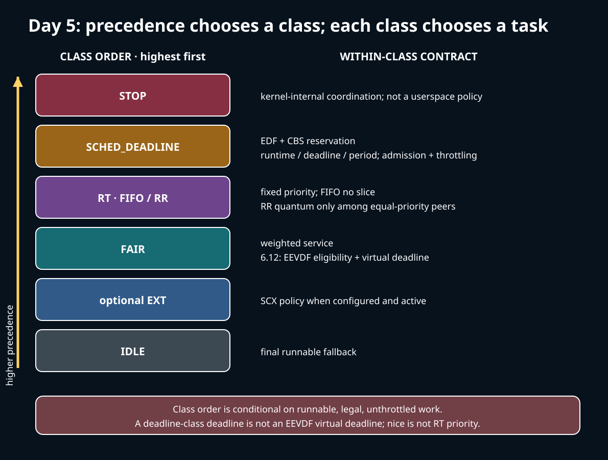
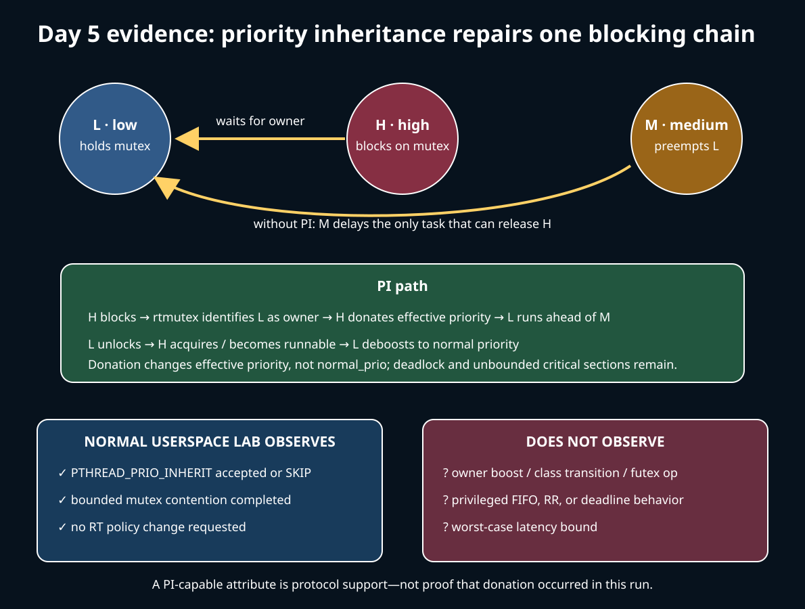

# Day 5 — Scheduler Classes, Contracts, and Priority Inversion

**Target time:** approximately 3 hours

> Driving question: what does Linux actually promise when runnable tasks belong to different policy classes, and what can break a priority argument?



## 1. Syntax for policy and precedence

A policy name, a priority number, and a scheduler class are related but not
interchangeable.

- `p->policy` records a userspace-visible policy such as `SCHED_FIFO`, `SCHED_RR`,
  `SCHED_DEADLINE`, or a normal fair policy.
- `p->sched_class` points to the implementation operations used by the core scheduler.
- `const struct sched_class *` is a pointer to a read-only operations table.
- `DEFINE_SCHED_CLASS(rt)` places a class object into a linker section. The linker script,
  not a runtime sort, establishes class order.
- `for_each_active_class(class)` walks those section entries from highest to lowest,
  skipping optional classes when inactive.
- `sched_class_above(a, b)` compares class addresses in that ordered region. It is not a
  numeric-priority comparison.

Within the RT class, a higher userspace `sched_priority` outranks a lower one; kernel
internal `prio` values use the opposite numeric direction. Nice values belong to the
fair class. Keep each policy's namespace and rules separate.
`SCHED_DEADLINE`'s `runtime`, `deadline`, and `period` are time parameters; an EEVDF
virtual deadline is a fair-class implementation value.

## 2. Linux 0.12: one ranking rule, no class contracts

Read Chapter 8.6, `kernel/sched.c`, printed pages 351–372 in the local commented Linux
0.12 PDF, guided by `references/EARLY_LINUX_012_MAP.md`.

Linux 0.12 filters the fixed global task table by `TASK_RUNNING`, then selects the
greatest positive `counter`. When all runnable counters are exhausted, it recomputes
them from decayed credit plus static priority. `switch_to(next)` transfers execution.

This teaches the basic split between eligibility and ranking, but it cannot express:

- a stop task that must outrank ordinary work;
- a reserved runtime/deadline/period contract;
- FIFO versus round-robin behavior at a fixed RT priority;
- fair-service accounting below real-time work;
- an idle task selected only when nothing else can run;
- admission control, class bandwidth, throttling, or PI boosting.

Calling the old `priority` field an RT guarantee would be an anachronism. It contributes
to counter replenishment in a uniprocessor heuristic.

## 3. Why policy classes became necessary

Different work asks for incompatible contracts. A fair desktop task wants proportional
service and bounded interactive delay. A control task may need fixed-priority ordering.
A deadline reservation describes runtime demand over a period. CPU-stop work is internal
coordination that must not wait behind userspace. An idle thread must exist as a final
fallback without competing as normal work.

One scalar ranking cannot state all those meanings. Linux splits common mechanics
(state, runqueue ownership, enqueue/dequeue, accounting, and context switch) from
class-specific selection. Precedence answers **which contract is considered first**;
the chosen class then applies its own ordering.

The cost is that “highest priority wins” is incomplete. The answer depends on class,
within-class priority or deadline, CPU affinity, admission, bandwidth state, throttling,
blocking, and PI. A runnable fair task can starve while unbounded higher-class work
remains runnable; throttling and reservations exist because precedence alone does not
create CPU capacity.

## 4. Exact ToyOS boundary

`projects/toyos/src/tasks.c:130-160` alternates two ring-0 tasks, skips a blocked task,
updates its three-state model, and invokes `context_switch()`.
`projects/toyos/src/switch.S:1-25` saves and restores the minimal C continuation.

There is no policy attribute, class table, numeric RT priority, FIFO queue, RR quantum,
deadline reservation, admission test, bandwidth timer, mutex PI, futex, userspace, or
privilege check. ToyOS demonstrates that state filtering precedes a switch; it cannot
demonstrate any Linux class guarantee.

The boundary matters especially here: a task that repeatedly yields in ToyOS is not
`SCHED_RR`, and the timer-preempted worker is not `SCHED_FIFO`.

## 5. Linux 6.12, pinned: actual class precedence

All excerpts are verbatim from Linux commit
`adc218676eef25575469234709c2d87185ca223a`.

The linker lays out the base classes in precedence order.

**`include/asm-generic/vmlinux.lds.h`, `SCHED_DATA`, lines 129–138:**

```c
#define SCHED_DATA				\
	STRUCT_ALIGN();				\
	__sched_class_highest = .;		\
	*(__stop_sched_class)			\
	*(__dl_sched_class)			\
	*(__rt_sched_class)			\
	*(__fair_sched_class)			\
	*(__ext_sched_class)			\
	*(__idle_sched_class)			\
	__sched_class_lowest = .;
```

The required base precedence is:

```text
stop > deadline > RT (FIFO/RR) > fair > idle
```

When `CONFIG_SCHED_CLASS_EXT` is present, the optional ext class is placed between fair
and idle in this pinned layout and active-class iteration accounts for whether SCX is
enabled. It does not move stop, deadline, or RT below normal fair work.

Initialization asserts the ordering rather than merely relying on documentation.

**`kernel/sched/core.c`, `sched_init()`, lines 8366–8381:**

```c
void __init sched_init(void)
{
	unsigned long ptr = 0;
	int i;

	/* Make sure the linker didn't screw up */
#ifdef CONFIG_SMP
	BUG_ON(!sched_class_above(&stop_sched_class, &dl_sched_class));
#endif
	BUG_ON(!sched_class_above(&dl_sched_class, &rt_sched_class));
	BUG_ON(!sched_class_above(&rt_sched_class, &fair_sched_class));
	BUG_ON(!sched_class_above(&fair_sched_class, &idle_sched_class));
#ifdef CONFIG_SCHED_CLASS_EXT
	BUG_ON(!sched_class_above(&fair_sched_class, &ext_sched_class));
	BUG_ON(!sched_class_above(&ext_sched_class, &idle_sched_class));
#endif
```

The stop class is kernel-internal; there is no userspace `sched_setscheduler()` request
that turns an application into a stop task. Idle is the final runnable fallback.

## 6. FIFO and RR: fixed-priority RT is conditional

`SCHED_FIFO` and `SCHED_RR` map to the RT class. A runnable task at a higher RT priority
precedes lower RT priorities and lower classes on an eligible CPU.

FIFO has no scheduler timeslice. A selected FIFO task continues until it blocks, yields,
is preempted by higher-priority work, leaves the policy, or is constrained by bandwidth
mechanisms. Equal-priority FIFO queue-position rules matter at wakeup, yield, and policy
changes; “runs forever” is not the contract.

RR uses the same RT priority ordering but adds a quantum among peers at the same priority.

**`kernel/sched/rt.c`, `task_tick_rt()`, lines 2570–2589:**

```c
static void task_tick_rt(struct rq *rq, struct task_struct *p, int queued)
{
	struct sched_rt_entity *rt_se = &p->rt;

	update_curr_rt(rq);
	update_rt_rq_load_avg(rq_clock_pelt(rq), rq, 1);

	watchdog(rq, p);

	/*
	 * RR tasks need a special form of time-slice management.
	 * FIFO tasks have no timeslices.
	 */
	if (p->policy != SCHED_RR)
		return;

	if (--p->rt.time_slice)
		return;

	p->rt.time_slice = sched_rr_timeslice;
```

RR does not make the RT class fair against fair-class tasks. A set of runnable RT tasks
can prevent fair work from running unless they block or bandwidth controls intervene.

Pinned defaults illustrate RT bandwidth, but they are runtime configuration, not eternal
constants.

**`kernel/sched/rt.c`, file scope, lines 11–21:**

```c
/*
 * period over which we measure -rt task CPU usage in us.
 * default: 1s
 */
int sysctl_sched_rt_period = 1000000;

/*
 * part of the period that we allow rt tasks to run in us.
 * default: 0.95s
 */
int sysctl_sched_rt_runtime = 950000;
```

Throttling protects capacity for other work under the configured RT bandwidth regime.
Administrators can change settings, cgroup hierarchy can add constraints, and boosted
work receives special treatment. Never infer the active values from this source excerpt;
inspect the running system with appropriate permissions.

## 7. SCHED_DEADLINE: reservation, admission, and throttling

Deadline class outranks RT in the class walk, but its contract is not “the earliest
timestamp always runs regardless of demand.” A task supplies runtime, relative deadline,
and period. Admission control limits accepted utilization; CBS accounting limits each
reservation's interference.

**`kernel/sched/deadline.c`, file header, lines 2–12:**

```c
/*
 * Deadline Scheduling Class (SCHED_DEADLINE)
 *
 * Earliest Deadline First (EDF) + Constant Bandwidth Server (CBS).
 *
 * Tasks that periodically executes their instances for less than their
 * runtime won't miss any of their deadlines.
 * Tasks that are not periodic or sporadic or that tries to execute more
 * than their reserved bandwidth will be slowed down (and may potentially
 * miss some of their deadlines), and won't affect any other task.
 *
```

The source's guarantee is conditional: the workload model, accepted reservation, and
runtime demand matter. Exhausted runtime is replenished on the reservation's period and
the entity can be throttled; overload, affinity constraints, blocking, hardware failure,
and incorrect demand estimates are not erased by EDF ordering.

Do not confuse this with Day 4's EEVDF virtual deadline. SCHED_DEADLINE parameters are a
userspace scheduling contract in real-time units. EEVDF deadlines rank eligible
fair-class service requests in virtual time.

## 8. Priority inversion: the scheduler cannot release a lock

Suppose low-priority L holds mutex M, high-priority H blocks on M, and medium-priority M2
preempts L. H is highest priority but cannot run through the critical section; M2 does
not need the mutex and can delay the only task able to release it. That is priority
inversion.

Priority inheritance changes the owner's **effective** priority to reflect a waiter,
possibly through a chain of blocked owners. It does not change the owner's normal policy
parameters permanently, make critical sections bounded, or cure deadlock.

**`kernel/sched/core.c`, `rt_mutex_setprio()`, lines 7075–7095:**

```c
/*
 * rt_mutex_setprio - set the current priority of a task
 * @p: task to boost
 * @pi_task: donor task
 *
 * This function changes the 'effective' priority of a task. It does
 * not touch ->normal_prio like __setscheduler().
 *
 * Used by the rt_mutex code to implement priority inheritance
 * logic. Call site only calls if the priority of the task changed.
 */
void rt_mutex_setprio(struct task_struct *p, struct task_struct *pi_task)
{
	int prio, oldprio, queued, running, queue_flag =
		DEQUEUE_SAVE | DEQUEUE_MOVE | DEQUEUE_NOCLOCK;
	const struct sched_class *prev_class, *next_class;
	struct rq_flags rf;
	struct rq *rq;

	/* XXX used to be waiter->prio, not waiter->task->prio */
	prio = __rt_effective_prio(pi_task, p->normal_prio);
```

For a process-shared PI lock, userspace state and the kernel futex PI path connect to an
rtmutex. The path queues a proxy waiter and waits on the PI mutex:

**`kernel/futex/pi.c`, `futex_lock_pi()`, lines 1014–1033:**

```c
	raw_spin_lock_irq(&q.pi_state->pi_mutex.wait_lock);
	spin_unlock(q.lock_ptr);
	/*
	 * __rt_mutex_start_proxy_lock() unconditionally enqueues the @rt_waiter
	 * such that futex_unlock_pi() is guaranteed to observe the waiter when
	 * it sees the futex_q::pi_state.
	 */
	ret = __rt_mutex_start_proxy_lock(&q.pi_state->pi_mutex, &rt_waiter, current);
	raw_spin_unlock_irq(&q.pi_state->pi_mutex.wait_lock);

	if (ret) {
		if (ret == 1)
			ret = 0;
		goto cleanup;
	}

	if (unlikely(to))
		hrtimer_sleeper_start_expires(to, HRTIMER_MODE_ABS);

	ret = rt_mutex_wait_proxy_lock(&q.pi_state->pi_mutex, to, &rt_waiter);
```

An ordinary pthread mutex does not establish this path. The mutex must request a PI
protocol, the platform must support it, and the contention path must actually occur.
Even then, PI limits one inversion mechanism; it does not create a worst-case response
bound without bounded critical sections, suitable scheduling policies, admitted load,
and system-level analysis.

## 9. Bounded lab: support check, not privileged-policy proof

Run:

```sh
./15-linux-scheduler-evolution/challenges/day-005-classes-guarantees.sh
```

The existing wrapper builds the project, verifies pinned source anchors, and runs
`inversion_lab`. The program:

- requests `PTHREAD_PRIO_INHERIT` in a mutex attribute;
- reports support or `SKIP unsupported`;
- has the main thread hold that mutex while a worker blocks;
- releases it after a bounded sleep and joins the worker;
- explicitly reports `rt_policy_change=none`.



**Observed:** whether the pthread implementation accepted the PI attribute, whether the
bounded contention completed, and that the program requested no RT policy change.

**Not observed:** an owner priority boost, the exact futex operation, class transition,
FIFO/RR behavior, deadline admission, RT throttling, starvation prevention, or any
worst-case latency.

**Pinned-source proof:** the class layout and assertions, RR quantum path, deadline/CBS
description, and rtmutex/futex PI connection shown above for Linux 6.12.

Normal pthread scheduling does not reproduce privileged kernel policy. Both threads may
remain ordinary fair tasks; a successful PI attribute is capability/protocol evidence,
not a demonstration of an RT schedule. The lab intentionally avoids `SCHED_FIFO`,
`SCHED_RR`, and `SCHED_DEADLINE`, which commonly require privilege or resource-limit
configuration and can disrupt the host.

## 10. Practical questions and limits

1. If a fair task never runs while a FIFO task spins, which evidence distinguishes
   intended class precedence from disabled or exhausted RT bandwidth protection?
2. Two RR tasks share a priority. What makes them rotate, and why does that say nothing
   about service for a lower-class task?
3. A deadline reservation is admitted with runtime 2 ms and period 10 ms. What happens
   when the task repeatedly demands 4 ms, and why is “deadline class always meets every
   deadline” false?
4. Why can a high-priority waiter remain blocked even though no runnable task outranks
   it directly?
5. Which mutex attribute and runtime observation would be needed before hypothesizing a
   PI futex path? What additional trace would test that hypothesis?
6. Why does PI change effective priority rather than `normal_prio`?
7. Why is the stop class absent from any safe userspace policy experiment?
8. Which limits—affinity, cgroup bandwidth, RT runtime, deadline admission, virtualization,
   or lock hold time—must be recorded before claiming a response guarantee?

Do not test starvation by launching an unbounded privileged RT loop. Use a disposable,
isolated environment with an external watchdog and explicit CPU/bandwidth limits if a
later lab is designed for real RT policy. This lesson's wrapper deliberately does not.

### Completion prompt

For each class, state one ordering rule and one condition that bounds the claim:

```text
stop → deadline → RT/FIFO-RR → fair → idle
```

Then narrate L/H/M2 inversion from mutex ownership through PI donation and deboost.
Label every claim as `policy contract`, `Linux 6.12 pinned implementation`,
`bounded lab observation`, or `not established`. Treat later upstream as
**potentially changed** until checked against a named version and commit.
