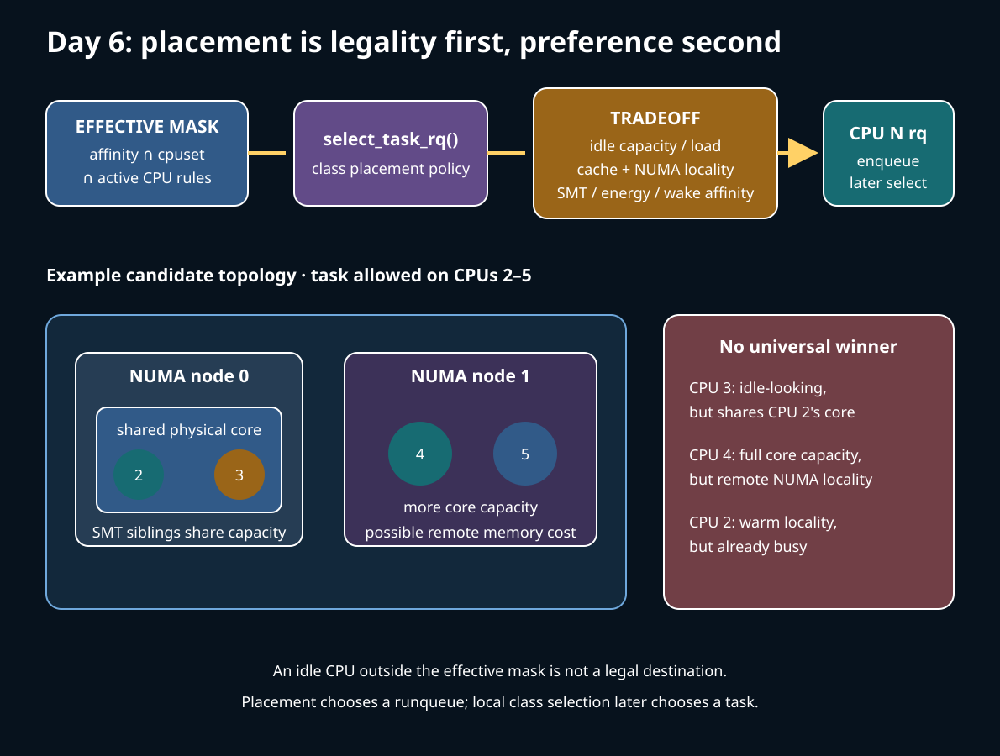
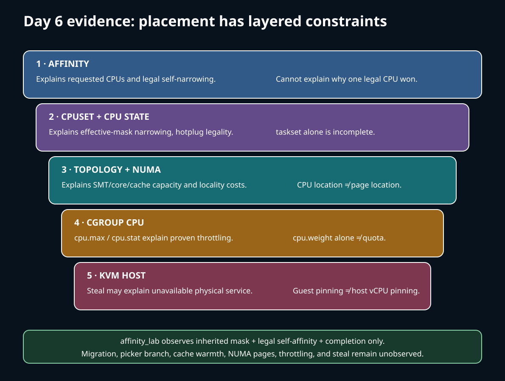

# Day 6 — SMP Placement, Topology, and Control

**Target time:** approximately 3 hours

> Driving question: after a task becomes runnable, which CPUs may run it, which CPU should run it, and what can our evidence actually prove?



Placement is not a second name for selection. Selection chooses a runnable task from a
runqueue; placement decides which runqueue should own that task. On one CPU the distinction
is easy to miss. On SMP it determines whether idle capacity can be used, whether cache and
NUMA locality survive, and whether affinity and administrative isolation remain true.

## 1. Syntax needed for the placement path

Read CPU masks as sets, not integers. In
`cpumask_test_cpu(cpu, p->cpus_ptr)`, `p->cpus_ptr` points at the task's currently effective
mask and the result answers membership for one CPU. `cpumask_and(dst, a, b)` computes an
intersection. An empty intersection means there is no ordinary legal destination; it does
not license the scheduler to choose a convenient CPU outside the constraints.

`for_each_domain(cpu, sd)` is a macro-expanded loop over an RCU-protected hierarchy.
The loop body may move from a close topology level toward wider levels. Read the lock and
RCU requirements around the call site before treating the macro like an array traversal.

The call

```c
new_cpu = p->sched_class->select_task_rq(p, cpu, wake_flags);
```

is an indirect function call through a scheduler-class operation. The common wakeup code
sets the protocol; the class supplies policy. A returned CPU number is a placement result,
not proof that the task immediately executed there.

`READ_ONCE()` and `WRITE_ONCE()` preserve the shape of an individual compiler access.
They do not replace the locks and acquire/release edges that stabilize `cpus_ptr`, `on_rq`,
and `on_cpu`. Likewise, `rcu_read_lock()` protects traversal lifetime; it does not freeze
load, idle state, or topology against every concurrent change.

## 2. Linux 0.12: why placement was absent

Use `references/EARLY_LINUX_012_MAP.md`, then read Chapter 8.6 of the local commented
Linux 0.12 PDF, `kernel/sched.c`, printed pages 351–372. The map deliberately asks only
four base questions: why a task sleeps, where runnable state is recorded, who wakes it,
and how another task receives the CPU.

Linux 0.12's `schedule()` scans the fixed `task[]` array for `TASK_RUNNING` tasks and
chooses the greatest positive `counter`. If all runnable counters are zero, it recalculates
each as half its previous value plus `priority` and scans again. `switch_to(next)` then
uses the 80386 hardware task-switch machinery.

This tiny mechanism makes three durable boundaries visible:

1. task state determines eligibility;
2. policy ranks the eligible tasks;
3. the switch transfers execution to the winner.

There is no destination-CPU decision because the implementation is uniprocessor. The
single scan is simultaneously the eligible set and the only runqueue. That is exactly why
0.12 is useful here: it shows what SMP had to add. It is not evidence for per-CPU queues,
modern affinity, load balancing, cpusets, NUMA, or software context switching.

## 3. Why the design had to evolve

With multiple CPUs, a single global queue and scan would make unrelated scheduling
operations contend on shared state and would ignore where a task's warm cache lines and
memory live. Per-CPU runqueues localize the common enqueue, pick, and accounting paths,
but they create a new problem: load and runnable work can become uneven.

Modern placement therefore has two different kinds of decision:

- **event placement** chooses a runqueue on wakeup, fork, or exec;
- **load balancing** periodically or reactively moves queued work when runqueues and
  topology groups are imbalanced.

Neither decision can be reduced to "pick the least loaded CPU." Moving a task consumes
cache locality, may turn local NUMA accesses into remote ones, may place two heavy tasks
on SMT siblings that share execution resources, and may violate affinity or cpuset rules.
Conversely, keeping perfect locality while another package is idle can waste much more
capacity than the locality saves.

Historical names must remain separated. Linux 0.12 used a counter scan; the later O(1)
scheduler used active and expired priority arrays; classic CFS ranked entities by virtual
runtime; pinned Linux 6.12 uses fair scheduling with EEVDF eligibility and virtual
deadlines. Those selection eras explain pressure on the design. They do not make an old
picker the implementation of current placement.

## 4. Exact ToyOS boundary

The actual course source in `projects/toyos/src/tasks.c` has two ring-0 kernel tasks.
Its private `schedule()` alternates task IDs, refuses a blocked candidate, validates the
saved stack and RIP, updates `TASK_RUNNABLE`/`TASK_RUNNING`, and calls `context_switch`.
`scheduler_tick()` invokes the same scheduler when a current task exists.

`projects/toyos/src/switch.S` saves `%r15`, `%r14`, `%r13`, `%r12`, `%rbx`, `%rbp`,
`%rsp`, and a continuation RIP, loads the next context, and jumps to it. This reconstructs
state filter → choose → switch and both cooperative and timer-triggered scheduling.

ToyOS has no CPU identifier, per-CPU `struct rq`, affinity mask, migration, balancing
domain, NUMA model, cpuset, hotplug protocol, cgroup CPU controller, NOHZ behavior, KVM
vCPU, or userspace return path. It therefore implements none of today's placement
subsystems. The absence is a precise boundary, not an invitation to infer them from the
round-robin choice.

## 5. Linux 6.12 pinned source: legality before preference

The source reference for this lesson is commit
`adc218676eef25575469234709c2d87185ca223a` in
`/home/jd/Documents/linux-6.12`. The following excerpts are verbatim and were checked by
normalized, ordered-line matching against that tree.

The fair-class wakeup callback starts with a previous CPU, the waking CPU, and policy
flags. The task's PI lock stabilizes the allowed-mask view while it considers fast paths:

`kernel/sched/fair.c`, `select_task_rq_fair()`, lines 8588–8608:

```c
static int
select_task_rq_fair(struct task_struct *p, int prev_cpu, int wake_flags)
{
	int sync = (wake_flags & WF_SYNC) && !(current->flags & PF_EXITING);
	struct sched_domain *tmp, *sd = NULL;
	int cpu = smp_processor_id();
	int new_cpu = prev_cpu;
	int want_affine = 0;
	/* SD_flags and WF_flags share the first nibble */
	int sd_flag = wake_flags & 0xF;

	/*
	 * required for stable ->cpus_allowed
	 */
	lockdep_assert_held(&p->pi_lock);
	if (wake_flags & WF_TTWU) {
		record_wakee(p);

		if ((wake_flags & WF_CURRENT_CPU) &&
		    cpumask_test_cpu(cpu, p->cpus_ptr))
			return cpu;
```

Later in this function the fast wakeup path may call `select_idle_sibling()`, while a
domain carrying the relevant balance flag can lead to
`sched_balance_find_dst_cpu()`. These are preferences among candidates. They do not
override the task's effective mask.

The core legality check also accounts for CPU lifecycle and special kernel-thread rules:

`kernel/sched/core.c`, `is_cpu_allowed()`, lines 2383–2407:

```c
static inline bool is_cpu_allowed(struct task_struct *p, int cpu)
{
	/* When not in the task's cpumask, no point in looking further. */
	if (!task_allowed_on_cpu(p, cpu))
		return false;

	/* migrate_disabled() must be allowed to finish. */
	if (is_migration_disabled(p))
		return cpu_online(cpu);

	/* Non kernel threads are not allowed during either online or offline. */
	if (!(p->flags & PF_KTHREAD))
		return cpu_active(cpu);

	/* KTHREAD_IS_PER_CPU is always allowed. */
	if (kthread_is_per_cpu(p))
		return cpu_online(cpu);

	/* Regular kernel threads don't get to stay during offline. */
	if (cpu_dying(cpu))
		return false;

	/* But are allowed during online. */
	return cpu_online(cpu);
}
```

This distinction is central:

- the **requested/allowed affinity** is the user's affinity intent, retained where the
  kernel can preserve it;
- the **effective affinity** is the mask the scheduler can currently enforce after
  cpuset restrictions, CPU availability, and special migration state are considered.

Do not describe `taskset` output as the entire legality calculation. A task can request
CPUs that an enclosing cpuset removes, and a CPU can transition through hotplug states.
Conversely, migration-disabled code has a bounded need to finish on its current online
CPU. Ordinary userspace does not gain that exception.

Changing affinity and moving a queued task are also distinct. In the pinned core,
`__migrate_task()` rechecks `is_cpu_allowed()` because the constraints may have changed
again. `move_queued_task()` deactivates under the old runqueue lock, changes the task CPU,
locks the destination runqueue, activates there, and checks wakeup preemption. An online
destination outside the effective mask is not legal merely because it is idle.

## 6. Domains encode topology for balancing

Scheduling domains are per-CPU hierarchy views used to compare nearby and progressively
wider groups. They are policy structures built from topology and configuration, not a
promise that every firmware description is accurate or that the hierarchy never changes.

`kernel/sched/topology.c`, package-topology comment, lines 1136–1159:

```c
 * Package topology (also see the load-balance blurb in fair.c)
 *
 * The scheduler builds a tree structure to represent a number of important
 * topology features. By default (default_topology[]) these include:
 *
 *  - Simultaneous multithreading (SMT)
 *  - Multi-Core Cache (MC)
 *  - Package (PKG)
 *
 * Where the last one more or less denotes everything up to a NUMA node.
 *
 * The tree consists of 3 primary data structures:
 *
 *	sched_domain -> sched_group -> sched_group_capacity
 *	    ^ ^             ^ ^
 *          `-'             `-'
 *
 * The sched_domains are per-CPU and have a two way link (parent & child) and
 * denote the ever growing mask of CPUs belonging to that level of topology.
 *
 * Each sched_domain has a circular (double) linked list of sched_group's, each
 * denoting the domains of the level below (or individual CPUs in case of the
 * first domain level). The sched_group linked by a sched_domain includes the
 * CPU of that sched_domain [*].
```

An SMT sibling is a logical CPU sharing core resources. Cores may share caches, and cores
belong to packages; a NUMA node describes a memory-locality relationship, not simply
"the next wider CPU group." Capacity can also be asymmetric. Consequently:

- two idle SMT siblings do not equal two idle physical cores of independent capacity;
- a same-core or same-cache destination may retain more locality;
- a remote NUMA CPU may offer enough free capacity to justify remote memory access;
- placing a task near memory does not prove its pages are actually local.

Load balancing walks domains and groups to decide whether work should move. Wake placement
and balancing can arrive at the same CPU, but they run for different events and use
different snapshots. A trace of `sched_migrate_task` proves a migration event and its
endpoints, not whether wake affinity, periodic balance, hotplug, or an affinity change was
the cause.

## 7. Constraints that alter apparent CPU service

**Cpusets and hotplug.** A cpuset can narrow where tasks may execute and can partition
scheduling domains. CPU hotplug changes online/active/dying state, rebuilds scheduling
structures, and may force tasks away. The lab reads its inherited mask; it neither writes
cpusets nor onlines or offlines a CPU.

**NOHZ and ticks.** Tick suppression removes unnecessary periodic ticks on idle or, under
the relevant configuration, isolated busy CPUs. It does not suspend scheduling. Wakeups,
timers, interrupts, explicit reschedule requests, and remote balancing mechanisms still
create work. Sparse tick observations are therefore not proof of a stuck scheduler.

**Cgroup CPU weight and quota.** In cgroup v2, `cpu.weight` shares available CPU
proportionally among competing sibling groups; it is not a reservation when no sibling
competes. `cpu.max` imposes bandwidth as quota and period. A runnable task can be affinity-
legal and fairly ranked yet receive no service while its group is throttled. Read the
task's cgroup membership and the corresponding `cpu.stat`; increasing
`nr_throttled`/`throttled_usec` is evidence for bandwidth exhaustion, whereas a weight
alone does not prove throttling.

**KVM.** A guest vCPU executes as a host thread. QEMU/KVM may also have emulator and I/O
threads whose placement is separate from vCPU placement. Pinning guest vCPU 0 inside the
guest constrains the guest task to that virtual CPU; it does not pin the host vCPU thread,
emulator thread, IRQ handling, or memory. Guest steal time reports intervals in which a
non-idle vCPU was not supplied by the host, when the platform exposes that accounting.
It cannot name the competing host task, distinguish quota from host priority, or prove
that an emulator thread was the bottleneck.

These topics interact with placement, but this lesson does not pretend to implement or
fully model cpuset partitioning, hotplug state machines, NOHZ housekeeping, cgroup
bandwidth, or KVM. It establishes where each can invalidate a simpler placement story.

## 8. Bounded lab: observation is not implementation proof

Run the existing wrapper:

```text
15-linux-scheduler-evolution/challenges/day-006-smp-placement.sh
```

It runs `make -C projects/linux-scheduler build`, executes
`projects/linux-scheduler/scripts/check-source.py`, then runs `build/affinity_lab`.
The program calls `sched_getaffinity()` for itself, counts the inherited allowed CPUs,
selects only the first CPU already in that mask, and narrows its own affinity to that CPU.
Its expected markers include `allowed_cpus=...`, `first_allowed=...`,
`scope=self_only`, and `PASS affinity_lab`; the wrapper then prints
`PASS week15-day6`.

This is intentionally safe and small. It does not force CPU 0, alter another process,
write cgroups, request RT policy, hotplug a CPU, mount tracefs, or generate sustained load.
If the inherited mask contains one CPU, the run still proves legal self-affinity behavior;
there is simply no two-CPU migration experiment to perform.



Use this evidence split in the report:

- **Observed by this run:** the host returned an inherited mask; the selected CPU belonged
  to that mask; narrowing self-affinity succeeded if the PASS marker appeared; the bounded
  process completed.
- **Not observed by this run:** which `select_task_rq_fair()` branch was taken, whether the
  task migrated, which domain was traversed, cache warmth, NUMA page location, NOHZ
  behavior, cgroup throttling, or KVM steal.
- **Proved by pinned source:** at commit
  `adc218676eef25575469234709c2d87185ca223a`, the quoted functions contain the shown mask,
  lock, CPU-state, and topology logic in the stated order.
- **Not proved by pinned source:** that the running host uses this exact build, that a
  particular branch ran during the lab, or that later upstream retains the same details.

Source and observation answer different questions. Never use a matching symbol in the
tree as a substitute for a captured event, and never use a userspace timestamp to claim a
particular internal branch.

## 9. Practical placement reasoning

For a delayed runnable task, reason in this order:

1. **Eligibility:** is the task actually runnable rather than sleeping on an I/O or lock
   predicate?
2. **Legality:** what is its effective CPU mask after affinity, cpuset, hotplug state, and
   migration constraints?
3. **Class and bandwidth:** is a higher scheduling class running, or is the task's cgroup
   out of quota?
4. **Placement event:** was this wake placement, fork/exec placement, periodic balancing,
   forced migration, or merely a sample of the current CPU?
5. **Topology cost:** would moving cross SMT/core/cache/package/NUMA boundaries gain real
   capacity, and what locality would it lose?
6. **Virtualization:** is the guest runnable while its host vCPU thread is not receiving
   service?

Consider a worker allowed on CPUs 2–5. CPUs 2 and 3 are SMT siblings; CPUs 4 and 5 are on
another NUMA node. CPU 2 is busy, CPU 3 is nominally idle, and CPU 4 has full core
capacity. "Choose idle CPU 3" ignores shared core capacity; "choose CPU 4" ignores remote
memory; "stay on CPU 2" ignores idle capacity. A defensible answer records the effective
mask, workload behavior, topology, page locality evidence, and repeated runtime
distribution. It does not promise one universally correct destination.

Mitigations must match evidence. Widen an accidentally narrow cpuset only if placement
legality is the constraint. Change `cpu.max` only when throttling evidence increases.
Separate vCPU and emulator-thread pinning only after host-side contention is established.
Avoid making RT policy, disabling SMT, or turning off NUMA balancing a generic latency
prescription.

## 10. Limits and completion check

Affinity snapshots can race with changes. `/proc` counters aggregate causes. A sampled
processor number says where the task was observed, not why it arrived there. Tracepoints
add event order but perturb timing and may be unavailable due to configuration,
capabilities, lockdown, or tracefs policy. A single fast run proves neither fairness nor a
latency bound; a slow run proves neither starvation nor a scheduler defect.

Complete the lesson by narrating:

`runnable event → effective-mask legality → select_task_rq preference → destination
runqueue → possible balance/migration → class selection → context switch`.

For each arrow label the evidence as `Linux 0.12 historical`, `ToyOS implemented`,
`Linux 6.12 pinned source`, `host observed`, or `hypothesis`. Include one SMT-versus-core
tradeoff, one NUMA-locality-versus-capacity tradeoff, one cgroup or KVM alternative
explanation, and one result that must be `SKIP` when the relevant interface is unavailable.
Any statement about a newer kernel must be separately version checked; otherwise label it
`potentially changed`.
