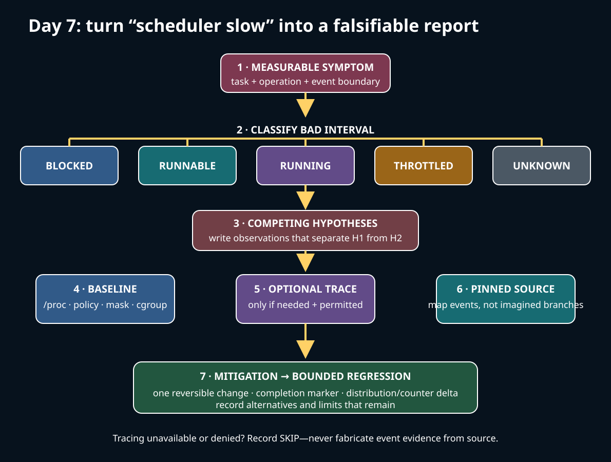
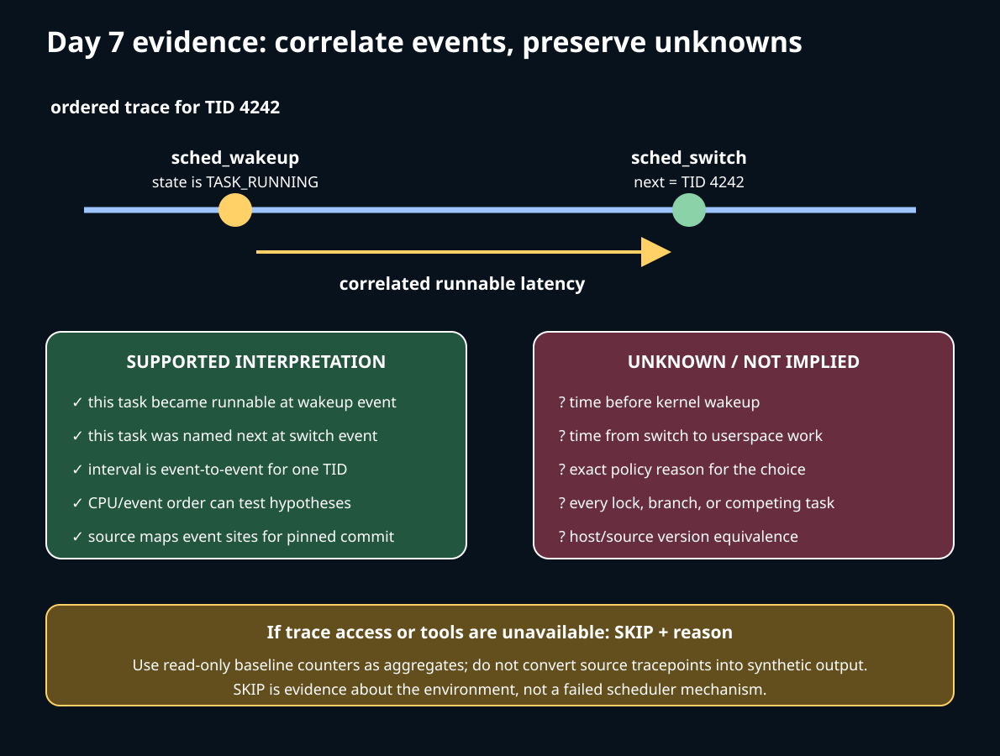

# Day 7 — A Scheduler Debugging Report

**Target time:** approximately 3 hours

> Driving question: how do we turn “the scheduler is slow” into a bounded, falsifiable report without inventing evidence?



Today is a workflow, not a catalogue of commands. A useful report starts with a visible
failure, identifies the scheduler boundary that could produce it, and chooses the least
invasive evidence that can separate competing causes. A tracer is optional; a falsifiable
hypothesis and an honest evidence boundary are not.

## 1. Syntax needed to read evidence paths

Kernel trace events are declared with macros. In a `TRACE_EVENT(name, ...)` declaration,
`TP_PROTO` describes the generated call signature, `TP_ARGS` passes those values, and
`TP_STRUCT__entry` describes recorded fields. This is source structure, not a record of a
live event. An event exists in the pinned tree even when the running kernel omits it,
tracefs is unavailable, or no one enabled it.

A call through `p->sched_class->select_task_rq(...)` dispatches policy through a function
pointer. A direct call such as `trace_sched_switch(...)` is a source landmark. Neither
syntax proves that a specific host run reached the call.

When reading `/proc/<pid>/stat`, remember that it is a positional interface. Parenthesized
`comm` can contain spaces, so an ad-hoc `cut -d' '` parser is unsafe. Prefer a maintained
tool or parse according to `Documentation/filesystems/proc.rst`. In `/proc/<pid>/status`,
named lines such as `State`, `Cpus_allowed_list`, `voluntary_ctxt_switches`, and
`nonvoluntary_ctxt_switches` are easier to read, but they remain snapshots or cumulative
counters.

`READ_ONCE()` is not a timestamp, and a scheduler lock does not make userspace observations
atomic with kernel state. Every `ps`, `/proc`, or trace read has a collection interval.
The report must say whether it observed a point sample, a cumulative delta, or ordered
events.

## 2. Linux 0.12: a small model for classifying delay

Start with `references/EARLY_LINUX_012_MAP.md` and Chapter 8.6 of the local commented
Linux 0.12 PDF, `kernel/sched.c`, printed pages 351–372. Its `schedule()` scans the fixed
`task[]` array for `TASK_RUNNING` tasks and chooses the largest positive `counter`. When
all runnable counters are zero, it recalculates counters from half the old value plus
`priority`, then scans again. `switch_to(next)` transfers execution.

That gives a compact first debugging split:

- if a task is not `TASK_RUNNING`, investigate the event or predicate that should wake it;
- if it is runnable but not selected, investigate ranking and available CPU service;
- if a different task was selected, investigate the switch and subsequent return path.

The old sleep helpers and `wake_up()` make this causal shape visible, but they are not
modern tracing semantics. Linux 0.12 is uniprocessor, has no per-CPU runqueues, scheduler
classes, cgroup bandwidth, SMP migration, NUMA placement, RT mutex PI chain, or KVM steal
accounting. A report may use 0.12 to explain the categories; it may not cite 0.12 as proof
of a current host mechanism.

## 3. Why debugging had to evolve with the scheduler

On SMP, “runnable but delayed” has many non-equivalent causes. The task may be queued
behind higher-class work, fairly waiting among peers, constrained to busy CPUs, throttled
by cgroup bandwidth, repeatedly migrated, waiting on a priority-inverted owner, or inside
a guest whose host vCPU thread is not running. A cumulative context-switch count cannot
distinguish these.

Per-CPU runqueues also make CPU identity part of the story. Wake placement and periodic
balancing can move work; topology makes two logical CPUs unequal in effective capacity;
NUMA adds memory locality costs. Scheduler classes add different contracts. Cgroup
controllers and virtualization add periods in which a runnable guest or process receives
no physical CPU service for reasons outside fair-queue ranking.

Historical mechanisms must not be collapsed. Linux 0.12's counter scan, the O(1)
scheduler, classic CFS, and Linux 6.12 fair EEVDF are different implementations. A modern
report maps evidence to the pinned implementation and labels later upstream details
`potentially changed` until separately checked.

## 4. Exact ToyOS boundary

In the actual `projects/toyos/src/tasks.c`, two ring-0 kernel tasks have
`TASK_RUNNABLE`, `TASK_RUNNING`, or `TASK_BLOCKED` state. Its private `schedule()` chooses
the other task, skips a blocked candidate, validates the saved context, updates states,
and calls `context_switch`. `scheduler_tick()` invokes scheduling when a current task
exists.

`projects/toyos/src/switch.S` saves the callee-saved registers, `%rsp`, and a continuation
RIP, restores the next context, and jumps. Serial markers prove the bounded ToyOS
self-tests reached their own completion paths when those tests are run.

ToyOS supplies no `/proc`, scheduler tracepoints, per-CPU queue, affinity, migration,
cgroup bandwidth, RT policy, PI mutex chain, NUMA placement, or virtualization. It can
teach state → choose → switch. It cannot reproduce any of today's five diagnoses, and
its serial output cannot be reported as Linux host tracing.

## 5. Linux 6.12 pinned source: what a switch event means

All pinned-source claims below refer to commit
`adc218676eef25575469234709c2d87185ca223a` in
`/home/jd/Documents/linux-6.12`. The excerpts are verbatim and were checked by normalized,
ordered-line matching.

In `__schedule()`, selection happens before the switch-only branch:

`kernel/sched/core.c`, `__schedule()`, lines 6647–6662:

```c
	next = pick_next_task(rq, prev, &rf);
picked:
	clear_tsk_need_resched(prev);
	clear_preempt_need_resched();
#ifdef CONFIG_SCHED_DEBUG
	rq->last_seen_need_resched_ns = 0;
#endif

	if (likely(prev != next)) {
		rq->nr_switches++;
		/*
		 * RCU users of rcu_dereference(rq->curr) may not see
		 * changes to task_struct made by pick_next_task().
		 */
		RCU_INIT_POINTER(rq->curr, next);
		/*
```

The tracepoint is emitted after accounting and before `context_switch()`:

`kernel/sched/core.c`, `__schedule()`, lines 6684–6697:

```c
		++*switch_count;

		migrate_disable_switch(rq, prev);
		psi_account_irqtime(rq, prev, next);
		psi_sched_switch(prev, next, block);

		trace_sched_switch(preempt, prev, next, prev_state);

		/* Also unlocks the rq: */
		rq = context_switch(rq, prev, next, &rf);
	} else {
		rq_unpin_lock(rq, &rf);
		__balance_callbacks(rq);
		raw_spin_rq_unlock_irq(rq);
```

Therefore, a captured `sched_switch` event can identify the previous and next task at that
point. It does not prove that the next task returned to userspace, how long it had been
runnable unless paired with suitable wakeup evidence, or why the policy chose it. If
`prev == next`, this call site emits no switch event even though scheduling work occurred.

The wakeup tracepoint's own pinned comment is deliberately narrow:

`include/trace/events/sched.h`, `sched_wakeup`, lines 174–180:

```c
/*
 * Tracepoint called when the task is actually woken; p->state == TASK_RUNNING.
 * It is not always called from the waking context.
 */
DEFINE_EVENT(sched_wakeup_template, sched_wakeup,
	     TP_PROTO(struct task_struct *p),
	     TP_ARGS(p));
```

A wakeup-to-switch interval is useful runnable-latency evidence only after correlating the
right task and CPU across ordered records. It is not identical to syscall latency,
end-to-end request latency, or time blocked on the original predicate.

## 6. Bounded baseline and the proof split

Run the required wrapper:

```text
15-linux-scheduler-evolution/challenges/day-007-debug-report.sh
```

It builds `projects/linux-scheduler`, runs `scripts/check-source.py`, and executes
`build/report_lab`. The lab prints its PID, reads only `/proc/self/status`, emits the
`voluntary_ctxt_switches` and `nonvoluntary_ctxt_switches` lines when available, then
prints `report_scope=self_proc_read_only` and `PASS report_lab`. The wrapper ends with
`PASS week15-day7`.

The wider project suite also contains bounded wakeup, pipe ping-pong, self-affinity, and
mutex-protocol exercises. `make -C projects/linux-scheduler tools` checks for `ps`,
`taskset`, `perf`, `trace-cmd`, and `bpftrace`. It runs only the read-only `ps` and
`taskset` views. Even when installed, `perf`, `trace-cmd`, and `bpftrace` are deliberately
reported as `SKIP ... not run automatically`; tracing requires explicit learner action
and host permission. Preserve that SKIP. No trace was captured merely because a tool was
present.



Use this prose evidence table for every report:

- **Observation:** the exact command, clock interval, PID/TID, host kernel from `uname`,
  and literal result. For the core wrapper this is limited to self `/proc` counters and
  completion markers.
- **Interpretation:** the smallest conclusion supported by the observation. A counter
  delta means cumulative switches changed; it does not enumerate switch causes.
- **Pinned-source proof:** path, function, exact line range, and commit for the mechanism
  being compared. Source establishes implementation structure for that commit, not host
  execution.
- **Unknown:** missing event order, privilege, cgroup ancestry, topology, host-side VM
  state, or any other fact not collected.
- **SKIP:** the unavailable or intentionally unrun probe and the reason. SKIP is data
  about the environment, not a failed scheduler mechanism.

## 7. The debugging workflow

Use the same seven steps for each scenario:

1. State the symptom in user terms: operation, affected task, start/end boundary, and
   frequency. “The scheduler is slow” is not measurable.
2. Record the environment: host kernel, bare metal or guest, PID/TID, scheduling policy,
   nice value, effective CPU list, cgroup path, and test duration.
3. Classify the task at the bad interval as blocked, runnable, running, throttled, or
   unknown. Do not infer state from elapsed time alone.
4. Write two competing hypotheses and one observation that would separate them.
5. Collect the least invasive baseline first; enable event tracing only if baseline
   evidence cannot answer the question and permission is explicit.
6. Map observed events to the pinned source without claiming unobserved branches.
7. Apply one scoped mitigation, then repeat a bounded regression check with deterministic
   completion assertions separated from noisy timing distributions.

Useful read-only baselines include:

- `/proc/<pid>/status`: state sample, allowed CPU/memory lists, and cumulative voluntary
  and nonvoluntary context switches;
- `/proc/<pid>/sched`: policy and per-task scheduler statistics when exposed, noting that
  fields vary with configuration;
- `/proc/<pid>/schedstat`: cumulative runtime, runqueue delay, and timeslices where
  enabled; compare deltas over a defined interval rather than raw lifetime totals;
- `/proc/<pid>/stat`: state, user/system CPU time, priority, nice, processor, and policy
  fields, parsed according to the documented positional format;
- `/proc/stat`: system CPU totals including guest-visible `steal` where applicable;
- `/proc/pressure/cpu`: aggregate CPU pressure, useful for contention context but not
  attribution to one task;
- `/proc/<pid>/cgroup` plus the matching cgroup v2 `cpu.stat`, `cpu.max`, and `cpu.weight`:
  membership, throttling counters, quota, and proportional weight.

`ps -L -o pid,tid,stat,cls,rtprio,pri,ni,psr,comm -p <pid>` and
`taskset -pc <tid>` are snapshots. They can race with migration and state changes.

## 8. Scenario A — runnable latency

**Symptom.** A pipe reader is awakened, but application work begins noticeably later.
The boundary of interest is “became runnable” to “was switched in,” not the entire read.

**Competing hypotheses.** H1: the task was runnable and queued behind other eligible work.
H2: the application timestamp began before the kernel wakeup, so most delay was still in
the blocked predicate or I/O path.

Evidence table in list form:

- **Baseline:** record repeated end-to-end samples, `/proc/<tid>/schedstat` deltas if
  available, policy/nice, allowed CPUs, cgroup membership, and CPU pressure over the same
  bounded interval.
- **Optional event proof:** correlate `sched_wakeup` for the TID with the next
  `sched_switch` that names it as `next`. `perf sched timehist`, ftrace scheduler events,
  `trace-cmd record -e sched:sched_wakeup -e sched:sched_switch`, or an equivalent
  bpftrace script can do this only when installed, supported, permitted, and explicitly
  run. Otherwise record `SKIP`; this lesson captured none of those traces.
- **Source mapping:** `try_to_wake_up()` and `select_task_rq()` in
  `kernel/sched/core.c`, `select_task_rq_fair()` in `kernel/sched/fair.c`, then
  `pick_next_task()` and the quoted `__schedule()` switch site.
- **Mitigation after evidence:** reduce proven CPU contention, repair an overly narrow
  affinity/cpuset, or shorten the actual blocking critical path. Do not assign RT policy
  merely because one latency sample was high.
- **Regression:** keep a deterministic completion marker and compare a distribution of
  wakeup-to-switch intervals under a recorded workload. Use a project-specific budget,
  not a universal Linux latency threshold.
- **Limit:** `sched_wakeup` to `sched_switch` still excludes later userspace execution and
  does not identify every policy input.

## 9. Scenario B — cgroup throttling mistaken for unfairness

**Symptom.** A CPU-bound service runs in bursts followed by pauses even though it remains
runnable and an allowed CPU appears available.

**Competing hypotheses.** H1: its cgroup exhausted `cpu.max` and was throttled until the
next period. H2: ordinary competition or host unavailability explains the pauses.

Evidence table in list form:

- **Baseline:** resolve `/proc/<pid>/cgroup` to the correct cgroup v2 directory; record
  `cpu.max`, `cpu.weight`, and before/after `cpu.stat`. Increasing `nr_throttled` and
  `throttled_usec` over the incident interval supports H1. A low `cpu.weight` alone does
  not prove quota throttling.
- **Optional event proof:** cgroup and scheduler tracing can improve timing correlation,
  but event names and availability vary. If unavailable or not permitted, use the
  controller counters and mark tracing `SKIP`.
- **Source mapping:** pinned `kernel/sched/fair.c` contains CFS bandwidth accounting;
  `kernel/sched/core.c` exports cgroup CPU statistics and the `cpu.max`/`cpu.weight`
  interfaces. `Documentation/admin-guide/cgroup-v2.rst` defines their user contract.
- **Mitigation after evidence:** right-size quota/period, reduce workload, or move the
  service to the intended cgroup. Changing nice cannot create runtime while the group is
  throttled.
- **Regression:** under the same bounded load, check completion, throughput distribution,
  and `cpu.stat` deltas. Record whether reduced throttling came from more budget or less
  work.
- **Limit:** aggregate cgroup counters do not attribute every throttled interval to one
  thread, and a container may hide the host hierarchy.

## 10. Scenario C — migration and locality

**Symptom.** Throughput or tail latency worsens after deployment, and sampled `psr` values
suggest that a worker moves among CPUs.

**Competing hypotheses.** H1: migrations lose cache or NUMA locality. H2: movement is a
helpful response to imbalance, while memory placement or another resource is the actual
bottleneck.

Evidence table in list form:

- **Baseline:** record `Cpus_allowed_list`, `Mems_allowed_list`, `taskset -pc`, topology
  from the read-only system interfaces available to the learner, and repeated CPU/runtime
  samples. A changing `psr` sample suggests movement but is not an ordered migration log.
- **Optional event proof:** `sched:sched_migrate_task` records origin and destination when
  enabled. Pair it with switch events and, if available, NUMA/page evidence. `perf`,
  ftrace, `trace-cmd`, or bpftrace absence/access denial is an honest SKIP.
- **Source mapping:** `select_task_rq_fair()` in `kernel/sched/fair.c`,
  migration helpers in `kernel/sched/core.c`, and domain construction in
  `kernel/sched/topology.c`. A migration event does not itself identify which path caused
  it.
- **Mitigation after evidence:** adjust an erroneous affinity/cpuset, colocate threads and
  memory, or widen placement if imbalance costs more than locality. Pinning everything
  can create the overload it was meant to cure.
- **Regression:** compare throughput and latency distributions while recording migration
  count, allowed mask, and NUMA environment. Revert if reduced migrations reduce capacity.
- **Limit:** CPU placement does not reveal page placement; NUMA locality and scheduler
  capacity need separate evidence.

## 11. Scenario D — RT starvation and priority inheritance

**Symptom.** A normal-policy thread receives little service, or a high-priority thread
waits behind a lock held by lower-priority work.

**Competing hypotheses.** H1: runnable RT work legitimately precedes fair-class work or
consumes its configured bandwidth. H2: the high-priority thread is blocked on a mutex and
the owner is delayed; PI may or may not be configured and active.

Evidence table in list form:

- **Baseline:** record per-thread policy/class, `rtprio`, state, and the synchronization
  boundary. Distinguish `R` from a blocked state. Read relevant RT bandwidth settings only
  if the environment permits; do not change them during diagnosis.
- **Lab boundary:** `inversion_lab` requests `PTHREAD_PRIO_INHERIT` and reports
  `pi_mutex=requested_supported` or `pi_mutex=SKIP unsupported`, but it makes no RT policy
  change. Protocol support under normal policy does not prove a kernel PI boost occurred
  or establish an RT response bound.
- **Optional event proof:** when available and enabled, `sched_pi_setprio` can show a
  priority change. Scheduler switches show service order. Lock-specific tools may be
  required to establish ownership. Without these, label PI execution unknown.
- **Source mapping:** class ordering and `__schedule()` are in `kernel/sched/core.c`;
  RT queueing is in `kernel/sched/rt.c`; PI behavior is implemented through the rtmutex
  paths and exposed by `sched_pi_setprio` in `include/trace/events/sched.h`.
- **Mitigation after evidence:** shorten the critical section, use a correctly supported
  PI mutex where the scheduling design requires it, bound RT utilization, or repair
  priorities. Never prescribe FIFO as a generic latency cure.
- **Regression:** assert lock completion and absence of deadlock, then measure bounded
  waiter latency under a declared policy/load matrix. Keep watchdogs and restore any
  privileged policy in a controlled external test.
- **Limit:** `ps` priorities are samples; a PI-capable mutex attribute alone is not an
  observed donation chain.

## 12. Scenario E — guest vCPU steal

**Symptom.** A task inside a VM is runnable and guest CPU pressure rises, yet wall-clock
progress stalls.

**Competing hypotheses.** H1: the host is not scheduling the guest's vCPU thread, visible
as increasing guest steal time. H2: the guest scheduler, cgroup quota, I/O emulation, or
an emulator thread is the bottleneck.

Evidence table in list form:

- **Guest baseline:** record `/proc/stat` steal deltas over the incident window,
  per-task runtime/runqueue-delay deltas, effective affinity, CPU pressure, and whether
  the kernel reports virtualization. Zero steal does not prove uninterrupted physical
  service on every platform.
- **Host evidence:** if the learner controls the host, identify the QEMU vCPU and emulator
  threads, their affinity, cgroup, policy, and service. Guest-only evidence cannot name a
  host competitor. If host access is unavailable, write `SKIP host-side attribution`.
- **Optional event proof:** host scheduler traces may correlate vCPU-thread wakeups and
  switches. Guest traces describe scheduling within the guest. Keep the two timelines
  separate and account for clock alignment. This lesson captured neither.
- **Source mapping:** `Documentation/virt/kvm/x86/msr.rst` defines KVM steal accounting;
  host scheduling still reaches the pinned core scheduler paths. Emulator-thread delay is
  not proven by guest steal alone.
- **Mitigation after evidence:** reduce host oversubscription, correct host vCPU/emulator
  affinity, or adjust a proven host cgroup budget. Guest task pinning does not pin its host
  vCPU thread.
- **Regression:** compare bounded guest work, steal deltas, and host vCPU service under
  the same allocation. Preserve host-side SKIP when unavailable.
- **Limit:** steal time is unavailable service, not a root-cause label.

## 13. Writing the final report

Keep the report compact but auditable:

1. **Symptom and boundary:** what was delayed, which TID, and between which two events?
2. **Environment:** kernel release, source commit used for comparison, CPU mask, policy,
   cgroup, topology/VM status, duration, and clock.
3. **Hypotheses:** at least two causes with predictions that differ.
4. **Evidence ledger:** each item labeled observation, pinned-source proof, interpretation,
   unknown, or SKIP.
5. **Causal path:** blocked/runnable state → placement → runqueue/class → bandwidth or
   host availability → switch → return. Mark every unsupported arrow.
6. **Mitigation:** one reversible change tied to the strongest evidence.
7. **Regression:** deterministic completion plus a bounded distribution/counter delta.
8. **Limits:** perturbation, races, aggregation, permissions, source/host version mismatch,
   and alternatives still consistent with the data.

Contradictory evidence stays in the report. If `cpu.stat` does not change while latency
spikes, throttling becomes less likely for that interval; do not hide the result. If a
tracer is denied, do not mount tracefs, change lockdown, or claim events from source.

## 14. Practical limits and completion check

Tracing perturbs scheduling and can overflow buffers. `/proc` reads race with state
changes. Per-task counters are cumulative and may have configuration-dependent semantics.
Clock domains can differ across guest and host. A tracepoint near a function does not
expose every lock, branch, virtual deadline, or reason code. The running host may not be
the pinned 6.12 tree.

Complete the day by choosing one of the five scenarios and producing the report structure
above. The core wrapper's actual results may be cited only for self `/proc` counters and
completion. Any optional `perf`, ftrace, `trace-cmd`, or bpftrace section must contain
literal captured output from an explicitly run command or the word `SKIP`; source excerpts
are never synthetic trace output.

Finish with one claim labeled `Linux 6.12 pinned source`, one labeled `host observed`, one
`unknown`, and one `potentially changed`. That separation—not the number of tools used—is
the debugging skill.
