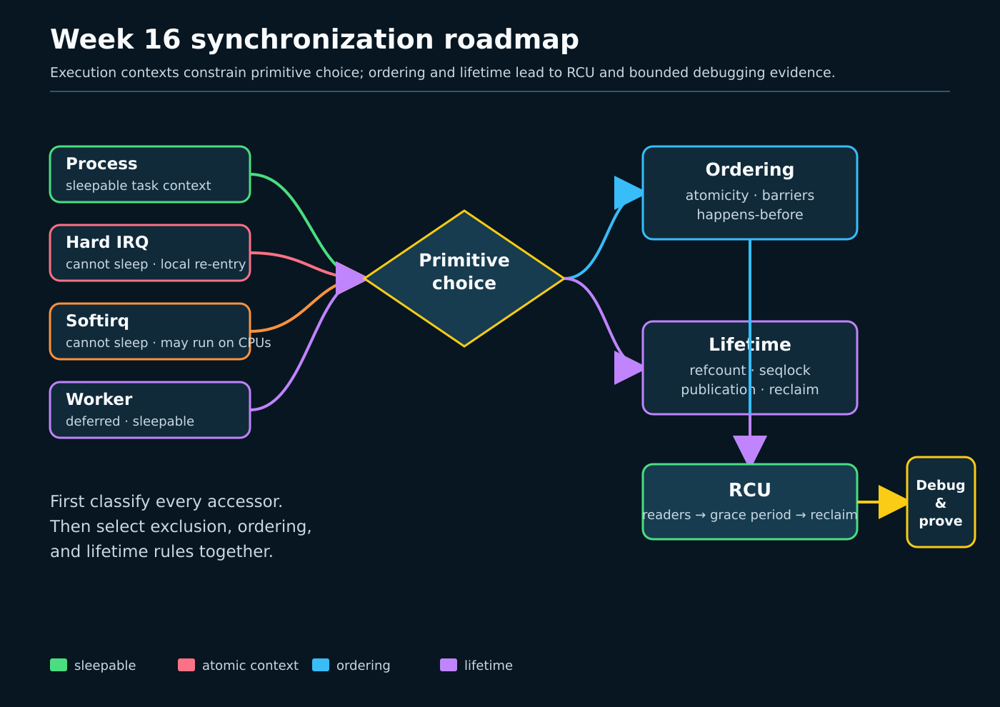

# Week 16 — Kernel Synchronization, Memory Ordering, and RCU

**Format:** seven mechanism-focused lessons, generated theory checks, and bounded userspace laboratories

**Readiness state:** prepared, not mastery. The learner remains at Week 1 until the course's separate progression process records otherwise.

Week 16 follows one required sequence every day: **syntax → Linux 0.12 → why evolution → exact ToyOS boundary → Linux 6.12/current → bounded evidence**. Syntax establishes how to read the construct. Linux 0.12 supplies a compact historical baseline. The lesson then names the concurrency pressure that forced evolution, states exactly what ToyOS does and does not implement, reads pinned Linux 6.12 before discussing current upstream as version-sensitive, and closes with evidence whose scope and limits are explicit.

The lab is [projects/linux-kernel-sync](../projects/linux-kernel-sync/). Its read-only source checker pins `/home/jd/Documents/linux-6.12` to commit `adc218676eef25575469234709c2d87185ca223a`, checks ordered synchronization landmarks, and verifies that the kernel source Makefile hash is unchanged. “Current Linux” means the pinned 6.12 tree unless a later tree is independently identified and checked.

## Learning boundary

Linux 0.12 largely relies on one CPU, interrupt exclusion, simple wait queues, and small critical regions; it is a causal starting point, not a modern synchronization recipe. Modern Linux must coordinate SMP CPUs, compiler and hardware reordering, interrupt and preemption contexts, object lifetime, scalable read-mostly access, lock dependency checking, and data-race detection.

ToyOS contributes only its implemented boundary: a single-CPU x86-64 teaching kernel with two ring-0 tasks, timer-driven scheduling, interrupt entry/exit, and small scheduler/console critical regions. It has no SMP memory model, lockdep, KCSAN, production refcount API, seqlock API, per-CPU synchronization framework, RCU grace-period engine, callback offload, PREEMPT_RT, or priority-inheritance mutex subsystem. The userspace labs model selected ideas; they are not kernel implementations and prove no kernel-internal execution path.

## Seven-day route

1. [Day 1 — Execution Context and Primitive Selection](sections/day-001-context-and-primitive-selection.md) — [wrapper](challenges/day-001-context-and-primitive-selection.sh), [theory check](challenges/day-001-theory-check.html).
2. [Day 2 — Atomics, Memory Ordering, and Barriers](sections/day-002-atomics-memory-ordering-and-barriers.md) — [wrapper](challenges/day-002-atomics-memory-ordering-and-barriers.sh), [theory check](challenges/day-002-theory-check.html).
3. [Day 3 — Spinlocks, IRQs, and Preemption](sections/day-003-spinlocks-irqs-and-preemption.md) — [wrapper](challenges/day-003-spinlocks-irqs-and-preemption.sh), [theory check](challenges/day-003-theory-check.html).
4. [Day 4 — Mutexes, rtmutexes, and Sleeping Locks](sections/day-004-mutexes-rtmutexes-and-sleeping-locks.md) — [wrapper](challenges/day-004-mutexes-rtmutexes-and-sleeping-locks.sh), [theory check](challenges/day-004-theory-check.html).
5. [Day 5 — Refcounts, Seqlocks, and Per-CPU State](sections/day-005-refcounts-seqlocks-and-percpu-state.md) — [wrapper](challenges/day-005-refcounts-seqlocks-and-percpu-state.sh), [theory check](challenges/day-005-theory-check.html).
6. [Day 6 — RCU Readers, Grace Periods, and Callbacks](sections/day-006-rcu-readers-grace-periods-and-callbacks.md) — [wrapper](challenges/day-006-rcu-readers-grace-periods-and-callbacks.sh), [theory check](challenges/day-006-theory-check.html).
7. [Day 7 — Lockdep, KCSAN, RCU Stalls, and Debug Reports](sections/day-007-lockdep-kcsan-rcu-stalls-and-debug-report.md) — [wrapper](challenges/day-007-lockdep-kcsan-rcu-stalls-and-debug-report.sh), [theory check](challenges/day-007-theory-check.html).

## Evidence and safety contract

Core tests require no root access, load no modules, use no network, and neither mount nor write tracefs. They do not change cgroups, sysctls, CPU state, affinity, scheduler policy, or host-wide tracing configuration. Every concurrent lab uses bounded thread counts and work, arms an alarm, joins all threads, and creates no persistent temporary files. The acquire/release lab checks successful publication and never claims that a forbidden outcome must appear. The priority-inheritance lab observes `PTHREAD_PRIO_INHERIT` support without requesting real-time policy. The epoch lab is clearly a userspace teaching simulator, not Linux RCU.

`make tools` is opt-in. It reports `SKIP` for perf, trace-cmd, bpftrace, and lockstat rather than executing them automatically. A wrapper builds only the project it needs, runs the pinned source check, then runs its bounded day program.

## Completion checkpoint

For each day, record the primitive choice, protected invariant, execution context, ordering edge, lifetime rule, evidence observed, and what remains unknown. Passing a wrapper establishes only that the bounded teaching contract ran on this host. It neither establishes mastery nor advances learner state.
