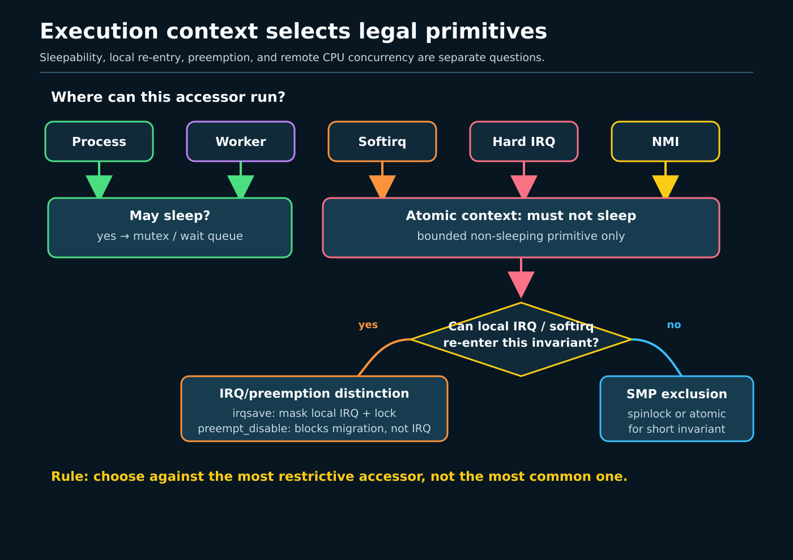
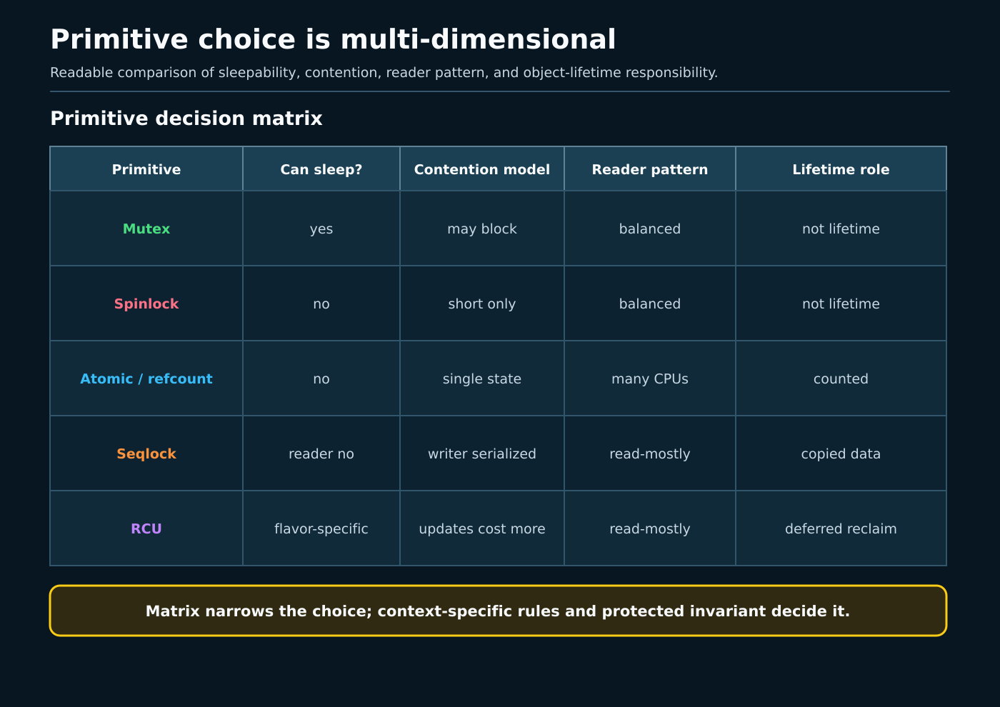

# Day 1 — Context, Invariants, and Primitive Selection

**Target time:** approximately 3 hours

> Choose synchronization only after naming the invariant, every context that
> can touch it, and whether any of those paths may sleep. “Protect this
> variable” is not enough: the same bytes may require a mutex in process
> context, an irq-safe spinlock across process and hardirq contexts, per-CPU
> ownership on a hot path, or RCU when reads dominate and reclamation can wait.

This lesson prepares the mechanism vocabulary ToyOS does not yet implement.
Week 11 supplied data races, ownership, mutexes, condition waits, and C
atomics. Week 14 supplied hardirq, softirq, threaded-IRQ, worker, preemption,
and sleepability contexts. Week 15 supplied task state, wait/wakeup, and
runqueue ownership. Today joins those facts into a selection argument.

## 1. Minimal C and assembly syntax

A lock protects a statement about state, not an address. Write that statement
before the lock:

```c
/* invariant: count equals the number of linked, live nodes */
mutex_lock(&set->lock);
list_add(&item->link, &set->items);
set->count++;
mutex_unlock(&set->lock);
```

`&set->lock` is the address of one lock object. `->` selects a member through
a pointer. Both updates belong to one critical section because exposing only
one would violate the invariant. A mutex has ownership: the task that locks it
is the task that unlocks it, and contention may sleep.

An atomic read-modify-write covers one atomic object:

```c
atomic_inc(&events);
if (atomic_dec_and_test(&refs))
        release_object();
```

It does not automatically protect a neighboring pointer, list, or lifetime.
The decrement-to-zero operation is useful only when the reference-count
protocol says no new reference can appear after zero.

On x86, these instructions answer different questions:

```asm
cli                         # mask maskable interrupts on this CPU
sti                         # allow them on this CPU
lock addl $1, events(%rip)  # atomic RMW against other CPUs
```

`cli` does not acquire a shared lock. Another CPU continues to execute.
`preempt_disable()` similarly prevents this CPU from scheduling another task
through ordinary preemption; it does not exclude another CPU, a hardirq on
this CPU, or an NMI. Neither operation by itself states the ordering protocol
for shared data. Lock acquire/release operations include ordering needed by
their lock contract; Day 2 separates that ordering from exclusion.

## 2. Linux 0.12: one CPU makes interrupt exclusion look like a lock

Use the local commented *A Heavily Commented Linux Kernel Source Code:
Kernel Version 0.12*, Chinese Revision 5, Chapter 8.6, printed pages 351–372,
together with `references/EARLY_LINUX_012_MAP.md`. The PDF viewer is about
seven pages ahead of the printed page numbers. In `include/asm/system.h`,
lines 16–17, the entire interrupt-mask interface is:

```c
#define sti() __asm__ ("sti"::)
#define cli() __asm__ ("cli"::)
```

In `kernel/sched.c`, `__sleep_on` lines 179–182 (printed page 359) stores
`current` through a wait pointer, changes its task state, and schedules:

```c
tmp = *p;
*p = current;
current->state = state;
repeat: schedule();
```

`wake_up`, lines 204–212 (printed page 360), changes the referenced task back
to runnable state. Elsewhere, callers surround small shared-state transitions
with `cli`/`sti`. On this uniprocessor, masking interrupts prevents an
interrupt handler and the interrupted process path from interleaving on that
one CPU.

The stable mechanism is the need to preserve an invariant across every
context that can modify it, and the separate ability to sleep until an event.
The historical details are a single CPU, a single IF bit, fixed task tables,
and wait pointers rather than modern wait queues. Early `cli`/`sti` is **not**
an SMP lock, an acquire/release pair for another CPU, or a substitute for a
memory barrier. The reading map explicitly says Linux 0.12 has no modern SMP
locking, C11 atomics, per-CPU runqueues, or RCU.

## 3. Why the mechanism had to evolve

The reason comes before the API.

With two CPUs, local interrupt masking leaves the other CPU free to enter the
same critical section. With preemptible kernels, process code may be switched
unless the protocol prevents it. With nested hardirq, softirq, and NMI
contexts, “interrupts are off” no longer describes every possible entrant.
With long waits, spinning wastes a CPU; with hardirq callers, sleeping is
impossible. With read-mostly structures, forcing every reader to write one
shared lock word destroys scalability. With per-CPU counters, sharing the
counter in the first place is avoidable.

Modern selection therefore starts with four questions:

1. **Invariant:** which fields and lifetime transitions must appear indivisible?
2. **Entrants:** process task, hardirq, softirq, worker, NMI, or another CPU?
3. **Waiting:** can the caller sleep, and can contention last long enough that
   it should?
4. **Shape:** exclusive update, many readers, one-shot event, one scalar,
   per-CPU ownership, or read-mostly pointer with deferred reclamation?



*The context determines whether waiting is legal; the invariant and access
shape determine which legal primitive fits.*

Disabling preemption answers “may this CPU switch tasks here?” Disabling local
IRQs answers “may a maskable hardirq run on this CPU here?” A lock answers
“which concurrent entrant owns this invariant?” An ordering primitive answers
“which accesses must become visible before which observation?” These answers
can be composed, but none implies all the others.

## 4. The exact ToyOS boundary

The boundary is the checked-in `projects/toyos`, not a future design.
`src/tasks.c` has two ring-0 tasks, one `current` pointer, and
`TASK_RUNNABLE`, `TASK_RUNNING`, and `TASK_BLOCKED`. `schedule()` mutates task
state and calls `context_switch`. IRQ0 enters through `src/isr.S`; vector 32 in
`src/arch.c` increments the `volatile uint64_t ticks`, sends the PIC EOI, and
calls `scheduler_tick()`. `interrupts_enable()` executes `sti`.

ToyOS is single-core. Its README says it has no locking, and inspection finds
no mutex, spinlock, raw spinlock, rwsem, completion, atomic API, per-CPU
storage, RCU API, wait queue, softirq, workqueue, or threaded IRQ. The static
pipe fields in `src/process.c`, allocator state, scheduler arrays, and `ticks`
therefore rely on the current milestone's single-CPU execution and narrow
control flow. `volatile ticks` requests observable compiler accesses; it does
not make `++ticks` an SMP-atomic increment or publish surrounding state.

The timer handler can switch tasks before the interrupt returns. That is a
compact teaching mechanism, not evidence that an arbitrary ToyOS critical
section is safe from IRQ re-entry, and not a production rule for switching
from hardirq context. `cli` in `qemu_exit()` merely makes the terminal halt
loop non-interruptible on that CPU.

The pre-ToyOS design requirement is therefore concrete: before adding a
shared subsystem, identify whether its process path can be interrupted by its
IRQ path, whether future SMP is in scope, and whether any path waits. Do not
retroactively label today's absence of interleaving as a lock implementation.

## 5. Linux 6.12: selection grounded in implementation

All excerpts below are verbatim from `/home/jd/Documents/linux-6.12`, tag
`v6.12`, commit `adc218676eef25575469234709c2d87185ca223a`. Line numbers and
behavior are pinned to that checkout.

### A mutex: owned and sleepable

**`kernel/locking/mutex.c`, `mutex_lock`, lines 281–288**

```c
void __sched mutex_lock(struct mutex *lock)
{
	might_sleep();

	if (!__mutex_trylock_fast(lock))
		__mutex_lock_slowpath(lock);
}
EXPORT_SYMBOL(mutex_lock);
```

The first semantic signal is `might_sleep()`. Use a mutex in process context
when one owner protects an invariant and contention may block. That includes
ordinary system-call paths, threaded IRQ handlers, and normal workers, until
the caller has entered a non-sleepable region. It excludes hardirq, softirq,
NMI, and code holding a spinlock. Week 11's ownership rule still applies:
locker and unlocker are the same task.

### A spinlock with local interrupt state

**`include/linux/spinlock.h`, `spin_lock_irq` and
`spin_lock_irqsave`, lines 374–382**

```c
static __always_inline void spin_lock_irq(spinlock_t *lock)
{
	raw_spin_lock_irq(&lock->rlock);
}

#define spin_lock_irqsave(lock, flags)				\
do {								\
	raw_spin_lock_irqsave(spinlock_check(lock), flags);	\
} while (0)
```

Use the irqsave form when process context and a hardirq on the same CPU can
touch the invariant: save the previous mask, prevent that local interrupt
from deadlocking on the lock, and acquire mutual exclusion against other
CPUs. The flags are restoration state, not lock ownership. If only process
and softirq paths share the object, the corresponding pattern is
`spin_lock_bh`. A plain spinlock is enough only when the caller's context
contract already handles local re-entry.

`spinlock_t` and `raw_spinlock_t` are not stylistic variants.
`raw_spinlock_t` preserves raw spinning semantics, including on
PREEMPT_RT, and is reserved for low-level code whose context and latency
require it. On RT, ordinary `spinlock_t` semantics may become sleeping
rtmutex-based locks. Choosing raw solely because it sounds faster discards
RT behavior and increases non-preemptible latency.

### A reader/writer semaphore: shared readers that may sleep

**`kernel/locking/rwsem.c`, `down_read`, lines 1521–1528**

```c
void __sched down_read(struct rw_semaphore *sem)
{
	might_sleep();
	rwsem_acquire_read(&sem->dep_map, 0, 0, _RET_IP_);

	LOCK_CONTENDED(sem, __down_read_trylock, __down_read);
}
EXPORT_SYMBOL(down_read);
```

An rwsem fits process-context data with read and write critical sections when
read-side sharing is useful and readers may sleep. It is not automatically
better than a mutex: reader bookkeeping, cache-line traffic, writer
starvation/fairness concerns, and short critical sections can make a mutex
better. It is not legal merely because an interrupt handler “only reads”; the
read acquisition can sleep.

### A completion: one event, not object ownership

**`kernel/sched/completion.c`, `complete_all`, lines 67–78**

```c
void complete_all(struct completion *x)
{
	unsigned long flags;

	lockdep_assert_RT_in_threaded_ctx();

	raw_spin_lock_irqsave(&x->wait.lock, flags);
	x->done = UINT_MAX;
	swake_up_all_locked(&x->wait);
	raw_spin_unlock_irqrestore(&x->wait.lock, flags);
}
EXPORT_SYMBOL(complete_all);
```

A completion expresses “an operation reached this point.” The completing
side may signal; the waiting side consumes or observes completion according
to the chosen API. It does not protect a data structure like a mutex, and it
is not a reusable boolean without a reinitialization/lifetime protocol.
Waiting for a completion sleeps, so hardirq code may complete an event but
may not wait for it.

### Per-CPU state: remove sharing before locking it

**`include/linux/percpu-defs.h`, per-CPU operation macros, lines 500–511**

```c
#define this_cpu_add_return(pcp, val)	__pcpu_size_call_return2(this_cpu_add_return_, pcp, val)
#define this_cpu_xchg(pcp, nval)	__pcpu_size_call_return2(this_cpu_xchg_, pcp, nval)
#define this_cpu_cmpxchg(pcp, oval, nval) \
	__pcpu_size_call_return2(this_cpu_cmpxchg_, pcp, oval, nval)
#define this_cpu_try_cmpxchg(pcp, ovalp, nval) \
	__pcpu_size_call_return2bool(this_cpu_try_cmpxchg_, pcp, ovalp, nval)
#define this_cpu_sub(pcp, val)		this_cpu_add(pcp, -(typeof(pcp))(val))
#define this_cpu_inc(pcp)		this_cpu_add(pcp, 1)
#define this_cpu_dec(pcp)		this_cpu_sub(pcp, 1)
#define this_cpu_sub_return(pcp, val)	this_cpu_add_return(pcp, -(typeof(pcp))(val))
#define this_cpu_inc_return(pcp)	this_cpu_add_return(pcp, 1)
#define this_cpu_dec_return(pcp)	this_cpu_add_return(pcp, -1)
```

Per-CPU storage is an ownership transformation: the common update touches
this CPU's instance rather than one globally contended cache line.
Aggregation, CPU hotplug, migration, and remote access still require a
protocol. A `this_cpu_*` operation is not permission to retain a pointer to
one CPU's storage after migration.

### RCU: readers do not exclude writers

**`include/linux/rcupdate.h`, `rcu_read_lock`, lines 845–852**

```c
static __always_inline void rcu_read_lock(void)
{
	__rcu_read_lock();
	__acquire(RCU);
	rcu_lock_acquire(&rcu_lock_map);
	RCU_LOCKDEP_WARN(!rcu_is_watching(),
			 "rcu_read_lock() used illegally while idle");
}
```

RCU fits read-mostly pointer-linked state when readers can tolerate seeing an
old or new version and writers can publish a replacement, coordinate with
other writers, and postpone reclamation until a grace period. It is a
lifetime protocol, not a general replacement for mutual exclusion. Readers
do not make a multi-field in-place writer update indivisible. An RCU pointer
must be published and dereferenced with the RCU accessors, and freeing the old
object must wait. Day 3 will develop that protocol; today the selection limit
is enough.

### Atomic operations: one state machine, not a tiny lock

An `atomic_t` is suitable for counters, flags, and carefully designed
single-object state machines. It is not a mutex compressed into an integer.
If correctness requires a list pointer, count, and lifetime to move together,
one atomic increment does not provide that transaction. Atomics also do not
mean sequential consistency by default in the kernel; ordering depends on the
operation. Day 2 supplies that vocabulary.



*First eliminate primitives illegal in the caller's context; then choose the
smallest protocol that preserves the whole invariant and lifetime.*

## 6. Bounded lab: observation versus source proof

The future lab belongs under `projects/linux-kernel-sync`; this lesson does
not claim that project or its output already exists. Keep the exercise
bounded and read-only with respect to the host kernel:

1. Build a userspace companion that compares a mutex-protected compound
   invariant, an atomic counter, and per-thread counters joined at the end.
2. Bound thread count and iterations, and use an alarm or test timeout.
3. Record the compiler, architecture, source revision, and exact command.
4. Run a pinned-source checker that validates the six excerpts above against
   commit `adc218676eef25575469234709c2d87185ca223a`.
5. Do not load a module, alter IRQ affinity, mount tracefs, or claim entry into
   hardirq/softirq context.

**Observation:** a completed host run can show that its mutex invariant held,
its atomic increments produced the checked total, and its partitioned
counters aggregated to the checked total. Timing may describe that one run.

**Source proof:** the pinned excerpts establish that `mutex_lock` may sleep,
the irqsave wrapper composes local IRQ state with a raw lock, `down_read` may
sleep, completion wakeup uses an irq-safe raw lock, per-CPU operations exist,
and RCU read locking is instrumented as an RCU critical section in this tree.

**Neither proves:** that userspace entered kernel interrupt context; that one
timing ranking generalizes; that an atomic counter protects compound state;
that a booted host matches the pinned tree; or that post-6.12 Linux is
unchanged. Unsupported tracing is `SKIP`, not fabricated evidence.

## 7. Practical selection and limits

Use this reasoning order on a real subsystem:

1. Write the invariant and object-lifetime rule in one sentence.
2. List every entrant and mark process, hardirq, softirq, worker, threaded
   IRQ, or NMI.
3. For each entrant, mark whether sleeping is legal before and after every
   lock already held.
4. Ask whether ownership can eliminate sharing: task ownership, per-CPU
   state, immutable replacement, or a message/completion.
5. If exclusion remains necessary, select a mutex/rwsem for sleepable
   contention or the appropriate spin/raw-spin variant for atomic context.
6. If one scalar remains, define the atomic state machine and ordering.
7. If reads dominate, define RCU publication, reader, writer-serialization,
   grace-period, and reclamation rules separately.
8. Check every error, timeout, teardown, and hotplug path against the same
   invariant.

Common category errors are now explicit:

- `preempt_disable()` is not mutual exclusion against another CPU;
- `local_irq_disable()` is not an SMP lock and does not stop NMI;
- a spinlock's mutual exclusion is not permission to sleep;
- a mutex's sleepability makes it illegal in hardirq and softirq;
- a completion signals progress but does not own protected state;
- an atomic operation covers its object, not an adjacent lifetime;
- per-CPU state postpones aggregation rather than eliminating its protocol;
- RCU protects readers from premature reclamation, not arbitrary in-place
  writer races.

Week 14 tells you the context. Week 15 tells you what blocking and waking do
to task eligibility. Week 11 tells you why an invariant needs a
happens-before relation. Primitive selection is the point where all three
answers must agree.

## Completion prompts

### Explain

Explain why a process path sharing a list with a hardirq path needs more than
`spin_lock()`: include same-CPU interruption, saved IRQ state, other CPUs, and
the no-sleep rule. Then explain why replacing the lock with `atomic_inc` does
not protect list reachability and lifetime.

### Draw

Draw one object touched by process, hardirq, softirq, and worker contexts.
Cross out illegal primitives in each row before selecting one. On a second
drawing, partition a hot counter per CPU and mark the separate aggregation
protocol.

### Observe

For the future bounded lab, preserve only actual stdout, compiler/architecture
identity, timeout status, and pinned-source-check result. Label each sentence
`host observation`, `Linux 6.12 pinned source`, `ToyOS boundary`, or
`hypothesis`.

### Source proof

For each excerpt, state the narrow claim it proves and one claim it cannot
prove. In particular, explain why the `spin_lock_irqsave` wrapper proves
composition of two mechanisms, not that IRQ masking itself is mutual
exclusion across CPUs.

### Build

Write a primitive-selection note for a hypothetical ToyOS device queue:
producer context, consumer context, queue invariant, sleepability, teardown
lifetime, primitive choice for single-core today, and the change required for
SMP tomorrow. Do not edit ToyOS yet.

Completion requires one final limit statement: **Linux 0.12 `cli`/`sti`,
ToyOS's single-core control flow, a userspace host run, and pinned Linux 6.12
source are four different kinds of evidence. None may be silently promoted
into another.**
