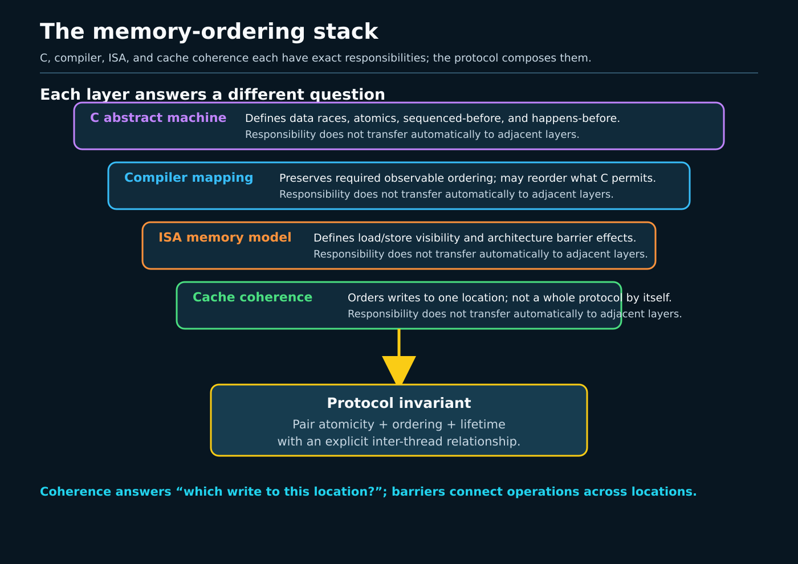
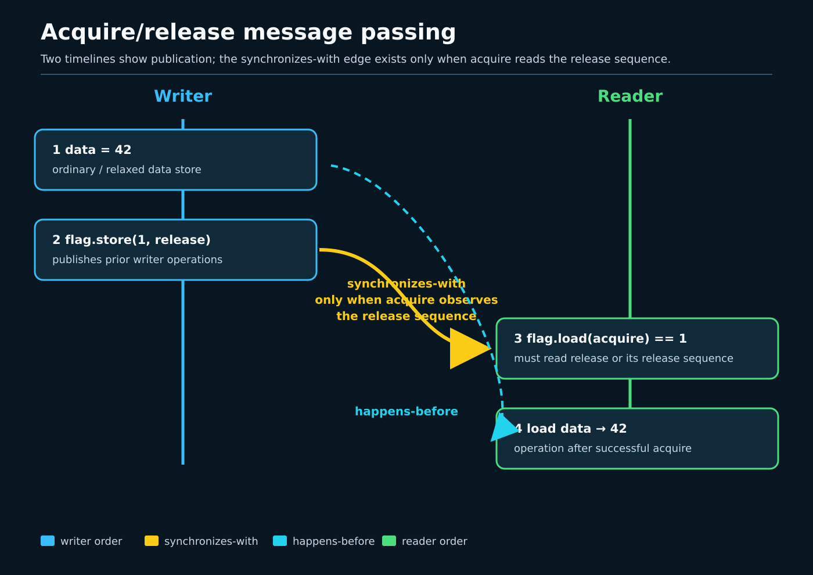

# Day 2 — Atomics, Memory Ordering, and Barriers

**Target time:** approximately 3 hours

> Atomicity answers whether one operation can tear or lose a competing
> update. Ordering answers which other accesses must be visible when another
> CPU observes that operation. A compiler barrier constrains translation. A
> CPU barrier constrains architectural memory behavior. Correct publication
> needs the right promise at every layer, not the strongest-looking mnemonic.

Week 11 introduced the C abstract machine and C11 atomics. Week 14 separated
interrupt masking from Linux context tracking. Week 15 used ordered task-state
publication and wakeup. This lesson bridges those ideas to the Linux Kernel
Memory Model (LKMM) before ToyOS grows SMP synchronization.

## 1. Minimal C and assembly syntax

Portable C atomics name an object, an operation, and an order:

```c
#include <stdatomic.h>

_Atomic unsigned ready;
int payload;

payload = 42;
atomic_store_explicit(&ready, 1, memory_order_release);
```

A reader uses an acquire load and reads `payload` only when that load returns
the value published by the release:

```c
if (atomic_load_explicit(&ready, memory_order_acquire) == 1)
        use(payload);
```

If the acquire reads from the release, the release synchronizes with the
acquire. The payload store, sequenced before the release, happens-before the
payload load sequenced after the acquire. Atomicity of `ready` alone does not
create that edge.

Kernel C uses related but distinct interfaces:

```c
WRITE_ONCE(payload, 42);
smp_store_release(&ready, 1);

if (smp_load_acquire(&ready) == 1)
        value = READ_ONCE(payload);
```

This is a conceptual bridge, not an assertion that kernel macros are C11
library atomics. LKMM, kernel compiler conventions, Kconfig, and architecture
headers define the kernel operations. The ISO C model defines
`atomic_*_explicit`. Do not mix objects or APIs and assume the names make the
program portable.

Three assembly forms illustrate the layers:

```asm
asm volatile("" ::: "memory")  # compiler barrier; emits no CPU fence
mfence                         # x86 CPU fence
dmb ish                        # AArch64 inner-shareable barrier
fence rw,rw                    # RISC-V memory fence
```

The empty inline assembly has a `"memory"` clobber, so the compiler must
treat memory as changed across it. It does not ask a CPU to do anything.
Conversely, a fence hidden in inline assembly without a compiler memory
clobber can fail to constrain compiler motion. Linux barrier macros provide
both halves as required by their contract.

## 2. Linux 0.12: `cli`/`sti` on a uniprocessor, then stop

Read Chapter 8.6, printed pages 351–372, in the local commented *A Heavily
Commented Linux Kernel Source Code: Kernel Version 0.12*, Chinese Revision 5,
and the Week 11 section of `references/EARLY_LINUX_012_MAP.md`. The PDF
viewer is about seven pages ahead of the printed numbering.
`include/asm/system.h`, lines 16–17 (the listing identified as Program 14-17
in the course's early-source notes), defines:

```c
#define sti() __asm__ ("sti"::)
#define cli() __asm__ ("cli"::)
```

`kernel/sched.c` uses `cli()` at line 233 around the floppy-motor state
update and later executes `sti()`. On one CPU, preventing the timer and other
maskable interrupts from entering keeps those interrupt paths from
interleaving with the update. That is a small implementation of local
critical-section control for its machine.

What survives is the need to order and serialize shared-state transitions.
What does not generalize is the mechanism. `cli` clears x86 IF on one CPU. It
does not stop another CPU, perform an atomic read-modify-write on a shared
cache line, or establish a portable C/LKMM publication edge. Linux 0.12 has
neither SMP memory-ordering protocols nor C11 atomics. Calling early
`cli`/`sti` an SMP lock or an SMP barrier would import a modern property that
the source does not implement.

## 3. Why ordering became explicit

Source order is processed by two independently optimizing machines.

The compiler preserves the language model's observable behavior, not the
line-by-line interleaving a programmer imagined. It can keep values in
registers, combine accesses, remove redundant loads, and move operations when
the model permits. Then the CPU follows its ISA memory model, using
out-of-order execution, store buffers, speculation, and coherent caches.
Coherence gives an order for writes to one location; it does not create the
cross-location publication edge for `payload` and `ready`.



*A correct claim names the source-level relation, the compiler constraint,
and the ISA mapping. Observing a machine outcome is not a language proof.*

SMP exposed those distinctions. A scalar counter needed indivisible
read-modify-write operations. A published pointer needed prior object
initialization ordered before publication. Lock-free readers needed stable
single accesses and lifetime rules. Scheduler wakeup needed task-state stores
ordered against the waker's state test. Device registers introduced a
different ordering domain from cache-coherent memory.

The resulting vocabulary is intentionally precise:

- `READ_ONCE`/`WRITE_ONCE` constrain compiler access shape and prevent common
  load/store invention, merging, and tearing for supported scalar sizes;
- relaxed atomics add atomic modification of one object, not cross-object
  publication;
- release orders earlier operations before publication;
- acquire orders later operations after observation;
- a full barrier orders the relevant accesses on both sides;
- lock acquire/release provides the ordering promised by the lock API;
- dependency ordering is narrow and cannot be inferred from any source-level
  `if` or pointer expression.

## 4. The exact ToyOS boundary

The checked-in `projects/toyos` is single-core x86-64. It has no
`READ_ONCE`, `WRITE_ONCE`, C `_Atomic`, kernel `atomic_t`, acquire/release
helper, SMP barrier, spinlock, RCU accessor, or per-CPU implementation.

`src/arch.c` declares `static volatile uint64_t ticks`; IRQ0 executes
`++ticks`, acknowledges the PIC, and calls `scheduler_tick()`.
`timer_ticks()` returns `ticks`. `volatile` makes these compiler-visible
accesses in this freestanding program. It does not make the increment an
atomic RMW against another CPU, and it does not order an unrelated payload.
The program's one-CPU interrupt/control-flow assumptions are doing work that
the declaration does not express.

`src/isr.S` saves registers, calls `interrupt_handler`, restores registers,
and executes `iretq`. `src/tasks.c` switches between two kernel contexts.
Neither file contains a second CPU or an inter-CPU observer. The static pipe
buffer and indices in `src/process.c` likewise have no SMP publication
protocol. They are not a hidden relaxed-atomic implementation.

The exact pre-ToyOS lesson is therefore negative but useful: adding a second
CPU would require protocols for scheduler state, allocator metadata, pipe
state, device state, and object lifetime before booting that CPU. Adding
`volatile` or wrapping those updates in `cli` would not supply those
protocols.

## 5. Linux 6.12: pinned implementation

All excerpts are verbatim from `/home/jd/Documents/linux-6.12`, tag `v6.12`,
commit `adc218676eef25575469234709c2d87185ca223a`. Each range is contiguous
and pinned to that checkout.

### `READ_ONCE` and `WRITE_ONCE`: access shape, not publication

**`include/asm-generic/rwonce.h`, `READ_ONCE` and `WRITE_ONCE`,
lines 47–62**

```c
#define READ_ONCE(x)							\
({									\
	compiletime_assert_rwonce_type(x);				\
	__READ_ONCE(x);							\
})

#define __WRITE_ONCE(x, val)						\
do {									\
	*(volatile typeof(x) *)&(x) = (val);				\
} while (0)

#define WRITE_ONCE(x, val)						\
do {									\
	compiletime_assert_rwonce_type(x);				\
	__WRITE_ONCE(x, val);						\
} while (0)
```

The type check constrains supported access sizes; the volatile-qualified
access constrains compiler treatment. There is no fence in this excerpt.
`WRITE_ONCE(ready, 1)` after a payload store is not, by itself, a release
publication on weakly ordered SMP. `READ_ONCE` is similarly not acquire.
They are building blocks used inside stronger operations.

### The compiler barrier is empty machine code

**`include/linux/compiler.h`, `barrier` and `barrier_data`,
lines 82–101**

```c
/* Optimization barrier */
#ifndef barrier
/* The "volatile" is due to gcc bugs */
# define barrier() __asm__ __volatile__("": : :"memory")
#endif

#ifndef barrier_data
/*
 * This version is i.e. to prevent dead stores elimination on @ptr
 * where gcc and llvm may behave differently when otherwise using
 * normal barrier(): while gcc behavior gets along with a normal
 * barrier(), llvm needs an explicit input variable to be assumed
 * clobbered. The issue is as follows: while the inline asm might
 * access any memory it wants, the compiler could have fit all of
 * @ptr into memory registers instead, and since @ptr never escaped
 * from that, it proved that the inline asm wasn't touching any of
 * it. This version works well with both compilers, i.e. we're telling
 * the compiler that the inline asm absolutely may see the contents
 * of @ptr. See also: https://llvm.org/bugs/show_bug.cgi?id=15495
 */
```

The ordinary `barrier()` emits an empty asm template with a memory clobber.
The adjacent comment demonstrates why compiler reasoning matters even when
no CPU instruction is desired. This primitive cannot flush a store buffer or
make another core observe data.

### A real release/acquire client

**`virt/kvm/dirty_ring.c`, dirty-GFN flag helpers, lines 92–105**

```c
static inline void kvm_dirty_gfn_set_invalid(struct kvm_dirty_gfn *gfn)
{
	smp_store_release(&gfn->flags, 0);
}

static inline void kvm_dirty_gfn_set_dirtied(struct kvm_dirty_gfn *gfn)
{
	gfn->flags = KVM_DIRTY_GFN_F_DIRTY;
}

static inline bool kvm_dirty_gfn_harvested(struct kvm_dirty_gfn *gfn)
{
	return smp_load_acquire(&gfn->flags) & KVM_DIRTY_GFN_F_RESET;
}
```

This is source evidence that the pinned tree uses release and acquire on the
same flag in a real subsystem. It does not, by itself, prove which writer each
reader observed; that requires following the callers and the flag state
machine. The plain assignment in the middle is also a warning against
assigning one order to every access merely because one field is involved.

## 6. Worked message passing: why the edge exists

The following is a teaching litmus, not a Linux-source excerpt:

```text
initially: payload = 0, ready = 0

CPU 0                                  CPU 1
payload = 42                           r = load_acquire(ready)
store_release(ready, 1)                if (r == 1)
                                           v = payload
```

Name the relations rather than saying “the barrier flushes everything”:

1. CPU 0's payload store is program-ordered before its release store.
2. CPU 1's acquire load reads the value written by that release.
3. That read-from connection creates the release/acquire synchronization.
4. CPU 1's payload load is program-ordered after the acquire.
5. The transitive chain orders the payload store before the payload load, so
   this execution reads `42`.



*The flag carries the synchronization edge only when the acquire observes the
release value. Seeing the old flag creates no permission to read the payload.*

Replace both flag operations with relaxed operations and the flag remains
atomic, but the cross-object edge disappears. In ISO C, reading the plain
`payload` concurrently then creates a data race and undefined behavior.
Making `payload` relaxed-atomic avoids undefined behavior but still permits
the old payload value. Replace the release/acquire pair with sequentially
consistent operations and the contract is stronger than this one-message
protocol needs.

A release store orders operations before it; it does not stop later accesses
from moving before unrelated later points. An acquire load orders operations
after it; it does not retroactively order earlier reader accesses. An
acquire-release RMW performs both directional jobs. A full barrier is useful
when the protocol needs ordering in both directions without one operation
serving solely as the publishing store or observing load.

## 7. Architecture mappings in this commit

The same kernel-level contract can require different instructions because the
ISAs permit different reordering.

### x86-64

**`arch/x86/include/asm/barrier.h`, SMP barrier and release/acquire,
lines 53–72**

```c
#define __smp_mb()	asm volatile("lock; addl $0,-4(%%" _ASM_SP ")" ::: "memory", "cc")

#define __smp_rmb()	dma_rmb()
#define __smp_wmb()	barrier()
#define __smp_store_mb(var, value) do { (void)xchg(&var, value); } while (0)

#define __smp_store_release(p, v)					\
do {									\
	compiletime_assert_atomic_type(*p);				\
	barrier();							\
	WRITE_ONCE(*p, v);						\
} while (0)

#define __smp_load_acquire(p)						\
({									\
	typeof(*p) ___p1 = READ_ONCE(*p);				\
	compiletime_assert_atomic_type(*p);				\
	barrier();							\
	___p1;								\
})
```

For normal cacheable memory, x86's ordering permits these release/acquire
mappings to use plain accesses plus compiler barriers. The full `__smp_mb`
is different: a locked operation supplies the stronger CPU ordering. x86 is
not “unreordered”; store buffering still matters, and MMIO has separate
rules.

### AArch64

**`arch/arm64/include/asm/barrier.h`, SMP barriers and beginning of
`__smp_store_release`, lines 123–140**

```c
#define __smp_mb()	dmb(ish)
#define __smp_rmb()	dmb(ishld)
#define __smp_wmb()	dmb(ishst)

#define __smp_store_release(p, v)					\
do {									\
	typeof(p) __p = (p);						\
	union { __unqual_scalar_typeof(*p) __val; char __c[1]; } __u =	\
		{ .__val = (__force __unqual_scalar_typeof(*p)) (v) };	\
	compiletime_assert_atomic_type(*p);				\
	kasan_check_write(__p, sizeof(*p));				\
	switch (sizeof(*p)) {						\
	case 1:								\
		asm volatile ("stlrb %w1, %0"				\
				: "=Q" (*__p)				\
				: "rZ" (*(__u8 *)__u.__c)		\
				: "memory");				\
		break;							\
```

AArch64 uses `dmb ish` for a full SMP barrier and store-release instructions
(`stlrb`, followed by other size cases later in the function) for release.
The matching acquire helper below this range uses `ldarb`, `ldarh`, and
`ldar`. Weak ordering makes those architectural semantics visible where x86
used plain memory instructions.

### RISC-V

**`arch/riscv/include/asm/barrier.h`, release/acquire helpers,
lines 59–72**

```c
#define __smp_store_release(p, v)					\
do {									\
	compiletime_assert_atomic_type(*p);				\
	RISCV_FENCE(rw, w);						\
	WRITE_ONCE(*p, v);						\
} while (0)

#define __smp_load_acquire(p)						\
({									\
	typeof(*p) ___p1 = READ_ONCE(*p);				\
	compiletime_assert_atomic_type(*p);				\
	RISCV_FENCE(r, rw);						\
	___p1;								\
})
```

This tree places `fence rw,w` before the release store and `fence r,rw`
after the acquire load. Its full SMP barrier, at line 28, is
`RISCV_FENCE(rw, rw)`. The sets name predecessor and successor access classes;
the release and acquire fences are directional, not aliases for the full
barrier.

These headers prove the Linux 6.12 mappings in this checkout. They do not
prove how a userspace C compiler lowers `memory_order_release` for arbitrary
flags, ABI, tuning, or compiler version. Compile that program for each target
and inspect its assembly when that is the claim.

## 8. Dependencies: narrow tools, not implicit acquire

A **data/address dependency** exists when a loaded value computes the data or
address of a later access. The ordering reaches that dependent access, not
every later operation. RCU pointer traversal relies on kernel accessors and
LKMM rules that preserve the relevant dependency. Copying a pointer through
an integer cast, allowing the compiler to prove its value, or using an
unapproved transformation can destroy the chain.

A **control dependency** exists when a load determines whether a later store
executes. Its scope is the controlled branch. It does not generally order a
load before a later load; that shape needs an acquire/read barrier or another
documented protocol. Operations after the branches rejoin are not
automatically ordered by the earlier condition. Compilers also do not
preserve every source `if` as the hardware control dependency imagined by the
author.

Therefore:

- do not replace acquire with “there is an `if`”;
- do not treat an address-dependent read as a full barrier;
- use `rcu_dereference()` rather than open-coding dependent pointer loads;
- use documented acquire/release operations when that is the intended edge;
- validate a dependency claim against LKMM documentation and a litmus test,
  not one disassembly alone.

ISO C's `memory_order_consume` is not a practical bridge here: major
compilers commonly strengthen it to acquire, while kernel dependency rules
belong to LKMM and kernel accessors.

## 9. DMA and MMIO: a boundary caveat only

`smp_mb()` orders CPU accesses to normal memory in the SMP domain. Device
registers and DMA involve additional actors and architecture-specific APIs.
Use `readl`/`writel` and their relaxed variants according to the device's
register protocol; use DMA mapping/synchronization APIs according to buffer
ownership and coherency. Do not infer that a CPU acquire/release pair flushes
a posted MMIO write or transfers DMA-buffer ownership.

ToyOS Week 9 intentionally stops at checked EDU MMIO. Its README states that
DMA was not enabled because correct testing also needs pinning, ownership,
and device-visible physical-buffer bookkeeping. This lesson preserves that
boundary and makes no DMA correctness claim.

## 10. Bounded lab: observation versus source proof

Align the future exercise with `projects/linux-kernel-sync`; do not claim that
the project or any output exists yet. A bounded lab should:

1. run a finite release/acquire message-passing test and a finite relaxed
   comparison using C atomics;
2. use a timeout and report observed counts without requiring a weak outcome;
3. emit compiler version, target architecture, options, and focused assembly
   for the publication functions;
4. run pinned-source validation for the six Linux excerpts in this lesson;
5. optionally run an LKMM litmus through existing kernel tooling, recording
   unavailable tools as `SKIP`;
6. avoid kernel modules, host-wide tracing changes, MMIO, and DMA.

**Observation:** one host run may show that every release/acquire iteration
accepted by the reader carried the expected payload, and may or may not show
a weak relaxed outcome. Its assembly proves one compiler's mapping for one
target and option set.

**Source proof:** the excerpts establish the access-shape macros, compiler
barrier, one real release/acquire client, and x86-64/AArch64/RISC-V mappings
in pinned Linux 6.12.

**Not proved:** absence of all allowed weak outcomes; equivalence between C11
and LKMM; execution of a shown kernel path by the host; behavior on another
architecture; MMIO/DMA ordering; or post-6.12 source stability. Never invent
an expected weak-outcome count. Zero is a valid observation and not a proof
that the relaxed model forbids the outcome.

## 11. Practical reasoning and limits

For every lock-free or low-level synchronization protocol, write this proof
outline:

1. List each shared object and whether accesses are plain, `READ_ONCE`,
   atomic, lock-protected, or RCU-protected.
2. Name the invariant and lifetime rule from Day 1.
3. Draw each writer's program order and each reader's program order.
4. Identify the exact read that must observe the exact write.
5. Name the synchronizes-with or LKMM relation that observation creates.
6. Follow transitivity to every payload access the protocol claims to order.
7. State what happens when the reader observes an older value.
8. Check compiler constraints and each supported ISA mapping.
9. Keep normal memory, MMIO, and DMA domains separate.
10. Test with bounded observations and source/litmus proof; do not promote one
    into the other.

Week 15's wakeup path is a concrete application: waiter state publication and
the waker's state test need an order so a wake cannot pass an unpublished
sleep. Week 14's `cli`, DAIF, and `sstatus.SIE` manipulate local interrupt
masks, not this inter-CPU relation. Week 11's C atomics remain the authority
for userspace labs, while LKMM remains the authority for kernel litmus claims.

## Completion prompts

### Explain

Explain why `WRITE_ONCE(payload, 42); WRITE_ONCE(ready, 1);` does not by
itself publish the payload on weakly ordered SMP. Then explain the exact
condition under which a release store and acquire load do publish it.

### Draw

Draw the worked message-passing execution with program-order, reads-from,
synchronizes-with, and happens-before edges. Beside it draw the relaxed
version and mark the missing edge. Add the compiler and CPU layers from the
ordering-stack visual.

### Observe

For the future bounded lab, preserve actual counts even when the weak count is
zero. Record compiler, target, options, timeout status, and assembly. Label
the result `host observation`, not `memory-model proof`.

### Source proof

For all six excerpts, validate the exact path and inclusive line range against
commit `adc218676eef25575469234709c2d87185ca223a`. State one narrow claim per
excerpt. Explain why x86's plain release store and AArch64's `stlr` can
implement the same kernel contract.

### Build

Write, but do not yet integrate, a ToyOS publication design for one immutable
object pointer. Include initialization, release publication, acquire
observation, old-value behavior, object lifetime, and the single-core build's
relationship to a future SMP build. Do not use `volatile` as the ordering
argument.

Completion requires this final limit: **atomicity is not ordering,
`READ_ONCE` is not acquire, interrupt masking is not an SMP barrier, one
architecture's assembly is not a portable C proof, and normal-memory barriers
do not silently solve MMIO or DMA ownership.**
