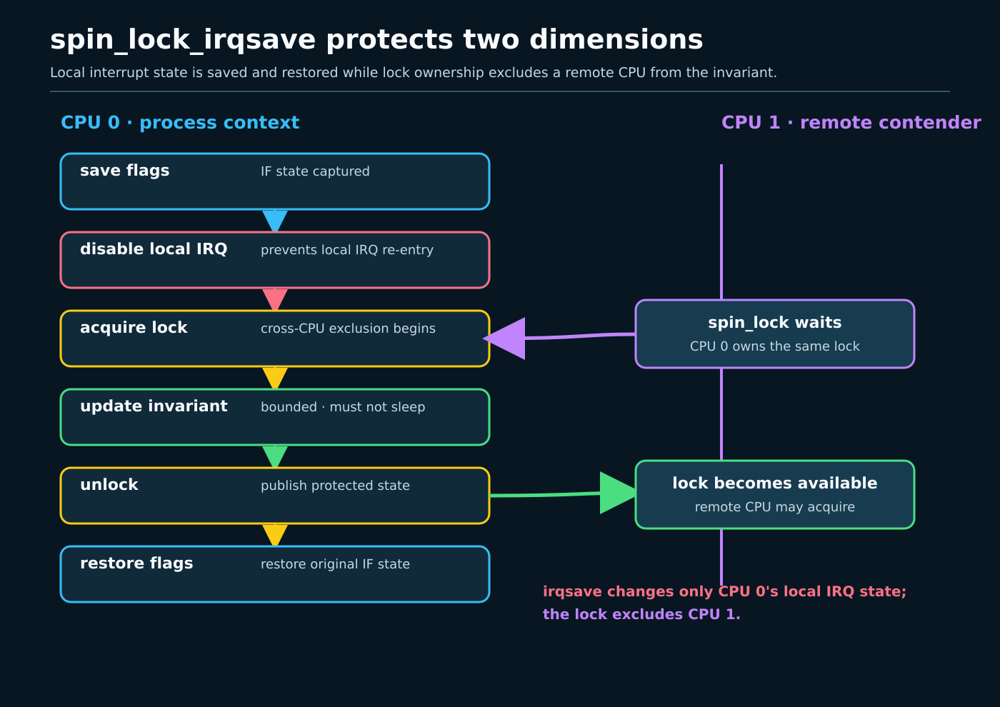
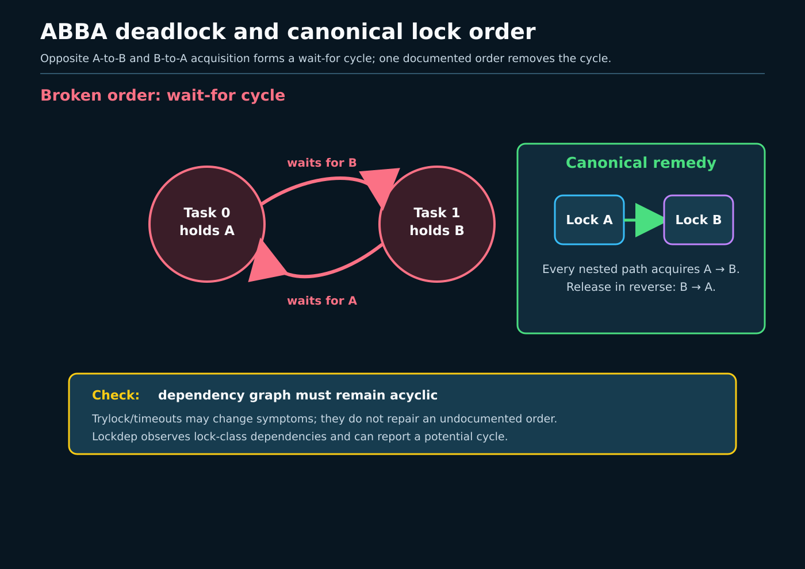

# Day 3 — Spinlocks, IRQs, and Preemption

**Target time:** approximately 3 hours

> Driving question: why can a lock be correct against another CPU and still
> deadlock when an interrupt arrives on the CPU that owns it?



## Why this mechanism exists

A shared invariant must never be observed half-updated. In process context, on
another CPU, and in interrupt work, multiple execution contexts can reach the
same object. A spinlock gives exactly one context permission to mutate the
protected state. The owner is the CPU currently executing the successful
acquire, not a task that may sleep and resume later: the owner must finish,
publish the update, and unlock without blocking.

That statement has three independent requirements:

1. competitors on other CPUs must not enter the critical section;
2. this CPU must not be preempted into code that tries to take the same lock;
3. if a local hardirq or softirq can take it, the matching local source must be
   excluded before acquisition.

A plain spinlock handles the first and, on non-RT kernels, normally the second.
It does not by itself prevent a hardirq from interrupting its owner. If that
handler spins for the same lock, the only CPU able to release it is trapped in
the interrupted critical section. `spin_lock_irqsave()` closes that local
deadlock window while preserving the caller's previous interrupt state.

## Syntax before mechanism

`spinlock_t *lock` is a pointer to a lock object. `unsigned long flags` receives
the architecture interrupt-mask state. The macro writes that variable, so it
is an output despite appearing as an ordinary argument. The matching
`spin_unlock_irqrestore(lock, flags)` releases first and restores exactly the
saved state; blindly enabling interrupts would break callers that entered with
interrupts already disabled.

`spin_lock_bh()` disables local bottom-half processing around the lock. It is
the process-context side of a lock also acquired by softirq code. It is not a
hardirq mask. `spin_lock_irq()` disables local hardirqs without preserving a
prior state and is appropriate only when the surrounding contract makes that
state known. `raw_spinlock_t` and `spinlock_t` are deliberately distinct,
especially under PREEMPT_RT.

`READ_ONCE()` and `WRITE_ONCE()` constrain compiler access width and
coalescing; they are not mutual exclusion. Lock acquire and release supply
ordering around data protected by the same lock. That does not make every
unrelated lock operation a full global fence. When Linux needs ordering
stronger than ordinary acquire semantics, it says so with helpers such as
`smp_mb__after_spinlock()`.

## Linux 0.12: interrupt exclusion before SMP locking

Read Chapter 8.6, `kernel/sched.c`, printed pages 351–372 of *A Heavily
Commented Linux Kernel Source Code: Kernel Version 0.12*, and the Week 11
boundary in `references/EARLY_LINUX_012_MAP.md`. Also inspect
`include/asm/system.h`, where `cli()` and `sti()` are direct x86 instructions.
The early kernel is uniprocessor. Closing the interrupt flag prevents an
interrupt handler from interleaving on that sole CPU, so many small critical
regions need no SMP lock.

The durable lesson is local reentrancy: an interrupt can arrive between two C
statements unless excluded. The historical boundary is equally important.
Linux 0.12 has no second CPU concurrently touching the cache line, no modern
spinlock API, no lockdep graph, no softirq/preemption accounting as Linux 6.12
uses it, and no PREEMPT_RT transformation. `cli` is not an SMP lock and `sti`
is not a safe substitute for restoring saved flags.

## Evolution pressure

SMP made local interrupt masking insufficient: CPU 1 keeps running when CPU 0
clears its own IF bit. Kernel preemption added another local competitor.
Deferred interrupt work required a distinction between hardirq and bottom-half
exclusion. Large systems then made contention, cache-line bouncing, lock
ordering, and diagnostics first-class concerns.

The resulting rule is contextual:

- use a plain spinlock only when no local interrupt context sharing the data
  can interrupt the owner;
- use the `_bh` form when process context shares with softirq/bottom-half work;
- use `_irqsave`/`_irqrestore` when hardirq sharing is possible or the incoming
  mask is not known;
- never sleep, fault deliberately, or call a blocking allocator while holding
  a spinning lock;
- use one global order for nested locks. If path A takes `L1 → L2` while path B
  takes `L2 → L1`, both CPUs can wait forever.



Lock ordering is part of the data structure's API, not a local style choice.
Lockdep can discover observed order cycles, but a clean run does not prove that
an unexecuted path is safe.

## Actual ToyOS boundary

ToyOS implements interrupt entry and timer-driven switching, but no lock.
`projects/toyos/src/arch.c:222-226` exposes `interrupts_enable()` as `sti`.
`interrupt_handler()` at lines 240–258 increments `ticks`, sends the PIC EOI,
and calls `scheduler_tick()`. `projects/toyos/src/tasks.c:130-160` changes the
current task and can context-switch from that tick.

There is no `spinlock_t`, atomic lock word, IRQ-save helper, bottom-half
facility, preemption counter, lock ordering, lockdep, or SMP CPU. The global
`ticks` variable is `volatile`, which does not make it an SMP atomic or provide
lock ordering. ToyOS therefore demonstrates that interrupt execution can
interleave with task code; it does not demonstrate a correct Linux spinlock,
an irqsave protocol, or a two-CPU deadlock.

## Linux 6.12 pinned source

All excerpts are exact, contiguous source from commit
`adc218676eef25575469234709c2d87185ca223a`. Line ranges refer to
`/home/jd/Documents/linux-6.12`.

The ordinary interface reaches the raw implementation embedded in
`spinlock_t`.

**`include/linux/spinlock.h`, `spin_lock()` / `spin_lock_bh()`, lines 349–356**

```c
static __always_inline void spin_lock(spinlock_t *lock)
{
	raw_spin_lock(&lock->rlock);
}

static __always_inline void spin_lock_bh(spinlock_t *lock)
{
	raw_spin_lock_bh(&lock->rlock);
```

The irqsave macro type-checks writable flag storage and passes it down. The
saved value belongs to this acquire and must reach the matching restore.

**`include/linux/spinlock.h`, `raw_spin_lock_irqsave`, lines 239–245**

```c
#if defined(CONFIG_SMP) || defined(CONFIG_DEBUG_SPINLOCK)

#define raw_spin_lock_irqsave(lock, flags)			\
	do {						\
		typecheck(unsigned long, flags);	\
		flags = _raw_spin_lock_irqsave(lock);	\
	} while (0)
```

The typed wrapper keeps the same pairing and rejects a non-spinlock argument
through `spinlock_check`.

**`include/linux/spinlock.h`, `spin_lock_irqsave`, lines 374–382**

```c
static __always_inline void spin_lock_irq(spinlock_t *lock)
{
	raw_spin_lock_irq(&lock->rlock);
}

#define spin_lock_irqsave(lock, flags)				\
do {								\
	raw_spin_lock_irqsave(spinlock_check(lock), flags);	\
} while (0)
```

Locks normally order critical sections with acquire/release semantics. This
commented litmus documents a site that explicitly strengthens ordering after
acquisition; the forbidden result is narrower and more precise than saying
“spinlocks are full barriers.”

**`include/linux/spinlock.h`, memory-ordering example, lines 133–146**

```c
 *	  { X = 0;  Y = 0; }
 *
 *	  CPU0				CPU1
 *
 *	  WRITE_ONCE(X, 1);		WRITE_ONCE(Y, 1);
 *	  spin_lock(S);			smp_mb();
 *	  smp_mb__after_spinlock();	r1 = READ_ONCE(X);
 *	  r0 = READ_ONCE(Y);
 *	  spin_unlock(S);
 *
 *      it is forbidden that CPU0 does not observe CPU1's store to Y (r0 = 0)
 *      and CPU1 does not observe CPU0's store to X (r1 = 0); see the comments
 *      preceding the call to smp_mb__after_spinlock() in __schedule() and in
 *      try_to_wake_up().
```

The raw acquire reaches the architecture lock and annotates ownership for
debugging. This is spinning state, not a scheduler wait queue.

**`include/linux/spinlock.h`, `do_raw_spin_lock()`, lines 184–189**

```c
static inline void do_raw_spin_lock(raw_spinlock_t *lock) __acquires(lock)
{
	__acquire(lock);
	arch_spin_lock(&lock->raw_lock);
	mmiowb_spin_lock();
}
```

PREEMPT_RT changes regular `spinlock_t`: this header routes it through an
rt-mutex-based implementation. The shown irqsave flags become zero rather than
an ordinary hardirq save. Therefore claims about “all spinlocks disable
preemption and spin with IRQs off” are false across configurations.

**`include/linux/spinlock_rt.h`, RT lock variants, lines 85–102**

```c
static __always_inline void spin_lock_bh(spinlock_t *lock)
{
	/* Investigate: Drop bh when blocking ? */
	local_bh_disable();
	rt_spin_lock(lock);
}

static __always_inline void spin_lock_irq(spinlock_t *lock)
{
	rt_spin_lock(lock);
}

#define spin_lock_irqsave(lock, flags)			 \
	do {						 \
		typecheck(unsigned long, flags);	 \
		flags = 0;				 \
		spin_lock(lock);			 \
	} while (0)
```

`raw_spinlock_t` remains the primitive for truly atomic low-level sections on
PREEMPT_RT; regular `spinlock_t` is transformed to improve latency. This lesson
does not grant permission to sleep while holding either API, nor does it claim
that an arbitrary driver becomes hard real-time merely by running an RT-patched
kernel.

## Reason through the invariant

Suppose task context takes `device->lock` and is interrupted locally.

- With plain `spin_lock`, a hardirq handler taking the same lock spins forever:
  the interrupted task is the owner and cannot run to unlock.
- With `spin_lock_irqsave`, the hardirq cannot enter on this CPU between mask
  save and restore. A handler on another CPU may spin, but the owner CPU can
  continue and release.
- With only `spin_lock_bh`, softirq execution is deferred locally, but a
  hardirq can still arrive.
- With two locks, irqsave does not cure ABBA. Every path still needs the same
  nested order.

The protected writes happen before unlock; a later successful acquire of the
same lock observes the critical section through the lock's ordering contract.
Data accessed outside that protocol needs its own atomic, RCU, sequence-count,
or other documented ordering. A spinlock does not retroactively protect an
unlocked read.

## Bounded lab: analogy, not kernel-path proof

Use the Day 3 exercise under `projects/linux-kernel-sync`. Its userspace
analogs/simulators may model a test-and-set owner, saved “IRQ enabled” state,
an injected local handler, and an ABBA timeout. Bound every run with a timeout
and report deadlock as a modeled state, not by hanging the course runner.

The lab can show:

- one modeled owner enters at a time;
- restoring the saved state differs from unconditional enable;
- an injected same-CPU handler deadlocks in the unsafe model;
- a fixed lock order completes in the bounded model.

It cannot prove that the host entered `spin_lock_irqsave`, disabled a real
interrupt line, exercised Linux lockdep, ran PREEMPT_RT, or obtained any
specific architecture barrier. Those claims come only from the pinned source
and an identified kernel build. Record `uname -r`; do not infer that the host
runs this 6.12 commit.

## Connections and limits

Week 11 supplied races, acquire/release reasoning, and the warning that
`volatile` is not synchronization. Week 14 supplied hardirq, softirq, and
preemption context: those contexts determine which lock suffix is required.
Week 15 supplies scheduling, but a non-RT spinlock section must finish without
sleeping into that scheduler; PREEMPT_RT's transformed regular locks are a
configuration-specific exception in implementation, not a blanket API change.

Do not use a spinlock for long work, I/O waits, userspace copies that may fault,
or a condition that requires another task to run. Do not use irqsave merely as
an SMP substitute, and do not use a mutex in hardirq or softirq context. The
excerpts establish Linux 6.12 at the named commit only. Later upstream is
**potentially changed** until checked at a named revision.

### Completion check

Explain one shared object as:

```text
invariant → possible CPU/IRQ/softirq competitors → chosen lock variant
→ acquire ordering → bounded non-sleeping mutation → release ordering
→ exact interrupt-state restoration
```

Then draw an ABBA cycle and remove it with one global order. Label every claim
`Linux 0.12 historical`, `ToyOS actual`, `Linux 6.12 pinned`, `userspace model`,
or `not established`.
