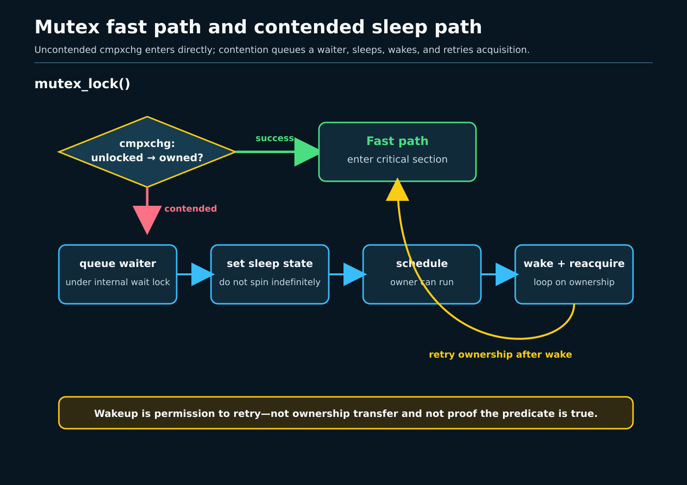
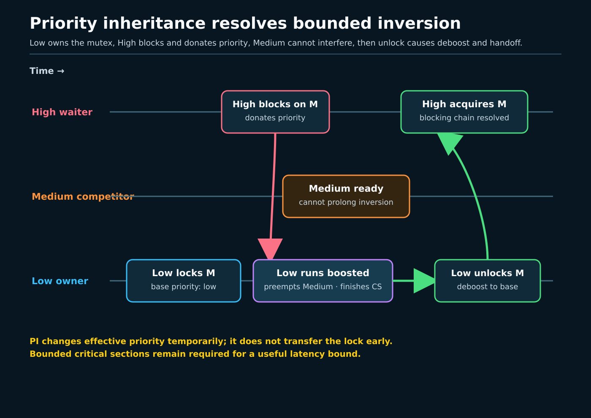

# Day 4 — Mutexes, rtmutexes, and Sleeping Locks

**Target time:** approximately 3 hours

> Driving question: when waiting for a lock may take an arbitrary time, why
> should the contender stop running, and how can priority inheritance keep the
> owner from being stranded behind unrelated work?



## Why sleeping locks exist

Spinning is useful only when the owner can run and release soon. If a critical
section may wait for memory, perform a blocking operation, or simply suffer
long contention, a spinning CPU burns execution time while making no progress.
A mutex moves a losing task onto a waiter list and lets the scheduler run
something else. The cost is larger machinery: task state, queueing, wakeup,
ownership, cancellation, and a retry protocol.

The invariant is exclusive ownership by one task. Unlike the CPU-oriented
spinlock rule, mutex ownership follows the task: only the owner unlocks, the
task may sleep while waiting to acquire, and acquisition is legal only in
sleepable process context. “A mutex can sleep” means the **acquire operation
may block**. It is not permission to call arbitrary sleeping functions while a
particular subsystem's mutex is held; higher-level lifetime and lock-order
rules still apply.

## Syntax before mechanism

`atomic_long_try_cmpxchg_acquire(&lock->owner, &zero, curr)` compares the owner
word with zero. On success it installs `current`, returns true, and supplies
acquire ordering. On failure it updates the expected value and sends the
caller toward the slow path.

`__sched` marks a function that may schedule. `might_sleep()` is a debugging
and voluntary-preemption annotation, not the mechanism that queues a waiter.
`set_current_state(state)` publishes a sleep state with ordering. A `for (;;)`
loop is required because wakeup does not grant ownership: the task must retry.
`wake_q_add()` builds a wake batch under the internal wait lock;
`wake_up_q()` runs after that lock is dropped.

An rtmutex is a mutex with priority-inheritance bookkeeping. “PI” means a
higher-priority waiter can donate effective priority to an owner that blocks
it. It does not mean the lock is automatically available, that deadlines are
guaranteed, or that a userspace process has permission to use a privileged
real-time scheduling class.

## Linux 0.12: whole sleep/wakeup shape, not a modern mutex

Read Chapter 8.6, `kernel/sched.c`, printed pages 351–372 in the local
commented Linux 0.12 PDF, as directed by the Week 11 section of
`references/EARLY_LINUX_012_MAP.md`. The `sleep_on`,
`interruptible_sleep_on`, and `wake_up` helpers expose a compact transition:
set task state, call `schedule()`, and later mark a waiter `TASK_RUNNING`.
The pipe example mapped at Chapter 12.11, printed pages 802–806, supplies a
resource condition that makes a task wait.

The stable mechanism is relinquish-and-retry: a task unable to proceed stops
consuming the CPU, another context changes the condition, and wakeup makes the
waiter runnable. The implementation is historical. A single wait pointer and
uniprocessor interrupt exclusion do not provide Linux 6.12 mutex ownership,
FIFO waiter lists, handoff flags, SMP ordering, lockdep, optimistic spinning,
or priority inheritance. Do not rename `sleep_on()` a mutex.

## Evolution pressure

SMP made owner and waiter transitions concurrent. Many waiters required a
real list and cancellation rules. Fast uncontended locks needed to stay close
to one atomic operation, while contention required a separate slow path.
Unlock had to prevent lost wakeups and unfair lock stealing without waking
under an internal raw spinlock.

Priority inversion added a different pressure. If high-priority task H waits
on a lock held by low-priority L, and medium-priority M keeps preempting L,
then H is indirectly delayed by M. PI temporarily raises L's effective
priority to that of its most important donor, and can propagate through a
chain if L itself blocks on another rtmutex. Unlock removes or replaces the
donation and recalculates priority—deboosting is as important as boosting.



Week 15 explains how that effective priority interacts with scheduler classes,
runqueues, preemption, and wakeup. This lesson stops at the locking side of
that boundary. It makes no claim that the learner can set `SCHED_FIFO`, that
the host grants `CAP_SYS_NICE`, or that a timing sample proves deterministic
real-time behavior.

## Actual ToyOS boundary

`projects/toyos/src/tasks.c:4-8` defines runnable, running, and blocked states.
At lines 53–70, `task_finish()` marks the current task blocked only after its
work is complete and calls the private scheduler. At lines 130–153,
`schedule()` skips a blocked candidate and switches between two ring-0 tasks.

There is no mutex object, owner word, waiter list, contention loop, wake
operation, semaphore, rwsem, completion, priority field, PI tree, or deboost.
ToyOS can show that a blocked state removes a task from simple selection and
that a saved continuation may later resume. It cannot show a task sleeping
*for a lock*, a lost-wakeup-safe mutex protocol, or a scheduler response to
priority donation.

## Linux 6.12 pinned: the uncontended path

All excerpts are exact, contiguous source from commit
`adc218676eef25575469234709c2d87185ca223a`. Line ranges identify
`/home/jd/Documents/linux-6.12`.

The fast path installs `current` into an empty owner word with acquire
ordering. No wait-list lock or scheduler call is needed.

**`kernel/locking/mutex.c`, `__mutex_trylock_fast()`, lines 162–174**

```c
/*
 * Optimistic trylock that only works in the uncontended case. Make sure to
 * follow with a __mutex_trylock() before failing.
 */
static __always_inline bool __mutex_trylock_fast(struct mutex *lock)
{
	unsigned long curr = (unsigned long)current;
	unsigned long zero = 0UL;

	if (atomic_long_try_cmpxchg_acquire(&lock->owner, &zero, curr))
		return true;

	return false;
```

The public operation states sleepability before branching. Failure of the
optimistic attempt is not final failure; it invokes the full protocol.

**`kernel/locking/mutex.c`, `mutex_lock()`, lines 275–288**

```c
 * (The CONFIG_DEBUG_MUTEXES .config option turns on debugging
 * checks that will enforce the restrictions and will also do
 * deadlock debugging)
 *
 * This function is similar to (but not equivalent to) down().
 */
void __sched mutex_lock(struct mutex *lock)
{
	might_sleep();

	if (!__mutex_trylock_fast(lock))
		__mutex_lock_slowpath(lock);
}
EXPORT_SYMBOL(mutex_lock);
```

## Linux 6.12 pinned: queue, sleep, retry, wake

The ordinary slow path appends in FIFO order, then publishes task state.
The internal `wait_lock` serializes list and handoff state; it is not the
mutex being requested.

**`kernel/locking/mutex.c`, `__mutex_lock_common()`, lines 638–654**

```c
	lock_contended(&lock->dep_map, ip);

	if (!use_ww_ctx) {
		/* add waiting tasks to the end of the waitqueue (FIFO): */
		__mutex_add_waiter(lock, &waiter, &lock->wait_list);
	} else {
		/*
		 * Add in stamp order, waking up waiters that must kill
		 * themselves.
		 */
		ret = __ww_mutex_add_waiter(&waiter, lock, ww_ctx);
		if (ret)
			goto err_early_kill;
	}

	set_current_state(state);
	trace_contention_begin(lock, LCB_F_MUTEX);
```

The contender drops the internal raw lock before scheduling. After wakeup it
re-establishes state and retries acquisition or handoff. This loop is why
“wakeup transfers the mutex” is an unsafe simplification.

**`kernel/locking/mutex.c`, `__mutex_lock_common()`, lines 683–695**

```c
		raw_spin_unlock(&lock->wait_lock);
		schedule_preempt_disabled();

		first = __mutex_waiter_is_first(lock, &waiter);

		set_current_state(state);
		/*
		 * Here we order against unlock; we must either see it change
		 * state back to RUNNING and fall through the next schedule(),
		 * or we must see its unlock and acquire.
		 */
		if (__mutex_trylock_or_handoff(lock, first))
			break;
```

Unlock selects the first waiter while protected, optionally records a direct
handoff, drops `wait_lock`, and only then performs the wake batch.

**`kernel/locking/mutex.c`, `__mutex_unlock_slowpath()`, lines 937–956**

```c
	raw_spin_lock(&lock->wait_lock);
	debug_mutex_unlock(lock);
	if (!list_empty(&lock->wait_list)) {
		/* get the first entry from the wait-list: */
		struct mutex_waiter *waiter =
			list_first_entry(&lock->wait_list,
					 struct mutex_waiter, list);

		next = waiter->task;

		debug_mutex_wake_waiter(lock, waiter);
		wake_q_add(&wake_q, next);
	}

	if (owner & MUTEX_FLAG_HANDOFF)
		__mutex_handoff(lock, next);

	raw_spin_unlock(&lock->wait_lock);

	wake_up_q(&wake_q);
```

## Linux 6.12 pinned: PI and deboost

When an rtmutex waiter becomes the top waiter, Linux replaces the owner's PI
donor, recalculates effective priority, and notes whether the owner is itself
blocked so a chain walk may be needed.

**`kernel/locking/rtmutex.c`, `task_blocks_on_rt_mutex()`, lines 1261–1276**

```c
	raw_spin_lock(&owner->pi_lock);
	if (waiter == rt_mutex_top_waiter(lock)) {
		rt_mutex_dequeue_pi(owner, top_waiter);
		rt_mutex_enqueue_pi(owner, waiter);

		rt_mutex_adjust_prio(lock, owner);
		if (owner->pi_blocked_on)
			chain_walk = 1;
	} else if (rt_mutex_cond_detect_deadlock(waiter, chwalk)) {
		chain_walk = 1;
	}

	/* Store the lock on which owner is blocked or NULL */
	next_lock = task_blocked_on_lock(owner);

	raw_spin_unlock(&owner->pi_lock);
```

On unlock, the departing owner loses this donor and is deboosted before the
top waiter is woken. Keeping new arrivals on the slow path prevents a
lower-priority task from stealing ahead of that waiter.

**`kernel/locking/rtmutex.c`, wakeup/deboost path, lines 1319–1337**

```c
	/*
	 * Remove it from current->pi_waiters and deboost.
	 *
	 * We must in fact deboost here in order to ensure we call
	 * rt_mutex_setprio() to update p->pi_top_task before the
	 * task unblocks.
	 */
	rt_mutex_dequeue_pi(current, waiter);
	rt_mutex_adjust_prio(lock, current);

	/*
	 * As we are waking up the top waiter, and the waiter stays
	 * queued on the lock until it gets the lock, this lock
	 * obviously has waiters. Just set the bit here and this has
	 * the added benefit of forcing all new tasks into the
	 * slow path making sure no task of lower priority than
	 * the top waiter can steal this lock.
	 */
	lock->owner = (void *) RT_MUTEX_HAS_WAITERS;
```

PI bounds one cause of inversion: an owner preempted by work below the donor's
effective priority. It cannot bound device latency, non-preemptible regions,
interrupt storms, a lock chain outside the PI protocol, or arbitrary critical
section length. It is a mechanism, not a privileged scheduling guarantee.

## Boundaries among sleeping primitives

A mutex represents exclusive ownership and must be unlocked by its owner.
A counting semaphore represents available units; `down()`/`up()` are not a
drop-in ownership discipline. An rwsem permits multiple readers or one writer
and is useful only when its read concurrency offsets extra fairness and cache
costs. A completion represents an event or handoff—“this operation finished”—
not protection of a mutable invariant. Its waiter normally calls
`wait_for_completion*()` and the producer calls `complete()` or
`complete_all()`.

Choose by the fact being represented:

- **one owner protects state:** mutex;
- **N fungible units:** semaphore;
- **many read-side holders, one writer:** rwsem;
- **one operation reaches a milestone:** completion;
- **atomic-context, very short invariant:** spinlock from Day 3.

None of the sleeping primitives is legal from hardirq or softirq context.
Completions can be signaled from atomic contexts where their implementation
permits it, but waiting is the sleeping side and requires process context.

## Bounded lab: analogy, not kernel-path proof

Use the Day 4 programs under `projects/linux-kernel-sync`. A bounded userspace
mutex analog may force one thread to hold a `pthread_mutex_t`, observe that a
contender stops making progress until unlock, and record wake-to-acquire time.
A PI simulator may model H waiting on L while M is runnable, then compare a
schedule with and without donation and deboost. Put a timeout around every
run.

These exercises can establish their own userspace ordering and simulator
state. They cannot prove that the kernel used `kernel/locking/mutex.c`, that a
futex took a particular slow path, that the scheduler performed Linux rtmutex
PI, or that the process received real-time policy. Do not request elevated
priority, capabilities, or host-wide scheduler changes. Keep
`kernel_path_claim=none` in the result.

## Connections, misuse, and limits

Week 11's condition-variable loop explains why waiters recheck instead of
assuming wakeup grants ownership. Week 14 determines sleep legality: process
context may block; hardirq, softirq, and NMI may not. Week 15 owns the next
decision after a waiter becomes runnable and explains how effective priority
changes selection.

A mutex is inappropriate for interrupt context, recursively locking the same
non-recursive mutex, or data read without participating in the lock protocol.
An rtmutex is inappropriate as a claim of hard real-time completion. A
semaphore is inappropriate when owner-only unlock and lockdep ownership are
the invariant. A completion is inappropriate as a reusable data lock without
a separate generation/lifetime design.

The excerpts prove only the named Linux 6.12 commit. A host run must record
`uname -r`; later upstream and downstream RT trees are **potentially changed**
until checked at named revisions.

### Completion check

Narrate both paths:

```text
unowned → acquire cmpxchg → protected work → release

owned → enqueue + publish sleep state → schedule → unlock selects waiter
→ wake → retry/handoff → acquire
```

Then add `H waits on L → donate → L runs → unlock → deboost → H retries` and
mark where Week 15 scheduler policy begins. Label each assertion
`Linux 0.12 historical`, `ToyOS actual`, `Linux 6.12 pinned`, `userspace
analog`, or `not established`.
