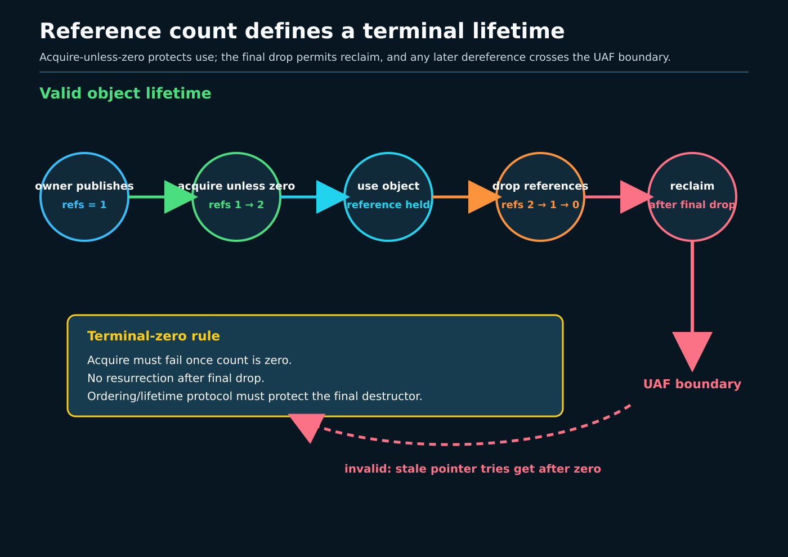
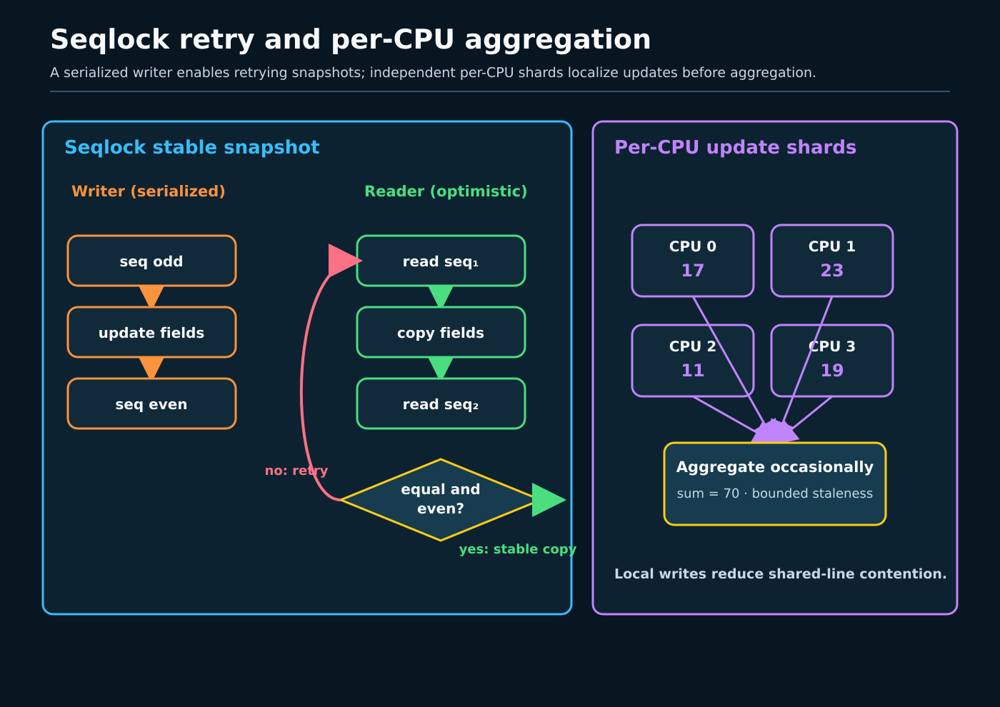

# Day 5 — Refcounts, Seqlocks, and Per-CPU State

**Target time:** approximately 3 hours

> Driving question: is the bug that two contexts update an object together,
> that one context frees it while another still uses it, or that a global
> counter forces every CPU onto the same cache line?



## Why these are three different mechanisms

Exclusion, lifetime, consistent snapshots, and locality solve different
problems.

- A lock prevents conflicting operations from overlapping.
- A reference count prevents destruction while a valid reference exists.
- A sequence counter lets readers detect that a snapshot overlapped a writer
  and retry.
- Per-CPU storage gives each CPU a local instance to reduce sharing.

None substitutes automatically for another. A refcount of two does not stop
both holders mutating the object. A mutex around lookup does not keep the
object alive after unlock unless the lookup acquires a reference. A seqcount
does not serialize two writers. A per-CPU counter is not a coherent global
total until an aggregation protocol defines what “now” means.

The first debugging question is therefore **which invariant failed?** Only
then choose a primitive.

## Syntax before mechanism

`refcount_t` wraps an atomic counter with misuse checks and saturation
semantics. `refcount_inc()` means the caller already owns a valid reference.
Acquiring from a lookup where zero is possible needs a documented
`*_inc_not_zero()`/RCU/lock protocol. `refcount_dec_and_test()` returns true
only to the last releaser, which then destroys the object.

`container_of(kref, struct object, ref)` recovers the containing object in a
release callback. A `kref` is commonly embedded in that object; `kref_get()`
and `kref_put()` encode the increment/final-release pattern.

A seqcount reader saves an even sequence, copies all fields, and asks whether
the sequence changed. An odd value means a writer is active. A retry discards
the entire snapshot. The writer must already be serialized and must not be
preempted into indefinite suspension while readers spin.

`DEFINE_PER_CPU(type, name)` declares one instance per possible CPU.
`this_cpu_*` accesses the current CPU's instance with the API's stated
preemption/interrupt guarantees. A pointer obtained by `this_cpu_ptr()` can
become the wrong CPU's pointer after migration unless migration or preemption
is held off for its use.

## Linux 0.12: counts and global state before modern hardening

Use the precise readings in `references/EARLY_LINUX_012_MAP.md`: Chapter 8.6,
`kernel/sched.c`, printed pages 351–372, shows one global task view; Chapter
12.14, `fs/open.c`, printed pages 817–825, shows `f_count` ownership in the
fixed global file table; Chapter 12.11, `fs/pipe.c`, printed pages 802–806,
shows inode counts participating in pipe endpoint lifetime.

The durable idea is that an object remains allocated while owners still refer
to it, and the final release changes what cleanup is legal. The historical
implementation is a plain integer in a uniprocessor kernel, often protected
by interrupt exclusion or surrounding global structure. Linux 0.12 cannot
teach `refcount_t` saturation, modern atomic ordering, kref lookup rules,
seqcounts, per-CPU allocation, migration safety, or SMP cache-line locality.

The map explicitly warns that 0.12 has no SMP memory-ordering problem, RCU, or
per-CPU runqueues. Preserve that boundary: an early `f_count++` is a useful
lifetime picture, not current lock-free reference-count guidance.

## Evolution pressure

SMP exposed three scalability and safety failures.

First, wrapping a small or unchecked atomic reference count through zero can
turn a misuse into premature free and use-after-free. `refcount_t` adds
warnings, forbidden transitions, and saturation so overflow tends toward a
leak rather than resurrection or premature destruction.

Second, read-mostly state sometimes needs a multi-field snapshot but cannot
afford a lock in every reader. Sequence counters make readers optimistic:
copy, validate, retry. Writers still serialize and publish an odd/even
generation around the update.

Third, a single hot global counter makes every CPU acquire exclusive ownership
of one cache line. Per-CPU state moves the common update to local storage and
pays aggregation cost later. This improves locality; it does not remove the
need to pin execution while deriving and using a current-CPU address.



## Actual ToyOS boundary

ToyOS has neither of the modern mechanisms. In
`projects/toyos/src/process.c:65-70`, `init_process`, `pipe_data`,
`pipe_length`, and `pipe_read_position` are single global objects. The pipe
read/write helpers at lines 150–167 update those globals without a lock,
refcount, seqcount, or per-CPU shard. Only one user process exists.

`projects/toyos/src/tasks.c:20-22` has a global two-element task array, one
`current` pointer, and completion flags. `task_finish()` at lines 53–70 marks
a task done; it does not decrement an object reference or invoke a destructor.
`volatile` on the flags and timer tick constrains compiler treatment but does
not supply an SMP lifetime protocol.

ToyOS therefore exposes the pressure point—a global state design that would
need synchronization before SMP—but implements no `refcount_t`, `kref`,
seqcount retry loop, CPU-local allocation, migration control, or aggregation.
Do not infer those mechanisms from one-CPU success.

## Linux 6.12 pinned: hardened lifetime

All excerpts are exact, contiguous source from commit
`adc218676eef25575469234709c2d87185ca223a`. Line ranges identify
`/home/jd/Documents/linux-6.12`.

The design deliberately saturates instead of wrapping. Saturation can leak an
object after misuse; that is safer than allowing a wrapped count to authorize
an erroneous final free.

**`include/linux/refcount.h`, saturation comment, lines 8–24**

```c
 * Saturation semantics
 * ====================
 *
 * refcount_t differs from atomic_t in that the counter saturates at
 * REFCOUNT_SATURATED and will not move once there. This avoids wrapping the
 * counter and causing 'spurious' use-after-free issues. In order to avoid the
 * cost associated with introducing cmpxchg() loops into all of the saturating
 * operations, we temporarily allow the counter to take on an unchecked value
 * and then explicitly set it to REFCOUNT_SATURATED on detecting that underflow
 * or overflow has occurred. Although this is racy when multiple threads
 * access the refcount concurrently, by placing REFCOUNT_SATURATED roughly
 * equidistant from 0 and INT_MAX we minimise the scope for error:
 *
 * 	                           INT_MAX     REFCOUNT_SATURATED   UINT_MAX
 *   0                          (0x7fff_ffff)    (0xc000_0000)    (0xffff_ffff)
 *   +--------------------------------+----------------+----------------+
 *                                     <---------- bad value! ---------->
```

An ordinary increment assumes the object is already stable because the caller
owns a reference. It intentionally provides no general publication ordering.

**`include/linux/refcount.h`, `refcount_inc()`, lines 244–259**

```c
/**
 * refcount_inc - increment a refcount
 * @r: the refcount to increment
 *
 * Similar to atomic_inc(), but will saturate at REFCOUNT_SATURATED and WARN.
 *
 * Provides no memory ordering, it is assumed the caller already has a
 * reference on the object.
 *
 * Will WARN if the refcount is 0, as this represents a possible use-after-free
 * condition.
 */
static inline void refcount_inc(refcount_t *r)
{
	__refcount_inc(r, NULL);
}
```

The final decrement supplies release ordering for prior accesses and acquire
ordering on the zero result so destruction follows them.

**`include/linux/refcount.h`, `refcount_dec_and_test()`, lines 310–325**

```c
/**
 * refcount_dec_and_test - decrement a refcount and test if it is 0
 * @r: the refcount
 *
 * Similar to atomic_dec_and_test(), it will WARN on underflow and fail to
 * decrement when saturated at REFCOUNT_SATURATED.
 *
 * Provides release memory ordering, such that prior loads and stores are done
 * before, and provides an acquire ordering on success such that free()
 * must come after.
 *
 * Return: true if the resulting refcount is 0, false otherwise
 */
static inline __must_check bool refcount_dec_and_test(refcount_t *r)
{
	return __refcount_dec_and_test(r, NULL);
```

`kref_put()` packages “decrement, then one final release callback.” The
callback is object-specific because destruction may remove registrations,
release children, and only then free storage.

**`include/linux/kref.h`, `kref_put()`, lines 49–69**

```c
 * kref_put - decrement refcount for object.
 * @kref: object.
 * @release: pointer to the function that will clean up the object when the
 *	     last reference to the object is released.
 *	     This pointer is required, and it is not acceptable to pass kfree
 *	     in as this function.
 *
 * Decrement the refcount, and if 0, call release().
 * Return 1 if the object was removed, otherwise return 0.  Beware, if this
 * function returns 0, you still can not count on the kref from remaining in
 * memory.  Only use the return value if you want to see if the kref is now
 * gone, not present.
 */
static inline int kref_put(struct kref *kref, void (*release)(struct kref *kref))
{
	if (refcount_dec_and_test(&kref->refcount)) {
		release(kref);
		return 1;
	}
	return 0;
}
```

The normal embedded pattern is:

```c
struct object {
	struct kref ref;
	/* object fields */
};

static void object_release(struct kref *ref)
{
	struct object *obj = container_of(ref, struct object, ref);
	/* unregister/release owned resources, then free obj */
}
```

This proposed pattern illustrates containment; it is not an additional pinned
excerpt. A lookup must keep the object stable while acquiring its reference.
Incrementing memory after another CPU has freed it is not repaired by an
atomic operation.

## Linux 6.12 pinned: consistent retry

The reader-side validation applies a read barrier, compares with the starting
sequence, and requires the caller to discard an invalid snapshot.

**`include/linux/seqlock.h`, sequence retry, lines 365–389**

```c
static inline int do___read_seqcount_retry(const seqcount_t *s, unsigned start)
{
	kcsan_atomic_next(0);
	return unlikely(READ_ONCE(s->sequence) != start);
}

/**
 * read_seqcount_retry() - end a seqcount_t read critical section
 * @s: Pointer to seqcount_t or any of the seqcount_LOCKNAME_t variants
 * @start: count, from read_seqcount_begin()
 *
 * read_seqcount_retry closes the read critical section of given
 * seqcount_t.  If the critical section was invalid, it must be ignored
 * (and typically retried).
 *
 * Return: true if a read section retry is required, else false
 */
#define read_seqcount_retry(s, start)					\
	do_read_seqcount_retry(seqprop_const_ptr(s), start)

static inline int do_read_seqcount_retry(const seqcount_t *s, unsigned start)
{
	smp_rmb();
	return do___read_seqcount_retry(s, start);
}
```

The write-side contract is explicit: writers are serialized and
non-preemptible, with IRQ/BH exclusion added when readers can interrupt them.
`seqcount_t` does not create writer serialization by itself; associated-lock
variants can assert and help provide that contract, while `seqlock_t` embeds a
spinlock.

**`include/linux/seqlock.h`, `write_seqcount_begin()`, lines 459–480**

```c
 * write_seqcount_begin() - start a seqcount_t write side critical section
 * @s: Pointer to seqcount_t or any of the seqcount_LOCKNAME_t variants
 *
 * Context: sequence counter write side sections must be serialized and
 * non-preemptible. Preemption will be automatically disabled if and
 * only if the seqcount write serialization lock is associated, and
 * preemptible.  If readers can be invoked from hardirq or softirq
 * context, interrupts or bottom halves must be respectively disabled.
 */
#define write_seqcount_begin(s)						\
do {									\
	seqprop_assert(s);						\
									\
	if (seqprop_preemptible(s))					\
		preempt_disable();					\
									\
	do_write_seqcount_begin(seqprop_ptr(s));			\
} while (0)

static inline void do_write_seqcount_begin(seqcount_t *s)
{
	do_write_seqcount_begin_nested(s, 0);
```

A seqcount is inappropriate when readers cannot cheaply retry, when the
snapshot contains pointers whose targets may be freed during the read, when a
writer can sleep in the odd-sequence interval, or when write contention is
high. Lifetime still needs RCU, references, or a lock-based protocol.

## Linux 6.12 pinned: CPU locality and migration

These helpers pin preemption while returning and using a current-CPU pointer.
The paired put re-enables it. The pointer must not escape past that boundary
without another rule keeping the selected CPU stable.

**`include/linux/percpu-defs.h`, `get_cpu_var()` / `get_cpu_ptr()`, lines 275–295**

```c
#define get_cpu_var(var)						\
(*({									\
	preempt_disable();						\
	this_cpu_ptr(&var);						\
}))

/*
 * The weird & is necessary because sparse considers (void)(var) to be
 * a direct dereference of percpu variable (var).
 */
#define put_cpu_var(var)						\
do {									\
	(void)&(var);							\
	preempt_enable();						\
} while (0)

#define get_cpu_ptr(var)						\
({									\
	preempt_disable();						\
	this_cpu_ptr(var);						\
})
```

The corresponding `put_cpu_var()` or `put_cpu_ptr()` re-enables preemption.
Preemption pinning prevents task migration; it does not prevent a hardirq on
the same CPU from touching the same per-CPU object. If task and hardirq both
update it, use an operation/API whose interrupt semantics fit or exclude the
interrupt. Remote CPUs can also access another CPU's instance with explicit
APIs, so “per-CPU” is a locality layout, not universal ownership enforcement.

Per-CPU state is inappropriate when every update must immediately produce one
globally linearizable value, when aggregation cost dominates, or when
cross-CPU access is the common path. Approximate statistics are a natural fit;
a one-copy ownership decision often is not.

## Bounded lab: analogs and simulators only

Use the Day 5 exercises under `projects/linux-kernel-sync`:

- a userspace lifetime model with explicit get/put and exactly one destructor;
- a sequence-counter simulator whose reader copies two related fields and
  retries if the generation changes;
- a thread-local/per-worker counter benchmark that aggregates after bounded
  work and compares contention with one global atomic counter.

Bound thread counts, iterations, and elapsed time. Inject misuse only into a
simulator that reports it safely; do not attempt overflow, use-after-free, or
privileged kernel tracing on the host.

The exercises can prove their own destructor count, retry count, final
aggregate, and timing sample. They cannot prove Linux `refcount_t` saturation,
that a kernel seqcount branch executed, that a task stayed on one CPU, or that
the host kernel used the pinned implementation. A thread-local analog is not
Linux per-CPU storage. Print `kernel_path_claim=none` and record `uname -r`
separately from source evidence.

## Connections and limits

Week 11 supplied atomic ordering and the distinction between safety and
progress. Week 14 supplied preemption, hardirq, and softirq context—the exact
facts that govern current-CPU pointer stability and seqcount writer exclusion.
Week 15 explains migration and why disabling preemption keeps a task on its
current runqueue temporarily; it does not make aggregation globally atomic.

Use refcounts for lifetime, not field exclusion. Use seqcounts for short,
retryable snapshots with externally serialized writers, not pointer lifetime.
Use per-CPU storage for locality, not an instantaneous global truth. Combining
them is common, but each invariant still needs a separate argument.

The excerpts establish only the named Linux 6.12 commit. RCU integration and
later upstream behavior are outside this day's proof and are **potentially
changed** until checked against named revisions.

### Completion check

For one imagined statistics object, write four separate statements:

```text
lifetime owner → get/put rule → final release
field mutation → exclusion rule
snapshot reader → begin/copy/retry rule
hot update → per-CPU pin/update/aggregate rule
```

Then name one case where each mechanism is inappropriate. Label every
assertion `Linux 0.12 historical`, `ToyOS actual`, `Linux 6.12 pinned`,
`userspace analog`, or `not established`.
