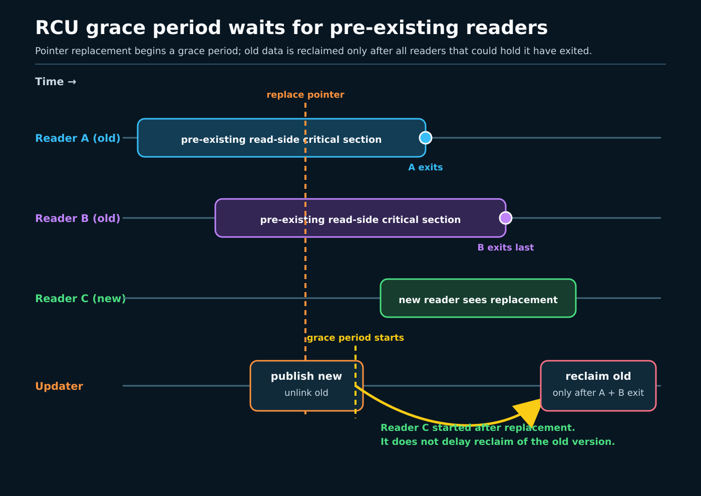
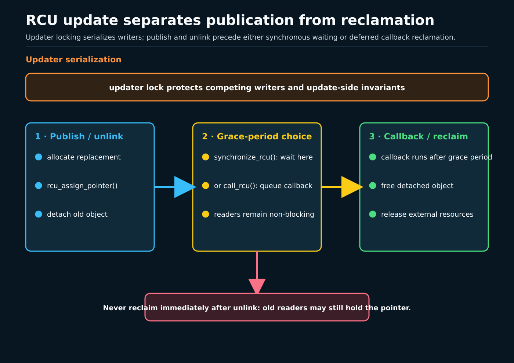

# Day 6 — RCU Readers, Grace Periods, and Callbacks

**Target time:** approximately 3 hours

> Driving question: how can a reader follow a shared pointer without taking the
> updater's lock, while an updater replaces and eventually frees the old object?

The hard part is not making the pointer change. It is deciding when the object
that used to be reachable can no longer be touched.

Imagine an interrupt-path lookup that runs thousands of times for every
configuration update. A reader loads `current_policy` and examines the pointed-to
object. An updater builds a replacement and publishes it. If the updater
immediately frees the old object, a reader that loaded the old pointer one
instruction earlier can dereference freed memory. If every reader instead takes
one global lock, lifetime is easy but the read-mostly path pays cache-line
bouncing, contention, and interrupt-context constraints.

RCU separates three events that a lock-centric explanation often collapses:

1. **publication** makes a fully initialized new object reachable;
2. **removal** makes an old object unreachable to future readers;
3. **reclamation** frees the old object only after every reader that could have
   seen it has finished.



## 1. Syntax: read the lifetime protocol before the implementation

The smallest conventional shape is:

```c
struct policy __rcu *current_policy;

rcu_read_lock();
p = rcu_dereference(current_policy);
if (p)
	use(p->limit);
rcu_read_unlock();
```

`__rcu` is a sparse address-space annotation. It helps static checking; it is
not a runtime reference count. `rcu_read_lock()` and `rcu_read_unlock()` delimit
a read-side critical section. They do not mean “acquire and release one reader
mutex,” and the reader normally does not update a shared reader count on every
entry.

`rcu_dereference()` is the paired consuming operation for an RCU-published
pointer. It performs the compiler and architecture-specific work needed to load
that pointer and preserve dependency/ordering rules, while also feeding RCU
debug checks. Plain `READ_ONCE()` is not a general substitute: it controls the
shape of one access but does not express the RCU lifetime contract.

An updater usually looks like this:

```c
mutex_lock(&policy_mutex);
old = rcu_dereference_protected(current_policy,
				lockdep_is_held(&policy_mutex));
rcu_assign_pointer(current_policy, new);
mutex_unlock(&policy_mutex);

synchronize_rcu();
kfree(old);
```

`rcu_assign_pointer()` publishes `new` with release ordering, so a reader that
obtains it through the matching dereference cannot observe the pointer while
still seeing pre-initialization contents. This ordering solves publication; it
does not by itself solve reclamation.

The updater-side mutex remains essential when multiple updaters can race. RCU
allows old and new *versions* to coexist for readers. It does not serialize two
writers modifying a list, choosing replacements, maintaining counts, or
enforcing a multi-field invariant.

Two callback-related pieces of syntax matter:

```c
struct item {
	/* fields read under RCU */
	struct rcu_head rcu;
};

call_rcu(&old->rcu, free_item_rcu);
```

`container_of(head, struct item, rcu)` recovers the enclosing object in the
callback. The embedded `rcu_head` is callback bookkeeping; it is not a reader
reference count.

## 2. Linux 0.12: exclusion and lifetime before modern RCU

Linux 0.12 has no modern RCU API, no `rcu_read_lock()`,
`rcu_dereference()`, `call_rcu()`, lockdep RCU validation, or Tree RCU grace
period engine. It is also a uniprocessor kernel, so it does not face the modern
problem of readers concurrently traversing shared structures on many CPUs under
weak memory ordering.

Use `references/EARLY_LINUX_012_MAP.md` and Chapter 8.6 of the local commented
Linux 0.12 PDF (`kernel/sched.c`, printed pages 351–372). The useful early model
is coarse: kernel control flow excludes competing work through the UP execution
context, interrupt disabling where interrupt concurrency matters, sleep/wakeup,
and explicit object ownership or counts. Scheduling and interrupt return expose
when another control flow can run. Object-specific code decides when a resource
is no longer referenced and can be released.

That model teaches the right first question—“who could still hold this
pointer?”—but not a modern answer. It has no per-CPU quiescent-state reporting,
preemptible RCU readers, callback segmentation, CPU hotplug integration, NOHZ
accounting, or SMP publication barriers. Saying “0.12 effectively used RCU
because it was UP” would be wrong: absence of simultaneous CPU execution can
simplify exclusion, but it is not the RCU API or grace-period protocol.

## 3. Why the mechanism evolved

Read-mostly kernel structures appear in routing, networking, credentials,
process relationships, filesystems, scheduler topology, tracing, and device
registries. Their readers may run in syscall, softirq, hardirq, or scheduler
paths. A shared reader-writer lock can make every reader write the same lock
cache line, and a writer can delay latency-sensitive readers. A reference count
also writes shared state on acquisition and release, and it only helps if a
reader can safely acquire a reference before the object disappears.

RCU changes the bargain:

- readers promise to keep each pointer use within a valid read-side interval
  unless they hand ownership to another lifetime mechanism;
- publishers promise to initialize before publishing with the correct
  primitive;
- removers prevent new readers from finding the old object;
- reclaimers wait for a grace period, or enqueue a callback that runs after it;
- writers still use locks or another update protocol to serialize updates.

A **grace period** is not “wait N milliseconds.” It is the interval needed to
establish that all read-side critical sections that existed before the grace
period began have ended. A **quiescent state** is state from which a CPU/task
cannot still be in one of those pre-existing read-side sections for the RCU
flavor in question. Context switches, user mode, idle, and explicit reporting
participate according to flavor and configuration; none is a universal
standalone definition.

Scheduling is therefore part of lifetime. On preemptible RCU, a task may be
preempted while inside a read-side critical section and remain a blocker until
it exits. Interrupt and softirq context also affect what counts as an active
reader. NOHZ and idle CPUs require explicit accounting because “no tick” must
not be mistaken for “no reader.”

## 4. Exact ToyOS boundary

The actual `projects/toyos/src/tasks.c` contains two ring-0 kernel tasks sharing
one address space. `schedule()` alternates between them, updates
`TASK_RUNNABLE`/`TASK_RUNNING`, and calls `context_switch`; `scheduler_tick()`
can invoke it from the PIT interrupt path. `task_finish()` marks a task blocked.
`projects/toyos/src/arch.c` increments `ticks`, acknowledges the PIC, and calls
the scheduler for timer vector 32.

ToyOS does **not** implement RCU. It has one CPU, no `__rcu` annotations,
read-side API, publication primitive, updater protocol, per-CPU RCU state,
grace-period sequence, quiescent-state reporting, callback queue, CPU hotplug,
NOHZ, preemptible reader tracking, lockdep, or sparse integration. Its
`volatile bool task_done[2]` is not an RCU-protected object, and `volatile` does
not create an SMP publication/lifetime protocol.

The exact bridge is narrower: ToyOS shows that scheduling and timer interrupts
create control-flow boundaries and that an object can outlive the code that
first exposed it. It cannot demonstrate that all pre-existing readers have
passed a grace period. Adding a userspace epoch counter to a course lab does
not retroactively add RCU to ToyOS.

## 5. Linux 6.12 pinned source

All source claims and excerpts below refer to commit
`adc218676eef25575469234709c2d87185ca223a` in
`/home/jd/Documents/linux-6.12`. Each excerpt is verbatim, contiguous, and
bounded to 6–25 lines.

### Publication is a release operation

`include/linux/rcupdate.h`, `rcu_assign_pointer`, lines 594–603:

```c
#define rcu_assign_pointer(p, v)					      \
do {									      \
	uintptr_t _r_a_p__v = (uintptr_t)(v);				      \
	rcu_check_sparse(p, __rcu);					      \
									      \
	if (__builtin_constant_p(v) && (_r_a_p__v) == (uintptr_t)NULL)	      \
		WRITE_ONCE((p), (typeof(p))(_r_a_p__v));		      \
	else								      \
		smp_store_release(&p, RCU_INITIALIZER((typeof(p))_r_a_p__v)); \
} while (0)
```

The non-NULL path is a release store. Initialize first, publish second. The
special NULL case does not need to publish pointee initialization.

The reader-facing check couples pointer loading to the read-side condition:

`include/linux/rcupdate.h`, `rcu_dereference`, lines 753–758:

```c
/**
 * rcu_dereference() - fetch RCU-protected pointer for dereferencing
 * @p: The pointer to read, prior to dereferencing
 *
 * This is a simple wrapper around rcu_dereference_check().
 */
#define rcu_dereference(p) rcu_dereference_check(p, 0)
```

The wrapper routes the ordinary reader through the checked dereference path.
It does not prove sparse or `CONFIG_PROVE_RCU` was enabled on a host.

### A quiescent state is reported into a protocol

`kernel/rcu/tree.c`, `rcu_momentary_eqs`, lines 360–379:

```c
 * Let the RCU core know that this CPU has gone through the scheduler,
 * which is a quiescent state.  This is called when the need for a
 * quiescent state is urgent, so we burn an atomic operation and full
 * memory barriers to let the RCU core know about it, regardless of what
 * this CPU might (or might not) do in the near future.
 *
 * We inform the RCU core by emulating a zero-duration dyntick-idle period.
 *
 * The caller must have disabled interrupts and must not be idle.
 */
notrace void rcu_momentary_eqs(void)
{
	int seq;

	raw_cpu_write(rcu_data.rcu_need_heavy_qs, false);
	seq = ct_state_inc(2 * CT_RCU_WATCHING);
	/* It is illegal to call this from idle state. */
	WARN_ON_ONCE(!(seq & CT_RCU_WATCHING));
	rcu_preempt_deferred_qs(current);
}
```

The scheduler boundary matters, but this specialized function has caller
preconditions. It must not be generalized into “every context switch
immediately completes every grace period.”

### Blocking wait and deferred callback are different updater choices

`kernel/rcu/tree.c`, `synchronize_rcu`, lines 4084–4098:

```c
void synchronize_rcu(void)
{
	unsigned long flags;
	struct rcu_node *rnp;

	RCU_LOCKDEP_WARN(lock_is_held(&rcu_bh_lock_map) ||
			 lock_is_held(&rcu_lock_map) ||
			 lock_is_held(&rcu_sched_lock_map),
			 "Illegal synchronize_rcu() in RCU read-side critical section");
	if (!rcu_blocking_is_gp()) {
		if (rcu_gp_is_expedited())
			synchronize_rcu_expedited();
		else
			synchronize_rcu_normal();
		return;
```

`synchronize_rcu()` waits for the required grace period and therefore belongs
in sleepable process context. Calling it from a vanilla read-side critical
section would wait for a set that includes the caller: the warning identifies
that impossible lifetime dependency.

By contrast, the `call_rcu()` contract explicitly allows later readers to
overlap the callback:

`kernel/rcu/tree.c`, `call_rcu` documentation, lines 3150–3164:

```c
 * @head: structure to be used for queueing the RCU updates.
 * @func: actual callback function to be invoked after the grace period
 *
 * The callback function will be invoked some time after a full grace
 * period elapses, in other words after all pre-existing RCU read-side
 * critical sections have completed.  However, the callback function
 * might well execute concurrently with RCU read-side critical sections
 * that started after call_rcu() was invoked.
 *
 * RCU read-side critical sections are delimited by rcu_read_lock()
 * and rcu_read_unlock(), and may be nested.  In addition, but only in
 * v5.0 and later, regions of code across which interrupts, preemption,
 * or softirqs have been disabled also serve as RCU read-side critical
 * sections.  This includes hardware interrupt handlers, softirq handlers,
```

The callback is safe for the removed object because later readers cannot newly
obtain that object after correct removal. It is not safe because “there are no
readers anywhere.”

The callback is recorded and placed on per-CPU callback machinery:

`kernel/rcu/tree.c`, `__call_rcu_common`, lines 3084–3108:

```c
	head->func = func;
	head->next = NULL;
	kasan_record_aux_stack_noalloc(head);
	local_irq_save(flags);
	rdp = this_cpu_ptr(&rcu_data);
	lazy = lazy_in && !rcu_async_should_hurry();

	/* Add the callback to our list. */
	if (unlikely(!rcu_segcblist_is_enabled(&rdp->cblist))) {
		// This can trigger due to call_rcu() from offline CPU:
		WARN_ON_ONCE(rcu_scheduler_active != RCU_SCHEDULER_INACTIVE);
		WARN_ON_ONCE(!rcu_is_watching());
		// Very early boot, before rcu_init().  Initialize if needed
		// and then drop through to queue the callback.
		if (rcu_segcblist_empty(&rdp->cblist))
			rcu_segcblist_init(&rdp->cblist);
	}

	check_cb_ovld(rdp);

	if (unlikely(rcu_rdp_is_offloaded(rdp)))
		call_rcu_nocb(rdp, head, func, flags, lazy);
	else
		call_rcu_core(rdp, head, func, flags);
	local_irq_restore(flags);
```

This is asynchronous reclamation infrastructure, not immediate function
invocation. The `local_irq_save()` section also connects callback enqueueing to
interrupt concurrency; it does not turn the callback itself into hardirq work.



## 6. One lifetime example, end to end

Suppose a device lookup table contains `struct endpoint` objects.

1. A reader enters `rcu_read_lock()`, obtains an endpoint with
   `rcu_dereference()`, and reads fields.
2. The updater takes `endpoint_mutex`, unlinks the endpoint, and releases the
   mutex. Future lookups can no longer obtain it.
3. A reader that loaded the pointer before unlink may still be using it.
4. The updater either calls `synchronize_rcu()` and then frees it, or calls
   `call_rcu()` and lets the callback free it later.

The reader must not return the raw pointer and dereference it after
`rcu_read_unlock()`. If the object must escape, acquire a stable reference
*while still protected*, using an object-specific “increment unless zero”
protocol whose removal path prevents resurrection. RCU protects the window in
which that reference is acquired; the reference count protects the later
lifetime. A refcount alone cannot close the load-versus-free race, and RCU alone
does not grant indefinite ownership.

Sleeping is flavor-specific. Do not write the blanket rule “RCU readers can
never sleep.” In ordinary non-preemptible RCU, blocking is illegal. Preemptible
RCU may preempt a reader but that does not make arbitrary blocking APIs valid.
SRCU read-side sections may sleep and have a different API and accounting.
Tasks RCU and Tasks Trace RCU wait on task-oriented conditions for specialized
users. RCU-bh and RCU-sched names remain relevant to API/history and validation,
while vanilla RCU grace periods in this pinned era account for additional
disabled-context regions. This lesson gives the map, not interchangeable
recipes.

## 7. Bounded userspace epoch lab

The actual `projects/linux-kernel-sync/src/epoch_rcu_lab.c` is a userspace
analogy, not a kernel RCU test. It starts exactly three pthread readers. Each
loads a global atomic epoch with acquire ordering, stores that epoch in its own
`active[]` slot, reads an atomic published integer, then clears its activity
slot. The updater increments the epoch, release-publishes value 2, joins all
three readers, and rejects any activity slot that still equals the retired
epoch. A five-second alarm bounds failure.

Run the complete deterministic suite with:

```text
make -C projects/linux-kernel-sync test-week16
```

For this exercise, the relevant literal success lines are
`model=userspace_epoch_not_linux_rcu ... grace_condition=met`,
`PASS epoch_rcu_lab`, and the suite's final `PASS test-week16`. Predict which
reader timings can observe the old epoch before running it.

The model demonstrates explicit reader activity records and a condition checked
before reuse. It has no removed heap object, free operation, callback mode,
Tree RCU quiescent-state detection, interrupt semantics, CPU hotplug handling,
callback offload, sparse annotation, or host-kernel barrier proof. Joining the
threads is stronger and more direct than kernel RCU's normal read-side
tracking. Treat the printed “grace condition” as the program's own predicate,
not a Linux grace period.

`make -C projects/linux-kernel-sync tools` only reports whether `perf`,
`trace-cmd`, `bpftrace`, and `lockstat` are present. It deliberately prints
`SKIP` even when a tool exists because no optional tracing is run
automatically. Preserve those SKIPs; do not synthesize events.

## 8. Evidence and limits

Keep these labels separate:

- **Linux 6.12 pinned-source proof:** the quoted code exists in the named path,
  function, and lines at the pinned commit.
- **Host observation:** literal output from an explicitly run bounded lab or
  interface, including host kernel and configuration facts actually collected.
- **Userspace analogy:** epoch bookkeeping illustrates lifetime ordering but
  does not execute kernel RCU.
- **Unknown:** which RCU configuration/flavor the host uses, whether a
  particular fast path ran, and callback latency if no trace was captured.
- **SKIP:** unavailable source project, compiler feature, tracing interface, or
  permission, with no inference of pass or failure.

Grace periods are not latency deadlines. A stalled CPU, long read-side section,
starved grace-period kthread, interrupt-disabled loop, overload, or callback
backlog can delay completion. `call_rcu()` avoids blocking the updater but can
increase memory awaiting reclamation. `synchronize_rcu()` provides a simple
sequencing point but can impose unacceptable latency and cannot be used in
atomic context.

Finish by being able to narrate:

`initialize → release-publish → read-side acquire/dereference → unlink under
update serialization → pre-existing readers finish → grace period completes →
free directly or invoke callback`.

For every arrow, say whether it is an API contract, pinned-source structure,
userspace-lab observation, or an untested hypothesis. That discipline is the
difference between understanding RCU's lifetime mechanism and merely
recognizing its function names.
