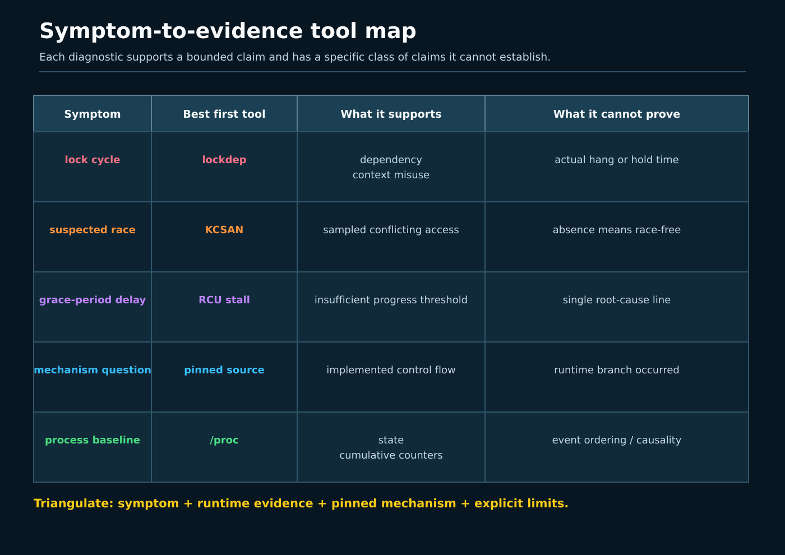
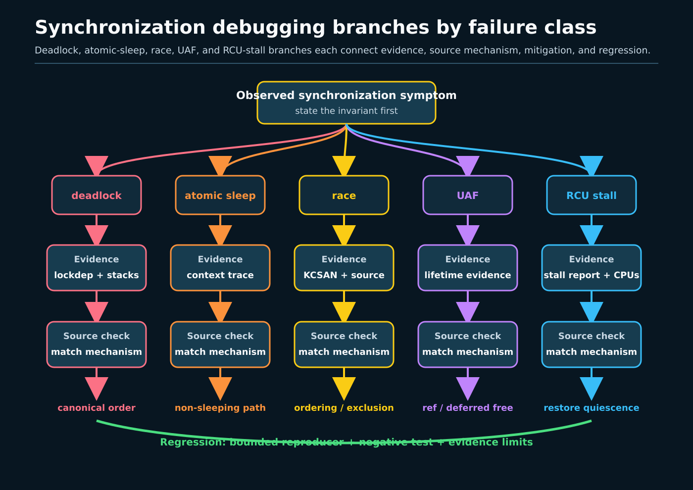

# Day 7 — Lockdep, KCSAN, RCU Stalls, and the Debug Report

**Target time:** approximately 3 hours

> Driving question: when concurrent kernel code fails only under an unlucky
> interleaving, what evidence distinguishes a bad lock order, illegal sleep,
> data race, lifetime error, seqcount misuse, or delayed RCU grace period?

Start with the symptom, not the favorite tool. “The machine hung” can mean two
tasks formed a lock cycle, one CPU spun with interrupts disabled, an RCU grace
period could not observe a quiescent state, or memory corruption damaged the
state later inspected by the watchdog. “KCSAN printed a race” is narrower, but
still does not tell you the intended invariant or the correct repair.

A useful report explains a causal boundary:

`first bad state → mechanism that permits it → evidence that observed it →
small mitigation → regression that would catch its return`.

It also preserves negative evidence. If a required kernel configuration,
tracefs access, symbol, or tool is unavailable, write `SKIP`. Tool absence is
not a clean run, and source code containing a detector is not proof that the
host enabled or triggered it.



## 1. Syntax: recognize what a report can name

Lockdep reasons about **lock classes** and observed acquisition dependencies,
not merely lock object addresses. If code acquires class B while holding class
A, it can add an `A → B` edge. A later path that requires `B → A` closes a
cycle. `lockdep_assert_held(&lock)` documents and checks a calling condition;
it does not acquire the lock.

Context annotations carry different claims:

- `might_sleep()` asks the debugging machinery to warn if the current context
  cannot schedule safely;
- `in_interrupt()`, preemption count, IRQ state, and held spinlocks help explain
  why a blocking operation is illegal;
- `READ_ONCE()`/`WRITE_ONCE()` constrain individual compiler accesses but do not
  create a complete synchronization protocol;
- `data_race(expr)` marks an intentionally racy access for tooling and review;
  it does not make an unsafe race correct;
- `__rcu` plus `rcu_dereference()` expresses an RCU-protected pointer contract;
- `refcount_inc_not_zero()` is useful only inside a window in which loading the
  pointer itself is safe.

A sequence-counter reader has a retry loop:

```c
do {
	seq = read_seqcount_begin(&state_seq);
	a = state.a;
	b = state.b;
} while (read_seqcount_retry(&state_seq, seq));
```

The fields from a failed iteration must be discarded. Writers must be
serialized and non-preemptible for the reader population. A seqcount does not
protect pointer lifetime: a reader can follow a pointer to freed memory before
it discovers that a retry was needed.

KCSAN uses sampled watchpoints and delays to expose conflicting accesses. That
makes it powerful and inherently incomplete: one run with no report does not
prove race freedom. A KCSAN report is evidence of the displayed conflict under
that build/run, not proof that every surrounding access lacks synchronization.

## 2. Linux 0.12: what is absent, and what remains useful

Linux 0.12 has no lockdep dependency graph, KCSAN instrumentation, sparse
`__rcu` checking, `CONFIG_PROVE_RCU`, modern refcount saturation diagnostics,
seqcount API, Tree RCU stall detector, ftrace, or `perf`.

Use `references/EARLY_LINUX_012_MAP.md` and Chapter 8.6 of the local commented
Linux 0.12 PDF (`kernel/sched.c`, printed pages 351–372). Its uniprocessor
kernel makes concurrency boundaries visible through interrupt enable/disable,
task state, sleep/wakeup, and scheduling. Coarse UP exclusion and
object-specific ownership/counting reduce the SMP interleavings modern tools
must diagnose.

That is a historical baseline, not modern evidence. A UP kernel can still have
interrupt/process-context races, illegal sleep, missed wakeups, and lifetime
bugs. It simply lacks simultaneous execution on several CPUs and the current
detectors. Do not project modern report strings or semantics backward onto it.

## 3. Why debugging had to evolve

SMP turns an implicit execution assumption into an observable ordering
problem. Per-CPU data reduces contention but adds migration and cross-CPU
publication. Preemption allows a task to stop while holding logical state.
Hardirq, softirq, NMI, process context, and workqueues have different
sleepability and nesting rules. Weakly ordered architectures expose missing
barriers that x86-64 may hide. RCU intentionally permits old and new versions
to coexist, so “pointer was removed” no longer means “object can be freed.”

No one detector spans all of that:

- **lockdep** validates modeled lock ordering, IRQ usage, and lock-context
  relationships on paths the instrumented kernel executes;
- **atomic-sleep checks** identify scheduling operations in a context whose
  preemption/IRQ/lock state forbids them;
- **KCSAN** samples conflicting memory accesses and can model selected weak
  memory effects, but it does not exhaust all interleavings;
- **sparse and `CONFIG_PROVE_RCU`** check RCU annotation and runtime
  read-side/lock conditions;
- **RCU stall warnings** report grace-period progress trouble, not one unique
  root cause;
- **KASAN/refcount diagnostics** can expose lifetime damage or misuse, but a
  refcount warning and a use-after-free are different events;
- **ftrace/perf** provide ordered activity or samples when configured and
  permitted; they do not establish an invariant by themselves.

## 4. Exact ToyOS boundary

The actual ToyOS has two ring-0 kernel tasks on one CPU.
`projects/toyos/src/tasks.c` changes task state and switches contexts;
`projects/toyos/src/arch.c` handles PIT vector 32, increments `ticks`,
acknowledges the PIC, and invokes `scheduler_tick()`. Assertions and serial
markers can prove only their explicit bounded self-tests.

ToyOS has no spinlock/mutex implementation, lock classes, dependency graph,
SMP race, C11 atomic protocol, seqcount, refcount API, RCU, grace-period
thread, stall detector, sparse build, KCSAN/KASAN instrumentation, ftrace,
perf events, `/proc`, debugfs, or tracefs. Its interrupt path can teach that
timer context interrupts task context and that sleeping rules depend on
context. It cannot generate any of the Linux reports in this lesson.

Do not label a ToyOS assertion as lockdep, a serial timestamp as ftrace, or its
single-CPU scheduling as an RCU grace period. Those substitutions erase the
mechanism being studied.

## 5. Linux 6.12 pinned source: what the detectors actually report

All excerpts below are verbatim, contiguous, 6–25 lines, and taken from
commit `adc218676eef25575469234709c2d87185ca223a` in
`/home/jd/Documents/linux-6.12`.

### Lockdep reports the cycle and both sides

`kernel/locking/lockdep.c`, `print_circular_bug_header`, lines 1947–1969:

```c
print_circular_bug_header(struct lock_list *entry, unsigned int depth,
			struct held_lock *check_src,
			struct held_lock *check_tgt)
{
	struct task_struct *curr = current;

	if (debug_locks_silent)
		return;

	pr_warn("\n");
	pr_warn("======================================================\n");
	pr_warn("WARNING: possible circular locking dependency detected\n");
	print_kernel_ident();
	pr_warn("------------------------------------------------------\n");
	pr_warn("%s/%d is trying to acquire lock:\n",
		curr->comm, task_pid_nr(curr));
	print_lock(check_src);

	pr_warn("\nbut task is already holding lock:\n");

	print_lock(check_tgt);
	pr_warn("\nwhich lock already depends on the new lock.\n\n");
	pr_warn("\nthe existing dependency chain (in reverse order) is:\n");
```

“Possible” is precise. Lockdep found a dependency cycle in its modeled graph;
the tasks need not have deadlocked in that run. The printed acquisition and
held-lock stacks are the evidence needed to reconstruct the order.

### Atomic-sleep checking reaches the reschedule validator

`kernel/sched/core.c`, `__might_sleep`, lines 8571–8586:

```c
void __might_sleep(const char *file, int line)
{
	unsigned int state = get_current_state();
	/*
	 * Blocking primitives will set (and therefore destroy) current->state,
	 * since we will exit with TASK_RUNNING make sure we enter with it,
	 * otherwise we will destroy state.
	 */
	WARN_ONCE(state != TASK_RUNNING && current->task_state_change,
			"do not call blocking ops when !TASK_RUNNING; "
			"state=%x set at [<%p>] %pS\n", state,
			(void *)current->task_state_change,
			(void *)current->task_state_change);

	__might_resched(file, line, 0);
}
```

The eventual warning must be read with the stack and context state. The mere
presence of `might_sleep()` in source does not show a host violated the rule.

### KCSAN deliberately filters and serializes reporting

`kernel/kcsan/report.c`, `kcsan_report_known_origin`, lines 674–697:

```c
	kcsan_disable_current();
	/*
	 * Because we may generate reports when we're in scheduler code, the use
	 * of printk() could deadlock. Until such time that all printing code
	 * called in print_report() is scheduler-safe, accept the risk, and just
	 * get our message out. As such, also disable lockdep to hide the
	 * warning, and avoid disabling lockdep for the rest of the kernel.
	 */
	lockdep_off();

	if (!prepare_report_consumer(&flags, &ai, other_info))
		goto out;
	/*
	 * Never report if value_change is FALSE, only when it is
	 * either TRUE or MAYBE. In case of MAYBE, further filtering may
	 * be done once we know the full stack trace in print_report().
	 */
	if (value_change != KCSAN_VALUE_CHANGE_FALSE)
		print_report(value_change, &ai, other_info, old, new, mask);

	release_report(&flags, other_info);
out:
	lockdep_on();
	kcsan_enable_current();
```

This code itself states an evidence limit: reporting can arise in scheduler
code, printing has its own locking risk, and candidate reports can be filtered.
No report is not proof that no conflict occurred.

### Seqcount writer rules are part of correctness

`include/linux/seqlock.h`, `write_seqcount_begin`, lines 459–480:

```c
 * write_seqcount_begin() - start a seqcount_t write side critical section
 * @s: Pointer to seqcount_t or any of the seqcount_LOCKNAME_t variants
 *
 * Context: sequence counter write side sections must be serialized and
 * non-preemptible. Preemption will be automatically disabled if and
 * only if the seqcount write serialization lock is associated, and
 * preemptible.  If readers can be invoked from hardirq or softirq
 * context, interrupts or bottom halves must be respectively disabled.
 */
#define write_seqcount_begin(s)						\
do {									\
	seqprop_assert(s);						\
									\
	if (seqprop_preemptible(s))					\
		preempt_disable();					\
									\
	do_write_seqcount_begin(seqprop_ptr(s));			\
} while (0)

static inline void do_write_seqcount_begin(seqcount_t *s)
{
	do_write_seqcount_begin_nested(s, 0);
```

A report about inconsistent fields should therefore ask about writer
serialization, preemption, reader interrupt context, retry handling, and
pointer lifetime—not merely whether the counter changed.

### PROVE_RCU gives a runtime suspicious-use report

`kernel/locking/lockdep.c`, `lockdep_rcu_suspicious`, lines 6776–6796:

```c
void lockdep_rcu_suspicious(const char *file, const int line, const char *s)
{
	struct task_struct *curr = current;
	int dl = READ_ONCE(debug_locks);
	bool rcu = warn_rcu_enter();

	/* Note: the following can be executed concurrently, so be careful. */
	nbcon_cpu_emergency_enter();
	pr_warn("\n");
	pr_warn("=============================\n");
	pr_warn("WARNING: suspicious RCU usage\n");
	print_kernel_ident();
	pr_warn("-----------------------------\n");
	pr_warn("%s:%d %s!\n", file, line, s);
	pr_warn("\nother info that might help us debug this:\n\n");
	pr_warn("\n%srcu_scheduler_active = %d, debug_locks = %d\n%s",
	       !rcu_lockdep_current_cpu_online()
			? "RCU used illegally from offline CPU!\n"
			: "",
	       rcu_scheduler_active, dl,
	       dl ? "" : "Possible false positive due to lockdep disabling via debug_locks = 0\n");
```

The last line matters: even the detector reports when its own lock-debug state
weakens confidence. Sparse is complementary compile-time evidence; it can flag
annotation misuse without observing execution.

### The RCU stall report carries progress context

`kernel/rcu/tree_stall.h`, `print_cpu_stall_info`, lines 482–506:

```c
static void print_cpu_stall_info(int cpu)
{
	unsigned long delta;
	bool falsepositive;
	struct rcu_data *rdp = per_cpu_ptr(&rcu_data, cpu);
	char *ticks_title;
	unsigned long ticks_value;
	bool rcuc_starved;
	unsigned long j;
	char buf[32];

	/*
	 * We could be printing a lot while holding a spinlock.  Avoid
	 * triggering hard lockup.
	 */
	touch_nmi_watchdog();

	ticks_value = rcu_seq_ctr(rcu_state.gp_seq - rdp->gp_seq);
	if (ticks_value) {
		ticks_title = "GPs behind";
	} else {
		ticks_title = "ticks this GP";
		ticks_value = rdp->ticks_this_gp;
	}
	delta = rcu_seq_ctr(rdp->mynode->gp_seq - rdp->rcu_iw_gp_seq);
```

An RCU stall warning means grace-period progress exceeded the detector's
threshold. It can result from a long read-side section, a CPU looping with
interrupts/preemption disabled, a starved RCU kthread, timer/clock trouble,
overload, virtualization delay, or detector/console effects. The warning is a
starting point, not a verdict of “RCU bug.”

## 6. Six symptom-driven reports

Each report below has the same spine: symptom, competing causes, evidence,
mitigation, regression, and limit.

### A. Deadlock or lock inversion

**Symptom:** two operations stop making progress; blocked stacks show each
waiting near a different lock, or lockdep prints a circular dependency.

**Competing causes:** an actual `A ↔ B` wait cycle; a lockdep-predicted cycle not
realized in this run; a long lock holder; missed wakeup; or unrelated CPU
starvation.

**Evidence:** preserve the complete lockdep report, kernel release/config, both
acquisition stacks, held locks, lock class names, PID/CPU, and surrounding
timestamps. If lockdep is unavailable, collect task stacks and owner/waiter
state where safely exposed, but label cycle reconstruction as a hypothesis.
ftrace lock events may establish order only if configured before the incident.

**Mitigation:** impose one documented global order, split the critical section,
or move blocking work outside the lock. Do not silence lockdep by changing
annotations unless the modeled class relationship is genuinely wrong.

**Regression:** a bounded stress test that executes both orderings and has a
watchdog, deterministic completion count, and lockdep enabled. A pass reduces
risk; it does not prove all paths cycle-free.

### B. Sleeping in atomic context

**Symptom:** `BUG: sleeping function called from invalid context`, an atomic-
sleep warning, or latency/hang near an allocation or mutex from IRQ/spinlocked
code.

**Competing causes:** blocking under a spinlock; blocking with IRQs or
preemption disabled; wrong allocation flags; a misleading secondary stack
after corruption.

**Evidence:** retain the first warning, preemption/IRQ state, held-lock list,
call stack, and allocation/sleep site. Source inspection establishes whether
the API may sleep; only the runtime report establishes the observed context.

**Mitigation:** move work to a sleepable context, use a truly atomic operation
with bounded failure handling, or redesign ownership. Replacing every
`GFP_KERNEL` with `GFP_ATOMIC` can hide architecture problems and exhaust
reserves.

**Regression:** execute the interrupt/softirq/process-context variants under
`CONFIG_DEBUG_ATOMIC_SLEEP`; require completion and absence of the specific
first warning, while reporting configuration explicitly.

### C. Data race

**Symptom:** KCSAN reports two conflicting accesses, or state intermittently
contains a combination no serialized execution permits.

**Competing causes:** missing lock/barrier; intentionally approximate
statistics; stale publication; lifetime reuse making two unrelated objects
share an address; or a false causal attribution from a later symptom.

**Evidence:** preserve both KCSAN stacks, access sizes/types, address/symbol,
value-change information, build config, and reproducer. Map both accesses to
the intended synchronization invariant. `READ_ONCE()` can prevent tearing or
compiler merging for supported sizes, but does not automatically fix a
multi-field invariant.

**Mitigation:** use one ownership/locking protocol, a correctly paired
release/acquire publication, an atomic RMW, or an explicitly documented benign
race only when the semantics permit it.

**Regression:** repeated bounded runs on the instrumented kernel plus a
deterministic invariant check. KCSAN silence remains sampled negative evidence.

### D. Refcount use-after-free

**Symptom:** KASAN reports access to freed memory; refcount diagnostics report
underflow/saturation; or a crash follows object removal.

**Competing causes:** missing reference; double put; acquiring a reference from
an already stale pointer; RCU removal followed by premature free; or unrelated
heap corruption.

**Evidence:** preserve the first allocator/free/access stacks, object address,
refcount warning, and ownership transition. A later page fault alone cannot
identify which put was wrong. Source proof of `refcount_inc()` does not prove
the pointer was alive when the increment began.

**Mitigation:** define who owns each reference; use RCU or the containing lock
to stabilize lookup; use increment-unless-zero where resurrection must fail;
remove visibility before final put; defer reclamation when old readers remain.

**Regression:** force lookup/removal overlap in a bounded instrumented test,
assert constructor/destructor balance, and check deterministic completion.
KASAN unavailable means `SKIP KASAN`, not “no UAF.”

### E. Seqcount misuse

**Symptom:** readers observe impossible field combinations, spin for excessive
time, or lockdep/KCSAN identifies writer-side misuse.

**Competing causes:** writers are not serialized; writer is preempted while the
sequence is odd; interrupt reader can interrupt a writer; reader forgot retry;
reader used values from a failed iteration; or protected data includes a
pointer whose target was freed.

**Evidence:** record writer lock/context, sequence values when safely
instrumented, reader retry count, and whether IRQ/BH masking matches reader
contexts. A perf sample in the retry loop shows CPU consumption, not why the
writer failed to finish.

**Mitigation:** use `seqcount_LOCKNAME_t` or `seqlock_t` when appropriate,
serialize writers, disable the required interrupt class, keep writes bounded,
and give pointer targets a separate lifetime mechanism.

**Regression:** bounded writer/readers with invariant assertions, retry budget
telemetry, and interrupt-context coverage where the real API permits it.

### F. RCU stall

**Symptom:** the kernel prints an RCU CPU/task stall warning, callback backlog
grows, or an updater waiting in `synchronize_rcu()` takes unexpectedly long.

**Competing causes:** long reader; CPU not scheduling or not taking timer
interrupts; excessive IRQ/preempt-disabled loop; starved grace-period kthread;
console flood; guest vCPU descheduling; or genuine RCU accounting defect.

**Evidence:** retain the entire first stall splat, grace-period sequence, listed
CPUs/tasks, `ticks this GP`/`GPs behind`, softirq and context-switch data,
stacks, kernel command line, virtualization context, and wall-clock interval.
Use ftrace events only when already enabled or safely reproduced; tracing after
the stall cannot reconstruct lost history.

**Mitigation:** shorten the proven reader/atomic section, restore scheduling or
interrupt progress, fix kthread starvation, reduce console disturbance, or
repair host vCPU service. Raising the timeout only changes detection unless the
event was a justified false positive.

**Regression:** repeat the bounded workload with callback-drain completion,
grace-period progress markers, and the same load/configuration. Do not promise a
universal maximum grace-period latency.

## 7. Evidence workflow and tool boundaries



Use this order:

1. Define the first externally visible symptom and the time/task/CPU boundary.
2. Preserve the first warning; later failures may be consequences.
3. Record exact kernel release, config evidence, boot parameters, taint, CPU
   topology, and bare-metal/guest status that are actually available.
4. Classify context: task, softirq, hardirq, NMI; IRQ/preemption state; held
   locks; RCU read-side state.
5. Write at least two causes with different predicted evidence.
6. Use the least invasive available detector or trace.
7. Map observed frames to pinned source while marking version mismatch.
8. Apply one reversible mitigation tied to the strongest evidence.
9. Run a bounded regression with deterministic completion plus detector output.

Tool boundaries:

- **lockdep:** executed lock dependencies and modeled contexts; not every
  unexecuted path and not arbitrary data-race detection.
- **KCSAN:** sampled conflicting accesses; not exhaustive proof and not object
  ownership intent.
- **sparse:** static annotation/address-space checking; not runtime branch
  execution.
- **PROVE_RCU:** runtime checking for instrumented RCU conditions; dependent on
  config, path execution, and lockdep state.
- **RCU stall detector:** delayed grace-period progress; not unique root cause.
- **ftrace:** ordered enabled events/functions within buffer and clock limits;
  dropped/disabled events remain unknown.
- **perf:** samples or configured counters/events; sampling absence is not
  execution absence, and unwinding may be incomplete.

If any tool or interface is missing, disabled, denied, or unsafe to enable,
write `SKIP: <tool> — <reason>`. Do not mount tracefs, change lockdown, load a
module, reboot into a debug kernel, or alter production controls merely to make
the report look complete.

## 8. Bounded userspace report lab

The actual `projects/linux-kernel-sync/src/debug_report.c` performs a read-only
self-observation. It opens `/proc/self/status` separately for each requested
field and checks only `State`, `Threads`, `voluntary_ctxt_switches`, and
`nonvoluntary_ctxt_switches`. It then prints:

```text
lockdep=kernel-config-dependent
kcsan=kernel-config-and-runtime-dependent
rcu_stall=no_claim_from_userspace
```

Run the complete bounded suite with:

```text
make -C projects/linux-kernel-sync test-week16
```

The suite builds seven strict-C17 pthread programs, runs a read-only checker
against the pinned source commit, and uses bounded alarms where a scenario
could otherwise hang. `epoch_rcu_lab` labels itself
`model=userspace_epoch_not_linux_rcu`; `debug_report` ends with
`PASS debug_report`. These are userspace completion and analogy evidence only.
The `/proc` fields are snapshots or cumulative counters and prove no lock
cycle, data race, refcount transition, seqcount retry, or RCU stall.

`make -C projects/linux-kernel-sync tools` checks `perf`, `trace-cmd`,
`bpftrace`, and `lockstat`, but runs none of them. Every result is deliberately
`SKIP`: either the tool is missing, or it is present but requires explicit
learner action and suitable permission. The core lab does not inspect host
lockdep, KCSAN, PROVE_RCU, KASAN, sparse, ftrace, or an RCU stall log. Preserve
that boundary instead of converting source availability into host observation.

## 9. Final report format

Write the report in nine compact sections:

1. **Symptom:** first failure, affected operation, PID/task/CPU, and interval.
2. **Environment:** exact observed host facts and relevant `SKIP`s.
3. **Mechanism invariant:** lock order, context rule, happens-before edge,
   reference ownership, seqcount contract, or RCU lifetime condition.
4. **Competing hypotheses:** at least two, each with a distinguishing
   prediction.
5. **Host observation:** literal warnings, stacks, counters, or traces.
6. **Pinned-source proof:** path/function/line/commit and what structure it
   proves—never a claim that the host executed it.
7. **Causal assessment:** strongest explanation, contradictory evidence,
   unknown arrows, and version mismatch.
8. **Mitigation:** one reversible change tied to the mechanism.
9. **Regression and limits:** deterministic check, bounded stress, detector
   configuration, sampling/perturbation, and remaining alternatives.

Finish with four explicit labels:

- `Linux 6.12 pinned source:`
- `host observed:`
- `unknown:`
- `potentially changed:`

The quality of the report is not the number of tools named. It is whether a
reviewer can tell which synchronization rule was violated, which evidence
actually came from the host, why the mitigation addresses that rule, and what
the regression still cannot prove.
